# 27个牛类公开数据集详细档案

> **记录类型：** 文献调研、资源核查与技术可行性分析  
> **记录编号：** RES-20261013-CATTLE27　　**整理 / 补查日期：** 2026-10-13（北京时间）  
> **历史资料日期：** 主档案收集于 2026-09-28；本次根据现有资料整理并补充核查  
> **记录人：** __________________　　**课题方向：** 牛只视觉数据集整理与跨数据集检测泛化  
> **本阶段产物：** 27 条可追溯档案、冲突登记、准入操作流程、条件性选型与图表底稿  
> **执行范围：** 读取本地资料、检索官方指南和原始研究、核对部分页面 / 小型元数据；未下载全部数据包，未开展新的模型训练与评估。  
> **相关档案：** 同主题的数据集收录参考版见 [牛只数据集/134个数据集信息收集/27个牛类公开数据集详细档案.md](../牛只数据集/134个数据集信息收集/27个牛类公开数据集详细档案.md)，其中含逐条链接可用性核查汇总与给池化实验的三条实操建议；本记录为科研实验记录，两者分工不同、内容不完全重叠。

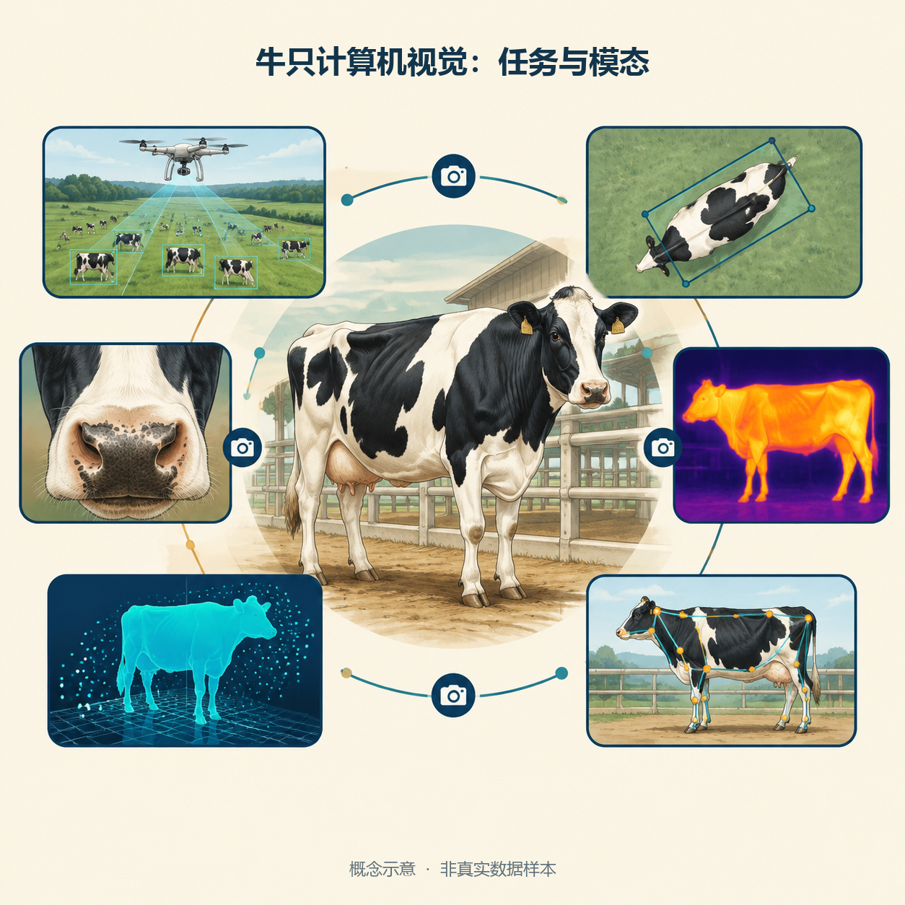

*图 1　牛只计算机视觉任务与模态概念图。Study Image 生成示意，中文标题由程序排入；牛只、热分布与骨架均为说明性绘制，不是任何公开集的真实样本或人工标注结果。*

## 1. 研究目的（Objective）

### 1.1 核心问题

本次调研围绕“哪些公开资源能支撑牛只视觉研究，以及怎样把它们转为可复现的数据视图”展开。27 个条目覆盖身份识别、目标检测、计数、行为、姿态、三维体形和体重等任务；文件可访问、任务可用、标注可比和样本独立是四个不同问题，需要分别给出证据。

具体目标为：建立每个条目的文献与资源入口，保留图片、帧、图像对、标注实例和动物数的分母；比较模态、机位与标注语义；定位影响数据筛选的矛盾；形成获取校验、标签检查、重复审计、分组划分与版本冻结的后续流程。对 CowCV 的用途判断单独给出，避免将调研清单直接当作已纳入 benchmark 的数据清单。［L1；L4；L5］

### 1.2 证据分级与记录原则

**来源事实**是本地记录、作者仓库、官方数据页或论文明确陈述的内容；**综合**是本次跨来源整理与方法判断；**推断**是尚无成员级证据的来源关系或预期收益；**待核实**是需要原包、逐图或实际运行才能解决的问题。每条档案明确标出出处及获取状态。

主档案中的链接符号与“实测”文字是 **2026-09-28 的历史记录**，不代表本次完成了 27 个资源的实时下载测试。TCP 可连接、网页可读、文件清单存在、ZIP 可下载、解压可用各有不同证据层级。本次只确认实际读到的页面 / 元数据内容；访问限制和失败保留为失败，不据此判定数据永久失效。

本次采用既有《实验记录格式参考》的七项结构，结合文献调研卡片与可行性评估。日期、耗时、下载成功、人工抽检与实验指标仅在有记录时填写；签字与审核栏留给本人和导师。［L7］

## 2. 原理与参考依据（Principle & References）

### 2.1 清单的版本范围

27 条清单来自主档案对 Bhujel 等综述 **arXiv v1 牛类部分**的整理。公开预印本摘要记录的是跨物种 58 个数据集；本地综述笔记记载正式发表版扩充至跨物种 67 个、牛类 32 个。因此本文保留“27 个”的历史版本边界，不称为“2026 年所有牛类公开数据集”或最新完整盘点。正式版 DOI 为 10.1016/j.compag.2024.109718；本次未获取其完整正式版逐条重新统计。［L1；L2 §1；O1；O2］

2026 年双向综述的本地笔记扩展到 315 个跨物种条目，提供后续检索线索；其检索范围、记录单位与本清单不同，不能用 315−27 解释牛类数据新增量。本次不将该扩展清单加入 27 条统计。［L3；本次综合］

### 2.2 任务语义先于格式统一

整牛框、躯干框、牛头框、鼻纹裁剪和个体分类目录代表不同监督信息。YOLO、VOC、AVA 与点云标签只是表示方式。把类名统一为 `cow` 不会使局部图像变成全身图像；把 OBB 转为 HBB 也不会自动扩充躯干框所排除的头、腿或尾。

本项目应同时登记 **原始资源 → 原始标签 → 转换 / 重标方法 → 实际使用视图**。例如，Cows2021 的原生躯干旋转框与 CowCV 的水平框视图必须分开；NWAFU、HCRD 的项目整牛框来源，也不能倒写为原资源原生标注。［L5 §3–4；O5；O17］

### 2.3 模态和统计单元

RGB-D 包含深度信息；双目相机不保证公开资源包含可用深度图；3D 标注与相机参数也不保证发行包有深度图。热成像记录与监控相机 infrared mode 分开，后者不能仅凭名称认定为测温热成像。PCD 的传感器型号由厂商页标为 ToF camera，本文据此改用 ToF 三维点云描述。［O13；O15；O21］

数据规模要写成带单位的元组，例如 `(图像数, 帧数, 动物数, 标注出现次数)`，缺少某项就写未报告。**本记录不累加 27 条混合规模，也不相加多个同源资源的动物数。** 连续帧、同步视角、同牛多图和增强点云有相关性，原始文件数只能描述存储或标注工作量，不能直接充当独立样本数。

### 2.4 多源池化的研究依据

Becker 等在红外车辆检测中研究数据池化、异质性与预处理，表明池化效果需要在明确数据组合和评估条件下验证。该工作是本项目设计“单源、同类场景池、跨场景池、未见目标域”的方法线索，其对象是车辆，不能直接提供牛只池化收益的实验证据。［L6；O22］

由此提出的 **待验证假设** 是：统一标注语义并控制来源相关后，场景互补的数据可能改善牛只检测泛化；跨模态差异、框定义差异和重复来源也可能降低收益。该假设需要后续对照实验，本记录不预设改善方向或幅度。

## 3. 资料、工具与产物位置（Materials & Environment）

### 3.1 本地资料与工具

主资料为《27 个牛类公开数据集详细档案》；补读 2025 综述笔记、2026 双向综述的相关段落、边界框候选评估、拍摄场景档案和池化方法笔记。格式来自本目录参考文件，既有“数据集整理与独立测试集评估”记录只作为结构与研究脉络参照。具体阅读定位见附录 A。

本次使用文件检索与内容读取、公开网页检索、官方小型元数据 HTTP 读取、Study Image 生成示意与表格母版，以及 Pillow 精确排入表格文字和数值。图表文件保留 300 dpi 元数据；像素尺寸按实际文件登记，不以 dpi 数值推定摄影分辨率。没有使用 GPU 进行训练，不补写远程实验环境。

### 3.2 档案分组与保存结构

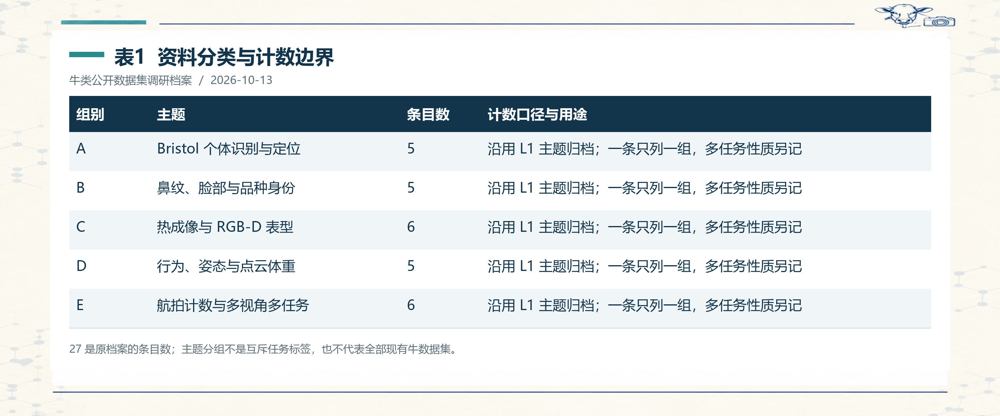

*表1　资料分类与计数边界。[可编辑文字](27个牛类公开数据集详细档案.assets/表格可编辑底稿.md#table-1)；27 是原档案的条目数；主题分组不是互斥任务标签，也不代表全部现有牛数据集。*

沿用原档案 A–E 分组可方便对照，但这些组不是严格任务分类。例如 PCD 在 D 组，实际任务为三维体重；CattleVideo 在 E 组，实际任务为视频身份识别。正式统计模态时另用图 3 的互斥分类。

```text
科研记录/
├── 27个牛类公开数据集详细档案.md
└── 27个牛类公开数据集详细档案.assets/
    ├── 图1、图2：Study Image 原图及中文排版图
    ├── 图3-主要模态条目分布.png
    ├── 科研表格版式母图.png
    ├── 表1 … 表10：精确排字的科研风格表格
    ├── 表格可编辑底稿.md
    ├── 档案与图表数据.json
    ├── 本地来源校验.json
    ├── 补充来源核查.json
    ├── 编制记录与图表.py
    └── 复核结果.json
```

所有正文图片采用同目录相对路径。正文的图表是展示层，JSON 和 Markdown 底稿是数字与文字的复核层；来源文件保留原状。

## 4. 操作步骤与本次过程（Procedures）

### 4.1 已执行的调研过程

1. **定位资料：** 确认主档案实际扩展名为 `.md`，阅读全文及格式参考；先查看知识库索引，再检索相关原始笔记与已有记录。
2. **建立条目对照：** 保留主总表 01–27 编号，按 A–E 归档；将年份、规模、任务、标签、采集、访问状态与许可拆开登记。
3. **识别冲突：** 比较主档案总表、详细卡片与综述译文；将相互矛盾的规模、数据模态和候选判断放入冲突表，而不自动更改原笔记。
4. **回溯原始页面：** 读取 Bristol README、Zenodo 记录及 API、作者仓库、PLOS 原论文、作者下载页，并补查格式、分组、版本与许可指南；只将实际可读的信息升级为本次确认。
5. **编制与制图：** 制作 27 条详细卡片、模态条目统计、准入流程及条件性决策；生成两幅示意图和表格母版，再按同一数据源精确排字。
6. **归档与检查：** 保存本地来源 hash、补查摘要、可编辑底稿和复核结果；同步一个 Wiki 来源摘要、总索引及当天维护日志。

上述是本次实际执行的文献整理流程。下面 §4.2–4.6 是后续数据获取与实验准备 SOP，尚未对全部原始包执行。

### 4.2 获取与校验 SOP〔后续方案〕

先从作者页面定位具体版本，登记论文 DOI 与数据 DOI；有概念 DOI 的同时记录具体版本 DOI。原站与镜像分别登记，镜像不能自动继承原站的内容完整性或许可结论。下载时保留原包，不执行附带的删除、重命名或训练脚本。记录文件长度、官方 checksum 和本地 SHA-256，解压到派生目录，再核对图片、标注和 README 的数量。［O19；本项目建议］

例如 BeefCattleMuzzle 的具体记录为 `10.5281/zenodo.6324361`，概念 DOI 为 `10.5281/zenodo.6324360`；本次 API 返回 ZIP 长度 `643745309` 字节及 MD5 `f2b19d9bab2fc668460a796259944204`。这些用于将来比对所取文件，不表示本次已下载该 ZIP。［O6；补充来源核查 JSON］

建议为每个资源保存：`dataset_id`、`paper_doi`、`data_doi`、`version`、`access_date`、`original_url`、`mirror_url`、`license_data`、`license_code`、`count_unit`、`counts`、`acquisition_groups` 与 `known_conflicts`。没报告的数量保留空值及说明，不填成 0。

### 4.3 标签语义和坐标检查 SOP〔后续方案〕

**语义检查：** 抽检正常、遮挡、截断、模糊、密集、小目标与空场景；检查是否所有可见牛都被标注，框包全身还是局部，遮挡体是否采用可见框或推断全体框。原任务无框时，单独建立人工重标版本并保存重标规范。

**格式检查：** 对水平框像素坐标 `(x_min,y_min,x_max,y_max)`，先确认 `0≤x_min<x_max≤W` 与 `0≤y_min<y_max≤H`，再转为：

$$
x_c=\frac{x_{min}+x_{max}}{2W},\quad
y_c=\frac{y_{min}+y_{max}}{2H},\quad
w=\frac{x_{max}-x_{min}}{W},\quad
h=\frac{y_{max}-y_{min}}{H}.
$$

YOLO 标签为 `0 x_c y_c w h`；每个目标一行，类别从 0 开始。负样本可以没有目标标签，但必须区分“确认无牛”与“标签丢失 / 未完成”。转换后再画框检查，不能只核对文件行数。［O17；本项目抽检建议］

**旋转框检查：** 以四个角点求最小 / 最大坐标得到水平外接框，并记录角度单位和坐标约定。此操作只生成外接框；若原框只包含躯干，整牛语义仍需重标。关键点、掩码、AVA 动作标签和点云区域标签各保留独立转换规范。

### 4.4 来源关联和重复审计 SOP〔后续方案〕

先计算图片内容 SHA-256 发现精确重复；再用 pHash 等寻找重编码、缩放或近似图候选，人工确认后形成重复组。哈希阈值是候选检索规则，不是自动判定同图或泄漏的真值。

同步保存牛 ID、视频 ID、相机 ID、日期、航次 / 地理区域、同步多视角时间、原图 ID 与增强母样本 ID。关联可交叠时，将需要隔离的关系合成组。来自同团队或相似牧场的图像先记风险线索；只有确认成员或内容跨 train/test 重叠，才能报告具体污染。［L4 的推断边界；本项目方案］

### 4.5 分组划分与版本冻结 SOP〔后续方案〕

先确定研究问题：同场新帧、新个体、跨日期、新机位或跨牧场。这些问题对应不同隔离单元。闭集身份识别允许同一身份出现在训练与测试，但仍应隔离关联帧 / 会话；开集识别需设计未见身份协议。整牛检测若要检验新个体泛化，应按个体隔离；若要检验新牧场，应按牧场隔离，不能用随机图片划分替代。

`GroupShuffleSplit` 根据组划分，`test_size` 控制组比例，实际图片比例可能不同。双模态配对图、同步七相机图、同原图切片与增强点云在相应组内保持一致。划分后保存显式成员清单、group 规则、随机种子、图片 / 标签 hash 与脚本版本；val 用于选模，test 在方案确定后评价，使用次数与用途写入记录。［O18；本项目方案］

### 4.6 准入与验收表

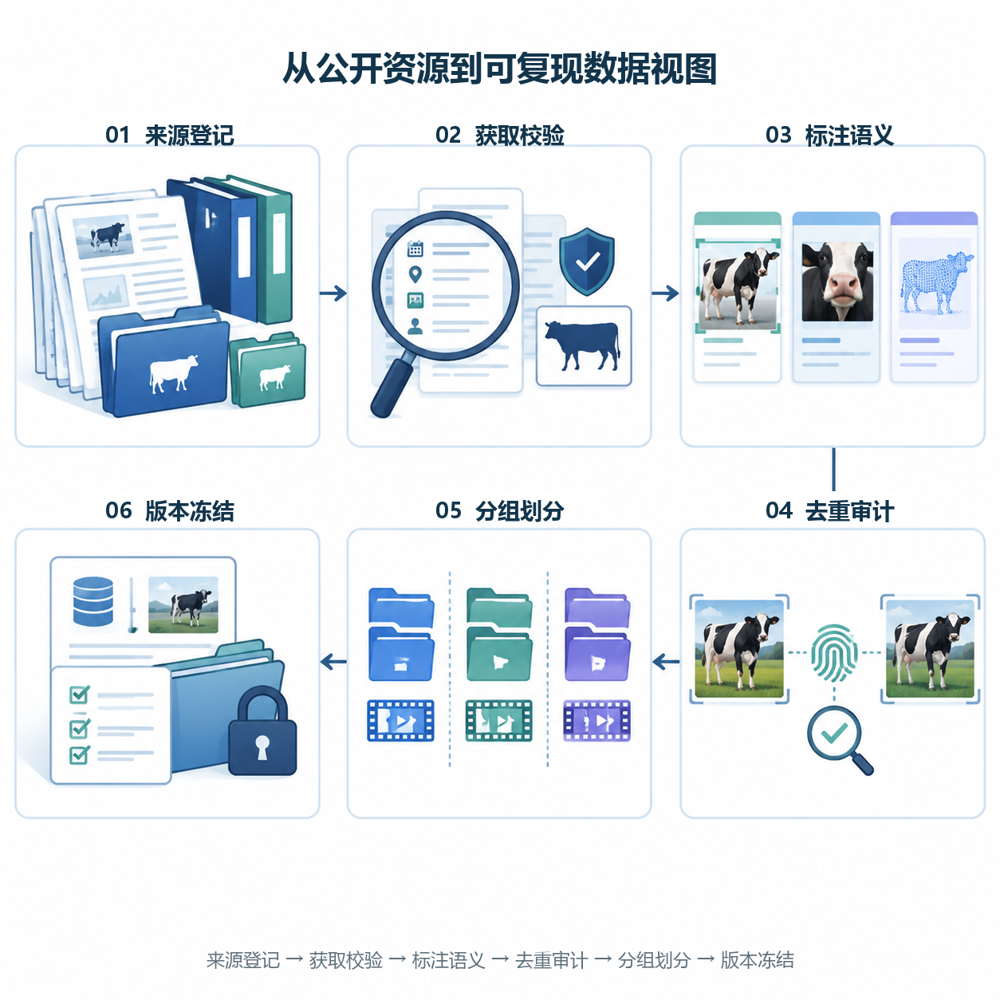

*图 2　后续数据准入流程。Study Image 概念示意；编号与中文由程序排入。图中的文件、数据指纹与锁只说明操作关系，不表示已经执行下载、去重或划分。*

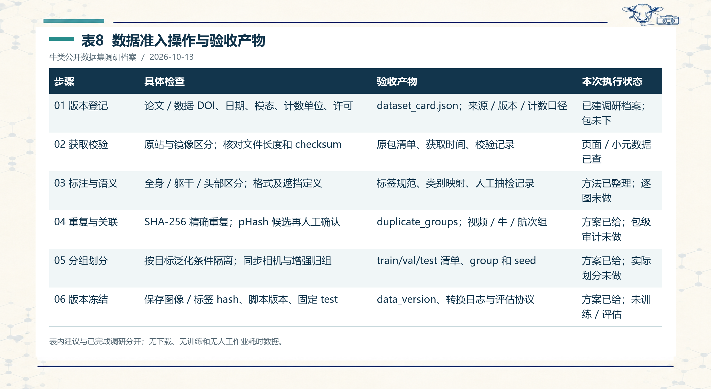

*表8　数据准入操作与验收产物。[可编辑文字](27个牛类公开数据集详细档案.assets/表格可编辑底稿.md#table-8)；表内建议与已完成调研分开；无下载、无训练和无人工作业耗时数据。*

## 5. 原始资料与逐数据集观察（Raw Sources & Observations）

**阅读方式：** 总表编号沿用 L1；卡片给出计数单位、采集、标签、获取和用途判断。只有 O 引用明确覆盖的字段是本次回查所得；其余字段保留为 L1/L2 的历史记录，包级真实性仍需后续核对。年份可能是论文年，数据发布年不一致时单独注明。

### 5.1 A 组：Bristol 个体识别与定位（5 条）

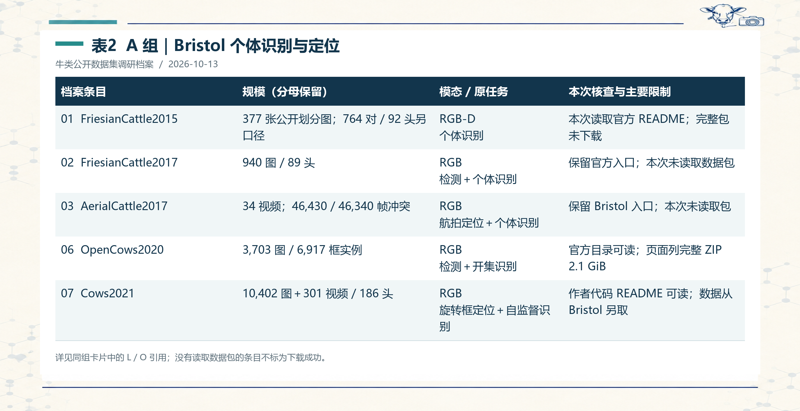

*表2　A 组｜Bristol 个体识别与定位。[可编辑文字](27个牛类公开数据集详细档案.assets/表格可编辑底稿.md#table-2)；详见同组卡片中的 L / O 引用；没有读取数据包的条目不标为下载成功。*

#### A1. FriesianCattle2015〔总表编号 01〕

**文献与数据入口：** 2016；[10.1109/ICIP.2016.7532404](https://doi.org/10.1109/ICIP.2016.7532404)；[资源页面](https://data.bris.ac.uk/data/dataset/wurzq71kfm561ljahbwjhx9n3)。事实定位：［L1 A1；L2 附录 3.1.1；O3］。

- **规模与计数单位：** 公开 README：83 训练图＋294 测试图；综述另记 764 对 RGB-D / 92 头。
- **采集与模态：** 挤奶站出口约 4 m 固定俯视；Kinect RGB-D；RGB-D。
- **原始任务与标签：** 个体识别；图像级身份；深度分割后的 RGB 图像。
- **获取状态与许可：** 本次读取官方 README；完整包未下载；Bristol 非商业许可应按本资源页面核对。

**核查与限制：** 官方 README 确认训练 10 个体 / 83 图、测试 40 个体 / 294 图，故 377 是这两个公开划分的图像和。综述的 764 对 / 92 头描述另一个采集或预处理口径；没有文件清单时，不将二者合并为一个总规模。

**本项目用途判断〔综合 / 建议〕：** 适合背部花纹与深度分割辅助识别；公开说明不支持将所有图像直接当作整牛检测图。研究新个体识别时需区分闭集与开集设置。

#### A2. FriesianCattle2017〔总表编号 02〕

**文献与数据入口：** 2017；[10.1109/ICCVW.2017.336](https://doi.org/10.1109/ICCVW.2017.336)；[资源页面](https://data.bris.ac.uk/data/dataset/2yizcfbkuv4352pzc32n54371r)。事实定位：［L1 A2；L2 附录 3.1.2］。

- **规模与计数单位：** 940 图 / 89 头。
- **采集与模态：** 室内挤奶通道固定俯视；RGB。
- **原始任务与标签：** 检测＋个体识别；边界框与牛只身份 ID。
- **获取状态与许可：** 保留官方入口；本次未读取数据包；L1 记 Bristol 非商业许可；资源级确认待补。

**核查与限制：** 与 Bristol 其他资源的团队、设备或场景关系，是同源风险线索。没有成员清单、日期对应和图片审计，尚不能写成已证明与 Cows2021 重复或泄漏。

**本项目用途判断〔综合 / 建议〕：** 适合固定俯视定位与身份联合研究；扩充 CowCV 时先核对来源重叠及整牛框语义，暂缓计作新的独立域。

#### A3. AerialCattle2017〔总表编号 03〕

**文献与数据入口：** 2017；[10.1109/ICCVW.2017.336](https://doi.org/10.1109/ICCVW.2017.336)；[资源页面](https://data.bris.ac.uk/data/dataset/3owflku95bxsx24643cybxu3qh)。事实定位：［L1 A3；L2 附录 3.1.3］。

- **规模与计数单位：** 34 视频；L1 总表 46,430 帧，卡片与 L2 正文 46,340 帧。
- **采集与模态：** 无人机、户外牧场、视频序列；RGB。
- **原始任务与标签：** 航拍定位＋个体识别；首帧人工框；KCF 传播与 ROI 裁剪。
- **获取状态与许可：** 保留 Bristol 入口；本次未读取包；L1 记 Bristol 非商业许可；资源级确认待补。

**核查与限制：** 两种帧数相差 90，需用发行包统计解决。跟踪产生的 ROI 裁剪图与完整场景帧不是同一种检测样本；KCF 框需检查漂移、漏目标和截断。

**本项目用途判断〔综合 / 建议〕：** 可研究航拍身份与低成本标注；用于检测须保留全景图及完整目标框，并按视频来源分组，避免相邻帧跨划分。

#### A4. OpenCows2020〔总表编号 06〕

**文献与数据入口：** 2020 数据 / 2021 论文；[10.1016/j.compag.2021.106133](https://doi.org/10.1016/j.compag.2021.106133)；[资源页面](https://data.bris.ac.uk/data/dataset/10m32xl88x2b61zlkkgz3fml17)。事实定位：［L1 A4；O4］。

- **规模与计数单位：** L1：3,703 图 / 6,917 框实例；识别资源涉及 46 头，实际 ID 目录另需核验。
- **采集与模态：** 俯视牛只背部花纹；各子集采集条件需分别登记；RGB。
- **原始任务与标签：** 检测＋开集识别；检测定位与识别双组件；Darknet TXT＋VOC XML。
- **获取状态与许可：** 官方目录可读；页面列完整 ZIP 2.1 GiB；官方页面：Non-Commercial Government Licence。

**核查与限制：** 本次确认双组件、标签目录和许可，不将页面可读升级为完整包下载成功。与 Cows2021 有研究与代码继承关系；代码继承本身不证明图片重复。

**本项目用途判断〔综合 / 建议〕：** 检测标签格式便于技术适配；纳入多源检测前仍要核对框所含身体部位、来源日期及与既有 Bristol 数据的重复关系。

#### A5. Cows2021〔总表编号 07〕

**文献与数据入口：** 2021；[arXiv:2105.01938](https://arxiv.org/abs/2105.01938)；[资源页面](https://data.bris.ac.uk/data/dataset/4vnrca7qw1642qlwxjadp87h7)。事实定位：［L1 A5；L5 §4.1；O5］。

- **规模与计数单位：** L1/L5：10,402 定位图＋301 视频 / 186 头；13,784 标注实例。
- **采集与模态：** RealSense D435，约 4 m 固定俯视挤奶通道；RGB。
- **原始任务与标签：** 旋转框定位＋自监督识别；躯干旋转框、方向、ID 与序列信息。
- **获取状态与许可：** 作者代码 README 可读；数据从 Bristol 另取；L1 记 Bristol 非商业许可；数据与代码分别核对。

**核查与限制：** 原始定位框主要包住躯干，排除头颈腿尾。旋转框转水平外接框只改变几何表示，不能补出完整身体区域；项目检测视图需明确人工重标或转换的来源。

**本项目用途判断〔综合 / 建议〕：** 适合视频自监督和旋转框定位；本项目已使用其派生检测视图。后续按实际标注语义、视频与个体信息解释评估，避免混用原始规模和项目子集规模。

### 5.2 B 组：鼻纹、脸部与品种身份（5 条）

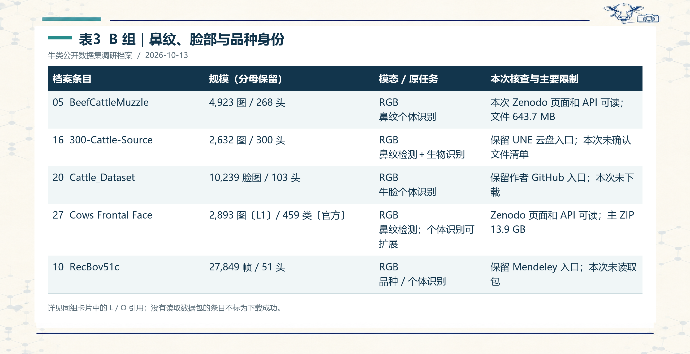

*表3　B 组｜鼻纹、脸部与品种身份。[可编辑文字](27个牛类公开数据集详细档案.assets/表格可编辑底稿.md#table-3)；详见同组卡片中的 L / O 引用；没有读取数据包的条目不标为下载成功。*

#### B1. BeefCattleMuzzle〔总表编号 05〕

**文献与数据入口：** 2022；[10.3390/ani12111453](https://doi.org/10.3390/ani12111453)；[资源页面](https://zenodo.org/records/6324361)。事实定位：［L1 B1；O6］。

- **规模与计数单位：** 4,923 鼻纹图 / 268 头。
- **采集与模态：** 栏外非接触拍摄；美国育肥场；3 类品种来源；RGB。
- **原始任务与标签：** 鼻纹个体识别；按个体分目录的清洁裁剪鼻纹图。
- **获取状态与许可：** 本次 Zenodo 页面和 API 可读；文件 643.7 MB；Zenodo API：CC BY 4.0。

**核查与限制：** API 区分具体记录 DOI 10.5281/zenodo.6324361 与概念 DOI 10.5281/zenodo.6324360；复现应记录实际使用版本及 ZIP 校验值。

**本项目用途判断〔综合 / 建议〕：** 适合鼻纹分类、检索与少样本研究。局部裁剪不含全身信息，不能通过改类别或改标签格式自动得到整牛检测样本。

#### B2. 300-Cattle-Source〔总表编号 16〕

**文献与数据入口：** 2021；[10.3390/agronomy11112365](https://doi.org/10.3390/agronomy11112365)；[资源页面](https://cloud.une.edu.au/index.php/s/eMwaHAPK08dCDru)。事实定位：［L1 B2；L2 附录 3.1.16］。

- **规模与计数单位：** 2,632 图 / 300 头。
- **采集与模态：** 头部保定条件下采集；混种牛；RGB。
- **原始任务与标签：** 鼻纹检测＋生物识别；L1 记图像级身份；具体公开框文件待核。
- **获取状态与许可：** 保留 UNE 云盘入口；本次未确认文件清单；未从本次可读原始页面确认。

**核查与限制：** 论文题目包含 muzzle detection，不等于当前公开包必有可复用的检测框。需区分采集图、鼻纹裁剪图、身份目录和检测标注。

**本项目用途判断〔综合 / 建议〕：** 适合少样本鼻纹识别；与无接触采集数据结合时，记录保定、距离和拍摄条件差异，避免把采集协议差异当作算法差异。

#### B3. Cattle_Dataset〔总表编号 20〕

**文献与数据入口：** 2022；[10.1016/j.compag.2022.106848](https://doi.org/10.1016/j.compag.2022.106848)；[资源页面](https://github.com/Oliver6999/cattle_dataset)。事实定位：［L1 B3；L2 附录 3.1.20］。

- **规模与计数单位：** 10,239 脸图 / 103 头；来自 295 段视频。
- **采集与模态：** 西门塔尔牛；1920×1080、50 fps 视频来源；RGB。
- **原始任务与标签：** 牛脸个体识别；图像级个体类别。
- **获取状态与许可：** 保留作者 GitHub 入口；本次未下载；未从本次可读原始页面确认。

**核查与限制：** L1 的“约 85% 无效帧”缺少本次核对的原论文分母，暂不作为定量结果。L2 记录视频抽帧后继续剔除无效及相似帧，只据此保留需清洗的定性事实。

**本项目用途判断〔综合 / 建议〕：** 可研究轻量化牛脸识别；需按原视频或采集批次核查相邻帧关联及类别不平衡，不能把脸图补写成整牛检测图。

#### B4. Cows Frontal Face〔总表编号 27〕

**文献与数据入口：** 2024；[10.1016/j.dib.2024.110125](https://doi.org/10.1016/j.dib.2024.110125)；[资源页面](https://zenodo.org/records/10535934)。事实定位：［L1 B4；O7］。

- **规模与计数单位：** L1：2,893 图；官方页面确认 459 类，版本 2.0。
- **采集与模态：** 多设备正脸 / 鼻纹近景；RGB。
- **原始任务与标签：** 鼻纹检测；个体识别可扩展；个体目录及鼻纹任务；具体框文件待读包确认。
- **获取状态与许可：** Zenodo 页面和 API 可读；主 ZIP 13.9 GB；Zenodo API：CC BY 4.0。

**核查与限制：** 官方版本说明把当前工作限定为 muzzle detection，recognition 留待未来探索。因此“YOLOv7 识别 459 个体”不能作为已核实结论；459 类不等于已完成识别基准。

**本项目用途判断〔综合 / 建议〕：** 可作鼻纹检测与身份研究素材；暂不用于整牛框 benchmark。作者的“最大”等宣传性文字不在本记录中扩写为截至 2026 年的全局排名。

#### B5. RecBov51c〔总表编号 10〕

**文献与数据入口：** 2020；[10.1016/j.compag.2020.105548](https://doi.org/10.1016/j.compag.2020.105548)；[资源页面](https://data.mendeley.com/datasets/8ysxtyf8p2/1)。事实定位：［L1 B5；L2 附录 3.1.10］。

- **规模与计数单位：** 27,849 帧 / 51 头；212 视频，4 台相机。
- **采集与模态：** 巴西潘塔内罗牛通道；背、侧、脸分机位采集；RGB。
- **原始任务与标签：** 品种 / 个体识别；按个体分 51 类；各类样本数不同。
- **获取状态与许可：** 保留 Mendeley 入口；本次未读取包；未从本次可读原始页面确认。

**核查与限制：** 多相机拍不同身体部位，不能仅按 ID 合并后忽略视角。原资料指出缺少完整全身图，头部或腿部常遮挡。

**本项目用途判断〔综合 / 建议〕：** 适合跨机位个体检索与类别不平衡分析；如果研究跨机位泛化，按相机隔离并同时记录个体是否重叠。

### 5.3 C 组：热成像与 RGB-D 表型（6 条）

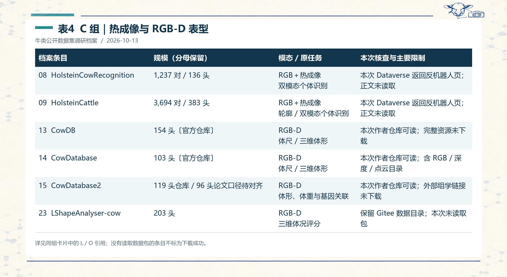

*表4　C 组｜热成像与 RGB-D 表型。[可编辑文字](27个牛类公开数据集详细档案.assets/表格可编辑底稿.md#table-4)；详见同组卡片中的 L / O 引用；没有读取数据包的条目不标为下载成功。*

#### C1. HolsteinCowRecognition〔总表编号 08〕

**文献与数据入口：** 2019；[10.1007/978-3-030-29891-3_10](https://doi.org/10.1007/978-3-030-29891-3_10)；[资源页面](https://dataverse.nl/dataset.xhtml?persistentId=doi:10.34894/O1ZBSA)。事实定位：［L1 C1；L2 附录 3.1.8］。

- **规模与计数单位：** 1,237 对 RGB＋热图 / 136 头。
- **采集与模态：** 挤奶站受控侧视；FLIR 相机，距牛约 5 m；RGB＋热成像。
- **原始任务与标签：** 双模态个体识别；图像级身份；成对数据配准与命名待核。
- **获取状态与许可：** 本次 Dataverse 返回反机器人页；正文未读取；本次未确认；保留数据 DOI 10.34894/O1ZBSA。

**核查与限制：** 反机器人页面表示本次工具无法完成核查，不能据此说数据集已删除。图像对数量不同于图像文件总数；热图是否为辐射温度数据、8-bit 映射或伪彩图仍需检查。

**本项目用途判断〔综合 / 建议〕：** 适合 RGB—热成像互补识别；L5 的 HCRD 项目视图只使用 RGB 并后加检测框，须核对实际版本，不能把项目 RGB 结果写成热成像检测结果。

#### C2. HolsteinCattle〔总表编号 09〕

**文献与数据入口：** 2022；[10.1016/j.eswa.2021.116354](https://doi.org/10.1016/j.eswa.2021.116354)；[资源页面](https://dataverse.nl/dataset.xhtml?persistentId=doi:10.34894/7M108F)。事实定位：［L1 C2；L2 附录 3.1.9］。

- **规模与计数单位：** 3,694 对 RGB＋热图 / 383 头。
- **采集与模态：** 侧视；9 天下午挤奶时段；约 5 m 距离；RGB＋热成像。
- **原始任务与标签：** 轮廓 / 双模态个体识别；图像级个体身份。
- **获取状态与许可：** 本次 Dataverse 返回反机器人页；正文未读取；本次未确认；保留数据 DOI 10.34894/7M108F。

**核查与限制：** 规模较大仅是本档案内的比较，不扩写为所有公开热牛数据中的最大。与前一条的个体、日期及图片重叠关系没有本次成员级证据。

**本项目用途判断〔综合 / 建议〕：** 适合多日识别与热成像特征研究；热成像数据标准化应记录数值范围、传感器与映射方式，独立评估还需控制个体和日期关系。

#### C3. CowDB〔总表编号 13〕

**文献与数据入口：** 2020；[10.1016/j.compag.2020.105821](https://doi.org/10.1016/j.compag.2020.105821)；[资源页面](https://github.com/ruchaya/CowDB)。事实定位：［L1 C3；L2 附录 3.1.13；O9］。

- **规模与计数单位：** 官方仓库：154 头 Hereford。
- **采集与模态：** 多深度相机受控通道采集；RGB-D。
- **原始任务与标签：** 体尺 / 三维体形；左右＋顶部 RGB、深度、点云与手工测量。
- **获取状态与许可：** 本次作者仓库可读；完整资源未下载；仓库公开可读；明确复用与再分发许可待核。

**核查与限制：** 使用仓库名称绑定 154 头这一发布口径；L2 正文的 103 与 CowDatabase 条目的 154 存在交换现象，保留冲突及核查来源。

**本项目用途判断〔综合 / 建议〕：** 适合点云配准、体尺回归与跨视角形体建模；不能把“头数”当作图像数，也不能把多个视角当作独立牛只样本。

#### C4. CowDatabase〔总表编号 14〕

**文献与数据入口：** 2020；[10.1016/j.compag.2020.105821](https://doi.org/10.1016/j.compag.2020.105821)；[资源页面](https://github.com/ruchaya/CowDatabase)。事实定位：［L1 C4；O10］。

- **规模与计数单位：** 官方仓库：103 头 Hereford。
- **采集与模态：** 2019-08-15，俄罗斯下诺夫哥罗德私人农场；RGB-D。
- **原始任务与标签：** 体尺 / 三维体形；9 项长度或围度测量＋体重，共 10 字段。
- **获取状态与许可：** 本次作者仓库可读；含 RGB / 深度 / 点云目录；明确复用与再分发许可待核。

**核查与限制：** 仓库明确写 103 头，并列出手工测量与采集日期。与 CowDB 引用同一论文，但是否为子集或不同发布视图，需按 ID、日期和内容 hash 对齐，暂不把 154＋103 累加为独立动物数。

**本项目用途判断〔综合 / 建议〕：** 可研究三深度相机非刚性形体恢复；与 CowDB 一同使用时先做成员级关系图，避免同一动物跨 train/test。

#### C5. CowDatabase2〔总表编号 15〕

**文献与数据入口：** 2022；[10.3390/ani12162128](https://doi.org/10.3390/ani12162128)；[资源页面](https://github.com/ruchaya/CowDatabase2)。事实定位：［L1 C5；L2 附录 3.1.15；O11］。

- **规模与计数单位：** 当前仓库 119 头 Black Angus；L1/L2 论文分析口径 96 头。
- **采集与模态：** 俄罗斯沃罗涅日；多深度相机；RGB-D。
- **原始任务与标签：** 体形、体重与基因关联；三视角 RGB-D、点云、体重和关联组学资料。
- **获取状态与许可：** 本次作者仓库可读；外部组学链接未下载；图像、测量、组学资料许可分别待核。

**核查与限制：** 当前发布口径是 119 头，96 可能属于论文分析样本，但本次未以成员清单证明其子集关系。遗传、屠宰和影像的有效配对数应逐字段记录。

**本项目用途判断〔综合 / 建议〕：** 适合表型—基因关系探索；跨模态配对、缺失值与样本筛选需要单独审计，不能将 119 都视为完整多组学样本。

#### C6. LShapeAnalyser-cow〔总表编号 23〕

**文献与数据入口：** 2023；[10.1016/j.compag.2023.108307](https://doi.org/10.1016/j.compag.2023.108307)；[资源页面](https://gitee.com/kznd/lshape-analyser/tree/master/Dataset/dairy)。事实定位：［L1 C6；L2 附录 3.1.23］。

- **规模与计数单位：** 203 头奶牛。
- **采集与模态：** 挤奶时段，斜后方 RGB-D；RGB-D。
- **原始任务与标签：** 三维体况评分；DeepLabCut 自动提取 3 个上体表地标。
- **获取状态与许可：** 保留 Gitee 数据目录；本次未读取包；未从本次可读原始页面确认。

**核查与限制：** 自动预测地标不等于人工关键点真值。体况评分的标签、评分者一致性以及自动地标的误差，需要随研究任务分别核查。

**本项目用途判断〔综合 / 建议〕：** 适合基于三维背部形状的表型研究；不把其 3 地标与 NWAFU / Dairy Cow 的 16 点或 CattleEyeView 的 24 点直接并成统一姿态标签。

### 5.4 D 组：行为、姿态与点云体重（5 条）

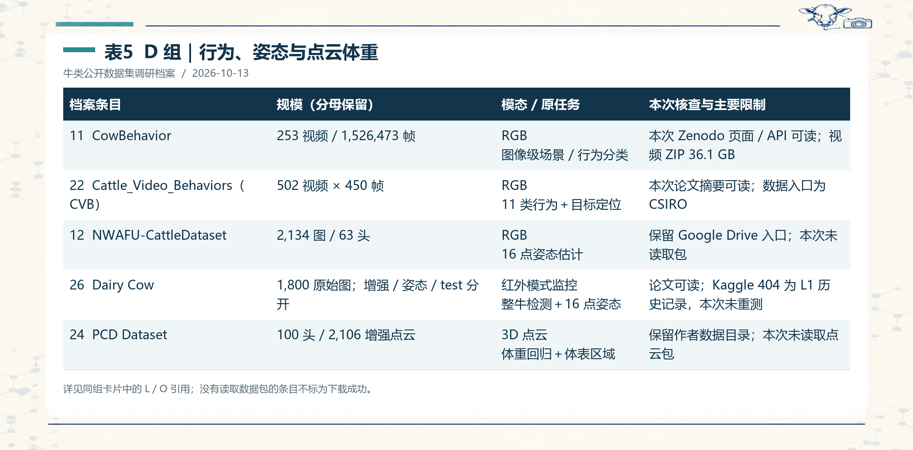

*表5　D 组｜行为、姿态与点云体重。[可编辑文字](27个牛类公开数据集详细档案.assets/表格可编辑底稿.md#table-5)；详见同组卡片中的 L / O 引用；没有读取数据包的条目不标为下载成功。*

#### D1. CowBehavior〔总表编号 11〕

**文献与数据入口：** 2020 数据 / 2022 论文；[10.23986/afsci.111665](https://doi.org/10.23986/afsci.111665)；[资源页面](https://zenodo.org/records/3981400)。事实定位：［L1 D1；L2 类别表；O8］。

- **规模与计数单位：** 官方：253 视频 / 1,526,473 标注帧；论文原用 280 视频。
- **采集与模态：** 自动挤奶站前约 3.3 m；连续两个月；RGB。
- **原始任务与标签：** 图像级场景 / 行为分类；0–9 十个常规标签，另有 undefined=-1。
- **获取状态与许可：** 本次 Zenodo 页面 / API 可读；视频 ZIP 36.1 GB；Zenodo API：CC BY 4.0。

**核查与限制：** 公开版本删去含人物的 27 段视频而保留对应 JSON 标签。实际可配对视频与标注必须按文件核查；undefined 与 0–9 十类分开记，不能把 11 个标签名写成十个有效类别。

**本项目用途判断〔综合 / 建议〕：** 可研究场景分类与行为监测；帧数很大却不代表同等数量的独立场景。需要按视频、日期和机位控制冗余；无原生整牛框时需重新标注。

#### D2. Cattle_Video_Behaviors（CVB）〔总表编号 22〕

**文献与数据入口：** 2023；[arXiv:2305.16555](https://arxiv.org/abs/2305.16555)；[资源页面](https://data.csiro.au/collection/csiro:58916v1)。事实定位：［L1 D2；O16］。

- **规模与计数单位：** 502 段视频；每段 15 s、450 帧；名义总帧数 225,900。
- **采集与模态：** 澳大利亚牧场四机位；最多 8 头同框；RGB。
- **原始任务与标签：** 11 类行为＋目标定位；视频 JSON、目标框和行为；提供 AVA 视图。
- **获取状态与许可：** 本次论文摘要可读；数据入口为 CSIRO；L1 记 CC BY-NC-SA 4.0；下载包许可待核。

**核查与限制：** 502×450=225,900 只是按视频长度计算的名义帧数，不是已核查的逐帧框标注数量。AVA 格式的行为标注采样频率也需读取文件。

**本项目用途判断〔综合 / 建议〕：** 可研究行为检测或派生整牛框；转成 CowCV 静态检测视图时按视频、机位、时间抽样并保留行为信息，不把所有连续帧无差别加入训练池。

#### D3. NWAFU-CattleDataset〔总表编号 12〕

**文献与数据入口：** 2019；[10.1016/j.compag.2019.104885](https://doi.org/10.1016/j.compag.2019.104885)；[资源页面](https://drive.google.com/open?id=1bLQFHd9rqllmEaYvbcAqEBJtlyfuKPdP)。事实定位：［L1 D3；L5 §4.9］。

- **规模与计数单位：** 2,134 图 / 63 头（33 奶牛＋30 肉牛）。
- **采集与模态：** 农舍自然条件；手机视频来源；RGB。
- **原始任务与标签：** 16 点姿态估计；16 个身体关键点。
- **获取状态与许可：** 保留 Google Drive 入口；本次未读取包；未从本次可读原始页面确认。

**核查与限制：** 姿态关键点与检测框是两种标签。L5 记项目 NWAFU_CD 使用人工整牛框；不能反过来声称这些 HBB 是原始公开集原生标注。

**本项目用途判断〔综合 / 建议〕：** 适合侧视姿态及奶牛 / 肉牛差异研究；移作整牛检测需明确重标来源，统一遮挡、截断和身体部位边界约定。

#### D4. Dairy Cow〔总表编号 26〕

**文献与数据入口：** 2022；[10.1371/journal.pone.0269259](https://doi.org/10.1371/journal.pone.0269259)；[资源页面](https://www.kaggle.com/twisdu/dairycow)。事实定位：［L1 D4；L5 §4.8；O15］。

- **规模与计数单位：** 原文：1,800 检测标注图（1620/180）；增强后训练 3,240；检测 test 400；另有 1,800 姿态图与 test 390。
- **采集与模态：** 两台海康红外模式相机，高 4 m，10 头牛，175 视频；红外模式监控。
- **原始任务与标签：** 整牛检测＋16 点姿态；LabelImg 框、Labelme 关键点与站 / 走 / 躺姿态。
- **获取状态与许可：** 论文可读；Kaggle 404 为 L1 历史记录，本次未重测；论文开放许可不等于数据包许可；原包条款待核。

**核查与限制：** 论文写 infrared mode，没有据此证明其为测温热成像；白天 / 夜间帧模态也需分开。检测、关键点和增强后的数量不可累加成独立原始图数，更不能与项目实际重整数量混用。

**本项目用途判断〔综合 / 建议〕：** 可研究夜间监控检测与遮挡姿态；先确认原始视频 / 图像来源及本地版本对应，再做重复审计。本次不复用旧的高指标作为新的实验结果。

#### D5. PCD Dataset〔总表编号 24〕

**文献与数据入口：** 2023；[10.1016/j.compag.2023.108184](https://doi.org/10.1016/j.compag.2023.108184)；[资源页面](https://github.com/colorful-days/0724/tree/master/data)。事实定位：［L1 D5；L2 附录 3.1.24；O21］。

- **规模与计数单位：** L1：100 头；增强后 2,106 点云。
- **采集与模态：** ifm O3D303 传感器；过滤与点云聚类；3D 点云。
- **原始任务与标签：** 体重回归＋体表区域；三维坐标与背 / 胸 / 臀 / 空白区域标签。
- **获取状态与许可：** 保留作者数据目录；本次未读取点云包；未从本次可读原始页面确认。

**核查与限制：** 厂家页面将 O3D303 标为 ToF camera，故本记录记作 ToF 三维相机产生的点云；不沿用综述中未经澄清的 LiDAR 标签。增强点云须与母牛 ID 同组，防止同一形体的变体跨划分。

**本项目用途判断〔综合 / 建议〕：** 适合 PointNet++ 等三维体重估计；以牛为统计单元，并记录单位、坐标系及增强来源，不能直接混入二维 RGB 检测池。

### 5.5 E 组：航拍计数与多视角多任务（6 条）

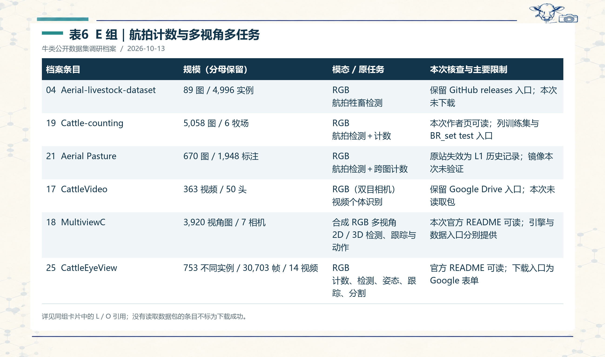

*表6　E 组｜航拍计数与多视角多任务。[可编辑文字](27个牛类公开数据集详细档案.assets/表格可编辑底稿.md#table-6)；详见同组卡片中的 L / O 引用；没有读取数据包的条目不标为下载成功。*

#### E1. Aerial-livestock-dataset〔总表编号 04〕

**文献与数据入口：** 2019；[10.1007/s41095-019-0132-5](https://doi.org/10.1007/s41095-019-0132-5)；[资源页面](https://github.com/hanl2010/Aerial-livestock-dataset/releases)。事实定位：［L1 E1；L2 附录 3.1.4］。

- **规模与计数单位：** 89 图 / 4,996 实例；29＋17＋43 三组。
- **采集与模态：** 3000×4000 高分辨率航拍；草地与复杂背景；RGB。
- **原始任务与标签：** 航拍牲畜检测；边界框；统一标签 livestock。
- **获取状态与许可：** 保留 GitHub releases 入口；本次未下载；未从本次可读原始页面确认。

**核查与限制：** livestock 是上位标签，需逐图或按官方物种说明确认是否全为牛。三组记录颜色与背景难度，可支持分层观察；不能称为所有航拍牛集中的唯一难度划分。

**本项目用途判断〔综合 / 建议〕：** 优先小规模检查类别、目标尺寸、密集遮挡和框完整性；若切图，所有同一原图切片归入同组，防止切片边界泄漏。

#### E2. Cattle-counting〔总表编号 19〕

**文献与数据入口：** 2021；[10.1016/j.compag.2021.106354](https://doi.org/10.1016/j.compag.2021.106354)；[资源页面](https://vhasoares.github.io/downloads.html)。事实定位：［L1 E2；L2 附录 3.1.19；O14］。

- **规模与计数单位：** L1/L2：5,058 图 / 6 牧场。
- **采集与模态：** 5 高度（80–120 m）×3 时段；多种土壤和体色；RGB。
- **原始任务与标签：** 航拍检测＋计数；cattle 边界框及地理参考信息。
- **获取状态与许可：** 本次作者页可读；列训练集与 BR_set test 入口；作者页未确认具体数据许可；待读包核验。

**核查与限制：** 页面有 training 与 BR_set 两个入口，不等于本次已经验证其成员独立性。沙土 / 红土与牛体颜色存在关联，不能把全部因素称为严格正交设计。第三方镜像的 3.28 GB 可能与 Aerial Pasture 混用，暂不写为已核实下载量。

**本项目用途判断〔综合 / 建议〕：** 作为高空小目标域的优先核查对象；保留牧场、航次、高度、时段与地理位置，检查相邻 / 重叠航拍图同一牛群重复出现。

#### E3. Aerial Pasture〔总表编号 21〕

**文献与数据入口：** 2020；[10.1080/01431161.2019.1624858](https://doi.org/10.1080/01431161.2019.1624858)；[资源页面](http://bird.nae-lab.org/cattle/)。事实定位：［L1 E3；L2 附录 3.1.21；O20］。

- **规模与计数单位：** 656＋14=670 图；1,886＋62=1,948 框标注。
- **采集与模态：** 50 m 航拍；不同区域 / 季节；SfM 跨图合并；RGB。
- **原始任务与标签：** 航拍检测＋跨图计数；框与 Normal / Truncated / Blurred / Occluded 元数据。
- **获取状态与许可：** 原站失效为 L1 历史记录；镜像本次未验证；L1 记 CC BY-NC-ND 4.0；原包条款仍需核对。

**核查与限制：** 1,948 为标注出现次数，不是 1,948 头独立动物；同一牛可能在多张图出现。CC 官方说明仅改变格式并不当然构成演绎，但修改后材料的再分发仍需按实际改动及许可核对。

**本项目用途判断〔综合 / 建议〕：** 适合遮挡 / 模糊等质量分层及重复计数研究；保留飞行区域与相邻图关系。申请作者许可与引用原数据都属于后续动作，本次未对外联系。

#### E4. CattleVideo〔总表编号 17〕

**文献与数据入口：** 2021；[10.3389/fanim.2021.759147](https://doi.org/10.3389/fanim.2021.759147)；[资源页面](https://drive.google.com/file/d/13LZmzb5XcqzUVQo3EiTIf4pur4lFHmZD/view)。事实定位：［L1 E4；L2 附录 3.1.17］。

- **规模与计数单位：** 363 后视视频 / 50 头；3 次采集。
- **采集与模态：** ZED 双目相机；商业农场饲料通道；多日期；RGB（双目相机）。
- **原始任务与标签：** 视频个体识别；按耳标人工身份标签。
- **获取状态与许可：** 保留 Google Drive 入口；本次未读取包；未从本次可读原始页面确认。

**核查与限制：** 双目相机采集不自动说明公开包提供深度或左右同步图。必须读取文件说明，区分纯 RGB 视频与可计算立体深度的成对资源。

**本项目用途判断〔综合 / 建议〕：** 适合时序特征、注意力 LSTM 与跨日期识别；划分按视频和采集批次设计，并声明个体是否在不同集合重复出现。

#### E5. MultiviewC〔总表编号 18〕

**文献与数据入口：** 2021；[arXiv:2112.03471](https://arxiv.org/abs/2112.03471)；[资源页面](https://github.com/Jiahao-Ma/MultiviewC)。事实定位：［L1 E5；L2 附录 3.1.18；O13］。

- **规模与计数单位：** L1/L2：7 相机×560 张=3,920 视角图；15 模拟牛。
- **采集与模态：** UE4；官方场地 37.5×37.5 m；五种动作；合成 RGB 多视角。
- **原始任务与标签：** 2D / 3D 检测、跟踪与动作；2D / 3D 信息、动作、相机内外参。
- **获取状态与许可：** 本次官方 README 可读；引擎与数据入口分别提供；引擎、代码和数据许可分别待核。

**核查与限制：** 官方 README 确认合成 RGB、多相机、2D / 3D 信息与标定；这些不能自动证明存在深度图，因此不沿用总表“合成 RGB-D”的笼统标记。同步七视角是一组场景观测，不能算七个独立事件。

**本项目用途判断〔综合 / 建议〕：** 适合多视角几何与合成到真实迁移；按同步场景时间或生成序列分组，真实农场泛化需要另用真实测试域验证。

#### E6. CattleEyeView〔总表编号 25〕

**文献与数据入口：** 2023；[10.1109/VCIP59821.2023.10402676](https://doi.org/10.1109/VCIP59821.2023.10402676)；[资源页面](https://github.com/AnimalEyeQ/CattleEyeView)。事实定位：［L1 E6；O12］。

- **规模与计数单位：** 官方：753 distinct cow instances / 30,703 帧 / 14 视频。
- **采集与模态：** 顶视；L1 记 6 品种及多月份采集；RGB。
- **原始任务与标签：** 计数、检测、姿态、跟踪、分割；身体 / 头框、轨迹、24 点与掩码〔L1〕。
- **获取状态与许可：** 官方 README 可读；下载入口为 Google 表单；仓库代码 Apache-2.0；数据 CC BY 4.0 为 L1 记载，待包核。

**核查与限制：** 753 是不同实例，30,703 是帧，两者分母含义不同，不能以 753/30,703 推导每帧密度或大量空帧。仓库当前列 README 与 LICENSE，数据需要另循表单入口，本次未提交申请。

**本项目用途判断〔综合 / 建议〕：** 多任务与多品种研究价值较高；用于整牛检测先确认身体框定义、区分头框，并读取各任务标注数量，再决定是否形成项目派生视图。

## 6. 结果与综合分析（Results & Analysis）

### 6.1 档案规模与模态分布

本次 27 条均完成结构化整理，分组数为 `5＋5＋6＋5＋6=27`。按本记录的主要模态互斥归类，RGB / RGB 视频 17 条、RGB-D 5 条、RGB＋热成像 2 条、红外模式监控 1 条、合成 RGB 多视角 1 条、三维点云 1 条。CattleVideo 在此按已记载的 RGB 视频归类；未确认发行深度数据。Dairy Cow 与 MultiviewC 采用上述更精确的模态口径。统计来自本记录 27 条元数据，不是原综述的全部物种模态统计。

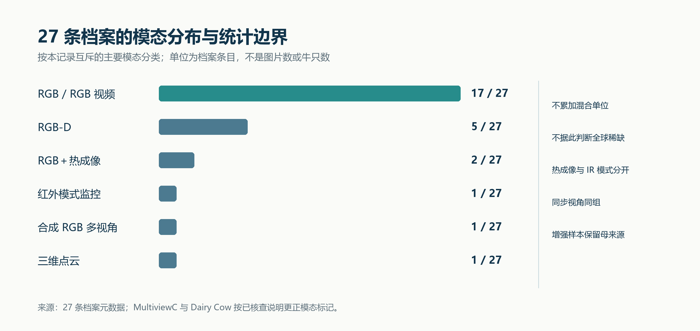

*图 3　主要模态的档案条目分布。程序按精确条目数绘制；17＋5＋2＋1＋1＋1=27。图中没有使用图片总量、帧总量或独立动物总量，因此不能据柱长推断可用训练规模。*

**综合判断：** 此历史清单中成对热成像资源较少，但不足以证明“全球只有 3 个红外牛数据集”或“本项目只能靠自采补齐”。新资源发现需要扩展检索，模态可用性需要包级核验；RGB 个体识别资源也不能自动作为热成像检测池成员。

### 6.2 冲突与错误传播控制

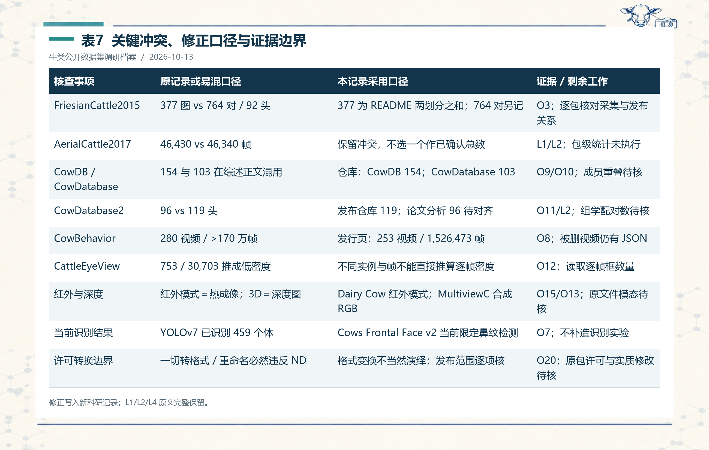

*表7　关键冲突、修正口径与证据边界。[可编辑文字](27个牛类公开数据集详细档案.assets/表格可编辑底稿.md#table-7)；修正写入新科研记录；L1/L2/L4 原文完整保留。*

本次修正的重点是**把名称、版本、分母和任务同时绑定**。CowDB / CowDatabase 的规模依作者仓库分别记载，但两者是否包含同一动物并未证明；CowDatabase2 保留发布版本与分析样本的差异；CowBehavior 使用公开发行数量，同时保留论文实验范围。一个冲突获得更直接来源，并不表示所有剩余字段已验证。

另有三类需要明确撤回的过强推断：

1. **低密度推断：** L4 用 CattleEyeView 的 753 / 30,703 解释低实例密度。官方描述的 753 是不同实例，缺少逐帧框总数，该比例不能证明空帧或帧冗余程度；仍可提出抽帧审计，但不能据此定量排除。［O12］
2. **已证明同源泄漏：** L4 对 Bristol 条目的排除依团队、场景和历史关系提出。现阶段只有来源关系风险；代码继承也不能证明图片重叠。正式结论需成员、时间与图像审计。类似场景同样不能证明两个航拍集近重复。［L4；O5；本次综合］
3. **严格正交及全局唯一：** Cattle-counting 的土壤与体色存在关联，没有各组合样本量和设计矩阵不能称严格正交；“最大”“唯一”“引用最高”缺少本次全域比较，均不作为结果。［L1/L2；本次综合］

### 6.3 本次访问核查的层级

已读取的直接来源包括 Bristol 的 2015 README 与 OpenCows2020 页面；三个 Zenodo 记录的页面 / API；CowDB、CowDatabase、CowDatabase2、CattleEyeView、Cows2021 和 MultiviewC 的作者说明；Cattle-counting 作者下载页；Dairy Cow 原论文与 CVB 摘要。官方指南见附录 A。

**受限与未完成：** 两个 Dataverse 页面返回反机器人页面；MultiviewC 的 GitHub API 返回限流，随后通过官方 raw README 完成文本核查；部分 DOI / 页面在网页工具中未能展开。本地 HTTP 批量读取有 SSL 失败；相关仓库、PLOS 论文和作者页随后通过页面读取补查，失败和成功记录同时保留。访问失败不升级成资源失效。Dairy Cow 的 Kaggle 404、Aerial Pasture 的原站无响应和第三方镜像情况仍按 L1 历史状态列示；本次没有把它们标成 2026-10-13 的重新实测结果。

所有数据集完整压缩包、许可文件、逐图标注、成员清单和实际运行均未在本次逐一验证。因此不给出“27 个全部可用”“9 个已成功批量下载”等结论。补充 API / README 核查的时间、返回状态、校验值和摘要保存于附录 B。

### 6.4 CowCV 检测扩展的条件性决策

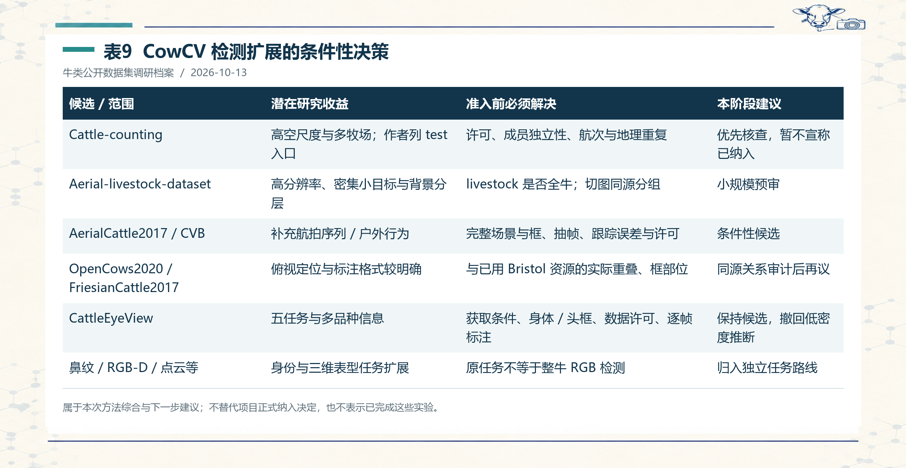

*表9　CowCV 检测扩展的条件性决策。[可编辑文字](27个牛类公开数据集详细档案.assets/表格可编辑底稿.md#table-9)；属于本次方法综合与下一步建议；不替代项目正式纳入决定，也不表示已完成这些实验。*

按原任务与潜在场景补充，优先核查高空航拍资源较有理由，但“有框、有 test 入口、数量多”仍只是筛选依据。许可、整牛语义、来源独立和实际可获取性是准入验收项。L4 的历史“不纳入”与“推荐”保留为项目当时判断，本记录提出新的条件性复议，不直接修改 benchmark 成员。

### 6.5 池化实验的设计草案〔待执行〕

在所有准入项完成后，可设计以下对照：每个源域单独训练；按相似模态与视角建立同类场景池；建立跨场景池；对从未用于训练 / 选模的目标域直接评价。记录每个池的图片、来源组、优化步数、输入尺寸、初始化与采样策略；池化造成数据量与预算变化时，不能将收益全部归因于域互补。

检测指标保留 `mAP@0.5` 与 `mAP@0.5:0.95`；报告 P/R/F1 时另登记置信阈值、匹配 IoU 与类别映射，不把置信过滤与 IoU 匹配混写。先逐目标域报告，再给等权宏平均；合并所有样本计算的 pooled 指标另行命名。身份识别、姿态与体重任务各采用其对应指标，不能以 accuracy、AP 和 MAE 跨任务排出总体优劣。［L5；L6；本项目方案］

连续帧或同牛多图的置信区间建议按来源组重采样；多随机种子的训练离散度另记。本记录没有训练结果、误差条、显著性检验或池化增益，以上属于实验设计草案。

## 7. 讨论、后续计划与阶段结论（Discussion & Next Steps）

### 7.1 本阶段的研究价值

此次工作把资源盘点推进到可执行的数据准入：27 条记录都有来源与用途判断，规模不再只保留一个混合数字；当前发布范围、论文分析样本和项目派生视图区分开来；页面访问、下载与实际可用性分开评价。冲突登记使后续更正可以定位到具体字段，避免同一错误在综述、候选清单和论文中重复传播。

值得重点保留的分析是：**格式统一不足以建立语义可比性；多帧多视角不足以建立样本独立性；网页公开不足以证明数据获取与许可完备。** 这些判断来自本次跨来源核对与方案整理，尚不替代原包审计。

### 7.2 局限与尚待核实事项

本次以历史档案为边界，未执行覆盖所有新数据集的系统检索；部分事实仍是本地二手笔记。未下载全量资源，无法确认精确文件数、每个版本的完整标签、跨集重复关系、当前全部许可证或实际获取体验。27 条清单适合明确版本的阶段记录，后续更新须另存版本并说明新增、移除和字段变化。

仍需优先处理：FriesianCattle2015 的采集 / 发布口径、AerialCattle2017 两种帧数、CowDB 系列成员关系、CowDatabase2 96 / 119 的对应、CattleEyeView 各任务标注数量与数据许可、热成像资源真实编码、航拍资源原站 / 镜像对应及重叠地理来源。

### 7.3 下一阶段与验收

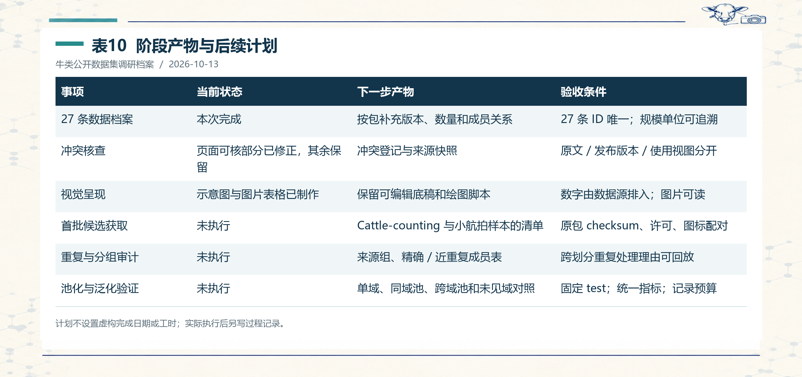

*表10　阶段产物与后续计划。[可编辑文字](27个牛类公开数据集详细档案.assets/表格可编辑底稿.md#table-10)；计划不设置虚构完成日期或工时；实际执行后另写过程记录。*

建议先核查一项高空计数资源与一项小规模航拍资源，形成可复核的试点包，再决定扩展哪些资源。试点要留下下载校验、目录清单、图标配对、抽检、成员关联、重复组与固定划分，而不是只记录下载链接。遇到原始框语义无法转换的资源，转入重新标注或独立任务路线，并记录投入需求。

**阶段结论：** 27 条历史牛类公开数据集已完成可追溯档案整理与部分原始页面核查，形成适用于 CowCV 后续数据筛选的语义、版本与来源检查框架。现阶段能够确认清单结构和部分直接来源事实；不能声称已经完成全部数据获取、无泄漏审计或新的模型性能验证。

## 附录 A. 本地来源与补充文献

下列来源的核查日期为 **2026-10-13**；本地资料自身日期另按原文记载。L 为本地笔记或记录；O 为本次读取的直接来源 / 官方指南。主档案中其他 DOI 与下载入口逐卡片保留为检索线索，未列 O 的条目不冒称本次阅读全文。

- **［L1］** [27 个牛类公开数据集详细档案（2026-09-28 历史档案）](牛只数据集/134个数据集信息收集/27个牛类公开数据集详细档案.md)。定位 / 使用范围：主清单、27 个条目、历史可访问状态与下载线索；全文读取。
- **［L2］** [精准畜牧养殖公开计算机视觉数据集系统综述（2025）](<精准畜牧养殖公开计算机视觉数据集系统综述 (Comput Electron Agric 2025).md>)。定位 / 使用范围：§1、§4.1、附录 3.1.1–3.1.27：版本、规模和采集方式；相关段落读取。
- **［L3］** [牛类开放数据集与 AI/GenAI 双向综述（2026）](<开放数据集与AI-GenAI驱动的精准畜牧计算机视觉双向综述 (Comput Electron Agric 2026).md>)。定位 / 使用范围：§1–3、§4、待核实线索；相关段落读取；315 条为跨物种扩展范围，本文未逐条复核。
- **［L4］** [CowCV 候选数据集评估（边界框类）](<../牛只数据集/CowCV 候选数据集评估（边界框类）.md>)。定位 / 使用范围：纳入标尺、Bristol 同源推断、CattleEyeView 密度、航拍候选；相关段落读取。
- **［L5］** [14 个检测数据集的拍摄环境与场景](../牛只数据集/拍摄环境与场景.md)。定位 / 使用范围：§1–4：Cows2021 躯干 OBB、HCRD 的 RGB 派生框、NWAFU / Dairy Cow 项目视图。
- **［L6］** [数据集融合方法 Fusion or Confusion](<../牛只数据集/数据集融合方法Fusion or Confusion (CVPR 2025 Workshop).md>)。定位 / 使用范围：§1–3：数据池、域差异与分层对照；相关段落读取并回溯原论文摘要。
- **［L7］** [实验记录格式参考](实验记录格式参考.md)。定位 / 使用范围：全文读取；采用七项结构与签字栏，结合文献调研格式调整。
- **［L8］** [数据集整理与独立测试集评估科研记录](数据集整理与独立测试集评估.md)。定位 / 使用范围：结构、证据层级与既有记录边界；只作格式及研究脉络参照。
- **［O1］** [Bhujel et al. Public Computer Vision Datasets for Precision Livestock Farming: A Systematic Survey, arXiv:2406.10628v1](https://arxiv.org/abs/2406.10628v1)。定位 / 使用范围：读取摘要与版本信息；58 个为跨物种预印本范围；逐条详情由 L1/L2 提供。
- **［O2］** [Bhujel 综述配套数据集仓库](https://github.com/Anil-Bhujel/Public-Computer-Vision-Dataset-A-Systematic-Survey)。定位 / 使用范围：读取配套清单入口；持续更新清单不能替代某篇论文的固定版本。
- **［O3］** [FriesianCattle2015 官方 README](https://data.bris.ac.uk/datasets/wurzq71kfm561ljahbwjhx9n3/readme.txt)。定位 / 使用范围：本地 HTTP 200 读取：83 训练图、294 测试图及数据格式；未下载 ZIP。
- **［O4］** [OpenCows2020 官方数据页](https://data.bris.ac.uk/data/dataset/10m32xl88x2b61zlkkgz3fml17)。定位 / 使用范围：双组件、Darknet / XML 目录、2.1 GiB 与非商业许可。
- **［O5］** [Cows2021 作者代码与使用说明](https://github.com/Wormgit/Cows2021)。定位 / 使用范围：旋转框检测代码、原视频与数据入口、对既有工作的代码继承说明。
- **［O6］** [BeefCattleMuzzle Zenodo 具体版本记录](https://zenodo.org/records/6324361)。定位 / 使用范围：描述和 API：4,923 图 / 268 头、裁剪鼻纹、版本 DOI、文件大小、CC BY 4.0。
- **［O7］** [Cows Frontal Face Zenodo v2.0](https://zenodo.org/records/10535934)。定位 / 使用范围：页面与 API：459 类、13.9 GB、当前 muzzle detection 范围与未来 recognition。
- **［O8］** [CowBehavior Zenodo 数据记录](https://zenodo.org/records/3981400)。定位 / 使用范围：页面与 API：253 视频、1,526,473 帧、隐私删去 27 视频与保留 JSON。
- **［O9］** [CowDB 作者仓库](https://github.com/ruchaya/CowDB)。定位 / 使用范围：读取 README：154 头 Hereford、RGB-D 和测量数据。
- **［O10］** [CowDatabase 作者仓库](https://github.com/ruchaya/CowDatabase)。定位 / 使用范围：读取 README：103 头、2019-08-15 采集、三视角与手工测量。
- **［O11］** [CowDatabase2 作者仓库](https://github.com/ruchaya/CowDatabase2)。定位 / 使用范围：读取 README：119 头 Black Angus、RGB-D / 点云及外部组学入口。
- **［O12］** [CattleEyeView 作者仓库](https://github.com/AnimalEyeQ/CattleEyeView)。定位 / 使用范围：README：753 不同实例、30,703 帧、14 视频、5 任务与 Google 表单入口；代码 Apache-2.0。
- **［O13］** [MultiviewC 官方 README](https://raw.githubusercontent.com/Jiahao-Ma/MultiviewC/main/README.md)。定位 / 使用范围：读取原始 README：UE4、37.5 m 场地、7 相机、标定与 2D / 3D 信息；未运行引擎。
- **［O14］** [Cattle-counting 作者下载页](https://vhasoares.github.io/downloads.html)。定位 / 使用范围：2021 条目下 Whole training dataset 与 BR_set test collection；未下载 Drive 包。
- **［O15］** [Gong et al. Multicow pose estimation based on keypoint extraction. PLOS ONE, 2022](https://journals.plos.org/plosone/article?id=10.1371/journal.pone.0269259)。定位 / 使用范围：Materials and methods / Data acquisition / Image labeling：红外模式、检测与姿态子集分母。
- **［O16］** [Zia et al. CVB: A Video Dataset of Cattle Visual Behaviors. arXiv:2305.16555](https://arxiv.org/abs/2305.16555)。定位 / 使用范围：读取论文摘要与元信息；具体发行格式沿用 L1，未解析 CSIRO 包。
- **［O17］** [Ultralytics Object Detection Datasets](https://docs.ultralytics.com/datasets/detect/)。定位 / 使用范围：Ultralytics YOLO format：类别从 0 开始，归一化 xywh，一目标一行。
- **［O18］** [scikit-learn GroupShuffleSplit](https://scikit-learn.org/stable/modules/generated/sklearn.model_selection.GroupShuffleSplit.html)。定位 / 使用范围：按 group 隔离划分；test_size 是组比例，非图片比例。
- **［O19］** [Zenodo About records](https://help.zenodo.org/docs/deposit/about-records/)。定位 / 使用范围：DOI、具体版本的新记录与可公开元数据；配合实际 API 保存文件与版本。
- **［O20］** [Creative Commons CC BY-NC-ND 4.0 官方说明](https://creativecommons.org/licenses/by-nc-nd/4.0/)。定位 / 使用范围：许可条款及脚注：仅改变格式不当然形成演绎；不发布未经允许的修改材料。
- **［O21］** [ifm O3D303 产品页](https://www.ifm.com/gb/en/product/O3D303)。定位 / 使用范围：页面标题标为 ToF camera；据此纠正传感器泛称，不扩展成本文已核查的全部参数。
- **［O22］** [Becker et al. Fusion or Confusion? CVPR Workshops, 2025](https://openaccess.thecvf.com/content/CVPR2025W/PBVS/html/Becker_Fusion_or_Confusion_A_Look_at_Dataset_Pooling_for_Infrared_CVPRW_2025_paper.html)。定位 / 使用范围：读取原论文摘要：七个红外车辆数据集的数据池实验；仅借鉴方法，未迁移其性能值。


**版本参考：** Bhujel et al. 2025 正式版 DOI `10.1016/j.compag.2024.109718` 与 Ruchay et al. 2026 DOI `10.1016/j.compag.2026.111917` 作为 L2/L3 文献标识保留；本次 DOI 页面未完整展开，相关正式版统计不标为本次全文重新复算。

**受限入口：** HolsteinCowRecognition 与 HolsteinCattle 的 Dataverse URL 见对应卡片；本次只获得反机器人页面。原站失效、镜像可用等历史判断，应以未来实际获取记录更新。

## 附录 B. 图表、复核与执行边界

- [表格可编辑底稿](27个牛类公开数据集详细档案.assets/表格可编辑底稿.md)：正文 10 张图片表格的完整 Markdown 文字。
- [档案与图表数据](27个牛类公开数据集详细档案.assets/档案与图表数据.json)：27 个条目、表格输入、模态统计与来源注册表。
- [图表与正文编制脚本](27个牛类公开数据集详细档案.assets/编制记录与图表.py)：由上述结构化输入生成精确表格、统计图与记录正文。
- [本地来源校验](27个牛类公开数据集详细档案.assets/本地来源校验.json)：八份本地资料的读取快照 SHA-256。
- [补充来源核查](27个牛类公开数据集详细档案.assets/补充来源核查.json)：部分官方小型元数据读取状态、时间、文件长度、校验值与失败信息。
- [复核结果](27个牛类公开数据集详细档案.assets/复核结果.json)：数量、链接、图片、来源 hash、脚本与索引检查，以及未运行项目。
- [复核脚本](27个牛类公开数据集详细档案.assets/复核记录.py)：可再次检查条目、图片表格元数据、相对链接、来源 hash 和索引关系。
- [知识库来源摘要](../wiki/sources/cattle27-public-dataset-evidence.md)：资料范围、关键冲突与本记录的关联。

**图像来源：** 图 1、图 2 的概念底图与表格母版由 Study Image 生成；中文标签、表 1–10 的全部正文 / 数字、图 3 的条目统计由程序准确排入。生成示意不作为真实采集图、热传感读数、关键点真值或审计截图。为复核和后续编辑，所有表格同时保留文字与 JSON。

**未运行：** 全量数据下载 / 解压、原图逐图审查、数据包级标签转换、精确 / 近重复审计、实际 train/val/test 划分、远程状态核查、模型训练、评估与统计显著性检验；SQLite / Qdrant / 向量索引同步也未运行。本文公式和 SOP 是待执行方法，不补造执行日志。

---

**记录人签字：** __________________　　**日期：** __________________  
**审核人 / 导师签字：** __________________　　**日期：** __________________
