# Label Studio 进行数据标注的分析与操作步骤

> **任务编号：** SPIKE-20261013-LS-01  
> **记录日期：** 2026-10-13（北京时间）  
> **记录类型：** 技术选型与可行性调研 + 操作规程（SOP）  
> **研究场景：** CowCV 牛只图像的单类别、水平边界框标注与修正  
> **记录人：** 待填写  
> **参考格式：** [实验记录格式参考](实验记录格式参考.md)中的“技术选型与可行性调研”，结合“实验步骤”和“原始数据与现象”调整。  
> **表格呈现：** 全文 15 张表统一排版为 16 幅高清科研表图；完整文字保留在[表格可编辑底稿](Label-Studio表格可编辑底稿.md)，便于检索与后续填写。  
> **验证边界：** 本次完成本地资料阅读、官方文档核查与文中示例检查；未连接远程服务器、未启动 Label Studio、未导入真实任务或开展人工计时。以下服务器状态与项目数量均为历史记录，不能当作当前运行状态。

**调研结论：有条件可行。** Label Studio 的图像矩形框、预标注导入和结果导出能力能够覆盖本项目的主要标注环节。建议首先采用“离线 YOLO 预标注 → Label Studio 人工修正 → 独立复核 → 导出验收”的路线；预标注质量差的图片改用人工从零标注。是否值得全量投入，应由代表性小样本的耗时和复核结果决定。社区版的角色权限和审核工作流有限，需要通过分工清单与外部复核记录补足。［O2，O3，O9，O10，O11］

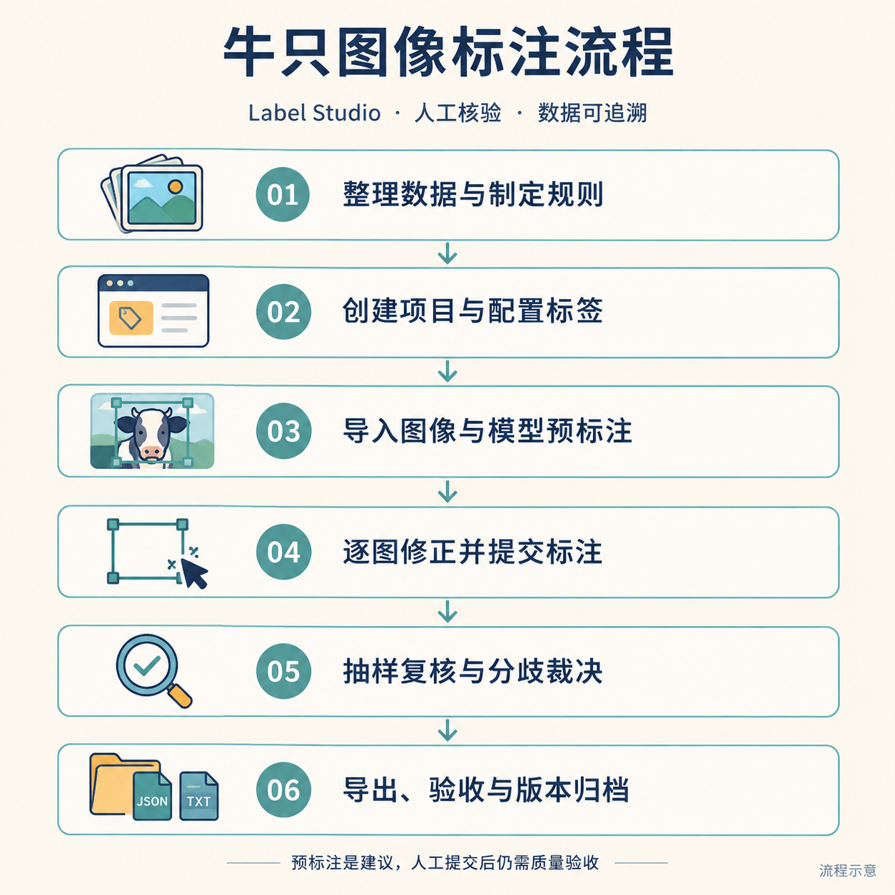

*图 1　牛只检测标注的整体流程。沿用本目录已有示意图；模型预标注是可选环节。图中“抽样复核”适用于一般训练数据的建议流程，正式验证集、测试集建议逐图复核。配图不代表已完成实验。*

[TOC]

---

## 1. 研究目的与评估标准（Objective & Criteria）

### 1.1 要解决的问题

现有数据整理同时存在三种需求：为无检测框的图片建立标注、修正模型生成的检测框，以及统一不同数据集的类别与目标范围。本地记录显示，牛只部位标注不能直接替代整牛检测框，模型预标注也必须与人工复核标签区分存放。［L3，L4，L5］

本次调研关注以下问题：

1. 能否在浏览器中稳定显示服务器上的图片，并逐图补框、删框、调整边界？
2. 能否导入已有 YOLO 预测，保留模型来源，再形成独立的人工标注？
3. 能否导出可检查、可追溯、可用于后续训练的数据？
4. 多人标注时如何避免类别不一致、漏标和未经审核的结果进入训练？
5. 在当前工作方式下，预标注是否真的降低了总人工成本？

### 1.2 准入条件与建议验收指标

下表为**本项目拟采用的检查标准**，不是 Label Studio 官方性能承诺，也不是本次实测结果。

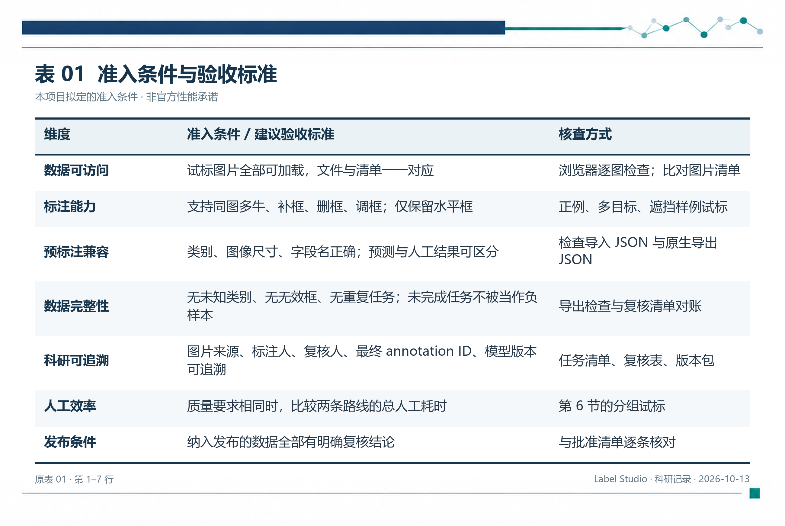

*表 01　准入条件与验收标准。[可编辑文字表](Label-Studio表格可编辑底稿.md#表-01-准入条件与验收标准)。*

## 2. 原理与证据边界（Principle & Evidence）

### 2.1 三类数据必须分清

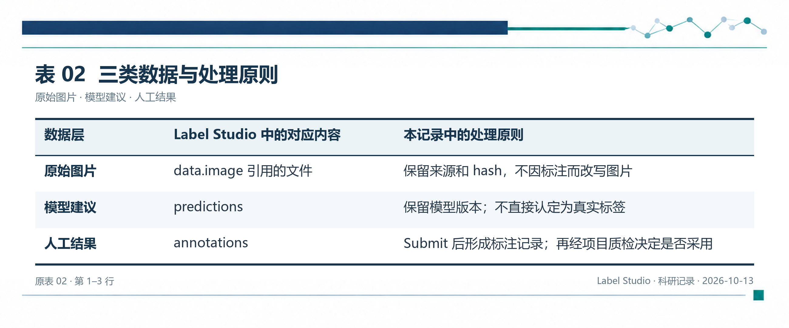

*表 02　三类数据与处理原则。[可编辑文字表](Label-Studio表格可编辑底稿.md#表-02-三类数据与处理原则)。*

官方文档说明，**prediction 本身只读**。人工修正通常发生在由预测复制出来的 annotation 上，而不是直接改写 prediction。项目设置中的预测显示开关、Quick View 的复制功能，会影响标注者看到和采用预标注的方式。［O2］

因此，“已导入预测”“已提交人工标注”“已通过质量验收”是三个不同的状态。最终训练标签应取自经复核选定的人工结果，而不是直接导出所有预测，也不能将一个任务中多人的 annotation 全部合并。后两条属于本项目的质量管理要求。

### 2.2 哪些内容已经有证据，哪些仍待验证

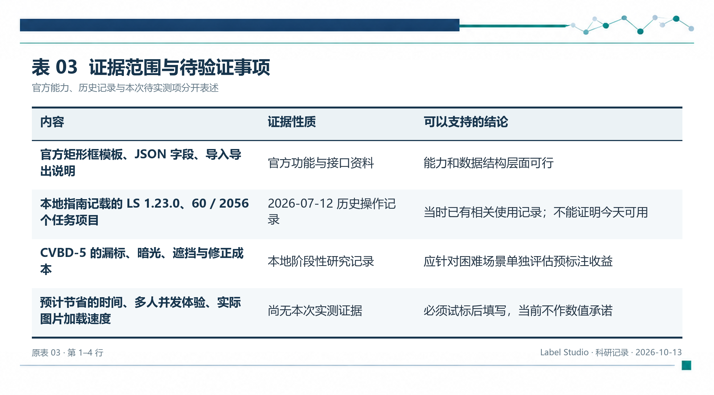

*表 03　证据范围与待验证事项。[可编辑文字表](Label-Studio表格可编辑底稿.md#表-03-证据范围与待验证事项)。*

本地《7月工作》记录：CVBD-5 共 5,322 张图片，现有标注存在较多漏标，模型预标注后仍需大量补框、删错框与调框；该阶段决定不开展全量重标、不纳入当时训练。这里只引用这一**历史决策及其条件**，不据此认定该数据集永久不可用，也不改变原有决策。［L4，§9.1］

## 3. 软件、数据与运行条件（Materials & Environment）

### 3.1 本地指南中的实例参数

以下参数来自《Label-Studio操作指南》§0、§10，**快照日期为 2026-07-12，本次未远程复核**。实际操作前应重新确认版本、端口、目录和服务状态。［L1］

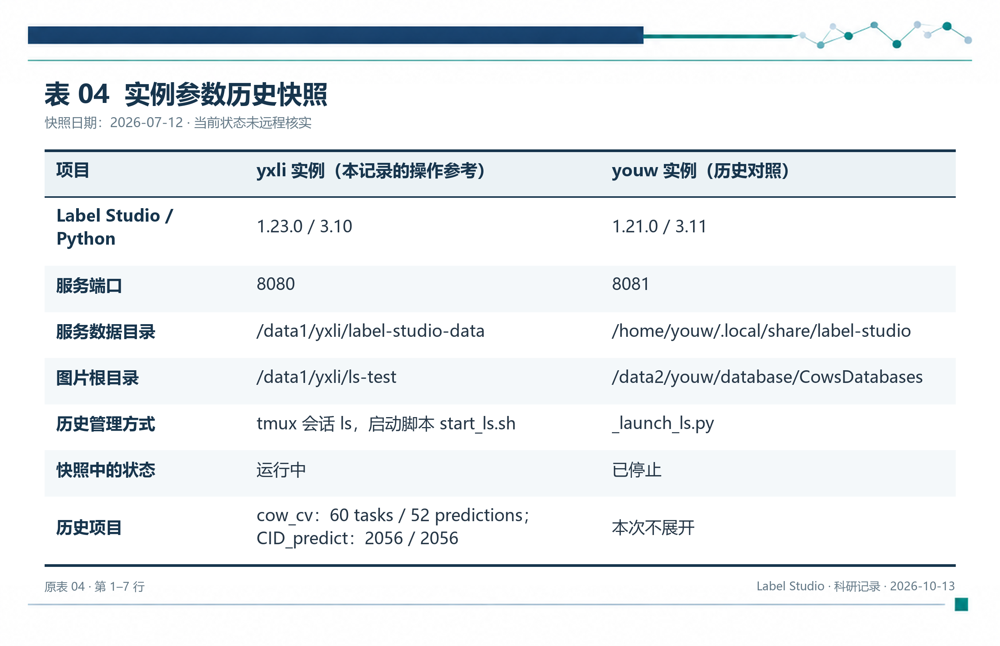

*表 04　实例参数历史快照。[可编辑文字表](Label-Studio表格可编辑底稿.md#表-04-实例参数历史快照)。*

旧指南中的账号密码不转载。正式执行时使用本人已有账户；新增账号、重启共享服务或调整权限需由实例管理员处理。

### 3.2 执行前准备清单

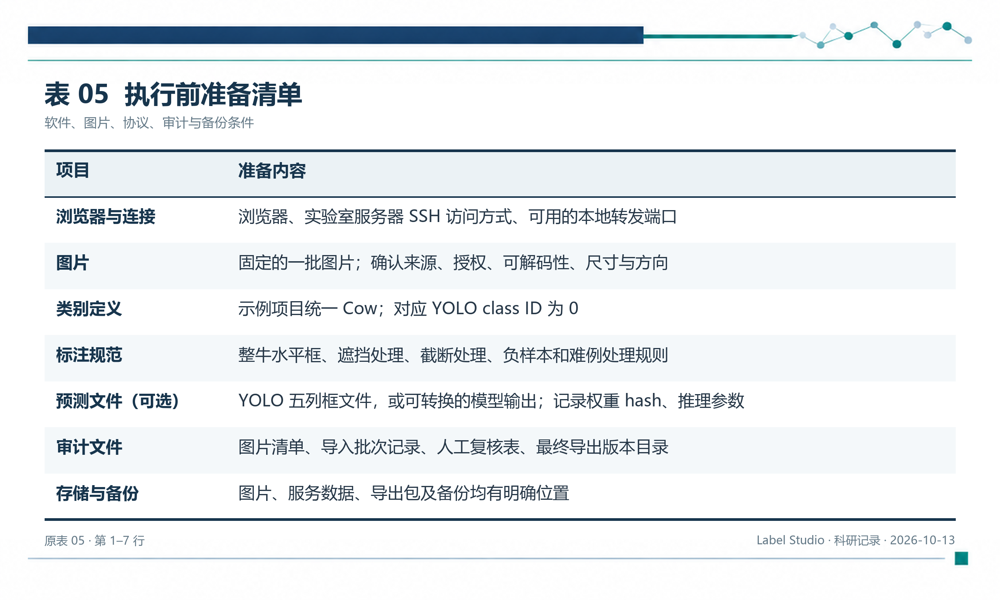

*表 05　执行前准备清单。[可编辑文字表](Label-Studio表格可编辑底稿.md#表-05-执行前准备清单)。*

**算力判断：** 单纯人工操作可先不接模型服务；离线预测由独立推理环境生成。Label Studio 官方支持外接 ML backend，但它意味着额外的服务部署、接口与数据访问配置。对本次固定批次标注，建议先验证离线导入流程，再评估是否需要在线预测。［O2，O12］

### 3.3 新建环境与既有环境的处理

已有稳定实例优先使用其已验证配置，不在共享环境中直接执行升级。若需要独立复现，可在新目录、新虚拟环境中固定版本。Label Studio **1.23.0 的 PyPI 元数据要求 Python ≥3.10、<4**；安装说明页中较低的 Python 版本描述不能替代这个版本的包约束。［O13，O14］

下面仅为 Windows 独立试验环境示例，**本次未执行安装**。选择一个尚不存在的工作目录，避免与已有实例混用：

```powershell
# 前提：已安装 Python 3.10，并已进入新建的独立试验目录
py -3.10 -m venv .venv
.\.venv\Scripts\python.exe -m pip install "label-studio==1.23.0"
.\.venv\Scripts\label-studio.exe version

$env:LABEL_STUDIO_LOCAL_FILES_SERVING_ENABLED = "true"
$env:LABEL_STUDIO_LOCAL_FILES_DOCUMENT_ROOT = "C:\ls-pilot\media"

# 预先创建 C:\ls-pilot\media\pilot_20261013\images 并放入试标图片
# 服务数据与图片分开保存；首次启动后在网页创建本人账户
.\.venv\Scripts\label-studio.exe start `
  --host 127.0.0.1 --port 8080 --data-dir "C:\ls-pilot\app-data"
```

官方本地存储文档特别提示 Windows 路径的反斜杠转义。上例为 PowerShell 字符串直接赋值；如果改写成 Python 字符串或 JSON，需要按对应语法处理转义。［O1］

## 4. 可行性分析与路线选择（Feasibility & Decision）

### 4.1 功能与限制

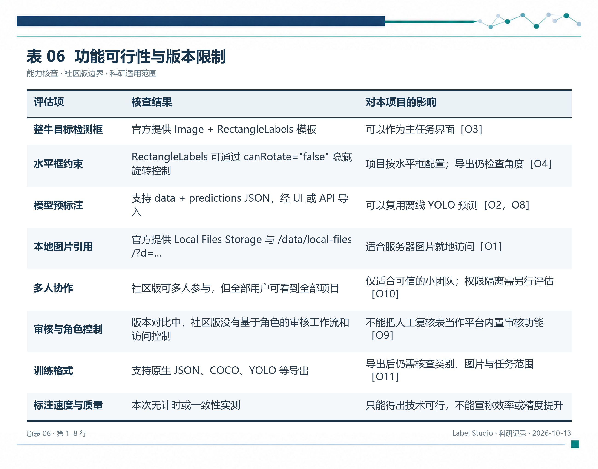

*表 06　功能可行性与版本限制。[可编辑文字表](Label-Studio表格可编辑底稿.md#表-06-功能可行性与版本限制)。*

### 4.2 三种路线的取舍

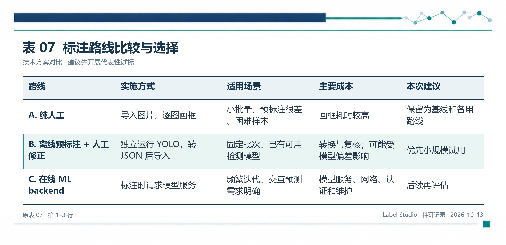

*表 07　标注路线比较与选择。[可编辑文字表](Label-Studio表格可编辑底稿.md#表-07-标注路线比较与选择)。*

路线 A、B、C 所用的能力分别来自标注、预标注与 ML 集成文档；表中的优先顺序是结合本地工作方式提出的方案判断。［O2，O6，O12］

**采用条件：** 小批量能完成完整导入—人工提交—复核—导出闭环，且导出数据通过检查。若路线 B 在相同质量标准下不比 A 节省总人工时间，则该批次选择 A；不因已有模型而强行使用预标注。

## 5. 操作步骤（Procedures / SOP）

### 5.1 先固定标注规则

以下为适合本项目试标的**拟议规则**，应由负责人确认后写入项目说明。已有数据集另有标注协议时，先判断能否兼容，不能直接覆盖其定义。

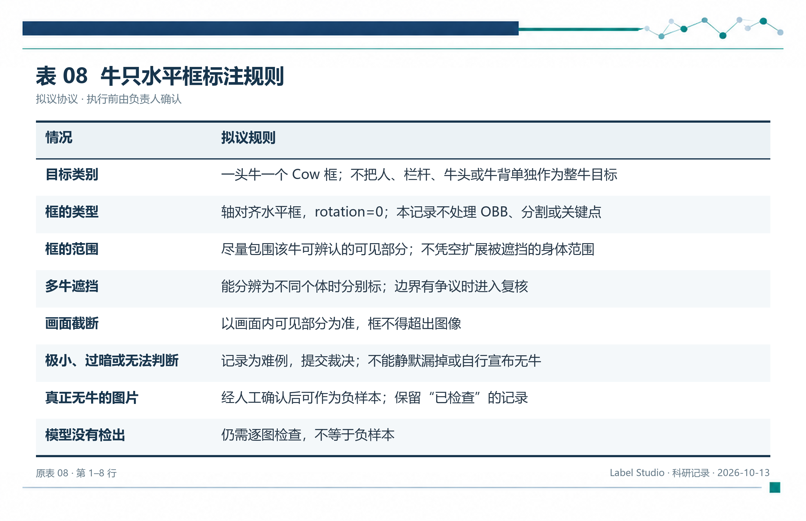

*表 08　牛只水平框标注规则。[可编辑文字表](Label-Studio表格可编辑底稿.md#表-08-牛只水平框标注规则)。*

**类别大小写要统一。** 本地指南使用 `Cow`，部分 CowCV 记录使用 `cow`。本次示例选择 `Cow`，转换时显式映射 `0 ↔ Cow`；如果既有项目使用 `cow`，则 XML、JSON、映射表全部改为同一拼写，不能同时保留两个近义类别。也不在已有标注完成后随意改名。［L1，L3，L5］

### 5.2 建立图片清单与目录

推荐对每个批次保留以下清单字段，作为项目管理约定：

```text
source_image_id,relative_path,sha256,width,height,dataset,group_id,split
```

`source_image_id` 为稳定的来源标识；`group_id` 可记录视频段、拍摄批次等关联关系。对连续帧或相同底图的变体，建议按组划分后续 train/val/test，避免近重复图片跨集合。划分和去重属于独立的数据治理步骤，不能由“成功导入标注平台”代替。

下面的 `pilot_20261013` 是**拟建试验批次**，不是已存在目录：

```text
/data1/yxli/ls-test/                  ← DOCUMENT_ROOT（历史实例参数）
└── pilot_20261013/
    └── images/
        ├── cow_001.jpg
        ├── cow_002.jpg
        └── negative_001.jpg

<本次工作目录>/                     ← 自行选择可写位置
├── image_manifest.csv
├── label_config.xml
├── class_map.json                  ← {"0": "Cow"}
├── predictions_yolo/               ← 原始模型预测，单独保留
├── tasks_with_predictions.json
├── import_ledger.csv
├── review_manifest.csv
└── exports/
```

核对图片与预测时，以**相对路径或稳定 ID**配对，不能只按文件 basename 匹配；不同子目录可能有同名图片。先固定图片方向和尺寸，再生成预测。本次操作不改写原始图片，也不覆盖 `/data1/yxli/new_labels/` 下已有的人工标签。［L3，L4］

### 5.3 访问或启动服务

**使用历史实验室实例时，先由有权限者确认服务状态。** 已运行则直接访问；下列命令是操作说明，本次未在服务器执行。

本地 PowerShell 建立隧道：

```powershell
ssh -p 55522 -N -L 8080:127.0.0.1:8080 yxli@211.69.141.71
# 保持窗口运行；浏览器访问 http://localhost:8080/
# 本地 8080 被占用时，可将 -L 改为 9090:127.0.0.1:8080
```

连接信息来自历史指南；若 SSH config 已有可用别名，可用别名替代。浏览器端口随本地转发端口改变。［L1，§0］

服务器端只读检查示例：

```bash
/data1/yxli/miniconda3/envs/label-studio/bin/label-studio version
tmux ls
curl -sS -o /dev/null -w "HTTP %{http_code}\n" http://127.0.0.1:8080/
```

入口返回 200 或跳转码只说明 HTTP 入口有响应，不能证明图片、登录、存储和标注流程全部正常。若服务未运行，由管理员核对脚本与端口后再按本地指南启动；不要为试标重启共享服务或同时拉起第二个占用相同端口的实例。

Linux 独立实例需要显式设置的图片访问变量为：

```bash
export LABEL_STUDIO_LOCAL_FILES_SERVING_ENABLED=true
export LABEL_STUDIO_LOCAL_FILES_DOCUMENT_ROOT=/data1/yxli/ls-test
```

变量必须进入实际运行服务的进程；修改后需重新启动相应实例才生效。图片根目录仅指向需要开放的媒体范围。［L1，§1–2；O1］

### 5.4 创建项目与标签界面

1. 登录网页，点击 **Create Project**。
2. 示例项目名：`CowCV_Pilot_20261013`。
3. 在说明中记录标注协议版本、批次 ID、类别和难例处理规则。
4. 在 **Settings → Labeling Interface** 中保存下面的 XML。

```xml
<View>
  <Header value="整牛水平框：逐图检查漏标、错标和边界"/>
  <Image name="image" value="$image" rotateControl="false"/>
  <RectangleLabels name="label" toName="image" canRotate="false">
    <Label value="Cow" background="#1F9D96"/>
  </RectangleLabels>
</View>
```

官方模板与标签文档支持上述矩形框配置；`canRotate="false"` 用于隐藏框的旋转控制，`rotateControl="false"` 隐藏图像旋转控制。仍需在导出时核查角度字段。［O2，O3，O4］

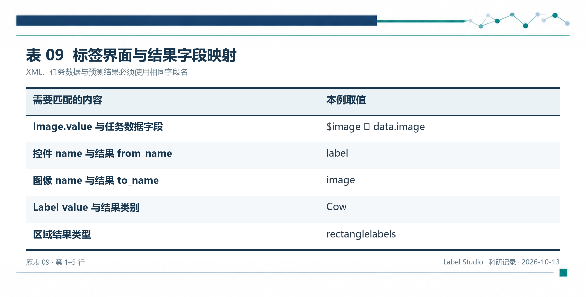

*表 09　标签界面与结果字段映射。[可编辑文字表](Label-Studio表格可编辑底稿.md#表-09-标签界面与结果字段映射)。*

这些映射决定预标注能否正确显示。项目优先通过 UI 或公开 API 创建；本地指南记录的直接 ORM / SQLite 操作只作为旧实例故障背景，不作为日常建项目的标准方法。［L1，§3；O2，O8］

### 5.5 注册本地图片存储

进入 **Settings → Cloud Storage → Add Source Storage → Local Files**。不同版本的菜单与分步界面可能略有不同，以实际页面为准。官方当前文档将连接路径写为 **Absolute local path**。［O1］

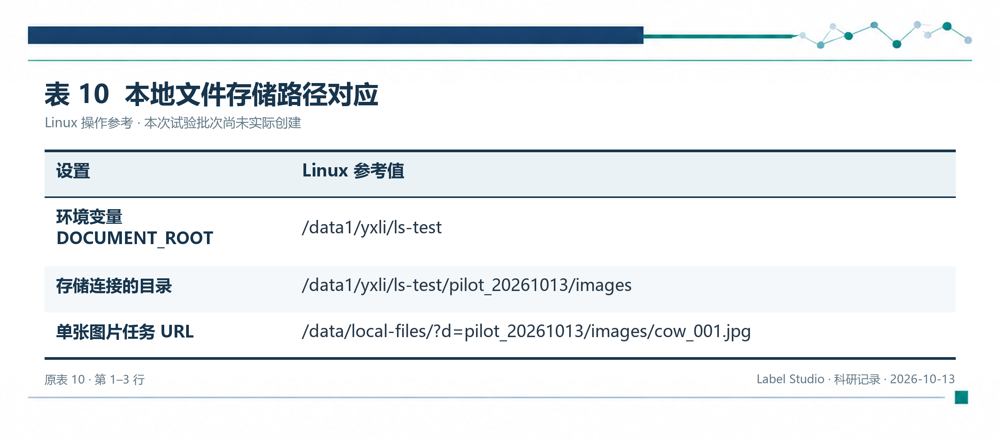

*表 10　本地文件存储路径对应。[可编辑文字表](Label-Studio表格可编辑底稿.md#表-10-本地文件存储路径对应)。*

**本地文件指运行 Label Studio 的机器上的文件**，不是浏览器所在电脑的 `C:\...`。Windows 独立实例则将存储目录改为本机媒体根下的实际子目录。

本记录选择“**先保存存储连接，再手动导入带 predictions 的 JSON**”路线。因此此步只 **Save**，不额外扫描图片生成另一批任务；如果界面有导入方式选项，按当前官方文档的任务引用方式配置。之后在第 5.7 节通过 Import 上传 JSON。［O1］

> **对旧指南的限定：** “不要 Sync”是本例为避免重复建任务而采用的流程选择。官方支持通过存储同步创建任务，也支持单独同步 JSON 任务文件；不能据此认定 Sync 功能普遍有错。本地出现 `$undefined$` 的情况应按当时实例和标签字段配置排查。［L1，§3；O1］

保存后，登录浏览器测试一张真实图片 URL。若图片打不开，先看第 7 节排障，不要反复导入或删除任务。

### 5.6 准备预标注与坐标转换

没有模型预测时，任务只包含 `data`，直接进入人工标注即可。有预测时，用官方 `predictions` 结构保存模型建议。以下示例和公式只适用于**未旋转的水平框**。［O2，O4］

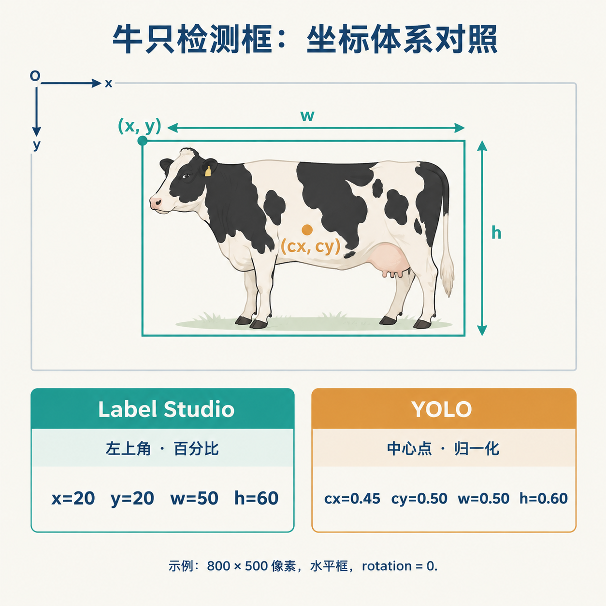

*图 2　使用 Study Image 绘制的坐标说明。图中位置关系为示意，不按数值比例绘制；计算以本节公式和数值例子为准。不是平台截图或真实数据样本。*

设 YOLO 一行是：

```text
class_id cx cy bw bh
```

其中中心坐标和宽高均相对于图像宽高归一化。LS 的 `x、y` 为左上角百分比，`width、height` 为宽高百分比。［O4，O15］

$$
x=100(c_x-b_w/2),\qquad y=100(c_y-b_h/2)
$$

$$
\mathrm{width}=100b_w,\qquad \mathrm{height}=100b_h
$$

反向转换：

$$
c_x=(x+\mathrm{width}/2)/100,\qquad
c_y=(y+\mathrm{height}/2)/100
$$

$$
b_w=\mathrm{width}/100,\qquad b_h=\mathrm{height}/100
$$

**数值检查例：** 图像 800×500，框左上角为 (160,100)，宽高为 (400,300)。则 LS 为 `(20,20,50,60)`；YOLO 为 `(0.45,0.50,0.50,0.60)`，文件一行为：

```text
0 0.450000 0.500000 0.500000 0.600000
```

下面是一个带预测的任务和一个不带预测的任务。图片名、ID 和模型版本均为**示例占位内容**，实际导入前替换为真实文件与推理来源。

```json
[
  {
    "data": {
      "image": "/data/local-files/?d=pilot_20261013/images/cow_001.jpg",
      "source_image_id": "pilot-cow-001"
    },
    "predictions": [
      {
        "model_version": "example-yolo11m-v1",
        "result": [
          {
            "id": "cow001-box1",
            "from_name": "label",
            "to_name": "image",
            "type": "rectanglelabels",
            "original_width": 800,
            "original_height": 500,
            "image_rotation": 0,
            "value": {
              "x": 20,
              "y": 20,
              "width": 50,
              "height": 60,
              "rotation": 0,
              "rectanglelabels": ["Cow"]
            }
          }
        ]
      }
    ]
  },
  {
    "data": {
      "image": "/data/local-files/?d=pilot_20261013/images/cow_002.jpg",
      "source_image_id": "pilot-cow-002"
    }
  }
]
```

结构依据官方预标注格式，自行加入的 `source_image_id` 用于来源追踪。`original_width/height` 必须来自实际图片，不能统一写成模型输入尺寸。［O2，O4］

转换时额外检查：

- **越界框：** 先转成两角 `x1,y1,x2,y2`，分别裁剪两角，再计算新宽高；不能只把负 `x` 改成 0 却保留原宽度。附录 A 提供可检查的转换函数。
- **错误类别或无效数值：** 遇到未知 class ID、NaN、无穷值、非正宽高时报错或进入异常清单，不静默丢弃。
- **文件名：** URL 路径中的空格、中文等需正确编码；从 URL 恢复文件名时要解析 `d` 参数并正确解码。
- **置信度：** 只有五列 YOLO 文件时通常没有保存置信度。不要把示例 `score=1.0` 当作模型真实置信度；可以省略 score。预测整体 score 的含义应事先约定，不能与单框置信度混用。［O2，O5，O15］

### 5.7 导入任务，并先做最小闭环验证

1. 新项目先导入 **3 张具有代表性的测试图片**：一张有正确预测、一张需要补漏框、一张人工确认无牛的候选负样本。数量是建议。
2. 在项目 **Import** 上传 JSON，检查任务新增数量与来源 ID。
3. 打开每个任务，核对图片、框、类别、尺寸与位置。
4. 按第 5.8 节提交，再按第 5.10 节导出原生 JSON，确认实际结果存在。
5. 最小闭环通过后，再导入第 6 节的试标批次，最后决定是否全量导入。

批量自动化可使用公开导入接口 `POST /api/projects/{id}/import`。官方资料说明其支持批量任务和 predictions；1.23.0 对应源码中也存在 `ImportAPI`，不能把旧笔记中的“API 走不通”解释为这个版本没有公开导入 API。［O8，O18］

**认证处理：** 当前官方文档区分 PAT 与 legacy token。PAT 是 refresh token，直接调用 HTTP API 时先经 `/api/token/refresh` 换取短期 access token，再用 `Authorization: Bearer ...`；legacy token 使用 `Authorization: Token ...`，且可能被组织设置禁用。SDK 可处理相应令牌流程。令牌通过受控环境变量或安全交互输入传递，不写入科研记录、任务 JSON 或日志。［O7］

**防重复原则：** 保存 `batch_id、source_image_id、task_id、导入时间、任务文件 hash` 的导入台账。重复上传、请求超时后的盲目重试，都应先核对项目中是否已经出现相应任务；不要假定导入接口会按文件名自动去重。

### 5.8 逐图标注与提交

1. 从 Data Manager 打开任务，或进入 **Label All Tasks**。
2. 确认图片与清单一致，先整体浏览牛只数量和位置。
3. 使用预标注时，确认已创建可编辑 annotation；若只看到只读预测，检查项目预测显示设置或使用复制功能。［O2］
4. 逐头检查，依次处理**补漏框、删错框、调边界、改类别**。
5. 放大检查小目标、遮挡处、画面边缘，不能只看已有框。
6. 对确定无牛的图片保留人工确认记录；对无法判断的图片进入难例清单。
7. 点击 **Submit** 保存，返回任务或导出抽查，确认没有仅停留在草稿状态。

常规画框与提交操作依据官方标注说明；具体快捷键查看当前实例的帮助，不复制未经确认的快捷键组合。［O6］

**Skip / Cancel 不等于负样本。** “没有 annotation”“取消的 annotation”“已检查且无牛的有效空结果”含义不同。若空框任务的提交行为在当前界面中无法确认，应增加明确的有无目标确认项或外部复核记录，并先验证导出结果；不要据空 `result` 就自动判定其为负样本。［O5；本项目管理建议］

### 5.9 复核、分歧裁决与最终结果选择

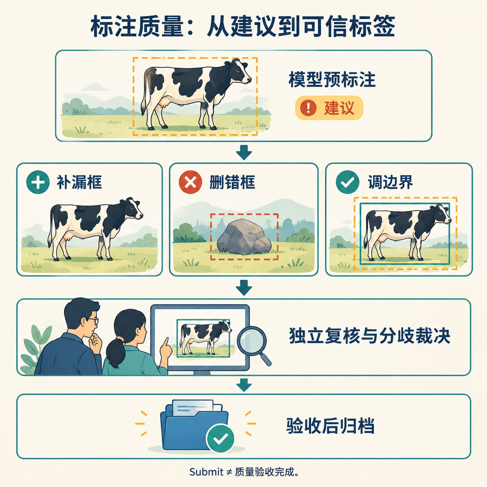

*图 3　使用 Study Image 绘制的质量管理示意。独立复核、裁决和归档是本项目拟定的管理环节；不表示社区版自带相同审核界面。*

社区版可多人参与标注，但没有完整的角色权限与审核工作流。建议小团队通过外部清单安排任务，并使第二位人员完成复核。需要独立重标的子集，可使用单独项目和固定图片清单，避免先看到他人的框后失去独立性。［O6，O9，O10；方案建议］

建议 `review_manifest.csv` 至少包含：

```text
source_image_id,task_id,approved_annotation_id,reviewer,decision,negative_confirmed,notes
```

其中 `decision` 使用 `accepted / revise / excluded`；这些是本项目自定义的复核字段，并非 Label Studio 内置状态。

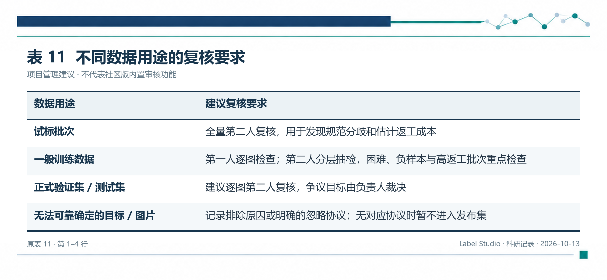

*表 11　不同数据用途的复核要求。[可编辑文字表](Label-Studio表格可编辑底稿.md#表-11-不同数据用途的复核要求)。*

正式转换时，依据 `approved_annotation_id` **每图选择一份最终结果**。不按“最新时间”自动判定审核通过，不把多人重复标注拼成双倍目标，也不把预测与人工框混入同一份 GT。

### 5.10 导出与训练前验收

先通过项目 **Export → JSON** 保留原生结果，再按需求导出 YOLO 或 COCO。原生 JSON 用于追溯任务、人工结果和预测来源；训练格式只作为派生副本。［O5，O11］

**导出范围注意：** 当前社区版官方说明指出，普通 UI 导出不按 Data Manager 页签筛选结果限制范围，并且可能包含取消的标注。因此，“页面上只看到已复核任务”不能证明导出包中只有已复核结果。应将导出数据与批准清单对账，筛出选定 annotation，并排除 `was_cancelled=true`、未完成和未获批准的记录。［O11］

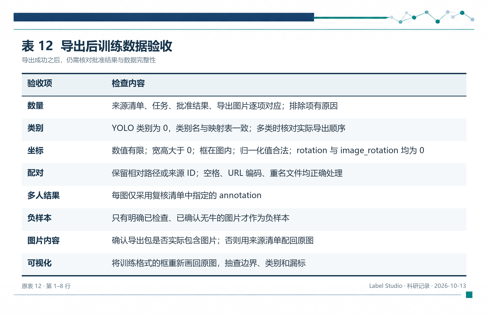

*表 12　导出后训练数据验收。[可编辑文字表](Label-Studio表格可编辑底稿.md#表-12-导出后训练数据验收)。*

官方导出文档提示类别默认存在排序规则；不要根据 XML 中的书写顺序猜测 YOLO class ID。普通 YOLO 导出也不应直接假定一定附带图片。［O11］

Ultralytics 检测格式要求每行 `class cx cy w h`，类别从 0 开始，坐标归一化到 0–1；无目标图片可以没有对应 txt。为方便本项目对账，可统一为已确认负样本保留空 txt，但这是一项项目约定，不是格式强制要求。**丢失标签文件与已确认负样本仍需通过清单区分。**［O15］

```yaml
# data.yaml 示例；须先实际建立对应的图片与标签目录
path: /path/to/released_dataset
train: images/train
val: images/val
test: images/test
names:
  0: Cow
```

只有实际存在独立测试集时才保留 `test` 项。验证集、测试集应保持预先确定的划分；标注版本变化需记录原因，不能用测试集结果反复挑选模型、阈值或标注规则。

### 5.11 版本归档与备份

建议每次发布固定一个新版本目录：

```text
CowCV_annotations_v01/
├── label_config.xml
├── class_map.json
├── image_manifest.csv
├── import_ledger.csv
├── review_manifest.csv
├── raw_export.json
├── labels/
├── data.yaml
└── README.md
```

README 记录 Label Studio 版本、标注规则版本、导出日期、图片与目标数量、排除项、模型权重 hash 和推理参数，以及最终批准结果的选择规则。此目录是发布建议，不表示本次已生成数据版本。

本地指南使用 SQLite。数据库运行期间的备份优先采用 SQLite 支持的一致性备份方式；不要把运行中数据库文件的普通复制视为可靠完整备份。下面是 CLI `.backup` 示例，要求目的目录可写且输出文件名未被使用：［L1，O16，O17］

```bash
sqlite3 /data1/yxli/label-studio-data/label_studio.sqlite3 \
  ".backup '/path/to/backups/label_studio-YYYYMMDD-HHMM.sqlite3'"
```

数据库备份之外，还需保留原始媒体、存储路径关系、项目配置与导出版本。数据库文件不能替代图片备份；原生 JSON 也不能替代服务的全部运行配置。

## 6. 试标实验设计与记录表（Pilot & Observations）

### 6.1 建议设计

**以下是待执行计划，本次没有试标数据。**

建议选取 100 张代表性图片，按单牛、多牛、遮挡、低照度、小目标、候选负样本分层。设置 50 张纯人工、50 张预标注修正，两组在各难度层尽量匹配；同一标注者交错处理两组，第二人按同一协议全量复核。数量是起始建议，实际样本不足时记录调整理由。

避免让同一人先完整标注一张图，再立即用另一种路线处理相同图片，否则会产生记忆影响。若需要对同图开展配对比较，可安排不同标注者，并交换两组人员与路线以减小人员差异。

### 6.2 记录模板

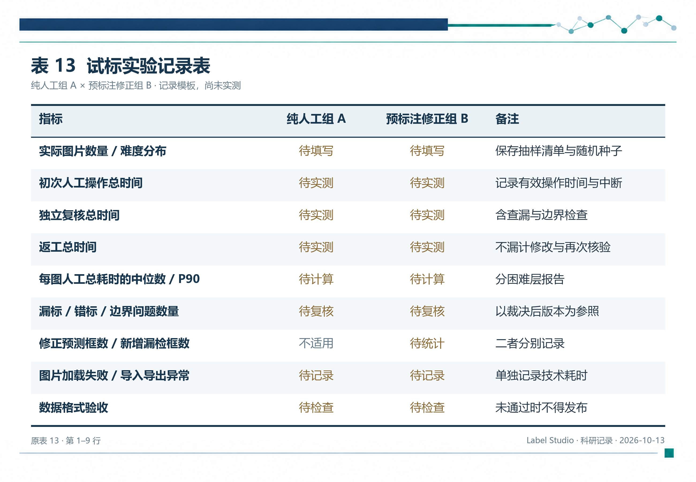

*表 13　试标实验记录表。[可编辑文字表](Label-Studio表格可编辑底稿.md#表-13-试标实验记录表)。*

### 6.3 分析方法

定义每图总人工时间：

$$
t_i=t_{\mathrm{首次操作},i}+t_{\mathrm{复核},i}+t_{\mathrm{返工},i}
$$

两组耗时应在相同质量标准、可比难度分布下分析；同时报告中位数、P90 和每个难度层。一次性配置时间与模型预测耗时另列，避免隐藏工程成本。

批次规划可使用以下估算式：

$$
T_{\mathrm{总投入}}=
T_{\mathrm{配置与转换}}+T_{\mathrm{模型推理}}
+\sum_{i=1}^{N}t_i+T_{\mathrm{导出验收}}
$$

该式用于估算各环节投入之和；若推理与人工操作重叠，日历工期应另按实际调度计算，不能直接等同。

如需检查两名标注者的框一致性，先对同类目标做一对一匹配，再报告 IoU、漏框与多框。**匹配 IoU 是标注比较的规则；模型 conf 是生成预标注的筛选参数，两者不能混用。**阈值需提前约定，一致性高也不自动代表两人都标对。

**推进判据：** 两条路线均先满足质量要求。若 B 的总人工耗时有稳定下降，且困难层没有明显增加漏标或返工，则考虑扩大；若收益仅出现在简单场景，可按场景混合使用 A 与 B。

## 7. 常见问题与旧指南的适用边界（Troubleshooting）

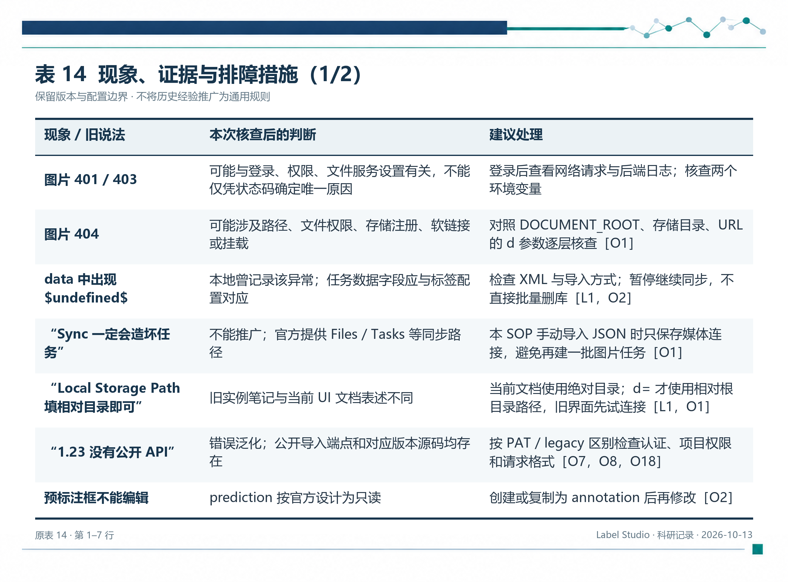

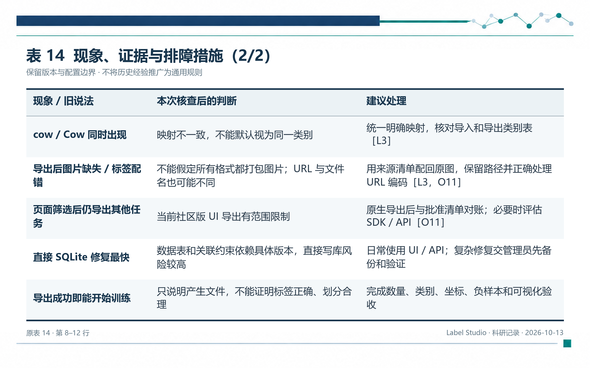

*表 14　现象、证据与排障措施。[可编辑文字表](Label-Studio表格可编辑底稿.md#表-14-现象证据与排障措施)。*

旧指南还包含 shell / ORM、多表删除与账号重置操作。本记录不将这些维护手段列入标注员日常步骤；若将来确需修复服务或数据库，应另立维护记录，说明具体实例、备份和操作范围。

## 8. 决策、后续计划与完成情况（Outcome & Next Steps）

### 8.1 当前决策

**技术路线建议：** 先复用已验证配置，开展小批量试标；以离线预标注修正为候选主路线、纯人工为对照，暂不优先部署在线 ML backend。

**决策理由：** 官方功能覆盖矩形框、预标注和导出；本地有历史使用记录；离线方式便于固定模型与预测版本。与此同时，困难图像的人工成本、当前服务器状态和最终导出质量尚未实测，因此当前结论限于“具备实施条件，值得试标”。［L1，L4，O2，O3，O11，O12；综合判断］

### 8.2 待执行事项

- [ ] 核实当前实例版本、端口、可用目录与管理员。
- [ ] 确认整牛框、遮挡、负样本和难例裁决规范。
- [ ] 完成 3 张图片的导入—标注—复核—导出闭环。
- [ ] 按第 6 节开展代表性试标，记录全部人工成本。
- [ ] 检查最终训练格式并将框回画到原图。
- [ ] 根据质量与耗时决定全量标注范围。
- [ ] 保存首个通过验收的标注版本，原始预测与人工 GT 分开归档。

### 8.3 本次记录完成情况

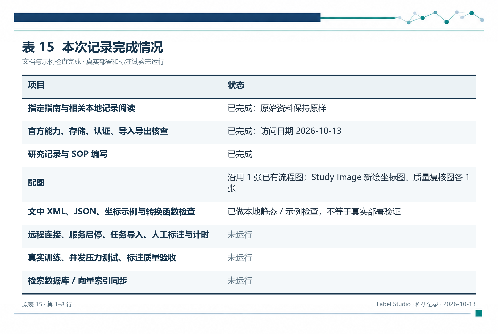

*表 15　本次记录完成情况。[可编辑文字表](Label-Studio表格可编辑底稿.md#表-15-本次记录完成情况)。*

---

## 附录 A. YOLO 水平框转 LS 的检查函数

下面是文中转换逻辑的最小辅助函数，并非全数据集转换程序。只处理已经解析的一行**五列 YOLO 水平框**；调用者仍需读取真实图片尺寸、逐文件配对、生成完整 JSON、检查重复来源 ID 并记录异常。

为保留错误的可见性，默认拒绝越界框。只有明确允许裁剪时才传入 `clip=True`；此时应在外层记录哪些框被裁剪。类别表必须与 XML 完全一致。

```python
import math

def yolo_box_to_ls(class_id, cx, cy, bw, bh, class_map, *, clip=False):
    """返回 Label Studio 的 value 字段；只适用于 rotation=0。"""
    if class_id not in class_map:
        raise ValueError(f"未知类别: {class_id}")
    values = (cx, cy, bw, bh)
    if not all(math.isfinite(v) for v in values):
        raise ValueError("坐标包含非有限值")
    if bw <= 0 or bh <= 0:
        raise ValueError("宽高必须大于 0")

    x1, y1 = cx - bw / 2, cy - bh / 2
    x2, y2 = cx + bw / 2, cy + bh / 2
    if not clip and not (0 <= x1 < x2 <= 1 and 0 <= y1 < y2 <= 1):
        raise ValueError("框越界；应先记录异常并检查来源")
    if clip:
        x1, y1 = max(0.0, x1), max(0.0, y1)
        x2, y2 = min(1.0, x2), min(1.0, y2)
    if x2 <= x1 or y2 <= y1:
        raise ValueError("裁剪后框为空")

    return {
        "x": round(x1 * 100, 6),
        "y": round(y1 * 100, 6),
        "width": round((x2 - x1) * 100, 6),
        "height": round((y2 - y1) * 100, 6),
        "rotation": 0,
        "rectanglelabels": [class_map[class_id]],
    }
```

处理文件名时，不要直接对 `/data/local-files/?d=...` 执行 `split("/")[-1]`。可按下面的方式取出媒体相对路径；`parse_qs` 已执行查询参数解码，不要再次重复解码：

```python
from urllib.parse import parse_qs, unquote, urlsplit

def media_reference(image_url):
    parsed = urlsplit(image_url)
    params = parse_qs(parsed.query)
    if "d" in params:
        return params["d"][0]
    return unquote(parsed.path).lstrip("/")
```

该函数只帮助解析引用，**不负责寻找本地文件或证明其属于哪张图**。真正配对应优先使用 `source_image_id` 与图片清单；还需处理 `/data/upload/` 的服务生成前缀和重名情况。

## 附录 B. 来源与定位（References）

以下 `L` 为本地个人记录，`O` 为官方资料。正文的 `［Lx］`、`［Ox］` 对应此处编号。外部资料访问日期均为 **2026-10-13**；官方站点是持续更新文档，具体实例须核对实际版本。

### B.1 本地资料

- **L1** — [Label-Studio操作指南](../服务器/Label-Studio操作指南.md)：§0 实例参数；§2 本地文件；§3 导入；§5 转换；§6 维护背景；§7 导出；§10 的 2026-07-12 快照。含历史配置和经验性判断，本记录未复核服务器现状。
- **L2** — [label studio](../牛只数据集/label%20studio.md)：早期 CLI 命令整理。仅作使用背景，具体版本和接口以当前官方资料及实际安装版本为准。
- **L3** — [71相关](../服务器/71相关.md)：“数据集”中的预测图片、人工标签路径与文件名编码问题；末尾 `cow/Cow` 类别提示。作为个人环境记录引用。
- **L4** — [7月工作](../牛只数据集/7月工作.md)：§2.3 标签来源；§9.1 CVBD-5 的标签质量、预标注修正成本与阶段决策。属于历史研究记录。
- **L5** — [拍摄环境与场景](../牛只数据集/拍摄环境与场景.md)：NWAFU Cattle Dataset、CBPD_ODD 等条目的原始任务与 CowCV 整牛水平框范围。

### B.2 官方资料

- **O1** — [Set up local project storage](https://labelstud.io/guide/storage_local)：环境变量、Absolute local path、Files / Tasks、Save / Sync、`d=` 相对路径。
- **O2** — [Import pre-annotated data](https://labelstud.io/guide/predictions)：`predictions` 结构、模型版本、只读预测、复制为 annotation、图像百分比坐标。
- **O3** — [Object Detection with Bounding Boxes](https://labelstud.io/templates/image_bbox)：图像矩形框标注模板及配置。
- **O4** — [RectangleLabels tag](https://labelstud.io/tags/rectanglelabels)：`canRotate`、真实图片尺寸及坐标字段定义。
- **O5** — [Label Studio Task Format](https://labelstud.io/guide/task_format)：`annotations`、`predictions`、`was_cancelled`、人员与时间字段。
- **O6** — [Label and annotate data](https://labelstud.io/guide/labeling)：打开任务、提交、多人标注、界面操作。
- **O7** — [Access tokens](https://labelstud.io/guide/access_tokens)：PAT / legacy token、JWT refresh 与 Bearer 认证。
- **O8** — [Import tasks — API Reference](https://api.labelstud.io/api-reference/api-reference/projects/import-tasks)：公开批量任务导入端点、配置校验与响应。
- **O9** — [Compare Label Studio Editions](https://labelstud.io/guide/label_studio_compare)：社区版的角色工作流与访问控制边界。
- **O10** — [Add users to Label Studio](https://labelstud.io/guide/signup)：社区版账户与项目可见性。
- **O11** — [Export Annotations](https://labelstud.io/guide/export)：导出格式、社区版 UI 范围、取消结果、类别顺序及 JSON 字段。
- **O12** — [Integrate Label Studio into your ML pipeline](https://labelstud.io/guide/ml)：外接 ML backend、预测与数据访问。
- **O13** — [Installation](https://labelstud.io/guide/install.html)：虚拟环境安装与部署方法；通用页的 Python 版本描述与包元数据不完全一致。
- **O14** — [PyPI: label-studio 1.23.0](https://pypi.org/project/label-studio/1.23.0/)：这个固定版本的 Python 约束，不表示本记录推荐自动升级。
- **O15** — [Ultralytics Object Detection Datasets](https://docs.ultralytics.com/datasets/detect/)：YOLO 五列格式、归一化坐标、类别编号、无目标图片与数据集配置。
- **O16** — [SQLite Command Line Shell](https://www.sqlite.org/cli.html)：`.backup` 命令。
- **O17** — [SQLite Online Backup API](https://www.sqlite.org/backup.html)：运行中数据库的一致性备份背景。
- **O18** — [Label Studio 1.23.0: data_import/api.py](https://github.com/HumanSignal/label-studio/blob/1.23.0/label_studio/data_import/api.py)：对应版本源码中的 `ImportAPI`，用于核查“没有公开导入 API”的泛化说法。

### B.3 配图与可追溯说明

- 图 1：沿用本目录已有 `Label-Studio.assets/标注流程概览.png`，未修改原图；此前生成过程本次未核实。
- 图 2、图 3：2026-10-13 使用 Study Image 生成，主题分别为坐标体系与质量复核；已人工检查文字和流程。
- 全部配图仅表达操作或概念，不作为实验数据、产品截图、标注精度或效率提升的证据。


### B.4 科研表格版式与可编辑底稿

- 全文 15 张表、96 行内容使用统一的白底、深蓝标题与细线表格版式，生成 16 幅 2600 像素宽的高清图；较长的排障表分为两幅，重复表头并保留原行顺序。
- 版式底图由 Study Image 于 2026-10-13 生成；表中文字在本地从原始 Markdown 精确排入，避免模型绘字造成路径、引用编号和数值错误。原有“待实测”“待复核”“未运行”等状态保持原样。
- [表格可编辑底稿](Label-Studio表格可编辑底稿.md)保存全部原表，可继续填写、检索和复核；更新内容时，应同步对应的表图，避免文字与图片不一致。
- 表 15 保留原调研完成情况。本轮新增的科研表图、底稿与排版检查记于本节和当天维护日志；本轮仍未开展远程操作或真实标注试验。

---

记录人确认：________　日期：________　　复核人确认：________　日期：________
