# 三种模型测试

> **实验编号：** EXP-202608-COWCV-3MODEL  
> **实验名称：** RetinaNet R50-FPN、YOLO11s 与 YOLO11l 的牛只目标检测训练与评估  
> **历史实验时段：** RetinaNet 队列于 2026-08-06 22:18:56 完成；YOLO11s/l 的补充记录记载队列于 2026-08-28—2026-08-29 运行，具体时间见 §4.6。历史时间戳的时区未注明。  
> **整理与文献核查日期：** 2026-10-14（北京时间）  
> **记录性质：** 依据既有实验记录进行的阶段总结、数值复算与方法核查  
> **记录人：** __________　　**审核人：** __________  
> **计算资源：** NVIDIA A100-PCIE-40GB；温湿度不作为本计算实验的控制变量  
> **格式依据：** [实验记录格式参考](实验记录格式参考.md)的七项实验记录结构；将“试剂与耗材”调整为“数据、软件与计算资源”。

**本阶段的主要产出：** 两份主记录记载，三种模型分别完成 14 个牛只数据集的训练，共形成 42 个模型—数据集组合的历史结果。复算得到 YOLO11s、YOLO11l 的原协议 mAP50–95 等权宏平均为 **0.7406、0.7448**，RetinaNet 的最佳验证宏平均为 **0.7001**。YOLO11l 在 9/14 个数据集上高于 YOLO11s，但跨框架的输入、seed、选模方式及两个数据集的评估 split 不一致，因此三项宏平均用于阶段性描述。［L1，§1、§3；L2，§1、§4–6；本记录复算］

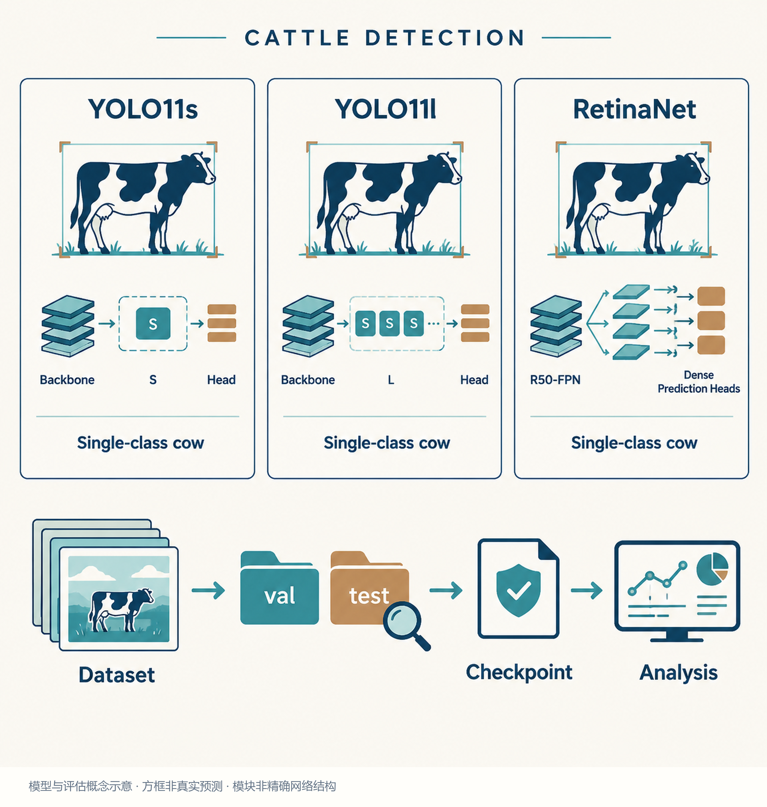

*图 1　三模型研究概览。Study Image 绘制；牛只、方框与网络模块均为概念示意，不是真实预测结果，也不表示精确网络拓扑。*

[TOC]

---

## 1. 实验目的（Objective）

### 1.1 研究问题

多来源牛只图像具有不同的拍摄角度、目标密度和标注规模。本阶段需要建立可追溯的检测基线，回答三个具体问题：

1. **训练与评估链路能否稳定完成？** 在固定单类别 `cow` 的数据视图上，验证数据读取、预训练初始化、训练、选模、复评及结果归档。
2. **同一 YOLO 系列增大模型容量是否普遍有益？** 比较 YOLO11s 与 YOLO11l 的逐数据集差值，检查整体提升是否掩盖了局部下降。
3. **如何解释 RetinaNet 与 YOLO 的阶段结果？** 对照框架、输入、训练精度、batch、seed、checkpoint 和 split，识别能比较的读数与仍需补齐的条件。［L1–L2；研究设计综合］

本阶段不以“某一种架构全面优于其余架构”为预设结论。已有结果来自逐数据集训练后在本域评估，尚不能证明跨数据集泛化能力。

### 1.2 证据与完成事项

**历史执行事实**主要来自 [Retinanet测试](../牛只数据集/Retinanet测试.md)和 [yolo11SL](../牛只数据集/yolo11SL.md)。[效率日志提取](../牛只数据集/_效率数据_远程日志提取_20260908.md)用于补查 YOLO 队列时间与 batch；[7月工作](../牛只数据集/7月工作.md)的 §13.6–13.7 用于核对重复图像审计。官方文档和指定版本源码用于核查接口与方法，不能替代历史实例的有效配置。［L1–L4；O1–O10］

本次实际完成：本地资料阅读、官方指南与原论文检索、展示读数复算、科研记录编写、图表绘制和文件检查。**本次未连接远程服务器，未运行训练或推理，也未打开历史远程 checkpoint、逐轮 CSV、逐图预测或重复成员清单。** 文中远程路径按原记录登记，当前存在性待实地核查。

### 1.3 判读规则

- **来源事实：** 文档明确记载的配置、数量、时间、指标和异常处理。
- **综合与复算：** 从展示读数算出的等权平均、差值、占比和分组统计。
- **推断：** 过拟合、场景复杂度或训练不稳定等候选解释，需新增证据验证。
- **待核实：** 配置冲突、成员一致性、权重身份、有效后处理及原始日志当前状态。

上述四类内容在相应章节分别说明，不将历史整理写成当天新完成的训练实验。

## 2. 实验原理与参考依据（Principle & References）

### 2.1 三种模型的比较意义

**YOLO11s 与 YOLO11l：** 属于 Ultralytics YOLO11 检测模型系列的不同规模版本，用于考察同系列容量变化对单类别任务的影响。官方模型页提供模型系列与支持任务的信息；其中 COCO 官方成绩、T4 延迟等数值与本项目数据和硬件不同，不作为本记录的实测结果。［O1；L2］

**RetinaNet R50-FPN：** 采用 ResNet-50 主干、特征金字塔与密集检测头。Focal Loss 原论文针对密集检测中大量易分背景样本的问题，通过降低易样本的损失权重，使训练更关注难样本。其一般表达式为：

$$
\operatorname{FL}(p_t)=-\alpha_t(1-p_t)^\gamma\log p_t.
$$

其中 $p_t$ 为真实类别的预测概率，$\alpha_t$ 控制类别权重，$\gamma$ 控制易样本降权程度。MMDetection v3.3.0 官方 RetinaNet 基础配置采用 Focal Loss；**本次未打开项目生成的有效配置，不能将官方基础配置的所有超参数自动认定为历史 run 的实际值。**［O10，§3–4；O6；L1，§2.3］

三种模型均执行单类别水平框检测。YOLO 标签中的类别 `0` 与 COCO JSON 中的 `category_id=1` 属于不同格式的编码；只要映射到同一类别语义，两者不构成类别数量冲突。MMDetection 自定义数据指南要求类别元信息、标注 `categories`、检测头 `num_classes` 和标注引用一致。［L1，§2.2；L2，§2.2；O4］

### 2.2 主指标与辅助指标

检测框与真实框的重叠度定义为：

$$
\operatorname{IoU}=
\frac{|B_{\mathrm{pred}}\cap B_{\mathrm{gt}}|}
{|B_{\mathrm{pred}}\cup B_{\mathrm{gt}}|}.
$$

本记录的主指标为：

$$
\operatorname{mAP}_{50:95}
=\frac{1}{10}\sum_{t\in\{0.50,0.55,\ldots,0.95\}}
\operatorname{AP}_{t}.
$$

单类别时无需再对多个类别取平均。mAP50 是 IoU=0.50 的 AP，mAP50–95 同时考虑更严格的定位要求；COCO 官方评估源码采用上述十个匹配阈值。**指标名称一致不保证两个框架的匹配、插值、预测截断及后处理完全等价。**［O9，`Params.setDetParams()`；O7，`compute_ap()`］

辅助读数为：

$$
P=\frac{TP}{TP+FP},\qquad
R=\frac{TP}{TP+FN},\qquad
F_1=\frac{2PR}{P+R}.
$$

本地 YOLO 文档给出了 P/R，RetinaNet 正式表没有逐域 P/R，因此不补造三模型 P/R 排名。官方 v8.4.92 `ap_per_class()` 在平滑后的平均 F1 曲线上选取工作点并返回 P/R；这些汇总值不能直接改写为固定 `conf=0.25` 的结果。［L1，§3；L2，§4–5；O7，`ap_per_class()`］

### 2.3 三个容易混淆的“阈值”

1. **预测置信度过滤：** 决定哪些候选框进入后续评估。
2. **NMS IoU：** 控制预测框之间的重复抑制；Ultralytics `model.val(iou=...)` 中的 `iou` 指此设置。
3. **AP 匹配 IoU：** 决定预测框与真实框是否匹配，本记录主指标取 0.50—0.95。

历史评估入口没有在两份主文档中完整列出所有阈值。当前官方文档用于理解参数含义，历史值仍须从 `metrics.json`、有效配置和当时安装源码确认。后续若补固定工作点 P/R/F1，应在 AP 主评估之外单独记录置信度阈值、匹配 IoU 和一对一匹配规则。［O2；O7；本项目建议］

### 2.4 权重选择与评估独立性

RetinaNet 使用验证集 `coco/bbox_mAP` 最大的 epoch；YOLO 复评加载每个 run 的 `weights/best.pt`。本记录将“训练曲线峰值轮次”“实际复评权重”和“第 100 轮结果”分开。［L1，§2.3–2.4、§3；L2，§3–5］

`yolo11SL.md` 将 `best.pt` 与峰值轮次可能不同归因于“综合 fitness”。但本次打开的官方 v8.4.92 `Metric.fitness()` 权重为 `[0, 0, 0, 1]`，仅使用 mAP50–95；trainer 按最佳 fitness 保存 `best.pt`。**原文解释与指定版本源码存在冲突，原因尚不能确定。** 应核查历史安装源码、是否有自定义修改、checkpoint 元数据、并列峰值及复评条件，不能简单用“综合 fitness”消除差异。［L2，§4；O7–O8］

val 参与选模，其峰值适合报告开发阶段表现。YOLO 的两个 `test` 视图与其余 val 分开登记；目录名为 test 还需结合来源隔离和重复审计判断独立性。`diarycow` 已存在训练到 test 的精确重复记录，不能将其读数解释为完全无泄漏的独立评估。［L2，§1、§8；L4，§13.6］

## 3. 数据、软件与计算资源（Materials & Environment）

### 3.1 模型环境与实际配置

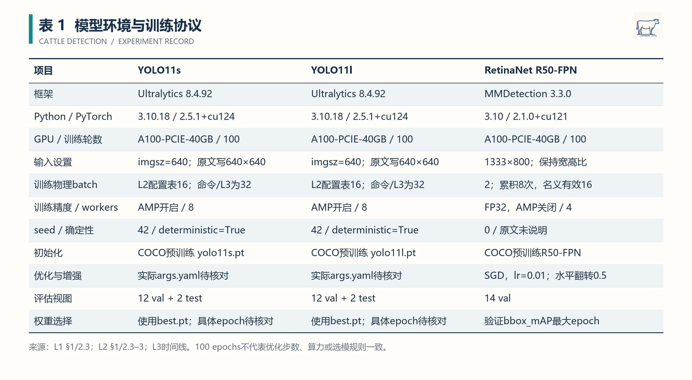

*表 1　按模型分别登记环境与协议。相同 GPU 与相同 epoch 数，不代表输入成本、优化步数或随机性控制相同。*

RetinaNet 的物理 batch 为 2，梯度累积 8 个 micro-batch，名义有效 batch 为 16；FP32、AMP 关闭。学习率为 0.01，SGD momentum=0.9、weight decay=0.0001；前 500 iterations warmup，起始系数 0.001；第 67、92 epoch 各乘 0.1。输入保持宽高比缩放到 `1333×800`，水平翻转概率 0.5。末批不足时的实际累积语义仍需查看有效实现。［L1，§2.3］

YOLO 的配置表写 `batch=16`，示例训练命令写 `--batch 32`，效率日志补充记录也写 s/l 使用 `batch=32、nbs=64`。本记录同时保留这些证据，暂不将某一值全局认定为全部历史 run 的事实。**训练 batch、评估 batch、名义有效优化批量是三个字段；不能看到评估命令中的 32 就推定训练 batch。**［L2，§2.3–2.4、§3.1；L3，时间线］

YOLO 文档记录 `imgsz=640` 并表述为 `640×640`。本次未直接核查训练或验证中的 letterbox、矩形 batch 与实际输入张量，因此表中按“输入设置”登记。也不将 RetinaNet 的 `1333×800` 缩放上限直接理解为每张图都拉伸成该固定尺寸。［L1–L2；待核实］

### 3.2 数据规模与版本

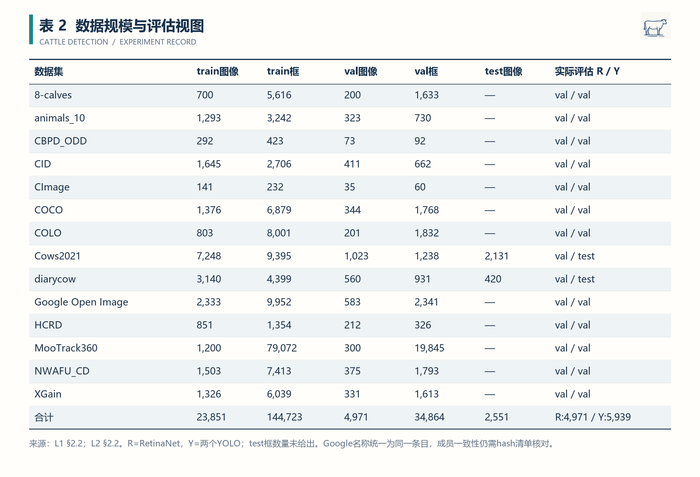

*表 2　沿用两份主记录的 14 个数据集。训练图像及框合计 23,851 / 144,723，val 合计 4,971 / 34,864；既有 test 合计 2,551 张。*

RetinaNet 在 4,971 张 val 图像对应的划分上验证。两个 YOLO 分别将 Cows2021 的 1,023 张 val 替换为 2,131 张 test，将 diarycow 的 560 张 val 替换为 420 张 test，因此每个 YOLO 原协议复评视图合计为：

$$
4971-1023-560+2131+420=5939\ \text{张}.
$$

上述是逻辑条目数量；不等于跨划分去重后的独立图片数。三个模型的训练/val 数量相同，也不足以证明各图片与标签成员逐项一致。正式比较应核对样本清单、图片 hash 和标签 hash。［L1，§2.2；L2，§2.2；本记录复算］

`COCO`、`NWAFU_CD`、`CImage` 的 YOLO 有效目录使用 `COCO_new1class`、`NWAFU_CD_new1class`、`CImage_new1class`，以区别于修正前的多类别视图。两文档中的 `Google Open Image` 与 `Google Open Image Dataset` 在本记录统一显示为前者；其训练/val 数量对应，但成员一致性仍需清单确认。`diarycow` 保留项目原拼写，不静默改写其目录名。［L2，§2.2、§7；L1，§2.2］

### 3.3 原始产物定位

历史远程项目根目录：

```text
/data1/yxli/CODE/ultralytics/self_mAP/
```

RetinaNet：

```text
scripts/train_retinanet.py
scripts/run_retinanet_all.sh
logs/retinanet_14/100ep_ebs16/summary.log
outputs/retinanet/100ep_ebs16/<dataset>/epoch_N.pth
outputs/retinanet/100ep_ebs16/<dataset>/best_coco_bbox_mAP_epoch_N.pth
outputs/retinanet/100ep_ebs16/<dataset>/last_checkpoint
```

YOLO11s / YOLO11l：

```text
logs/yolo11s_14/summary.csv
logs/yolo11s_14/summary.json
logs/yolo11l_14/summary.csv
logs/yolo11l_14/summary.json
logs/yolo11_eval.status
outputs/yolo11s/<run>/results.csv
outputs/yolo11l/<run>/results.csv
outputs/yolo11s/<run>/weights/{best,last}.pt
outputs/yolo11l/<run>/weights/{best,last}.pt
outputs/evaluations/yolo11s/<run>_<split>/metrics.json
outputs/evaluations/yolo11l/<run>_<split>/metrics.json
```

这些是原记录中的定位信息。本次没有下载或验证远程产物，也没有为缺失的权重、标签版本或原始文件生成虚构 hash。仅对本次读取的五份本地来源保存了 SHA-256。［L1，§2、§5；L2，§2、§3、§7］

## 4. 实验步骤（Procedures / Protocol）

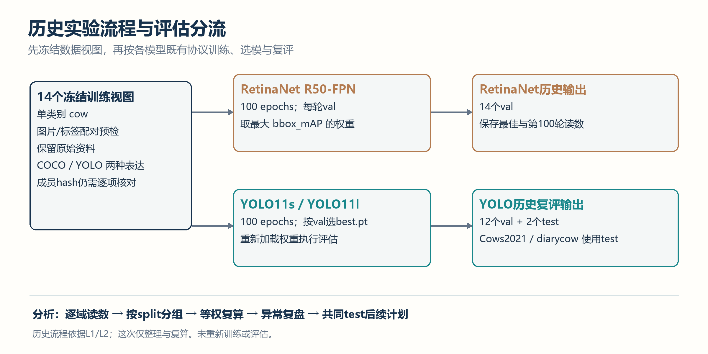

*图 2　依据原记录重建的流程。RetinaNet 的 14 个 val 输出与 YOLO 的 12 val + 2 test 输出分别登记。*

### 4.1 冻结视图与预检

1. 沿用现有训练/验证/测试划分，不重新随机划分、不改原始图片和标签。
2. YOLO 检查 YAML、split 目录、图片标签配对、单类别 `0 cow`、既定图像数量及两套 test 目录。
3. RetinaNet 检查 `instances_train.json`、`instances_val.json`、单类 COCO 定义、图片目录/软链接、JSON 图像数量、`CocoDataset` 构建及有效配置生成。
4. 两份主记录均记载 14 个数据集通过预检。预检证明当时文件链路可用；内容级重复和来源分组另做审计。［L1，§2.2；L2，§2.2］

### 4.2 RetinaNet 烟雾测试

正式队列前，在 CImage 上执行 1 epoch 的真实 GPU smoke test，验证权重初始化、单类检测头、训练、验证与 checkpoint 保存。原文记录 `mAP50–95=0.535、mAP50=0.666`。这两项只证明当时链路可运行，**不纳入 100 epoch 正式结果与宏平均**。［L1，§2.5］

### 4.3 正式串行训练与恢复

RetinaNet 按固定顺序串行训练 14 个数据集，每轮验证，保存普通 epoch 权重与最佳权重。中断后由 `last_checkpoint` 恢复，已完成数据集跳过。原记录称训练显存约 2.5—3.9 GB、未出现 OOM；该范围按原文保留，未与本次实时监控核对。［L1，§2.1、§2.3–2.4］

YOLO 两套模型各自按固定顺序执行 14 集队列，保存 `results.csv`、`best.pt`、`last.pt`；中断可由 `last.pt` 继续。原记录称两套模型全部训练到 100 epochs。为了保持跨模型串行约束，后续运行应明确两套队列的先后关系；文档里的两个后台启动示例不能单独证明两套队列互斥。［L2，§2.3–2.4；L3，顺序队列时间线］

以下入口来自原文，供追溯使用；**本次未执行**：

```bash
# 位于历史远程项目的 Ultralytics 环境
python scripts/check_yolo11s.py --json logs/yolo11s_14/preflight.json
python scripts/check_yolo11l.py --json logs/yolo11l_14/preflight.json

# 只展示队列预览入口；真实训练batch须先解决16/32冲突
bash scripts/run_yolo11s_all.sh --dry-run
bash scripts/run_yolo11l_all.sh --dry-run
```

### 4.4 最佳权重复评

YOLO 评估脚本加载各 run 的 `weights/best.pt`，在对应 YAML 中使用既有 split：Cows2021、diarycow 选 test，其余选 val；输出逐数据集 `metrics.json` 和可视化。原文入口：

```bash
python scripts/evaluate_yolo11s.py --all \
  --imgsz 640 --batch 32 --device 0 --workers 8
python scripts/summarize_yolo11s.py

python scripts/evaluate_yolo11l.py --all \
  --imgsz 640 --batch 32 --device 0 --workers 8
python scripts/summarize_yolo11l.py
```

以上 `batch=32` 是复评入口参数；不替代训练 batch 核查。原文记录 `--all` 曾因 `nargs="*" + choices` 的空列表解析报错，改为解析后显式检查数据集名称后重跑成功，评估状态为两模型各 14/14。该修复是历史文档所述，本次未复现错误或运行修复脚本。［L2，§3.1–3.2］

### 4.5 后续标准复评接口

Ultralytics 官方 `model.val()` 支持显式指定数据与 split。后续核对同一评估视图时，应显式登记这些字段，而不是依赖未记录的隐含默认值。下面是**建议模板，未执行**：

```python
from ultralytics import YOLO

model = YOLO("/path/to/frozen/best.pt")
metrics = model.val(
    data="/path/to/frozen/dataset.yaml",
    split="test",
    imgsz=640,
    batch=32,
    device=0,
    workers=8,
)
print(metrics.box.map50, metrics.box.map)
# 还须单独冻结并记录conf、NMS、max_det、输入几何与评估器版本。
```

MMDetection 3.3.0 官方提供 `python tools/test.py CONFIG_FILE CHECKPOINT_FILE`。对 RetinaNet 重评时，应使用该 run 的有效配置，核对 `test_dataloader`、标注文件与 `test_evaluator`，再指定冻结权重；单看 `test.py` 名称不能判定其读取独立 test。主记录没有给出历史有效配置文件的具体名称，故不编造一条可直接执行的本项目命令。［O2；O5］

### 4.6 关键时间与执行证据

- **2026-08-06 22:18:56：** RetinaNet 14 集队列完成，原记录退出码为 0。［L1，§1］
- **2026-08-28 12:55—2026-08-29 14:04：** 补充效率记录称 YOLO11s/l 按顺序连续执行队列；未在本次打开逐 run 时间日志。［L3，末尾时间线］
- **2026-10-14：** 完成本科研记录的资料核对、统计复算与图表制作；历史时间戳未重新解释为本次运行时间。

## 5. 原始读数与过程现象（Data & Observations）

### 5.1 三模型逐数据集读数

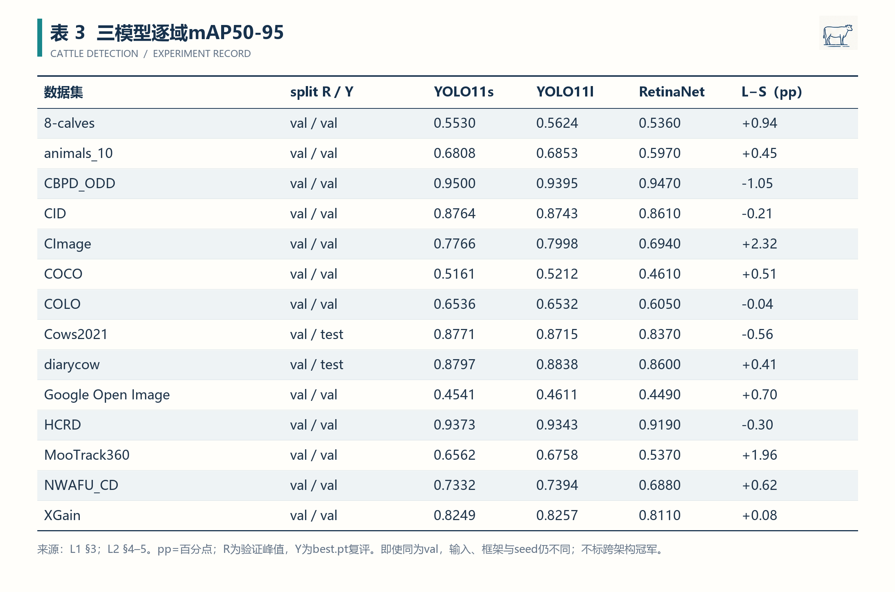

*表 3　原文正式读数的整理。RetinaNet 为 100 epochs 中最佳验证 mAP50–95；YOLO 为 `best.pt` 在对应 split 上的复评值。差值仅在两个 YOLO 之间计算。*

关键观察：

1. 两个 YOLO 均在 CBPD_ODD 上取得较高读数：s 为 0.9500，l 为 0.9395；RetinaNet 的最佳 val 为 0.947。三个值接近，但仍不替代统一实现的正式比较。［L1，§3；L2，§4–5］
2. Google Open Image 与 COCO 在三份历史结果中的 mAP50–95 相对较低。场景复杂度、框尺度、标注质量和模型适配均为候选因素，尚缺分层误差证据，不能只用一个 AP 将原因定为“场景复杂”。［L1–L2；综合与推断］
3. MooTrack360 的训练框为 79,072、训练图像为 1,200，平均约 65.9 框/图；val 为 19,845 框、300 张图，平均约 66.2 框/图。平均值不证明每张图都小于预测上限，应另查每图实例数分布。［L1，§2.2；本记录复算］

### 5.2 辅助指标

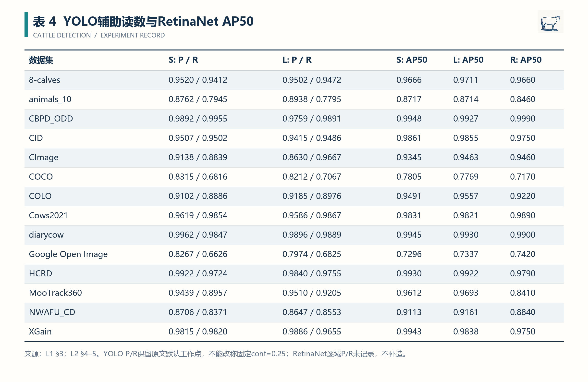

*表 4　保留两个 YOLO 的 P/R 与三模型 AP50。P/R 未升级为统一固定置信度工作点；RetinaNet 缺失的逐域 P/R 不填入推测值。*

例如 Google Open Image 的 YOLO11s P/R 为 0.8267/0.6626，YOLO11l 为 0.7974/0.6825。两个读数显示这一默认工作点下 precision 与 recall 的变化方向不同；在工作点及预测文件未核对前，不能将其解释为部署阈值固定时的严格召回提升。［L2，§4–5；O7］

### 5.3 峰值轮次、末轮与异常现象

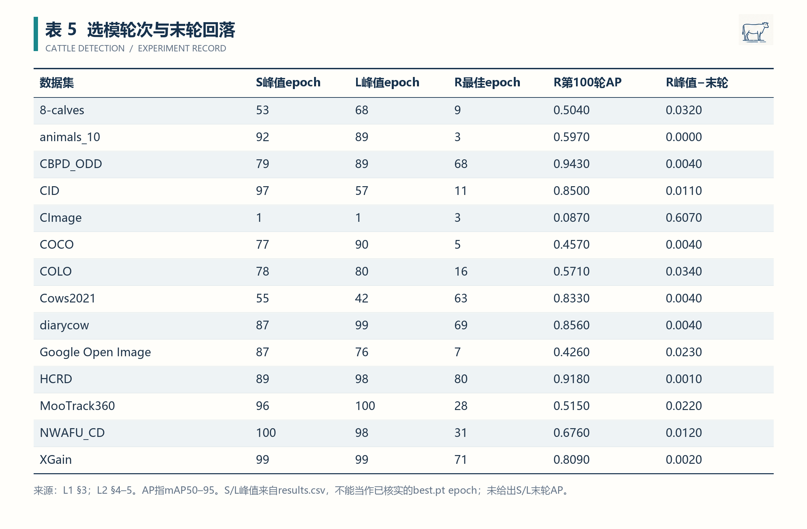

*表 5　YOLO 的“峰值 epoch”沿用训练 `results.csv` 记载，不等同于本次已核实的 `best.pt` epoch。RetinaNet 的最佳权重轮次及末轮读数按原文保存。*

CImage 只有 141 张 train、35 张 val。RetinaNet 在 epoch 3 达到 0.694，epoch 100 为 0.087；两个 YOLO 的训练曲线峰值均为 epoch 1。**早期峰值与末轮下降是已记录现象；过拟合、优化不稳定、样本组成或验证波动是待验证解释。** 应结合训练损失、逐图预测、学习率和数据分布，而不是仅凭两个端点定因。［L1，§2.2、§3–4；L2，§4–5、§8］

RetinaNet 有 5/14 个数据集在 epoch≤10 达到最佳值，其余最佳轮次分布较晚。此现象提示不同数据集可能需要不同训练停止策略，但不足以证明统一 100 epochs 对全部数据集都无效。［表 5；本记录复算］

## 6. 结果与数据分析（Results & Analysis）

### 6.1 统计方式与复算精度

本记录采用数据集等权宏平均：

$$
\overline{\operatorname{AP}}_M
=\frac{1}{|D|}\sum_{d\in D}\operatorname{AP}_{M,d}.
$$

每个数据集权重相同，避免 MooTrack360 等高框密度数据主导汇总；该统计与汇总全部图像后重新计算 AP 是不同量。复算输入为文档展示值：RetinaNet 保留三位小数，YOLO 保留四位小数。派生统计保留四位小数，不能视为直接读取远程原始浮点结果。脚本、JSON 与 CSV 一并保存。［L1，§3.1；L2，§6；本记录复算］

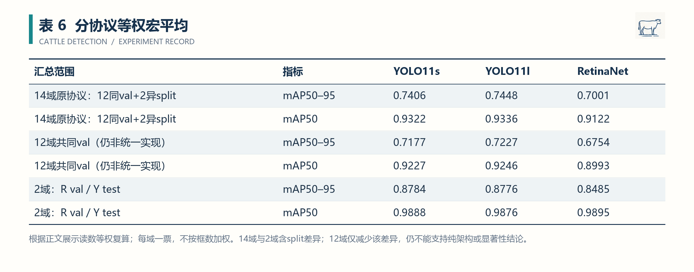

*表 6　分别报告原协议 14 域、12 个共同 val 及两个 split 不一致数据集。12 域子集只减少 split 差异，仍保留输入、框架、seed、标签成员和选模实现差异。*

原协议 14 域的 mAP50–95 复算结果为：

$$
\overline{\operatorname{AP}}_{\mathrm{s}}=0.7406,\quad
\overline{\operatorname{AP}}_{\mathrm{l}}=0.7448,\quad
\overline{\operatorname{AP}}_{\mathrm{R,best\ val}}=0.7001.
$$

移除 Cows2021、diarycow 两个 split 不一致数据集后，12 域共同 val 的对应读数为 **0.7177、0.7227、0.6754**。这些值支持“在各自历史协议下得到上述验证表现”的结论；尚不支持“统一预算下纯架构优势”的归因。

### 6.2 YOLO 模型容量收益

定义逐域差值：

$$
\Delta_d=\operatorname{AP}_{\mathrm{l},d}
-\operatorname{AP}_{\mathrm{s},d}.
$$

两个 YOLO 的原协议宏平均差为 **0.004164…**，即约 **0.42 个百分点**，l 在 **9/14** 个数据集上更高、5/14 更低、无相等项。这里的百分点是 AP 差乘 100；不能写成提升 4.2 个百分点。［表 3；本记录复算］

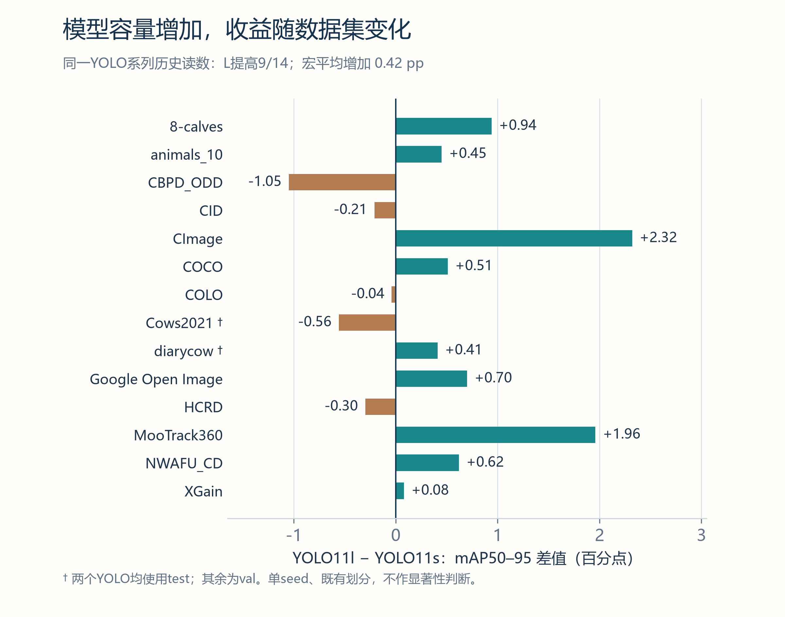

*图 3　两个 YOLO 的逐域 mAP50–95 差值。† 为两模型均使用 test 的数据集。无置信区间，因为现有记录没有提供多 seed 重复实验。*

最大的正差来自 CImage（+2.32 pp）与 MooTrack360（+1.96 pp）；最大的负差来自 CBPD_ODD（−1.05 pp），Cows2021 为 −0.56 pp。结果表明增大容量的收益随数据集变化。CImage 验证集较小，不能把这一单次提升直接当成稳定收益。**小规模模型在部分域达到相近或更高读数，值得保留为后续资源受限比较的候选；部署是否更快仍须实测。**

### 6.3 RetinaNet 末轮回落由哪些数据集贡献

RetinaNet 最佳 val 宏平均为 0.7001，第 100 epoch 宏平均为 **0.6459**，平均下降 **0.0543**，即约 **5.43 pp**。CImage 单域下降 0.607（60.7 pp），占 14 个域下降量之和约 **79.9%**；其余 13 域的平均下降为 **0.0118**，约 1.18 pp。［L1，§3；本记录复算］

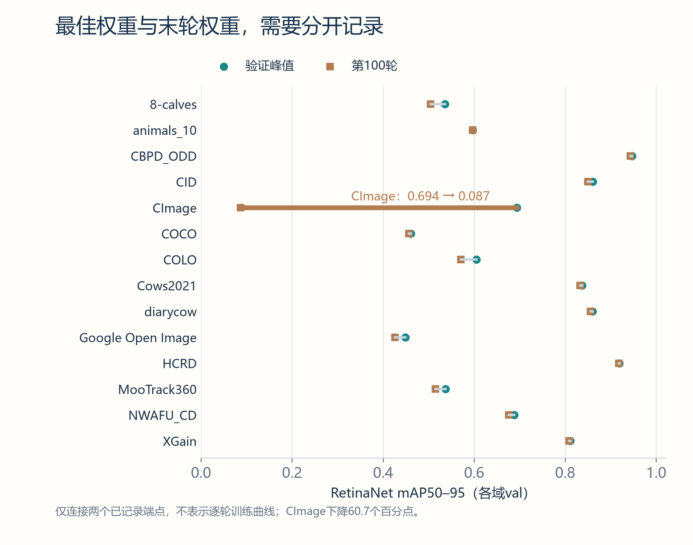

*图 4　RetinaNet 各域验证峰值与第 100 轮读数。连线仅连接两个已知端点，不是虚构的逐轮训练曲线。*

因此，“末轮宏平均显著回落”在本记录中首先是**由 CImage 强烈贡献的数值现象**，不应扩写为“RetinaNet 在所有域均发生严重过拟合”。后续应优先复盘 CImage，并在验证规则确定后使用对应最佳权重；不能在 test 上反复选择峰值权重或早停点。

### 6.4 宽松检测与严格定位

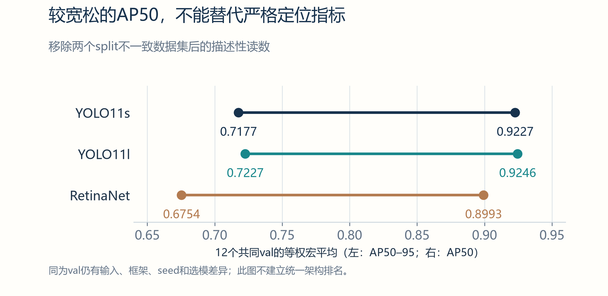

*图 5　12 个共同 val 的等权 AP50 与 AP50–95。各模型两端之间的间距用于展示指标口径差异；三模型仍有历史协议差异。*

12 域共同 val 的 AP50 宏平均分别为 **0.9227、0.9246、0.8993**，对应 AP50–95 为 **0.7177、0.7227、0.6754**。较高的 AP50 不能替代严格定位结果，下一步应结合框偏移、尺度、截断、遮挡和漏检分层分析。仅由两种 AP 的间距不能确定误差来源。［表 6；O9；综合与建议］

### 6.5 可比性与污染边界

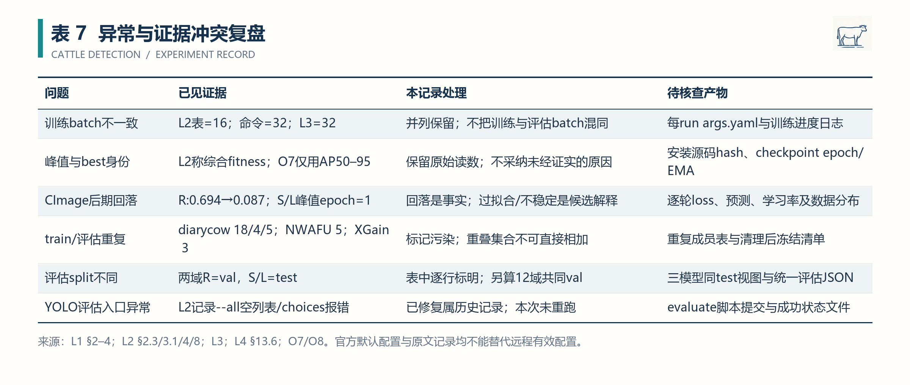

*表 7　把异常、证据冲突、本次处理和下一步核查对象放在同一表中。*

重复审计的已知记录为：

- `diarycow`：train→test 18 张，train→val 4 张，val/test 另有 5 张相同图像。
- `NWAFU_CD`：train→val 5 张。
- `XGain`：train→val 3 张。［L2，§8；L4，§13.6］

本次没有读取成员交集表，不能把 diarycow 的 18 与 5 简单相加成“23 张 test 污染”。SHA-256 精确重复审计也不能排除重压缩、缩放、裁剪、视频相邻帧或同牛多视角的近重复。7 月后续记录另有感知哈希与人工复核，是否覆盖这次全部 s/l 与 RetinaNet 数据版本仍需确认。［L4，§13.6–13.7］

MooTrack360 的高密度还要求核查预测数量上限。官方 RetinaNet 基础配置有 `max_per_img=100`，COCO 默认主 AP 采用 `maxDets=100`；**这些是官方设置，未证实为历史 run 的完整有效设置。** 两框架的上限、置信度、NMS 与每图真实实例分布应共同核对，不能把平均约 66 框/图当作上限永不影响结果的证明。［O6；O9；L1，§2.2；待核实］

本阶段没有多 seed 方差、来源簇区间估计或统一算力预算。14 个异质数据集是 14 个不同任务条件，不能替代同一条件下的 14 次独立随机重复；“9/14 更高”与“统计显著优于”是不同结论。

## 7. 讨论与后续计划（Discussion & Next Steps）

### 7.1 阶段结论

**已由本地记录支持：** 三模型各 14 个训练任务完成，YOLO 两模型各 14 个复评完成；数据与 checkpoint 存储位置已登记，RetinaNet 先执行过不纳入正式统计的 smoke test。［L1–L2］

**已由展示读数复算支持：** YOLO11l 的原协议宏平均比 YOLO11s 高约 0.42 pp，在 9/14 域更高；RetinaNet 最佳到末轮的宏平均下降主要由 CImage 贡献。三模型逐域结果及按 split 分组的宏平均可从附件复算。

**仍为推断或待核实：** CImage 回落的具体原因、Google/COCO 相对低 AP 的成因、不同容量的部署性价比、历史 best 权重与峰值轮次差异的来源、无泄漏独立 test 表现，以及纯架构优势和跨域泛化。后续应以有效配置、原始预测和受控重复实验推进。

### 7.2 按优先级推进

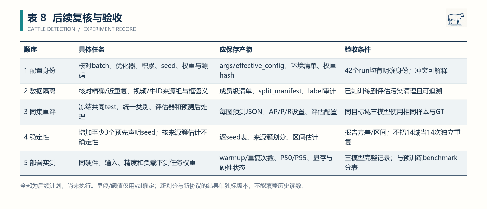

*表 8　后续任务与对应验收条件。全部为计划，没有记作已完成实验。*

先解决配置和数据身份，再冻结共同 test 与评估器。若重新划分，应为新版本重新训练或按预先声明规则评估，保留旧版本结果供追溯；不能只在旧表中替换少数“清理后读数”却仍称统一历史协议。

多 seed 重复应提前固定 seed 集合、选模规则和停止规则。对于视频帧或同牛多视角样本，不确定性分析优先按来源簇组织；来源单元如何定义，需要结合实际样本清单确认。固定置信度工作点、早停和超参数选择仅利用 val，冻结后再评估 test。

若开展跨数据集研究，再使用已冻结 checkpoint 建立训练来源到目标域的交叉评估矩阵；本记录的域内 val/test 读数不回填成零样本迁移成绩。部署比较则须补三模型在相同硬件、输入、精度与负载下的任务权重实测。L3 的推理表在本次未核对权重身份和全部输入条件，且没有完整 RetinaNet 对照，因此不纳入三模型速度排名。

### 7.3 本次整理验收与签署

本次建立 42 个模型—数据集组合的机器可读读数、8 张科研风格表格、5 幅正文图、可编辑表格底稿及复算脚本。图表数值来自文档与程序计算；模型图由 Study Image 绘制，表格视觉母版亦由 Study Image 生成，数据区再由程序精确排字。正文图片使用 Typora 相对路径。

复核结果另见[文件与数值核验](三种模型测试.assets/文件与数值核验.json)：来源 hash、数值对应、图片路径、Markdown 本地链接、Wiki Frontmatter 和索引条目检查。图表总览经目视检查；没有用概念图伪装检测截图，没有生成未提供的学习曲线或显著性标记。

**未运行：** 远程训练、推理、checkpoint 原始身份验证、逐图误差复核、成员级重复审计复现、多 seed 显著性分析、SQLite/向量索引同步。本地复算通过不等于实验本身已在本次复现。

---

记录人签字：________________　日期：________________  
审核人 / 导师签字：________________　日期：________________

## 附录 A　资料与文献定位

### A.1 本地资料

- **L1**　[RetinaNet 牛只数据集测试过程与结果](../牛只数据集/Retinanet测试.md)：§1 历史环境与完成时间；§2 数据、训练、smoke test 与 checkpoint；§3 正式读数；§4–6 分析、产物与建议。
- **L2**　[YOLO11s/YOLO11l 牛只数据集训练与测试过程及结果](../牛只数据集/yolo11SL.md)：§1–3 环境、划分、训练与评估入口；§4–6 逐域读数、峰值轮次与宏平均；§7–8 产物路径及重复污染限制。
- **L3**　[域内模型效率数据——远程日志提取](../牛只数据集/_效率数据_远程日志提取_20260908.md)：队列时间与 `batch=32、nbs=64` 补证。其效率排名、YOLO11m 和收敛阈值统计不纳入本记录主结果。
- **L4**　[7月工作](../牛只数据集/7月工作.md)：§13.6 SHA-256 跨划分重复；§13.7 感知哈希与人工复核。成员清单和后续数据版本未在本次直接核查。
- **L5**　[实验记录格式参考](实验记录格式参考.md)：七项实验记录结构与签署格式。

### A.2 官方指南、版本源码与原论文

以下来源于 2026-10-14 打开核查。当前网页会更新，涉及历史实现时以指定版本源码及历史有效配置为准。

- **O1**　Ultralytics：[YOLO11 模型指南](https://docs.ultralytics.com/models/yolo11/)。用于确认模型系列与支持任务，不引用其官方 COCO 成绩作为本项目结果。
- **O2**　Ultralytics：[Model Validation](https://docs.ultralytics.com/modes/val/)。定位 `model.val()`、`split`、`conf`、NMS `iou` 与指标读取。
- **O3**　Ultralytics：[Model Training](https://docs.ultralytics.com/modes/train/)。用于核查训练参数与断点恢复的一般接口，不补填历史隐含参数。
- **O4**　MMDetection 3.3.0：[Customize Datasets](https://mmdetection.readthedocs.io/en/v3.3.0/advanced_guides/customize_dataset.html)。定位类别映射与检测头类别数检查。
- **O5**　MMDetection 3.3.0：[Test existing models](https://mmdetection.readthedocs.io/en/v3.3.0/user_guides/test.html)。定位 `tools/test.py`、配置、checkpoint 与评估输出。
- **O6**　MMDetection v3.3.0：[RetinaNet R50-FPN 基础配置](https://github.com/open-mmlab/mmdetection/blob/v3.3.0/configs/_base_/models/retinanet_r50_fpn.py)。定位 `FocalLoss`、`test_cfg`；不是本项目已核实的有效配置。
- **O7**　Ultralytics v8.4.92：[metrics.py](https://github.com/ultralytics/ultralytics/blob/v8.4.92/ultralytics/utils/metrics.py)。定位 `Metric.fitness()`（raw 源码第 1009–1012 行）、`ap_per_class()` 的工作点（第 885–886 行）与 `compute_ap()`；行号对应本次读取版本。
- **O8**　Ultralytics v8.4.92：[trainer.py](https://github.com/ultralytics/ultralytics/blob/v8.4.92/ultralytics/engine/trainer.py)。定位 `save_model()` 的 best 保存（raw 第 712–714 行）和 `validate()` 的 fitness 更新（第 814–817 行）。
- **O9**　COCO 官方：[pycocotools/cocoeval.py](https://github.com/cocodataset/cocoapi/blob/master/PythonAPI/pycocotools/cocoeval.py)。定位 `Params.setDetParams()` 与 `summarize()`，用于核查匹配 IoU 和 `maxDets`。
- **O10**　Lin, T.-Y., Goyal, P., Girshick, R., He, K., & Dollár, P. **Focal Loss for Dense Object Detection.** ICCV, 2017. [原论文](https://arxiv.org/abs/1708.02002)，定位 §3 Focal Loss 与 §4 RetinaNet。其原始通用检测实验不直接证明本项目牛只数据的优势。

## 附录 B　可编辑数据与图表文件

- [表格可编辑底稿](三种模型测试.assets/表格可编辑底稿.md)：8 张图表对应的 Markdown 数据表，便于检索、校对与改排。
- [逐数据集读数 CSV](三种模型测试.assets/逐数据集读数.csv)、[JSON](三种模型测试.assets/逐数据集读数.json)：42 个模型—数据集组合；缺失 P/R、末轮指标保留为空。
- [统计复算](三种模型测试.assets/统计复算.json)：分组宏平均、逐域差值、CImage 回落贡献与数据规模。
- [复算与绘图脚本](三种模型测试.assets/复算与绘图.py)：从两份主文档解析读数，不执行训练；依赖 Pillow、matplotlib 与中文字体。
- [来源文件 hash](三种模型测试.assets/来源文件hash.json)、[外部来源核查清单](三种模型测试.assets/外部来源核查.json)：定位本次证据及核查范围。
- [图表校阅总览](三种模型测试.assets/图表校阅总览.jpg)、[排版测量](三种模型测试.assets/排版测量.json)：用于统一检查表格与正文图。
- [Study Image 原始概念图](三种模型测试.assets/StudyImage-三模型研究概览原图.png)、[科研表格视觉母版](三种模型测试.assets/StudyImage-科研表格视觉母版.png)：保留生成原图；数值图采用标准绘图程序生成，表格为 2400 像素宽、300 dpi。
