# 域内重测

> **实验编号：** EXP-20261005-COWCV-ID-RETEST  
> **实验主题：** 统一协议下的 YOLO11m 域内监督参照重建、可复现性审计与 LODO 保持率分析  
> **历史执行时段：** 2026-10-05—2026-10-08（主实验与 stock 运行重复）；2026-10-09—2026-10-12（effective-seed 扩展与汇总）  
> **整理与方法核查日期：** 2026-10-14，北京时间  
> **记录性质：** 既有实验的追溯整理、脚本核查与表格复算；本次未重新训练或远程推理  
> **记录人：** 待填写　　**审核人：** 待填写  
> **格式依据：** [实验记录格式参考](实验记录格式参考.md)的七项结构；将“试剂与耗材”调整为“数据、软件与计算资源”。

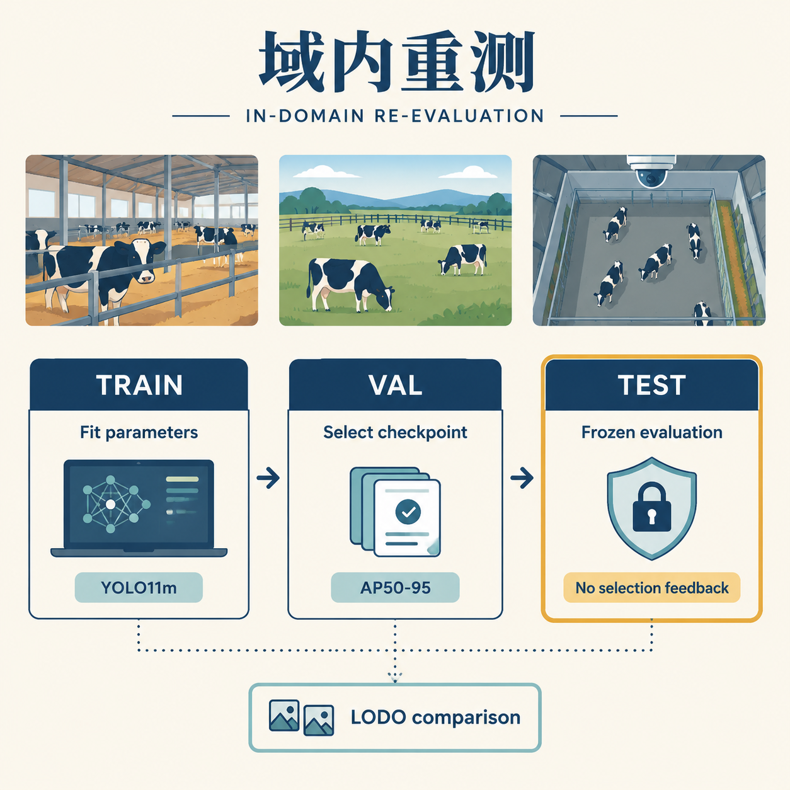

*图 1　训练负责参数学习，验证负责权重选择，测试负责预定权重的最终评估；保持率分析使用与 LODO 相同的目标 test 视图。场景及流程为 Study Image 方法示意，不是数据集实拍或模型预测结果。*

本阶段完成了 **YOLO11m×14 域**的监督参照重建。主方案的 test mAP@0.5:0.95 等权宏平均为 **0.7214**；有效种子扩展的三种子宏平均为 **0.72049±0.00159**（样本 SD，n=3）。同视图 LODO 相对域内监督参照的逐域保持率宏平均约为 **0.7328**。这三组数分别回答“单域监督能达到什么水平”“跨有效种子会怎样波动”“多源零样本保留了多少目标域监督表现”，不能混成一个统计量。（L2 §§4、6、11；本次表格复算）

本记录的研究重点包括：修正旧验证口径的证据链、冻结可追溯协议、处理误覆盖事件、查明名义 seed 与实际随机流的差异，以及建立监督参照与多源泛化的同视图比较。

## 1. 实验目的（Objective）

### 1.1 重测所针对的具体问题

2026 年 7 月的域内模型比较可用于阶段观察，但不宜直接作为本轮正式 test 参照。重测计划列出了三项需要修正的问题。（L1 §1）

1. **训练设置不统一。** 历史 YOLO11m 部分数据集使用 batch=16，其余使用 batch=32；跨模型还存在 AMP、自动优化器、有效 batch 和环境变更等差异。
2. **选模与报告集合未充分分离。** 历史主表以 val 报告，diarycow 的一个名义 test 别名也实际指向 val。以同一集合选出峰值并报告，不能替代独立冻结 test。
3. **数据版本与新泛化实验不一致。** 旧阶段划分为 23,851/4,971/2,551；新 `data/` 经 SHA-256 同图同标去重及重切，划分为 25,079/3,142/3,124。两套数据规模与划分均发生变化。

因此，本轮重测在新的 `data/` 上重新训练，而非只对旧权重换一个评测路径。所有目标域使用同一检测器、初始化、输入尺度与明确优化协议，构建与 LODO 目标 test 对齐的域内监督参照。（L1 §§1–3；L2 §§1–2）

### 1.2 研究问题与完成判据

本阶段围绕四个问题组织证据：

- **参照重建：** 本域 train 学习、本域 val 选模、冻结 test 报告后，各域的 $M_{t\to t}$ 是多少？
- **选择敏感性：** 按 val 最优轮选择，与预定第 100 轮权重相比，test 结果改变多少？
- **复现机制：** 运行名中的 seed=42/43/44 是否真正改变洗牌与增强随机流？重复执行的差异如何报告？
- **泛化保持：** 在同一目标 test 上，13 源 LODO 的 $M_{-t\to t}$ 相对本域监督参照保留多少表现？

验收材料包括 14 域完整训练记录、预选权重及选择依据、每轮 28 条 selected/epoch100 评测结果、test 数量核验、分协议重复结果，以及可定位的事故与恢复记录。这些材料的历史完成状态依据 L2；本次已独立检查本地文档、镜像脚本及汇总算术，未重开服务器原始产物。

### 1.3 范围与研究边界

本轮对象固定为 **YOLO11m**。RT-DETR-L、Faster R-CNN、RetinaNet 及 YOLO11s/l 的统一复核另行排期；当前结果不形成四架构的新 test 排名。旧 14×14 单源迁移矩阵的数据与视图也未同步更新，因此本轮不能据此计算同视图 $\Delta_{multi}$。（L1 §§1、7；L2 §10）

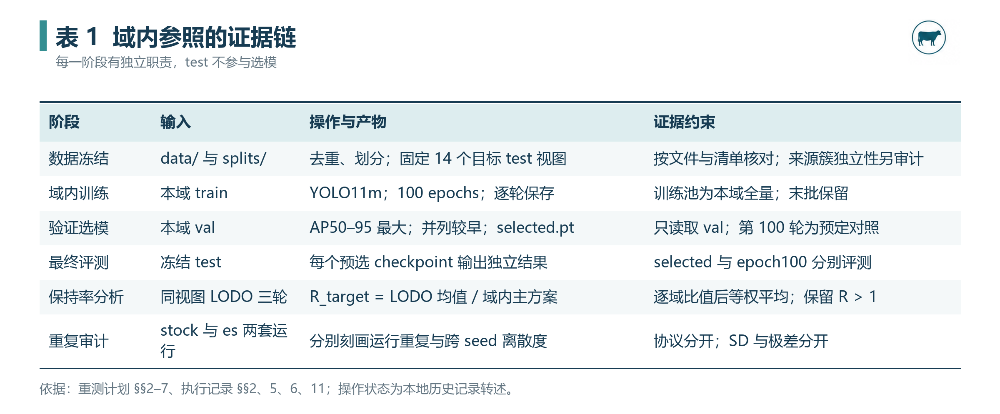

*表 1　各阶段的输入、产物与证据约束。可编辑数据见[表格底稿](域内重测.assets/表格可编辑底稿.md)。*

## 2. 实验原理与参考依据（Principle & References）

### 2.1 域内监督参照与同视图比较

设目标域 $t$ 的 train、val、test 分别为 $D_t^{train}$、$D_t^{val}$、$D_t^{test}$。对 100 轮训练中的候选权重 $W_{t,e}$，冻结选模规则：

$$
e_t^*=\min\operatorname*{arg\,max}_{1\le e\le100}
\mathrm{AP}^{val}_{50:95}(W_{t,e}).
$$

$$
M_{t\to t}
=\mathrm{AP}^{test}_{50:95}(W_{t,e_t^*};D_t^{test}).
$$

“min”表达并列选较早 epoch。训练、选择和报告依次使用不同数据职责，test 不反馈到权重选择。L1 §4 与本地 `indomain_select_checkpoint.py` 都以 val AP50–95 为依据；镜像脚本采用严格 `>` 顺序扫描，并把选择写入 `selection.json`。

LODO 的 $M_{-t\to t}$ 来自排除目标域后的 13 源训练；其选模依据为源域 val 的等权宏平均。两类模型在同一目标 test 上评估，构成协议明确的配对比较。训练池、洗牌实现和验证构成仍有声明差异，因此“同视图可比”不等于“训练样本量及优化步数相同”。（L1 §§2–3；L3 §§2、4）

Gulrajani 与 Lopez-Paz 的 *In Search of Lost Domain Generalization* 将模型选择列为域泛化评估的重要组成部分。本项目据此将“按什么集合、什么指标选模”与最终分数一起记录；该论文的方法论不直接证明本项目的结果。（R9，摘要）

### 2.2 指标与工作点：AP、NMS 和 P/R 分别说明

单类别 `cow` 下，本文沿用源记录的 mAP 名称；AP50–95 表示 0.50、0.55、…、0.95 共 10 个匹配 IoU 阈值的 AP 均值：

$$
\mathrm{AP}_{50:95}
=\frac1{10}\sum_{k=0}^{9}\mathrm{AP}_{0.50+0.05k}.
$$

COCO API 的评估参数明确区分匹配 IoU、召回采样点和每图最大检测数；Ultralytics v8.4.92 检测 validator 也设置了该 10 阈值向量。本轮使用 Ultralytics 默认 evaluator，不能因此声称输出与所有 `pycocotools` 细节完全等价。（R8、R15）

三个容易混淆的量需要分别登记：

- **置信度预筛选：** v8.4.92 默认配置注释中，val 的默认 `conf` 为 0.001；这是保留候选预测的门槛。
- **NMS IoU：** 版本配置默认 `iou=0.7`，用于去除重复预测。
- **AP 匹配 IoU：** 采用 0.50–0.95 扫描，判断预测框与真值框的匹配质量。

这些是版本源码的默认设置核查，不代替历史评测的完整生效参数快照；是否有安装补丁或继承参数仍应回到当时源码及运行材料核实。（R13、R15；L2 §2.3）

本地评测镜像直接读取 `m.results_dict` 中的 P/R，没有执行另一个固定 conf=0.25 的严格计数函数。v8.4.92 `ap_per_class` 在平滑 F1 曲线上取峰值索引，再返回 P/R。因此表 4 的 P/R 为**默认汇总工作点指标**，不是统一冻结置信阈值下的 TP/FP/FN；在 test 上从曲线取得峰值也不等于在 val 上冻结阈值后测试部署工作点。AP 为本记录的主分析指标。（L5；R4）

### 2.3 等权宏平均、保持率与不确定性

为防止 Cows2021 的 1,040 张 test 图在汇总中主导其他域，主汇总对 14 个数据集等权：

$$
\overline M_{\mathrm{ID}}=\frac1{14}\sum_tM_{t\to t}.
$$

保持率采用主方案 stock 分母与 LODO 三种子平均分子：

$$
R_{\mathrm{target}}^{\mathrm{LODO}}(t)
=\frac{\overline M_{-t\to t}^{\,\mathrm{LODO}}}{M_{t\to t}^{\,\mathrm{stock}}},
\qquad
\overline R=\frac1{14}\sum_tR_{\mathrm{target}}^{\mathrm{LODO}}(t).
$$

$$
\overline R\ne
\frac{\overline M_{\mathrm{LODO}}}{\overline M_{\mathrm{ID}}}
\quad\text{（一般情况下）}.
$$

$M_{t\to t}$ 是此训练预算下的经验监督参照，不是理论上限。因此 $R>1$ 有明确含义，应保留原值。比值也受分母波动影响，尤其是小样本域和运行噪声域。（L1 §10；L2 §§5–6）

本记录分别使用：stock 重复的**实际范围与极差**，es 三种子的**样本标准差**。对有效种子 $s$，先算 14 域宏平均 $\bar M_s$，再计算：

$$
\mu=\frac13\sum_s\bar M_s,\qquad
\mathrm{SD}_{seed}
=\sqrt{\frac{\sum_s(\bar M_s-\mu)^2}{3-1}}.
$$

不能把 14 个域的分数标准差称为“种子 SD”，也不能把三轮极差写成“±SD”。当前 SD 表示少量重复下的描述性离散度；test 抽样误差、来源簇相关性和置信区间尚未独立量化。（L2 §§5、11；L5 聚合脚本）

### 2.4 固定 seed 的声明需要机制证据

PyTorch v2.5.1 可复现性文档说明，固定种子并不保证跨版本、平台或 CPU/GPU 完全复现；数据加载器的 `generator` 与 `worker_init_fn` 也参与随机流控制。其 DataLoader 实现将 generator 传给 RandomSampler，并从同一 generator 抽取 worker base seed。（R6、R7）

因此，本阶段把可复现性拆成“参数写了什么”“随机流实际由什么驱动”“观察到了什么差异”三个层次。seed 空操作及 es 激活机制的具体证据见 §4.6、§5.3，适用范围限定为本地记录所述的 8.4.92、单卡、单类初始化与数据加载配置。

## 3. 数据、软件与计算资源（Materials & Environment）

### 3.1 数据版本、目标域与实际测试规模

本轮权威数据位置为服务器项目根下的 `data/`；源记录登记 train 25,079、val 3,142、test 3,124，共 **31,345 图**。14 域包括 8-calves、animals_10、CBPD_ODD、CID、CImage、COCO、COLO、Cows2021、diarycow、Google_Open_Images、HCRD、MooTrack360、NWAFU_CD、XGain。（L1 §2；L3 §2.1）

各域 test 图数见表 4。CImage 仅 17 张，CBPD_ODD 36 张，不能与 1,040 张的 Cows2021 视作等量证据。等权汇总表达的是“每个目标域同等重要”，不代表各域估计精度相同。

SHA-256 去重与清单匹配支持精确重复审计和数据版本追踪；它们不能自动排除连续帧近重复、同牛身份交叉、相同摄像头来源重叠或预训练接触。Beery 等人的固定机位新环境研究表明，同位置与新位置表现可明显不同，启发本项目继续登记来源和拍摄簇；该研究不证明本项目某域的失败原因。（R10，摘要；本记录的后续建议）

### 3.2 历史运行环境与初始化身份

L2 登记的环境为 **NVIDIA A100-PCIE-40GB 单卡、Ultralytics 8.4.92、PyTorch 2.5.1+cu124**；与 LODO 使用同环境。项目根为：

```text
/data1/yxli/LODOANDClassbyDomain/
```

所有域从 `lodo/yolo11m.pt` 初始化；执行记录登记其 MD5 为：

```text
2c2bcbb54c3829b20d31a32524ee0f03
```

这是历史记录中的身份信息，本次未下载权重重算其 hash。训练镜像会在 `run_info.json` 中登记权重路径及 MD5、Ultralytics/torch/CUDA 版本、GPU、数据规模和理论步数。本次另外对 4 份本地文档与 7 份协议/脚本镜像计算 SHA-256，保存在[来源 hash](域内重测.assets/来源hash.json)，用于确认整理期间未改动来源。

### 3.3 冻结配置与预算差异

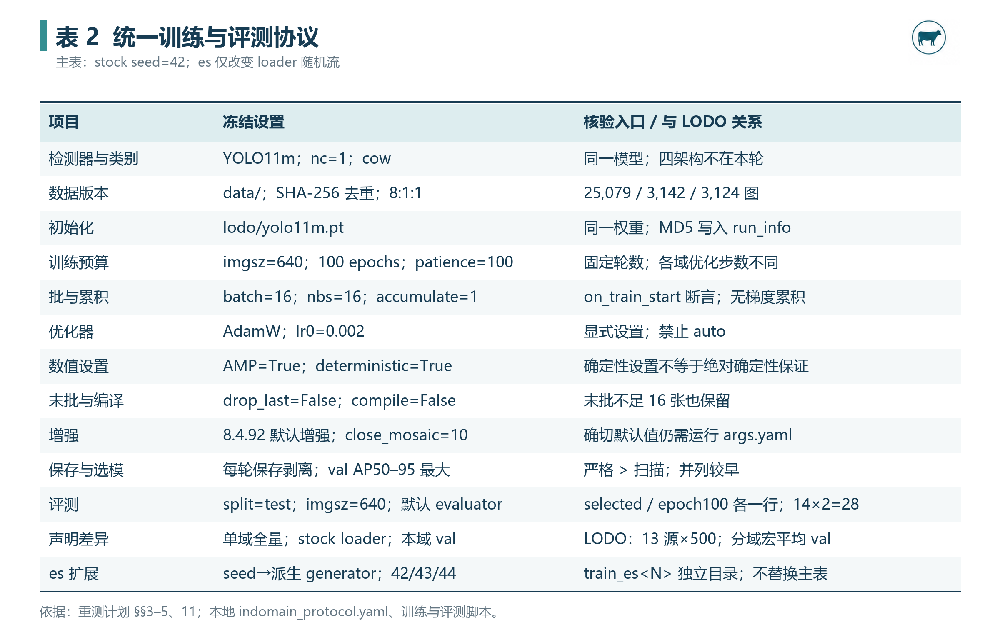

*表 2　训练规则、核验入口与 LODO 对照；默认增强的确切生效参数仍以历史 `args.yaml` 为准。*

对域 $t$，末批保留且 accumulate=1 时，每轮理论 batch 数为：

$$
B_t=\left\lceil\frac{N_t^{train}}{16}\right\rceil.
$$

100 轮理论训练 batch 数为 $100B_t$。该量不应伪装成逐次记录的实际 `optimizer.step()`：AMP 跳步等运行细节需要额外日志。LODO 每轮 13×500=6,500 张、407 个 batch，末批 4 张；单域全量的预算随规模改变。由此，本实验能评价各自冻结协议下的监督参照和零样本表现，但不能将差异单独归因于域数量或样本多样性。（L1 §3；L5 训练镜像）

### 3.4 资产组织与本次访问边界

服务器侧历史产物的定位如下，路径均相对于上述项目根。（L2 §9）

```text
indomain/
├── protocol.yaml
├── <域名>/
│   ├── logs/<run>/run_info.json
│   ├── logs/<run>/train_stdout.log
│   └── runs/<run>/
│       ├── args.yaml / results.csv
│       ├── weights/epoch0.pt ... epoch99.pt
│       ├── selected.pt / epoch100_final.pt
│       └── selection.json
├── results/
│   ├── indomain_test_results.{csv,json}
│   ├── indomain_test_results_train_es{42,43,44}.{csv,json}
│   ├── indomain_seed_repeats.{csv,json}
│   └── indomain_vs_lodo.{csv,json}
└── archive/2026-10_stock_repeats/
    ├── runs/
    ├── results/
    └── _quarantine_s43_20261006/
```

本次直接检查了 `D:\牛只数据集实验\` 的训练、选择、评测、聚合、CPU seed 测试、串行驱动器与协议镜像，共 7 份。它们支持核查**当前本地实现**；与历史远程执行源码逐字一致、远程结果文件当前存在、权重身份与全部断言实际输出，本次均未实时复核。

## 4. 实验步骤与过程记录（Procedures）

### 4.1 准备、冻结与冒烟

历史流程先确定 `data/<t>/data.yaml` 与 `splits/<t>/train.txt`，使用同一初始化和冻结参数。训练回调在 loader 构建后检查 batch/nbs=16、accumulate=1、AdamW、lr0=0.002、AMP、compile=False、resume=False、drop_last=False，以及 loader 数据规模与清单一致。（L1 §6；L2 §§2.4、3.1；L5）

正式运行前以 CImage×2 epochs 的 smoke 验证保存、优化器剥离、选择和 test 评测；执行记录报告全链路通过，e*=1 映射到 epoch0.pt，复跑指标一致。这里的冒烟是历史记录，不是本次在本机完成的 GPU 测试。（L2 §3.3）

### 4.2 串行执行与实际时间线

`run_indomain_all.sh` 使用 `flock` 防止同一域内驱动器双开；按域顺序串行训练。CSV 达到 100 行时视为完成并跳过；未完成的运行在下一遍从头重跑，最多三遍，不使用 optimizer resume。历史记录报告六轮完整运行各完成 14/14。（L2 §§1、11.2；L5 驱动器）

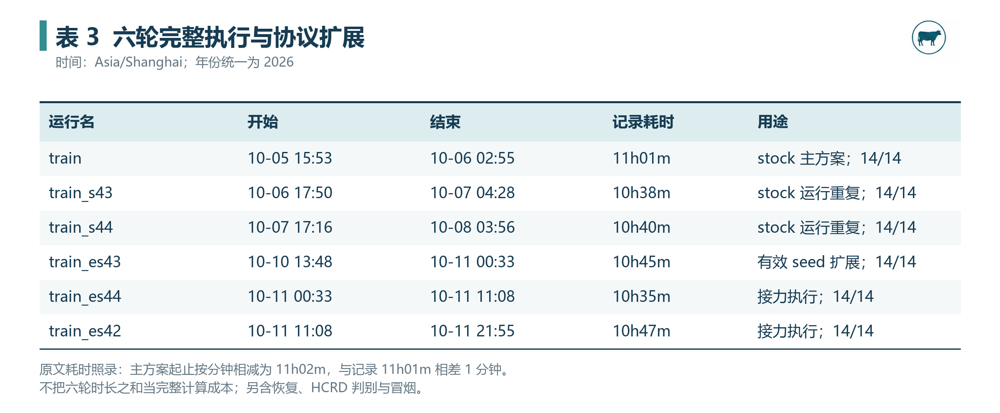

*表 3　主方案、两轮 stock 重复与三轮 es 扩展。原文主方案耗时为 11h01m，分钟级起止相减为 11h02m；差 1 分钟予以保留，未猜测秒级时间。*

stock 主方案完成于 2026-10-06；es 的最后训练完成于 2026-10-11 21:55，三轮结果聚合记录于 2026-10-12。2026-10-14 是本科研记录的整理日，不能写成训练日。

Cows2021 的历史训练耗时约 3h26m、diarycow 1h23m、CImage 7m。逐域耗时和六轮时段反映工程规模，但不是完整成本账目：其中未统一计入冒烟、恢复、判别实验及所有评测时间。（L2 §1）

### 4.3 保存权重并按 val 选择

每轮保存一次 checkpoint，随后剥离优化器状态。镜像选择脚本读取 `metrics/mAP50-95(B)` 列，严格 `>` 扫描保留第一次达到最大值的行；登记源文件、e*、val 分数和并列信息，并输出 `selected.pt` 与 `epoch100_final.pt`。（L5 选择脚本）

映射关系为：

```text
results.csv 的 epoch e（1-based）
         ↕
weights/epoch{e-1}.pt（0-based 文件名）
```

剥离后的内部 `epoch` 为 −1，不能拿它反推训练轮次；优化器状态移除后的权重也不具备完整 optimizer resume 信息。选择的可追溯性应依靠文件映射、CSV、选择记录及权重身份。（L2 §3.2；R12）

**版本核查修正：** v8.4.92 检测 fitness 权重为 `[0,0,0,1]`，在该实现中等于 AP50–95，不沿用旧版本 0.1×AP50+0.9×AP50–95 的说法。stock 保存 best 的相等判断仍可能使并列保留较晚轮；本项目独立选模规则更便于审计。全部历史主方案报告无并列，但本次未重新读取逐轮 CSV 验证。（R4、R5；L2 §4.1）

### 4.4 预定 test 评测与字段修正

选择完成后，对 selected 与第 100 轮权重各评测一次：

```python
m = YOLO(str(ckpt)).val(
    data=str(data_yaml),
    split="test",
    imgsz=640,
    device=0,
    plots=False,
    verbose=False,
)
```

这是本地评测镜像核心调用的摘录；历史脚本还设置输出目录与名称。对完整一轮运行预期为 **14×2=28 条**，不因已看过 test 而再选择较高分 checkpoint。不同预先定义的重复轮可以再次评估同一冻结 test，因此“只评测一次”应指**每个预先选定权重的一次计划内评测**，不能描述成整个项目从未重复读取 test。（L1 §§4–5；L5）

镜像在评测前核对各域 test 图数。实例计数字段也已区分：

```text
nt_per_class.sum() → GT 实例数
nt_per_image.sum() → 单类别下含 GT 的图像数
```

L2 §3.2 记载旧 LODO 的 `test_instances` 曾错误命名为后者；当前域内评测另存 `test_images_with_gt`，避免继续混用。表 4只列来源明确提供的 test 图数，不补造未提供的实例数。（L5；R4、R15）

### 4.5 排障：误覆盖、隔离、恢复与加固

2026-10-06 16:29，seed=43 驱动调用漏传 `--run-name`，写入主方案 `runs/train`，覆盖 8-calves 的 100 轮及 animals_10 前 29 轮审计材料；17:04 发现后停止。执行记录称 selected、epoch100_final、selection、run_info 及主结果 CSV 未被该训练调用触碰。（L2 §3.4）

处理步骤按原记录重建如下：

1. **界定受影响资产。** 将污染材料隔离，保留事故日志，不把全项目结果笼统宣布为损坏或无影响。
2. **修正运行命名。** 按 seed 自动派生 `train`/`train_s<N>`；显式 `train` 配非 42 seed 时硬报错；驱动器补传运行名。
3. **保护结果输出。** 增加 `--out-tag`，为子集恢复核验生成独立结果文件；es 协议另禁止写入 stock 冻结目录。
4. **从 seed=42 完整恢复。** 两域重训后核对学习曲线、e* 与 val 峰值、test 全指标三条链。

L2 §3.5 记载 animals_10 前 29 行学习列与隔离前缀一致（time 列除外）、恢复 e*=96/val=0.66209/test AP=0.66643；8-calves 100 轮一致、恢复 e*=63/val=0.59602/test AP=0.57732。事故区后于 2026-10-10 归档到表述于 §3.4 的 archive 路径。

**本次核查状态：** 已在本地脚本中看见运行名保护、es 目录隔离及 `--out-tag`；三重恢复通过是历史执行记录报告，本次没有重新加载远程逐轮材料验证。这一区分保留了排障成果，也保留了证据层级。

### 4.6 源码审计与 effective-seed 扩展

stock 重复出现长曲线逐位相同后，原先“换 seed 会改变检测头初始化”的解释被修正。L2 记录该配置下单类头通过 `cls_remap` 确定性映射，日志为 `Transferred 649/649 items`；v8.4.92 `tasks.py` 可核查按规范化类别名称复制头通道的机制。完整历史覆盖情况仍以该运行日志为依据。（L2 §5.1；R11）

同时，v8.4.92 `build_dataloader()` 中实际创建的 generator 为：

```python
generator = torch.Generator()
generator.manual_seed(6148914691236517205 + RANK)
```

该 generator 不读取用户 seed，并同时参与洗牌和 worker 派生种子。因此在本记录的初始化、单卡及 loader 条件下，仅改名义 seed 的 stock 三轮主要构成**运行间重复**，不能作为有效种子重复的证据。此结论不推广到所有 Ultralytics 模型、DDP 或版本。（R3、R7；L2 §5）

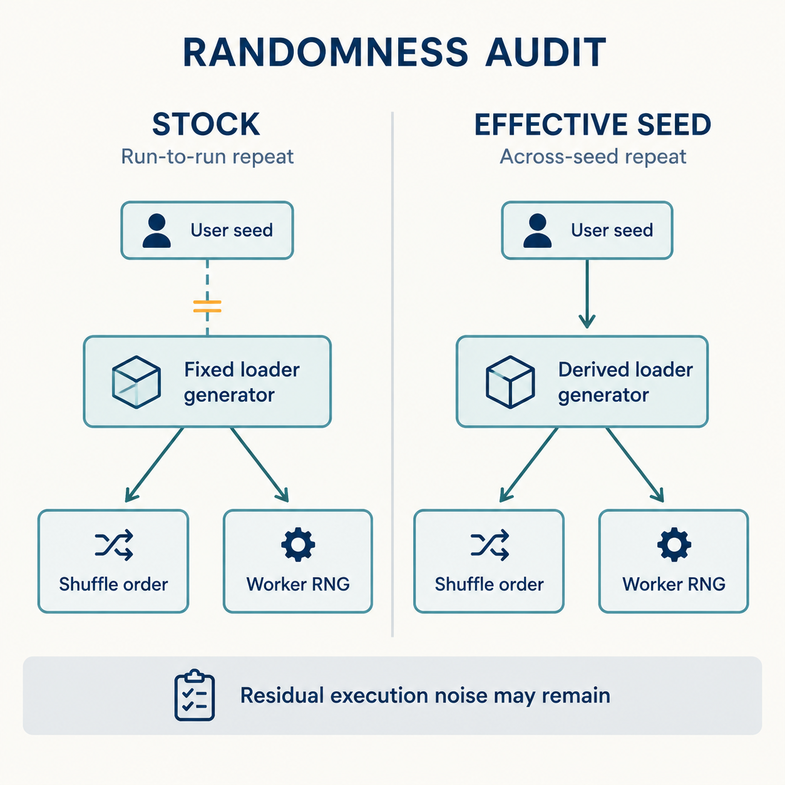

*图 2　Study Image 示意：stock 的 loader generator 不由用户 seed 控制；es 覆盖为由 seed 派生的 generator，从而同时控制洗牌及 worker RNG。两套运行都仍可能存在残余执行噪声。*

2026-10-09 增补 es 协议。保持训练超参、数据与选模/评测规则不变，唯一明确改动为在进程内以子类替换 `InfiniteDataLoader`，按 loader 创建顺序生成 seed+0、seed+1、… 的 generator。运行写入 `train_es42/43/44`，并存 `seed_loader_creations.json`；默认关闭开关时保持 stock 路径。（L1 §11；L5 `make_seed_effective()`）

历史扩展前验证包括同 seed 顺序一致、异 seed 首轮分叉、逐 epoch 洗牌、worker 种子分离、stock 对照不变，以及 CImage 两轮端到冒烟。L2 报告通过；本次读取了 CPU 机制测试脚本，但未在本机或服务器运行该训练环境测试。

### 4.7 可复现操作入口

下列为**历史复现命令入口**，本次没有执行。重新运行前须核对远程环境、协议文件和归档状态；不要把已归档 stock 重复的训练命令当成只读分析。

```bash
conda activate ultralytics
cd /data1/yxli/LODOANDClassbyDomain

# stock 主方案
bash run_indomain_all.sh
python3 indomain_select_checkpoint.py --all --run train
python3 indomain_eval_test.py --run train

# es 扩展示例；42/44 按各自运行名执行
bash run_indomain_all.sh 43 es
python3 indomain_select_checkpoint.py --all --run train_es43
python3 indomain_eval_test.py --run train_es43

# CPU 机制检查与三种子聚合
python3 indomain_seed_patch_test.py
python3 indomain_compare_lodo.py --es-runs train_es42,train_es43,train_es44
```

镜像聚合器扫描活跃及 archive 结果中的 stock 轮次，es 由 `--es-runs` 显式指定并单独输出。此设计可以防止两种协议静默混入同一方差表。（L5 聚合脚本）

## 5. 原始记录摘录与过程现象（Raw Data & Observations）

### 5.1 主方案逐域读数与选模轮次

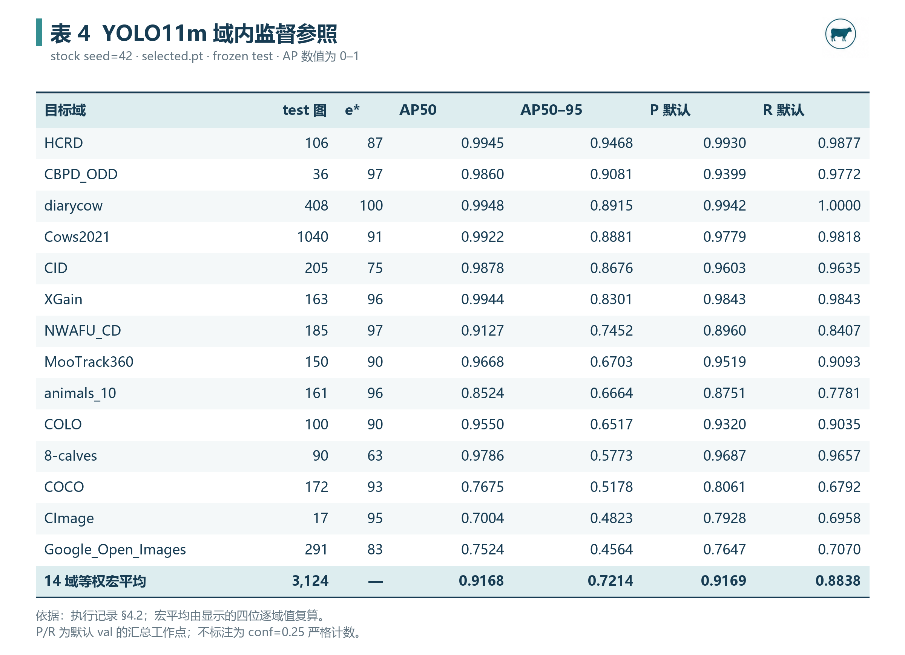

*表 4　L2 §4.2 的逐域值；$e^*$ 来自 §4.1。数字照录或由显示精度复算，不是本次新产生的远程输出。*

e* 分别包括 8-calves=63、CID=75、Google=83、diarycow=100；其余域处于 87–97。原记录“除 8-calves 外集中在 83–100”的概括漏掉 CID，本记录按表值修正。diarycow 最优轮为最后一轮，这只说明当前候选预算的 val 最大值位置，不足以证明充分收敛或继续训练无收益。

### 5.2 stock 重复：完全一致域与噪声域

三轮 stock 中，L2 §5.2 报告以下 11 域训练曲线、e*、val 峰值及 test 指标逐字段一致：8-calves、animals_10、CID、CImage、COCO、Cows2021、diarycow、Google_Open_Images、MooTrack360、NWAFU_CD、XGain。

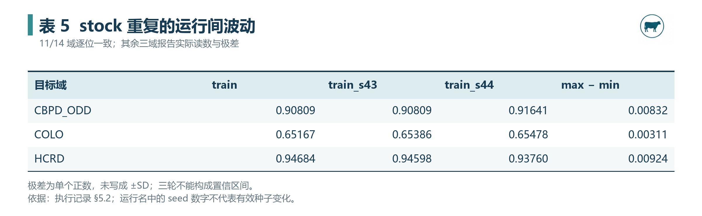

*表 5　三个噪声域的极差分别为 0.00832、0.00311、0.00924；这些是重复运行间范围，不是对称误差棒或置信区间。*

原记录报告 COLO 前 48 轮一致、第 49 轮起分叉，HCRD 第 5 轮起分叉；CBPD_ODD 有两轮一致、一轮不同。两轮一致不能独自证明未来运行完全确定。（L2 §5.2）

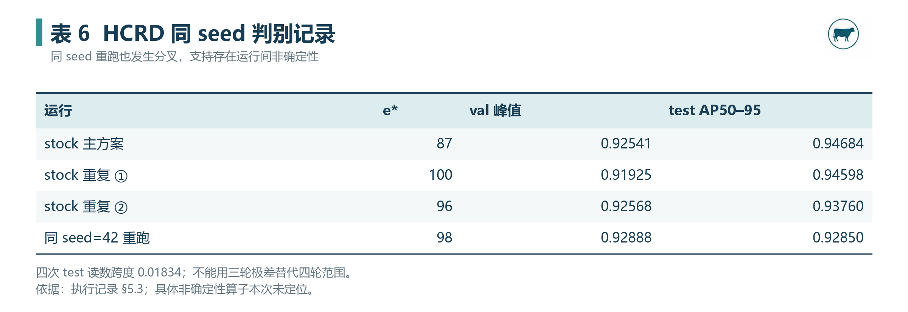

*表 6　同 seed=42 的 HCRD 重跑也从首轮与主方案不同。加入该判别运行后，四次 test 结果范围为 0.92850–0.94684，跨度 0.01834。*

该结果支持残余运行间非确定性，但不能定位到某个特定 CUDA kernel。v8.4.92 用 `torch.use_deterministic_algorithms(True, warn_only=True)`；无法确定化的操作可能只发出警告。原记录“三条通道全部关闭”的强表述应收紧为：**本配置下主要 seed 通道未激活，确定性设置限制部分非确定性，但观察到残余运行噪声**。（L2 §5.3；R12）

### 5.3 es 生效的直接现象与结果

L2 §11.2 摘录 CImage 首轮 box/cls/dfl loss：

```text
stock : 0.95283 / 2.92736 / 1.41423
es42  : 0.92338 / 2.95144 / 1.39412
es43  : 0.89472 / 2.98540 / 1.38925
es44  : 0.89429 / 2.83650 / 1.36561
```

es42 与 stock 已不同，符合 generator 随机流被替换；三种子各异则支持有效 seed 生效。选模轮次也变化，例如 8-calves 的 es42/43/44 为 58/63/79，CID 为 80/57/64。最终成绩须继续遵循 val 选模，不能根据 test 再选择 seed。（L2 §11）

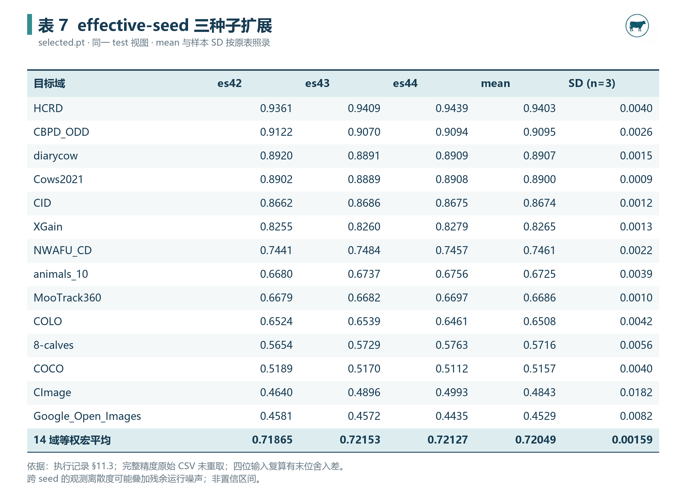

*表 7　逐域 mean 和样本 SD 按 L2 §11.3 照录，宏平均汇总为 0.72049±0.00159。完整精度 CSV 未重取；显示精度复算见附录 B。*

### 5.4 第 100 轮敏感性对照

L2 §4.3 报告 selected 与 epoch100 的 AP50–95 平均绝对差为 **0.0089**；除 CImage 差约 0.078 外，其余不超过 0.011。CImage 的 epoch100 AP 约 0.560，高于 selected 的 0.4823，但主结果仍保持按 val 选择的 0.4823，不能事后替换。（L2 §§4.3、7）

这支持“多数域在这两种预定选择下差异较小”的有限观察。CImage 是必须保留的反例；没有完整逐轮 test 评测，也不应去寻找 test 最优轮或将差异全部归因于测试样本量。

## 6. 结果与数据分析（Results & Analysis）

### 6.1 同协议域内参照的总体水平

从表 4 显示值复算，14 域 AP50、AP50–95、默认 P、默认 R 宏平均分别为 **0.9168、0.7214、0.9169、0.8838**。AP50–95 从 Google_Open_Images 的 0.4564 到 HCRD 的 0.9468，跨域跨度为 0.4904。（L2 §4.2；本次复算）

该跨度描述统一检测器在这些目标域和当前标注定义下的难度差异，不能据此给数据集“质量”排名。test 图数、来源组成、框语义和目标尺度都可能参与变化；当前没有控制变量实验。

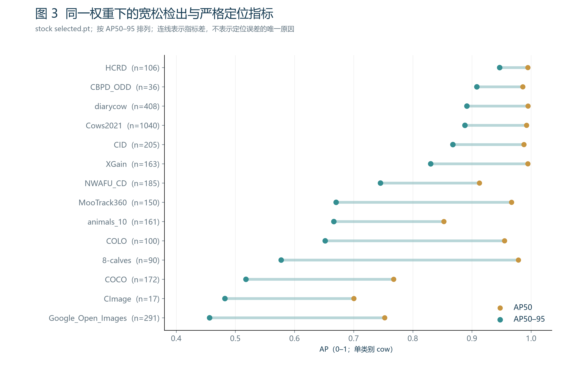

*图 3　同一权重下 AP50 与 AP50–95 的配对。n 为 test 图数；连线长度是指标差，不等于某一误差原因的贡献。*

8-calves 的差为 0.4013、COLO 为 0.3033、MooTrack360 为 0.2965，提示在宽松检出之外优先审核高 IoU 定位、遮挡边界与标注语义。COCO 和 Google_Open_Images 的 AP50 本身也相对较低，需同时检查漏检与定位。这里是**误差审核优先级的综合建议**，不是已完成的逐图错误归因。

### 6.2 跨有效种子的总体稳健性

es 三种子宏平均为 0.71865、0.72153、0.72127；跨种子 mean±样本 SD 为 **0.72049±0.00159**。与 stock 主方案 0.7214 的差约为 **0.00091**，即约 **0.091 个百分点**，支持当前总体分数量级对该随机流变化较稳定。（L2 §11.3）

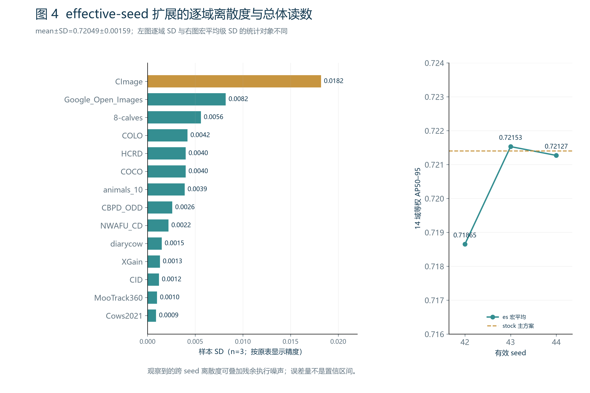

*图 4　左图为各域三种子的样本 SD，右图为先逐种子等权汇总后的三个宏平均。二者统计对象不同；未绘制置信区间。*

CImage 的 SD=0.0182，为当前 es 表最高，约为总体宏平均 SD 的 11 倍；Google_Open_Images 为 0.0082。原文把这两域都概括为“小样本方差最大”需要区分：CImage 确实只有 17 张 test，Google 为 291 张并非本表最小集合之一。其波动不能仅凭样本量确定原因。

从显示值复算，逐域 SD 中位数约 0.0033。原表“10/14 域 SD≤0.004”依赖显示舍入：HCRD 的三位读数复算 SD≈0.003934，而 COCO≈0.004012；按显示的四位 SD 判断为 10 域，按显示三值重新计算则为 9 域。完整精度结果未重取，本记录不把临界计数作为主结论。（本次复算；附录 B）

**统计边界：** es 改变了有效种子，但每种子仅一轮，残余执行噪声仍可叠加在跨种子 SD 中。stock 与 es 的设计分别提供两种诊断证据，没有严格分离所有方差分量。若需分离，应增加“每 seed 多次重复”的嵌套实验；当前不作显著性声明。

### 6.3 与 LODO 的同目标配对及保持率

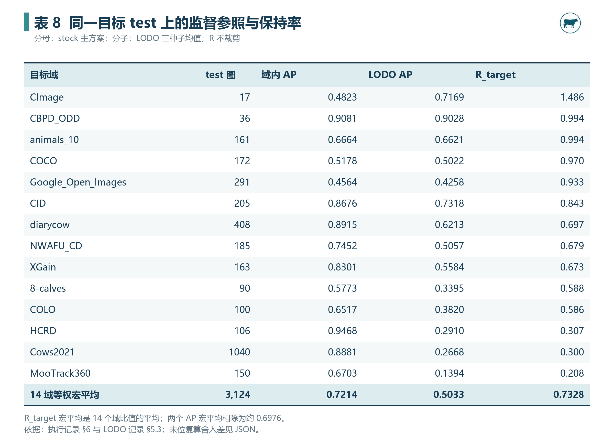

*表 8　LODO 均值取 L3 §5.3，分母取 L2 §4.2。逐域比值宏平均复算为 0.7327588，约 0.7328；表内三位 R 的末位可能与原表截取精度不同。*

域内 AP 宏平均 0.7214，LODO 三种子均值的 AP 宏平均约 **0.5033**。逐域保持率等权平均约 **0.7328**；两个 AP 宏平均相除约 **0.6976**。二者回答不同问题，不能互换。原记录另报告 stock 三轮×LODO 三种子的九组合保持率为 0.7325，该数本次未从完整原始 CSV 独立复算。（L2 §6；L3 §5.3）

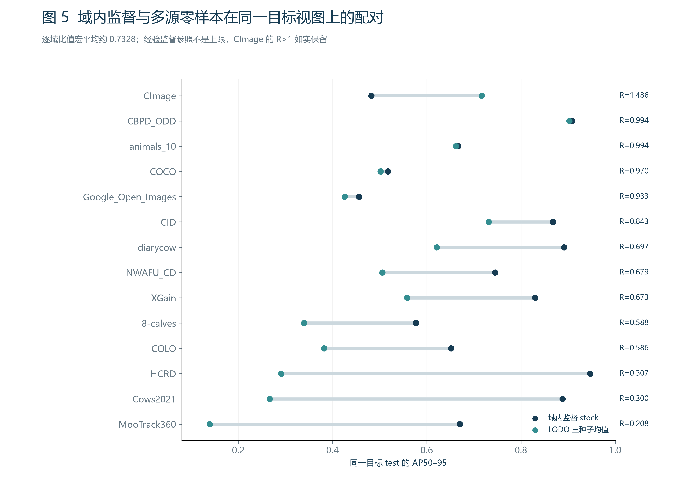

*图 5　点对使用同一目标 test 的 AP50–95；右侧为逐域保持率。图中域内分母保持 stock 主方案，不替换成 es 均值。*

观察可分为三组：

1. **接近域内监督的域。** CBPD_ODD 与 animals_10 的 R 约 0.994，COCO 0.970、Google 0.933；CID 为 0.843。不能把 CID 纳入“均≥0.93”的概括。
2. **保持率明显较低的域。** MooTrack360 约 0.208、Cows2021 0.300、HCRD 0.307，其余若干域约 0.59–0.70。它们指出本轮多源零样本还不能替代目标域监督；原因需要来源与误差分析。
3. **超过经验监督参照的 CImage。** 域内 0.4823、LODO 0.7169，R≈1.486。域内训练仅 141 图、test 17 图（L2 §8），适合优先研究少样本微调和多源迁移，但当前未证明过拟合或特化是唯一机制。

Cows2021 域内 AP=0.8881、R≈0.300，而 CBPD_ODD 域内 AP=0.9081、R≈0.994，说明相近的高域内分数可以对应完全不同的保持率。原记录“域内绝对水平与保持率无关”过强；本记录采用**高域内精度不足以保证高泛化保持率**，不宣称统计独立或不存在相关。

### 6.4 与旧记录的描述性对照

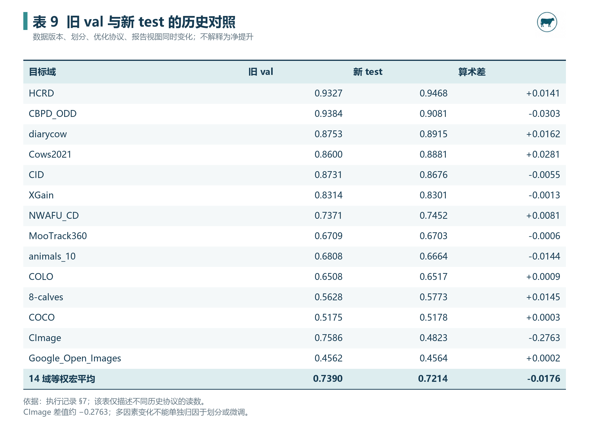

*表 9　旧 val 与新 test 的算术差仅帮助定位历史变化，不解释为净性能增益。*

旧均值约 0.7390，新均值 0.7214，差约 −0.0176；CImage 从 0.7586 到 0.4823，差约 −0.2763。（L2 §7；本次复算）

旧 val 同时承担选模和报告，可能带来选择乐观性；但数据、划分、有效 batch 与报告视图同时变化，不能证明下降由哪一个因素导致。CImage 的 selected/epoch100 差和 es 波动提供了进一步审核入口，未构成因果分解。

## 7. 讨论、后续计划与阶段结论（Discussion & Next Steps）

### 7.1 本阶段的研究价值

本阶段的核心收获是把域内分数放回可追溯的实验流程。统一配置消除了若干明显的协议差异，冻结 test 分离了选模与报告，独立选择脚本避免依赖模糊的 best 文件语义，事故恢复保留了工程审计链，而 seed 机制核查揭示了仅修改参数名称不能保证随机流改变。（L1、L2；本地镜像核查）

对后续 CowCV 分析，新的 $M_{t\to t}$ 提供目标域监督参照，LODO 保持率补充了单独域内精度不能回答的问题。两者结合可形成更清晰的研究讨论，但不扩大为数据质量排名、环境因果解释或多源训练净收益证明。

### 7.2 来源冲突与采用口径

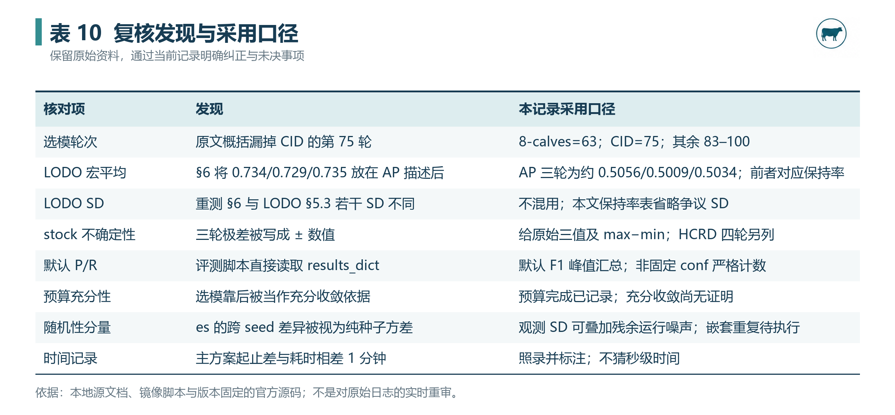

*表 10　核查保留原始资料，通过本记录说明修正；未回写或覆盖两份实验来源文档。*

还需特别保留以下冲突：

- **AP 与保持率的混用。** L2 §6 描述分子侧逐种子宏平均为 0.734/0.729/0.735；L3 §5.4 的 AP 三轮为 0.5056/0.5009/0.5034。按 L3 逐域 AP 与 stock 分母复算，前一组三数约对应逐种子保持率，故本文不把它们称为 LODO AP。
- **LODO 的 SD 字段不同。** L2 §6 的 CImage SD=0.043、CBPD_ODD=0.013 等，与 L3 §5.3 的总体 SD=0.0207、0.0115 等不一致。镜像聚合器同时计算多个比值 SD，可能存在字段转述差异，但本次没有完整原输出，不能据此确定原因。保持率主表省略争议 SD。
- **总体与样本 SD。** L3 的宏平均约 0.5033±0.0019 使用总体 SD（ddof=0）；同三轮改用样本 SD 约为 0.0024。es 扩展使用样本 SD（ddof=1），两者应标明定义后再比较。
- **测试隔离声明。** 禁止以 test 选权重及手工调参，与默认 P/R 从当前曲线峰值汇总是两件事。若文章需要固定部署工作点，应在 val 冻结阈值，再对 test 严格计数，单独命名指标。

### 7.3 后续执行与验收

1. **补齐远程原始证据身份。** 导出各域的 CSV、selection、run_info、args、代码版本与权重 hash，核对本地镜像；检查评测是否恰有 14 个 selected 与 14 个 epoch100 条目、实例数语义是否正确。
2. **审核小样本及来源簇。** 对 CImage、CBPD_ODD 优先登记图像来源与标注；按视频、摄像头、身份或采集批次核查近重复和划分关系，必要时再冻结新版本。抽样审阅须留逐图条目及裁决依据。
3. **嵌套重复量化不确定性。** 在重点噪声域用每有效 seed 多次运行；分别估计 seed 差异、运行噪声与 test 来源簇抽样误差，避免把 n=3 SD 当置信区间。
4. **统一部署工作点。** 保留 AP 主表；另在 val 选择或直接冻结 conf=0.25，test 上按 IoU≥0.5 一对一匹配输出 TP/FP/FN、P/R/F1，并记录预测数与阈值。
5. **补做同视图单源与预算对照。** 新 `data/`、新 test 上复核 14×14 单源迁移，再计算 $\Delta_{multi}$；研究域多样性效果需匹配样本量、优化更新预算和选模规则。
6. **论文落点与其他模型复核。** 新 YOLO11m test 结果单独注明协议，衔接目标保持率和随机性声明；不将它直接混进旧四架构 val 表。其他架构需先冻结跨框架 evaluator、输入、训练与选模协议。

上述为待执行工作，不计入本次完成的训练、评测或错误分析。

### 7.4 可采用的阶段结论

> 在去重后的 `data/` 与冻结 test 视图上，YOLO11m 的 14 域域内监督参照 AP50–95 等权宏平均为 **0.7214**（stock 主方案）。有效种子扩展的三种子宏平均为 **0.72049±0.00159**（样本 SD，n=3），总体分数量级与主方案接近。stock 重复在 11/14 域记录为逐位一致，3 域存在运行间波动；HCRD 同 seed 判别进一步提示残余非确定性。以同目标 test 的 LODO 三种子平均为分子，逐域保持率宏平均约为 **0.7328**，各域差异明显且 CImage 可超过经验监督参照。高域内精度不足以保证高跨域保持率。上述结果支持当前协议下的描述性比较，不构成数据集质量排名、因果解释、理论上限或显著性结论。

**本次完成：** 来源阅读、镜像脚本核查、15 项官方/原始研究入口核查、表格复算、图表制作、相对链接与资料身份检查。  
**本次未运行：** 远程训练/推理、逐图误差分析、CPU seed 机制测试、显著性检验、来源簇 bootstrap、SQLite/向量索引同步。

---

**记录人签字：** __________________　**日期：** __________________  
**审核人/导师签字：** ______________　**日期：** __________________

## 附录 A. 来源、文献与定位

### A.1 本地直接阅读来源

- **L1　[10月域内重测计划](../牛只数据集/10月域内重测计划.md)。** 制定 2026-10-05；es 增补 2026-10-09。完整读取；重点定位 §§1–7 的协议、§10 的边界、§11 的种子扩展。
- **L2　[域内重测：过程与结果](../牛只数据集/域内重测-10月.md)。** 完整读取；§3 排障与恢复、§4 主表、§5 stock 稳定性、§6 保持率、§7 旧对照、§9 资产、§11 es 扩展。历史实验事实的主要本地依据。
- **L3　[LODO测试：过程与结果](../牛只数据集/LODO测试-9月.md)。** 本次重点读取 §2.1–2.3、§5.3–5.4 及相关结果位置；用于核对新数据规模、三种子分子、SD 与保持率口径。
- **L4　[实验记录格式参考](实验记录格式参考.md)。** 完整读取；采用实验目的、原理、材料、步骤、观察、结果、讨论七项结构与签字栏。
- **L5　本地实现镜像。** 只读检查以下 7 份：`D:\牛只数据集实验\indomain_protocol.yaml`、`indomain_train.py`、`indomain_select_checkpoint.py`、`indomain_eval_test.py`、`indomain_compare_lodo.py`、`run_indomain_all.sh`、`indomain_seed_patch_test.py`。已记录 SHA-256；路径本次存在，但未确认与远程历史执行代码完全一致。

背景定位时还查看了已有[多源留一域泛化记录](多源留一域泛化.md)及其[来源摘要](../wiki/sources/cowcv-indomain-architecture-evidence.md)，用于衔接已有索引与辨识口径；没有用它们替代 L1/L2 原始记录。

### A.2 本次自行核查的操作指南与原始研究

外部入口访问日期统一为 **2026-10-14**。官方滚动文档用于操作概念，历史机制尽量引用固定 `v8.4.92`/`v2.5.1` 源码。R9/R10 本次核查论文摘要与元信息，不称为全文精读。具体命中片段、HTTP 状态、访问时间与内容 hash 见[外部来源核查](域内重测.assets/外部来源核查.json)。

- **R1　[Ultralytics Model Training](https://docs.ultralytics.com/modes/train/)。** 定位 Train Settings；核查 optimizer、seed、deterministic、nbs 和 close_mosaic 概念。滚动页面已含其他模型内容，不将其默认值直接冒充历史生效设置。
- **R2　[Ultralytics Model Validation](https://docs.ultralytics.com/modes/val/)。** 定位 Validation Arguments；核查 split、候选 conf、NMS IoU 与汇总 P/R 工作点。
- **R3　[Ultralytics v8.4.92：data/build.py](https://github.com/ultralytics/ultralytics/blob/v8.4.92/ultralytics/data/build.py)。** `build_dataloader`、`seed_worker`：固定 generator 常数与 worker 派生规则。
- **R4　[Ultralytics v8.4.92：utils/metrics.py](https://github.com/ultralytics/ultralytics/blob/v8.4.92/ultralytics/utils/metrics.py)。** `ap_per_class`、`Metric.fitness`、`DetMetrics`：平滑 F1 峰值、fitness 权重与计数字段。
- **R5　[Ultralytics v8.4.92：engine/trainer.py](https://github.com/ultralytics/ultralytics/blob/v8.4.92/ultralytics/engine/trainer.py)。** 累积步数、warmup 更新与 `save_model` 相等判断。
- **R6　[PyTorch v2.5.1：Reproducibility](https://github.com/pytorch/pytorch/blob/v2.5.1/docs/source/notes/randomness.rst)。** 复现限制及 DataLoader 的 generator/worker_init_fn 示例。
- **R7　[PyTorch v2.5.1：DataLoader 源码](https://github.com/pytorch/pytorch/blob/v2.5.1/torch/utils/data/dataloader.py)。** `RandomSampler(..., generator=generator)` 与 `_BaseDataLoaderIter._base_seed`。
- **R8　[COCO API：cocoeval.py](https://github.com/cocodataset/cocoapi/blob/master/PythonAPI/pycocotools/cocoeval.py)。** 10 个 IoU 阈值、101 个召回阈值与 maxDets。访问时记录 hash；用于指标定义，不声称本实验直接使用其全部实现。
- **R9　Gulrajani, I.; Lopez-Paz, D. (2020). [In Search of Lost Domain Generalization](https://arxiv.org/abs/2007.01434)。** 原论文摘要：域泛化比较中的实验条件与模型选择问题；本项目的协议参考。
- **R10　Beery, S.; van Horn, G.; Perona, P. (2018). [Recognition in Terra Incognita](https://arxiv.org/abs/1807.04975)，ECCV 2018。** 原论文摘要：固定摄像位置到新环境的识别泛化；启发来源簇审核，非本项目因果证据。
- **R11　[Ultralytics v8.4.92：nn/tasks.py](https://github.com/ultralytics/ultralytics/blob/v8.4.92/ultralytics/nn/tasks.py)。** `_remap_cls_by_names`、`load`：按类别名重映射及 Transferred 计数。
- **R12　[Ultralytics v8.4.92：utils/torch_utils.py](https://github.com/ultralytics/ultralytics/blob/v8.4.92/ultralytics/utils/torch_utils.py)。** `init_seeds` 的 warn_only 与 `strip_optimizer` 的 epoch/optimizer 改写。
- **R13　[Ultralytics v8.4.92：cfg/default.yaml](https://github.com/ultralytics/ultralytics/blob/v8.4.92/ultralytics/cfg/default.yaml)。** 版本固定的 conf 注释、NMS iou 与 max_det；不代替历史运行参数。
- **R14　[Ultralytics v8.4.92：detect/train.py](https://github.com/ultralytics/ultralytics/blob/v8.4.92/ultralytics/models/yolo/detect/train.py)。** `get_dataloader` 中 `drop_last=self.args.compile and mode=="train"`。
- **R15　[Ultralytics v8.4.92：detect/val.py](https://github.com/ultralytics/ultralytics/blob/v8.4.92/ultralytics/models/yolo/detect/val.py)。** AP 的 10 阈值向量与 `target_img=np.unique(cls)` 的计数语义。

## 附录 B. 图表、复算与审核说明

### B.1 可编辑与机器可读材料

- [表格可编辑底稿](域内重测.assets/表格可编辑底稿.md)：正文 10 张科研表格的 Markdown 数据，便于修改与导出。
- [逐域指标与种子结果 CSV](域内重测.assets/逐域指标与种子结果.csv)：14 域主结果、e*、es/LODO 三种子及保持率；它是本次从文档摘录的派生表，不是服务器原始 CSV。
- [数值复算 JSON](域内重测.assets/数值复算.json)：宏平均、SD、极差、保持率、AP 差、选模轮次及显示舍入边界。
- [来源 hash](域内重测.assets/来源hash.json)与[外部来源核查](域内重测.assets/外部来源核查.json)：本地资料身份和外部核查路径。
- [图表生成与复算脚本](域内重测.assets/生成图表与复算.py)、[外部来源核查脚本](域内重测.assets/核查外部来源.py)、[本地复核脚本](域内重测.assets/复核记录.py)：重新生成与审核入口。
- [图表校阅总览](域内重测.assets/图表校阅总览.jpg)及[表格版面检查](域内重测.assets/图表版面检查.json)：统一视觉审阅与文字界限检查。

### B.2 舍入、图像来源与诚实呈现

主方案四位逐域 AP 复算宏平均恰为 0.7214。es 四位逐域输入复算均值约 0.72048095、样本 SD≈0.00159702，与原表完整汇总的 0.72049/0.00159 存在末位差；本文保留原报告值，同时在 JSON 留下显示精度复算。完整精度原始 CSV 未重取，不用舍入数据反向覆盖实验结果。

LODO 三种子逐域表复算 AP 宏平均约 0.50559/0.50085/0.50336；总体 SD≈0.00194，样本 SD≈0.00237。保持率使用原表四位均值和域内四位分母，宏平均≈0.73275884。原表 CImage R=1.486，当前显示精度复算为 1.486419；逐项舍入差不代表实验变化。

**Study Image 产物：** 图 1 证据链、图 2 随机性审计、[科研表格视觉母版](域内重测.assets/StudyImage-科研表格视觉母版.png)。场景图为说明性绘制；表格母版只提供设计参考及非数据区的小装饰。10 张表格的全部文字与数字由同一程序数据精确排字；3 张统计图由 Matplotlib 绘制，未让生成模型编造曲线或改写读数。表格为 2,400 像素宽、300 dpi，统计图同为 300 dpi。

所有正文配图采用同目录 `.assets/` 相对路径，适配 Typora。图题、表题和说明保留在 Markdown 中；若只移动记录文件而遗漏资源目录，图片将无法显示。未使用伪造预测框、训练截图、签章或实验照片来充当原始证据。
