# 多源留一域泛化

> **实验编号：** EXP-20260708-COWCV-ID-ARCH  
> **实验主题：** 四种代表性检测器在 14 个牛只数据集上的域内验证、评测排障与比较分析  
> **历史训练时段：** 2026-07-11 至 2026-08-06  
> **历史核查与评测修复：** 2026-09-02、2026-09-06；原文包含后续补记  
> **首次整理日期：** 2026-10-13；**本次补充、复算与文献核查：** 2026-10-14（北京时间）  
> **记录类型：** 既有实验整理与方法复核；本次未重新训练或远程评测  
> **记录人：** 待填写　　**审核人：** 待填写  
> **研究对象：** YOLO11m、RT-DETR-L、Faster R-CNN R50-FPN、RetinaNet R50-FPN  
> **格式依据：** [实验记录格式参考](实验记录格式参考.md)的七项结构；将“试剂与耗材”调整为“数据、软件与计算资源”。

**本阶段的研究产出：** 汇集四种检测范式的 56 组独立域内训练记录，建立逐数据集指标与等权宏平均；整理预测输入形状、重复检测匹配和插值统计的三项排障过程；明确验证峰值、固定置信度工作点和保存权重的不同含义。结果支持当前协议下的域内差异描述，为正式统一架构复核提供参照。［L1，§1–3；L2，§4.3］

**2026-10-14 补充的研究联系：** 依据用户指定的 9 月 LODO 计划与执行记录，梳理“域内架构参照→固定 YOLO11m 的未见域测试→外部验证”的研究链，复算 42 组 LODO 目标域读数，并与新数据同一 test 视图上的 YOLO11m 域内监督参照配对。相关协议、过程、结果与局限集中在 §7.4；旧四架构 val 表保留为一套历史记录。［L6–L7；L4–L5］

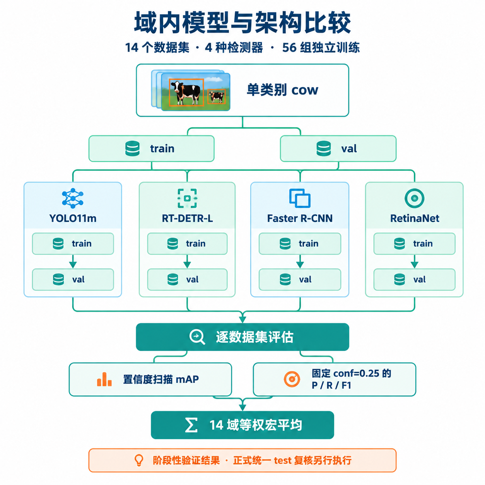

*图 1　域内比较的研究流程。每个检测器在每个数据集上分别训练，共 4×14=56 组；图中 train→val 表示先训练、后验证与选模，val 不参与梯度更新。该图由 Study Image 绘制，表示历史验证比较的范围。*

[TOC]

---

## 1. 实验目的（Objective）

### 1.1 研究问题

单一检测器在某个牛只数据集上取得高分，不能说明其他检测范式具有相同表现，也不能直接代表跨数据集泛化能力。因此，本阶段在各数据集内部独立训练四种检测器，重点回答以下问题：

1. **共同难度是否存在？** 不同检测器是否共同在某些数据集上取得高分或低分，数据集之间的相对次序是否一致？
2. **架构差异有多大？** 逐域比较与等权宏平均是否给出一致图景，整体均值是否掩盖个别数据集的差异？
3. **困难出现在检出还是定位？** 联合观察 AP50 与 AP50–95，识别宽松匹配下的检测困难及高 IoU 下的定位敏感性。
4. **工作点与评估实现怎样影响读数？** 区分固定 conf=0.25 的 P/R/F1、验证集最佳 F1 工作点和扫描置信度的 mAP，并追溯推理、匹配与聚合过程。［L1，§3；L2，§4.3］

### 1.2 比较单位与研究边界

本节的比较单位是“**检测器—数据集**”组合。YOLO11m 的 14 域宏平均来自 14 份分别训练的权重，其他检测器同理；这里没有“一份权重同时在 14 个域上获得上述域内精度”的含义。

历史四模型主表全部使用各数据集的 **val**。Cows2021 与 Dairy Cow 的名义 test 划分只作为数据登记，不进入本节的四模型主结果。验证集既参与 checkpoint 选择，又用于本节性能报告，因此主表是选模后的阶段性验证表现。正式独立测试估计需要另行执行。［L2，§3.2、§4.3、附表 A1］

本记录聚焦文章初稿 **4.3 的域内架构比较**。YOLO11s/m/l 的精度—效率选择属于 4.4；固定 YOLO11m 的单源迁移与 LODO 属于 4.5。不得把本节四架构数值扩展为跨域能力排名。

### 1.3 本次整理的证据范围

本次完整读取两份指定的9月LODO计划与执行记录、域内服务器核查笔记和格式参考，另读取文章初稿、10月重测计划与执行记录的相关章节；另外查阅官方指南、版本源码和原始论文。**没有连接历史服务器，没有重新打开远程训练日志或 56 份 metrics.json，没有重新训练、推理或人工逐图审核。**

全文采用以下区分：

- **记录事实：** 本地资料明确记载的配置、读数和历史事件；涉及远程执行时明确为原记录转述。
- **复算结果：** 从本地已公开表格计算的均值、差值、排序相关与描述统计。
- **方法依据：** 本次打开的官方文档、版本源码或原始论文支持的机制与操作原则。
- **推断／待核实：** 指标不能独立证明的原因解释，或本地描述与官方实现之间仍需查证的差异。

这种区分使记录既保留已有工作的贡献，也不把尚缺证据的解释包装为新实验结果。

### 1.4 与 9 月 LODO 计划的关系

两份指定文档关注多源泛化，不能独自提供四种架构的域内训练参数和主结果。因此，本记录用 L1、L2 补足标题所需的域内比较证据，再用 L6、L7 说明后续为何固定 YOLO11m 研究数据域迁移。

这里固定 YOLO11m 是已有项目协议的选择：便于沿用单源基线并把比较集中到来源组合、采样和目标域表现；**不是通过四架构跨域实验选出的“泛化最优架构”**。LODO 只训练 YOLO11m，也没有提供 RT-DETR、Faster R-CNN、RetinaNet 的同协议未见域分数。［L6，§2–3；本记录综合］

## 2. 实验原理与参考依据（Principle & References）

### 2.1 四种检测范式的选择依据

**YOLO11m：单阶段检测。** Ultralytics 将 YOLO11 用于目标检测等任务，并提供训练、验证与推理接口。本项目采用其 m 规模模型作为既有牛只基线，目的在于提供直接检测范式的参照；官方 COCO 性能或速度表不等于本项目牛只数据上的实测效率。［W1；L2，§4.1］

**RT-DETR-L：端到端 Transformer 检测。** 原论文通过高效混合编码器和查询选择设计实现实时端到端检测，原生推理流程无需 NMS。此机制适合与直接检测和两阶段检测进行范式对照。但原生能力与历史自定义评测脚本的实际执行路径必须分开核查。［W2、W9、W10］

**Faster R-CNN R50-FPN：两阶段检测。** Faster R-CNN 的 RPN 与检测器共享卷积特征，先生成候选区域，再进行区域分类与框回归；本项目使用 R50-FPN 配置。FPN 提供多尺度特征表示，不是 Faster R-CNN 原论文名称的一部分。［W3、W12；L1，§1.1］

**RetinaNet R50-FPN：单阶段密集检测。** Focal Loss 针对密集检测中前景与背景的训练不平衡，降低容易样本的损失贡献，使训练更关注困难样本。本项目用 RetinaNet 补充另一种单阶段实现，观察其在牛只数据上的阶段性表现。［W4、W12；L1，§1.1］

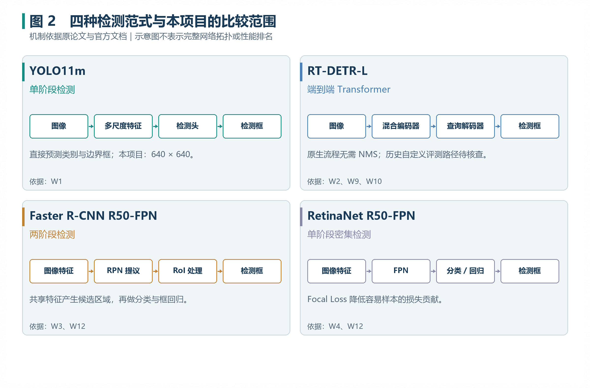

*图 2　检测机制对照。此图由本地程序依据原论文与官方资料排绘，表示方法关系，不表示完整网络拓扑、复杂度或性能排名。*

### 2.2 指标的定义与工作点

预测框 $B_p$ 与真实框 $B_g$ 的重叠程度为：

$$
\operatorname{IoU}(B_p,B_g)
=\frac{|B_p\cap B_g|}{|B_p\cup B_g|}.
$$

在类别一致、匹配 IoU 达到规定阈值且完成一对一匹配后，统计 TP、FP、FN：

$$
P=\frac{TP}{TP+FP},\qquad
R=\frac{TP}{TP+FN},\qquad
F1=\frac{2PR}{P+R}.
$$

本节主工作点为 **conf=0.25、匹配 IoU≥0.5**。其中 conf 控制哪些预测进入统计，匹配 IoU 判断预测是否正确定位。**NMS IoU 是另一项参数**，用于预测框之间的抑制；不能把 NMS IoU=0.7 写成 AP 的正确匹配阈值。［L1，§3.1；L2，§4.2.1；W13、W14］

本项目只有一个检测类别 `cow`，固定 IoU 下的 mAP 数值等于该类别 AP。AP50–95 在 0.50、0.55、…、0.95 共十个匹配阈值上平均：

$$
\operatorname{AP}_{50:95}
=\frac{1}{10}\sum_{u\in\{0.50,0.55,\ldots,0.95\}}\operatorname{AP}_u.
$$

本文沿用源文档的 `mAP@0.5` 与 `mAP@0.5:0.95` 写法。AP 由预测分数排序形成的 P–R 曲线计算，不是固定 conf=0.25 下的一次 P/R/F1；实际曲线仍受低分预测收集下限、最大检测数、匹配与插值规则影响。“扫描置信度”不意味着评估完全不受这些设置影响。COCO API 的默认检测设置包含多个 maxDets 档位，标准 AP 汇总通常使用每图最多 100 个检测；正式复核应保存实际 evaluator 参数。［W13；L2，§4.2.1］

### 2.3 宏平均的含义

对相同的 14 个数据集集合，逐域计算指标 $M_{m,d}$，再等权平均：

$$
\overline{M}_m
=\frac{1}{14}\sum_{d=1}^{14}M_{m,d}.
$$

每个数据集的权重相同，CImage 不因为只有 35 张验证图像而被减权，Cows2021 也不因为验证图像更多而主导均值。该汇总回答“按数据集等权的平均表现”，不等于将所有图像或实例合并计算的 pooled/micro 指标。不同方法必须纳入相同数据集集合后才能比较。

宏平均 F1 必须先逐域计算 F1，再取平均；不能把宏平均 P、R 代入 F1 公式。验证集最佳 F1 阈值也应逐“检测器—数据集”选择，不是一个跨域共享阈值。［L2，§4.2.2、§4.3.2、附表 A1］

### 2.4 同轮数与同 batch 并不自动构成公平比较

历史四模型均训练 100 epochs，但优化器、输入变换、增强、AMP、有效 batch 和软件环境不同。相同轮数仅表明相同名义遍历次数；它不保证更新次数、计算量或总耗时一致。

MMEngine 支持 `accumulative_counts` 梯度累积。micro-batch 与累积次数相乘可描述名义有效 batch，但受末批、warmup、实际执行和批归一化等因素影响，不能把两种 micro-batch 实现直接称为数值完全等价。Ultralytics 的累积设置在 warmup 中也可能变化；正式训练应直接记录优化器 step 次数与 AMP 的实际执行状态。［W6、W11；L1，§1.4］

正式协议需要先确定研究问题：比较各方法的原生训练配方，还是在受控设置下比较模型实现。随后选择并公开预算原则，例如相同数据遍历、相同更新预算或相同计算预算，并补充其他成本指标。简单地把所有超参改成同一数值，也未必能合理体现各架构能力。

## 3. 数据、软件与计算资源（Materials & Environment）

### 3.1 数据覆盖与类别定义

历史工作集共 **31,373 张图像**，登记 train 23,851 张、val 4,971 张、名义 test 2,551 张。四模型主表均在 val 上汇总，类别统一为 `cow`。源记录训练名 `diarycow` 对应正文的 Dairy Cow，`NWAFU_CD` 对应 NWAFU Cattle Dataset，COCO 与 Google Open Images 均指当前牛类子集。［L2，§3.2、§4.3］

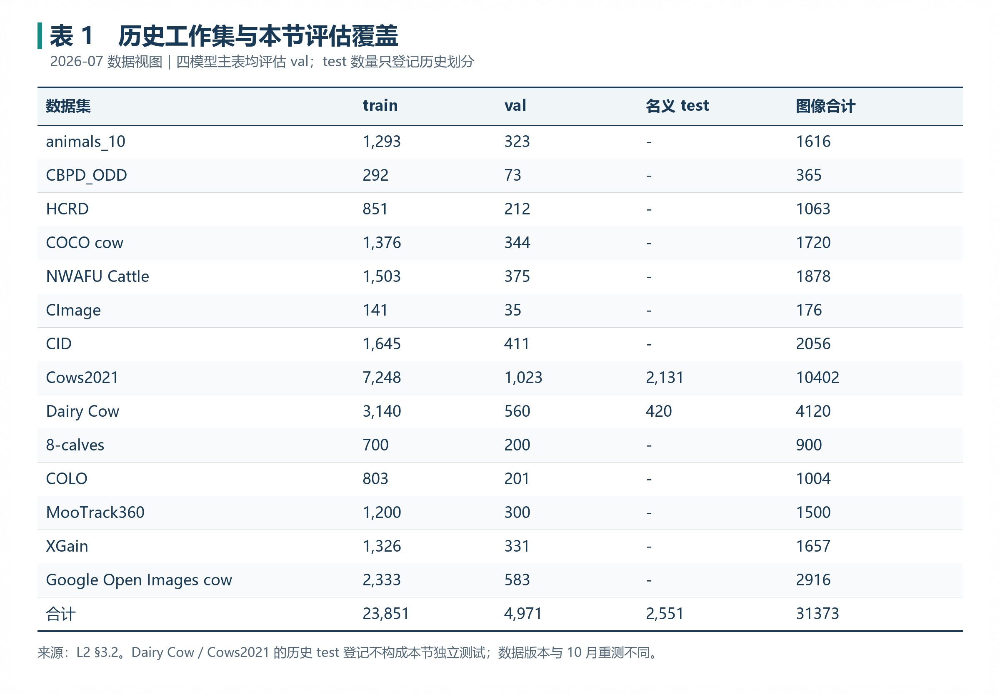

*表 1　数据规模和评估覆盖。表中的 test 数量只表示历史登记，不说明本次四模型 test 已完成。图中简称与完整名称的映射保存在可编辑底稿及指标 CSV 中。*

单类别统一只解决类别词汇的一致性。全牛框、躯干框、裁切目标边界和遮挡目标规则仍可能不同；这些差异会影响定位指标。因此，高分或低分只解释为当前标签与验证视图上的表现，不直接作为数据集质量评价。［L2，§3.3、§4.3；本记录综合判断］

### 3.2 历史训练参数

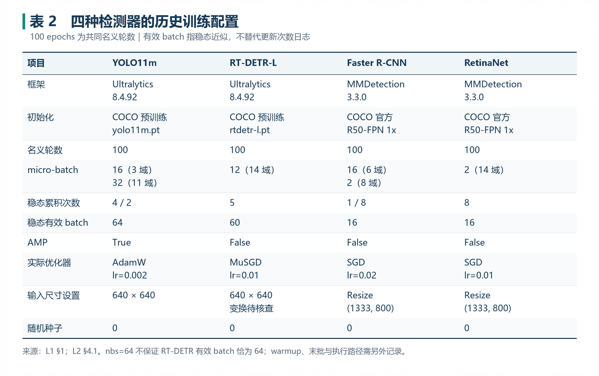

*表 2　四模型训练配置。数据来自本地历史核查记录；“实际优化器”表示记录中的运行日志选择结果，不是本次重新执行 `optimizer=auto` 得出的结果。*

参数中的几个关键差异需要单独登记：

1. **YOLO11m 名义 batch 曾变化。** animals_10、CBPD_ODD、HCRD 为 16，其余 11 个有效实验为 32；nbs=64 下记录的稳态累积分别为 4、2。
2. **RT-DETR-L 的有效 batch 为 60。** 名义 batch=12、记录的稳态累积=5，乘积为 60。文章 4.1 中“两者有效 batch 为 64”的总括句不能覆盖这一组合，详见 §7.1。
3. **Faster R-CNN 有两种实现。** 前 6 个数据集采用 micro-batch 16，其余 8 个采用 micro-batch 2×累积 8；RetinaNet 的 14 个实验均为后者。两种实现的名义有效 batch 都是 16，但不能据此断言数值完全等价。
4. **优化器不是统一设置。** YOLO11m 和 RT-DETR-L 的配置传入 `optimizer=auto`，核查笔记分别记录实际 AdamW、MuSGD；MMDetection 两模型为各自配置的 SGD。配置入参不能替代实际优化器日志。
5. **AMP 仅 YOLO11m 开启。** RT-DETR-L、Faster R-CNN、RetinaNet 均记录为关闭。［L1，§1.1、§1.4–1.6；L2，§4.1］

Ultralytics 的历史增强参数包含 mosaic、HSV、平移、缩放、水平翻转等配置字段；MMDetection 核查记录的管线为加载图片与标注、保持比例 Resize、随机水平翻转和打包输入。**共享配置字段的存在不等于每个模型实际执行了同样的增强路径**；RT-DETR 的生效变换应结合对应版本的数据集与 trainer 代码复核。［L1，§1.7；W9、W10］

### 3.3 训练时硬件与软件环境

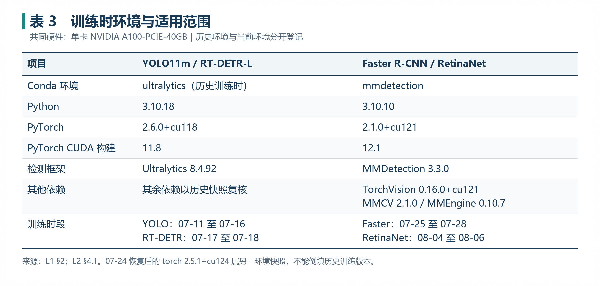

*表 3　历史环境按模型家族分列。软件版本是本地记录对历史日志的转述，未在本次重新登录核查。*

核查笔记记载共用单卡 A100-PCIE-40GB，驱动 545.23.06。YOLO11m／RT-DETR-L 历史日志头为 PyTorch 2.6.0+cu118；2026-07-24 的环境恢复记录则为 2.5.1+cu124。后者不能倒填为 7 月前期训练版本。MMDetection 两模型使用独立环境，不能把 Ultralytics 的系统与依赖表无条件扩展到所有模型。［L1，§2；L2，§4.1］

### 3.4 产物定位与身份登记

历史项目根由 L1 记载为：

```text
/data1/yxli/CODE/ultralytics/self_mAP/
├── outputs/yolo/<数据集>/
│   ├── args.yaml
│   ├── results.csv
│   └── weights/best.pt
├── outputs/rtdetr/<数据集>/
│   ├── args.yaml
│   └── results.csv
├── outputs/faster_rcnn/100ep_bs16/<数据集>/
│   ├── effective_config.py
│   └── <时间戳>/...log、vis_data/scalars.json
├── outputs/retinanet/100ep_ebs16/<数据集>/
│   ├── effective_config.py
│   └── <时间戳>/...log、vis_data/scalars.json
├── outputs/evaluations/<framework>/<run>_val/metrics.json
└── scripts/
    ├── evaluate_yolo_pr.py
    └── evaluate_mmdet_pr.py
```

该结构用于定位证据，不表示本次确认所有目录或文件仍存在。正式归档不能仅凭文件名 `best.pt` 判断选模身份，应同时保存数据清单、配置、源代码版本／补丁、选模规则、epoch 映射及权重 SHA-256。

## 4. 实验步骤与过程记录（Procedures）

### 4.1 准备与单类别配置

历史步骤按本地资料重建如下：

1. 分别登记 14 个数据集的训练和验证视图，统一检测目标为 `cow`；确认数据集名称与 run 目录映射。
2. Ultralytics 侧使用相应单类别数据配置；MMDetection 侧基于官方 R50-FPN 1x COCO 配置调整数据路径、类别元信息及检测头。
3. MMDetection 的 Faster R-CNN 需要调整 RoI bbox head 的 `num_classes`，RetinaNet 需要调整其 bbox head；仅改类别名称或数据 JSON，不能保证检测头输出维度正确。官方指南也要求数据元信息与模型类别配置对应。［L1，§1；W5］
4. 保留 COCO 预训练初始化的具体文件身份。L1 中权重后面的 `39M`、`64M` 缺少明确单位，本记录不将它们写成参数量。正式复核分别记录文件字节数与模型参数数目。

### 4.2 执行历史训练并保存生效设置

各“模型—数据集”组合独立训练 100 epochs，每轮在本域 val 验证。Ultralytics 留存 `args.yaml`、`results.csv` 及权重；MMDetection 留存 `effective_config.py`、运行日志、`scalars.json` 与最佳 checkpoint。训练脚本和批量脚本的参数用于解释实际 batch、AMP 与优化器；环境头用于识别训练时版本。［L1，§1–2、§5］

历史记录另外说明 RT-DETR-L 的 Cows2021 从中断的 `last.pt` 续训。该事件应作为运行轨迹保留，而不能仅凭最终曲线完整就抹去续训事实。正式实验需明确 resume 是否允许、如何保留恢复前后的日志和随机状态。

### 4.3 选择权重：区分“验证最高行”和“保存文件”

**Ultralytics。** L1 早期描述 mAP 主表取 `results.csv` 中 mAP50–95 的最高行。L2 附表 A1 后的说明则明确：P/R/F1 重评使用 `best.pt`，28 个 Ultralytics run 中有 3 个的 mAP 最高轮与该文件不同，记录的轮间差异不超过 0.001。因此，本记录保留两类身份：

- mAP：已发表在本地表格中的验证记录值；
- P/R/F1：文档所述 checkpoint 的重评读数。

**本次未证实所有指标均来自完全同一轮权重**。差值小也不能替代文件身份核查。

**MMDetection。** L1 记载 `CheckpointHook` 按 `coco/bbox_mAP` 保存最优模型、每轮验证，产物为 `best_coco_bbox_mAP_epoch_*.pth`。`save_best` 与比较规则属于 hook 设置，应和最终加载的文件逐项核对。官方文档提供这种保存机制，但不能替本项目证明某份文件已正确加载。［L1，§1.2；L2，§4.1、附表 A1；W7］

**新发现的版本冲突。** L1 将 Ultralytics fitness 写成 `0.1×AP50+0.9×AP50–95`；本次打开的官方 `v8.4.92` 指标源码却将检测 fitness 权重定义为 `[0, 0, 0, 1]`。这项冲突尚不能仅靠网页解决：历史安装可能存在本地补丁、版本标记差异或记录错误，需核对实际训练代码、日志和文件。正文不沿用前一公式作为确定事实。［W8；L1，§1.2］

### 4.4 重推理与固定工作点评测

L1 记载 2026-09-06 修复后的 `evaluate_yolo_pr.py` 与 `evaluate_mmdet_pr.py` 在各 run 的 val 上重推理，形成 56 份 metrics.json，保存：

- conf=0.05／0.25／0.50 的 P/R/F1 与预测计数；
- 验证集最佳 F1 阈值及其指标；
- 后处理配置与协议字段。

主表统一报告 conf=0.25、匹配 IoU≥0.5；最佳 F1 工作点用于补充说明阈值敏感性。最佳阈值只在 val 上确定，不在 test 上搜索。［L1，§3.1、§3.6；L2，附表 A1］

L1、L2 将 Ultralytics 的后处理总括为 NMS IoU=0.7、max_det=300、低分收集下限 0.001；MMDetection 则为 score 阈值 0.05、NMS IoU=0.5、max_per_img=100。**这些是本地记录口径，不构成四模型共享后处理的证据。** 尤其 RT-DETR 原生路径并不调用常规 NMS，不能把 YOLO 参数不加区分地套给 RT-DETR。［W9、W10；L1，§3.1；L2，附表 A1］

### 4.5 排障一：预测输入形状与验证输入不一致

**现象。** L1 记载早期 Ultralytics predict 默认 `rect=True`，可能形成 480×640 等矩形输入，与对应验证路径的输入边界条件不同。8-calves 的一个贴边目标虽达到 IoU=0.897，分数仅为 0.002。

**处理。** 评测脚本对相关预测路径显式设置 `rect=False`，并按图片、GT、像素／张量、预测集合逐层对照。L1 报告 200/200 张图片的预测集合一致、GT 数量 1,633 对齐。

**本次复核的限制。** 官方 `v8.4.92` 的 RT-DETR predictor 使用 `scale_fill=True`，validator 使用独立变换路径，不能将“设置 rect=False”理解为所有模型都执行同一个 letterbox。L1 的案例保留为历史排障记录；RT-DETR 的实际缩放、填充、坐标还原须分别检查。［L1，§3.0；W9、W10］

**方法收获。** 模型名、imgsz 和权重相同，仍不足以保证两次评估的输入相同。对照应覆盖实际张量形状、像素预处理、目标坐标与预测还原。

### 4.6 排障二：重复检测的一对一匹配顺序

**现象。** L1 记载初版按 IoU 降序实现的重复检测匹配与目标版本行为不一致；低分重复框可能先绑定 GT，在后续固定阈值统计中造成 TP 丢失。记录中的 RT-DETR CBPD_ODD 案例涉及 92 个 GT，初版少计 10 个。

**处理。** 评测实现按目标版本的索引顺序复刻，并以该案例验证匹配计数恢复为 92=92。该修复说明：相同 IoU 阈值和“一对一匹配”描述，并不保证算法顺序、去重或并列处理完全相同。

**证据边界。** 单个案例和有限数据集对照不能自动证明两个评估器在所有密集场景中的匹配行为完全等价。本次未读取脚本进行全覆盖验证；正式复核应保存重叠 GT、重复预测、同分预测和临界 IoU 的构造案例，明确筛分与匹配先后顺序。［L1，§3.0；W13］

### 4.7 排障三：插值曲线值与严格阈值计数

**现象。** L1 记载训练日志的 P/R 来自插值曲线与最优 F1 网格点，不能直接当作 conf=0.25 下的严格计数。8-calves 的历史对照在该阈值处出现约 4.5 个百分点的 Recall 差异。

**处理。** 固定工作点重新基于筛选后的 TP、FP、FN 计算；插值与最佳 F1 曲线结果作为独立补充口径保留。官方版本源码的 `ap_per_class` 包含插值网格和曲线处理，支持“报告语义不同”的判断。［L1，§3.0；W8］

**修订措辞。** 不将某个对照中的高估推广为插值方法在所有数据和阈值上都会高估，也不把语义差异直接称为框架 bug。L1 描述的具体偏差保留为该案例现象。

## 5. 原始记录摘录与过程现象（Raw Data & Observations）

### 5.1 验证峰值轮次

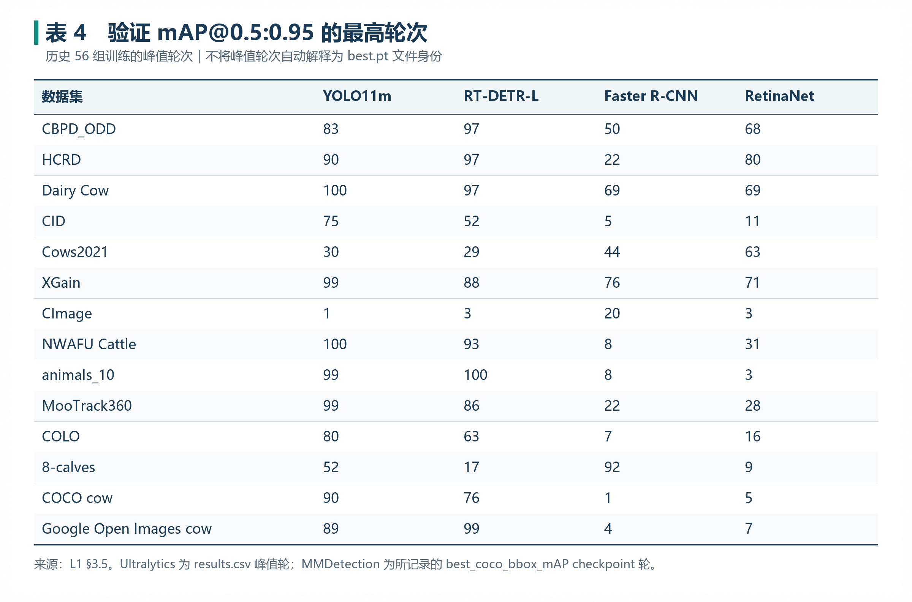

*表 4　L1 记录的 mAP50–95 最高轮次；Ultralytics 的峰值行与保存权重身份分开登记。*

记录中的部分峰值很早：YOLO11m 的 CImage 为第 1 轮，Faster R-CNN 的 COCO 为第 1 轮，RetinaNet 的 CImage 和 animals_10 为第 3 轮。它们说明**验证表现的最优时刻并不总在训练末尾**，应保留每轮曲线并审计选模规则。

早期峰值不独立证明过拟合、预训练表征遗忘或跨域更强。要验证这些解释，需要训练／验证曲线、原始预训练参照、同视图评估和重复运行，而不能仅凭一个最佳 epoch。

### 5.2 mAP 主结果

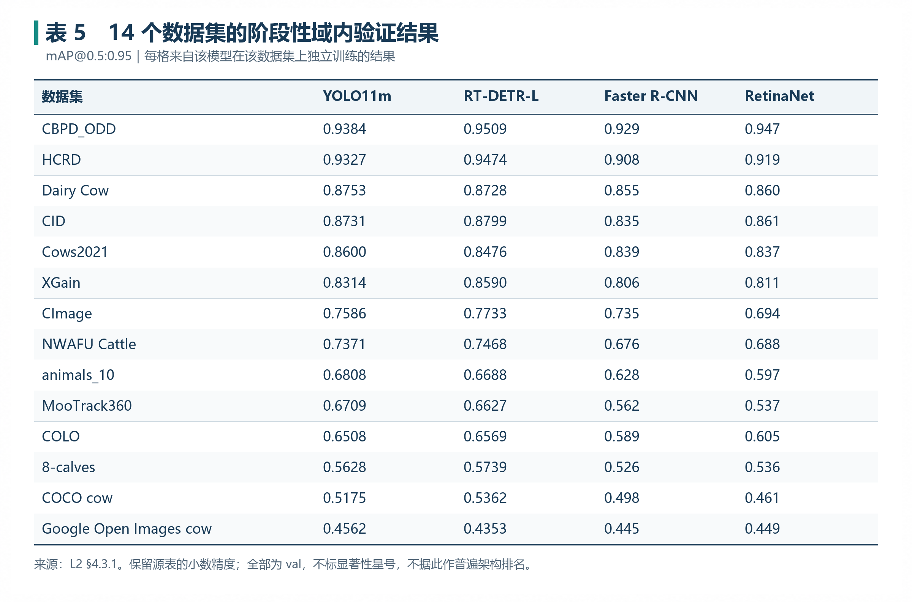

*表 5　四模型在各自 val 上的 mAP50–95。YOLO11m、RT-DETR-L 保留源表四位小数，MMDetection 两列保留三位小数，不补造远程全精度值。*

该表是 L2 中已有结果的重排，**不是本次重新生成的远程原始输出**。完整 AP50、P/R/F1、最佳工作点和阈值保存于 [表格可编辑底稿](多源留一域泛化.assets/表格可编辑底稿.md)，56 个组合的机器可读记录保存于 [逐模型逐数据集指标 CSV](多源留一域泛化.assets/逐模型逐数据集指标.csv)。

### 5.3 固定工作点的 F1

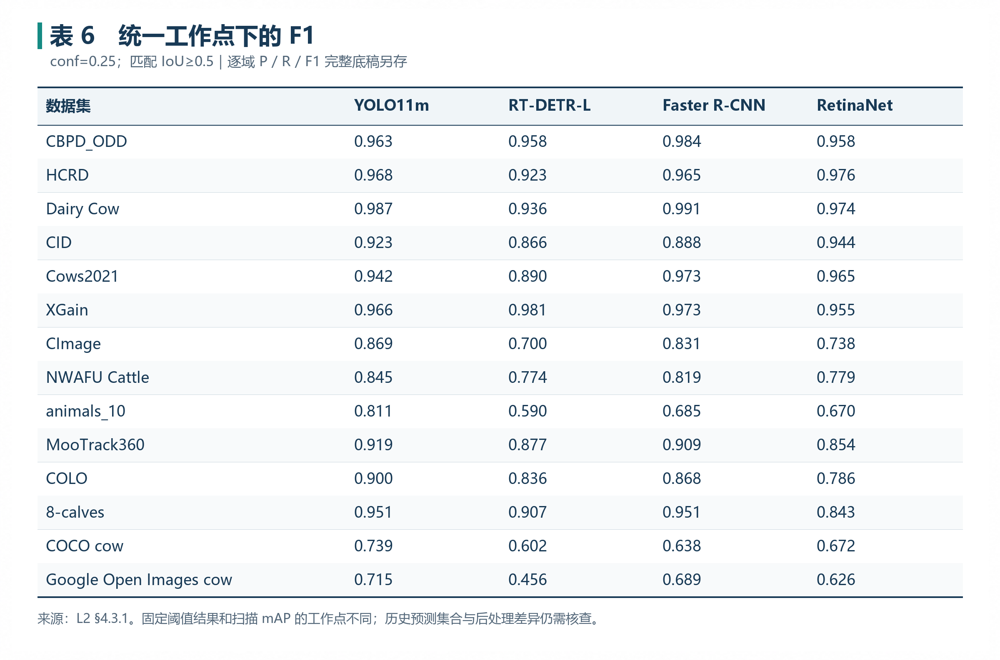

*表 6　conf=0.25、匹配 IoU≥0.5 下的 F1。逐域 P、R 完整保留在底稿中，正文用 F1 表减少宽表重复。*

从主表可以直接观察到：某个模型的 AP50–95 较高，不保证其固定工作点 F1 同样较高。两类指标分别衡量扫描分数下的精度曲线和指定工作点的误检／漏检权衡，解释时需要同时标明协议。

### 5.4 历史时间记录及缺失项

L1 的墙钟时间来自批量脚本的 Starting／Completed 时间戳，包含模型加载与验证等开销，记录完整度并不相同：

- RT-DETR-L 有 7 个批量 run 的时间，另外 7 个单独完成的 run 缺相应时长；例如 Cows2021 为 6 h 57 min、Dairy Cow 为 3 h 24 min。
- RetinaNet 的 14 个 run 均有时间；例如 Cows2021 为 11 h 29 min、Dairy Cow 为 8 h 18 min、8-calves 为 1 h 02 min。
- Faster R-CNN 批量部分有 8 个 run 的记录，其中 XGain 的结束时间未独立记录，约 2 h；前 6 个单独启动的 run 无完整时间。Cows2021 为 16 h 58 min、Dairy Cow 为 7 h 40 min。
- L1 记载 2026-09-02 的 MMDetection P/R/F1 评测耗时约为 Faster R-CNN 14 域 25 min、RetinaNet 14 域 15 min；不能将这些时间自动视为 09-06 修复版重跑的耗时。［L1，§4］

本记录不补造 YOLO11m 四架构对照所缺的完整时长，也不以零填充缺失项。这些墙钟读数不用于正式速度排名，不能代替标准 batch=1 延迟或相同数据视图上的计算成本测量。

## 6. 结果与数据分析（Results & Analysis）

### 6.1 数据集等权宏平均

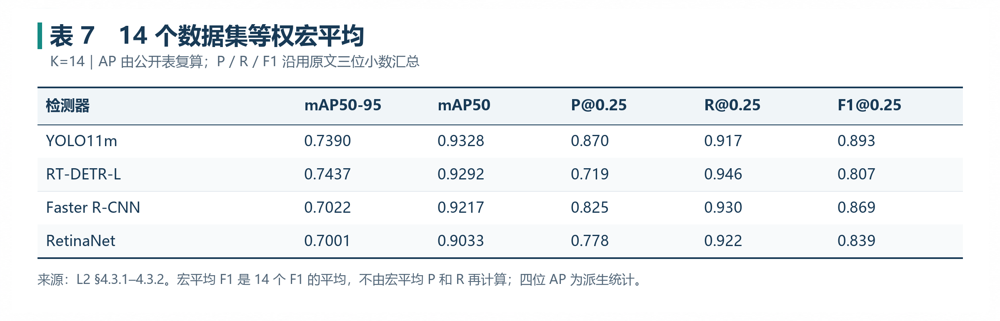

*表 7　14 域等权宏平均。AP 的四位结果由逐域表复算；P/R/F1 沿用 L2 的三位汇总。逐域三位读数复算会受到源表舍入影响，不冒充远程全精度结果。*

AP50–95 宏平均复算为：

- YOLO11m：**0.7390**；
- RT-DETR-L：**0.7437**；
- Faster R-CNN：**0.7022**；
- RetinaNet：**0.7001**。

这是当前历史协议下的描述性均值。它们不能脱离输入尺寸、初始化、AMP、优化器、增强、权重身份和评估器差异解释为架构本身的净效应。

### 6.2 YOLO11m 与 RT-DETR-L：总体接近，逐域优势不同

RT-DETR-L 的 AP50–95 高于 YOLO11m 的域数为 **9/14**，YOLO11m 高于 RT-DETR-L 为 **5/14**。宏平均差值为：

$$
\overline{\Delta}
=\frac{1}{14}\sum_d
\left(M_{\mathrm{RT},d}-M_{\mathrm{YOLO},d}\right)
=0.004707\ldots
$$

即约 **0.47 个百分点**。逐域绝对差均值为 0.0127，即约 **1.27 个百分点**；12/14 个数据集的绝对差不超过 0.02。

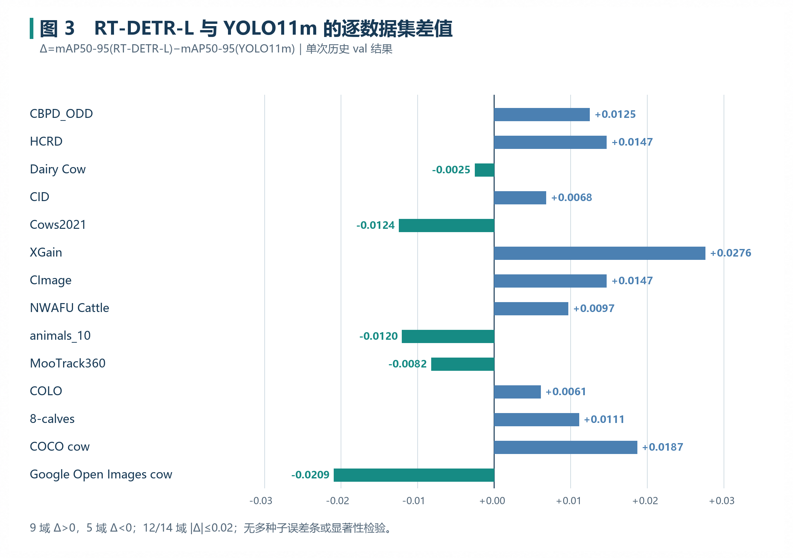

*图 3　RT-DETR-L 减 YOLO11m 的配对差值。蓝色为 RT-DETR-L 较高，青绿为 YOLO11m 较高；横轴保留正负方向。单次历史 val 记录不添加误差条或显著性星号。*

其中 RT-DETR-L 在 XGain 高 0.0276，YOLO11m 在 Google Open Images cow subset 高 0.0209；Dairy Cow 的差值仅 −0.0025。总体均值小与个别域差异较大可以同时成立。

**阶段结论：** 两者在当前协议下总体接近，相对优势依赖数据集；尚无依据断言 0.0047 的均值差在重复训练中稳定、具有统计显著性，或能迁移到独立 test。

### 6.3 四模型共同的数据集次序

对四模型在 14 域上的 AP50–95 进行排序，两两 Spearman 秩相关为 **0.9736–0.9912**。当前各模型的 14 个分数均无并列，复算采用：

$$
\rho_s
=1-\frac{6\sum_d(r_{m,d}-r_{n,d})^2}{14(14^2-1)}.
$$

全部六个相关系数及排序复算保存在 [数值复算 JSON](多源留一域泛化.assets/数值复算.json)。

数据集四模型均值最低为 Google Open Images cow subset 的 **0.4464**，最高为 CBPD_ODD 的 **0.9413**，跨度 **0.4949**。四模型各自宏平均的跨度为 **0.0435**。这表明当前数据中跨数据集的性能变化幅度大于模型总体均值变化，四种实现呈现出相近的域内相对次序。［L2，§4.3.2；本次复算］

这一比较的两种跨度不是方差分解，也没有控制数据规模、场景、标签或验证组成。因此，不据此证明“数据集因素贡献了多少比例”，不构成数据集质量排名，也不将任何单个因素写成已确认的主因。

### 6.4 宽松检出与严格定位的不同困难

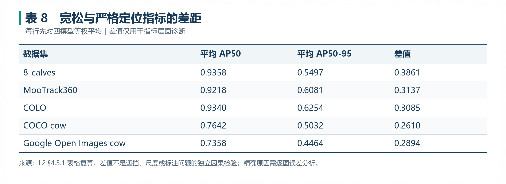

*表 8　先对四模型平均，再比较 AP50 与 AP50–95。差值在未舍入均值上计算，最后保留四位小数；因此不能只对展示的两列小数相减来验证最后一位。*

**8-calves、MooTrack360、COLO。** 四模型平均 AP50 分别为 0.9358、0.9218、0.9340；AP50–95 为 0.5497、0.6081、0.6254。宽松匹配下仍较高，但在更严格定位要求下明显下降，提示应优先检查边界框精确定位、密集目标匹配和标注边界一致性。

**COCO 与 Google Open Images 牛类子集。** 平均 AP50 分别为 0.7642、0.7358，宽松匹配下也已有检测困难，不能将下降全部归到高 IoU 定位阶段。

上述仅为**指标层面的诊断**。要区分小目标、遮挡、鱼眼畸变、框范围差异、误检和漏检，需要逐图案例及分层统计。特别是 AP50–95 本身包含 AP50，二者差值不是某个可独立分离的“定位损失量”。［L2，§4.3.1；W13；本次复算］

### 6.5 F1 的工作点敏感性

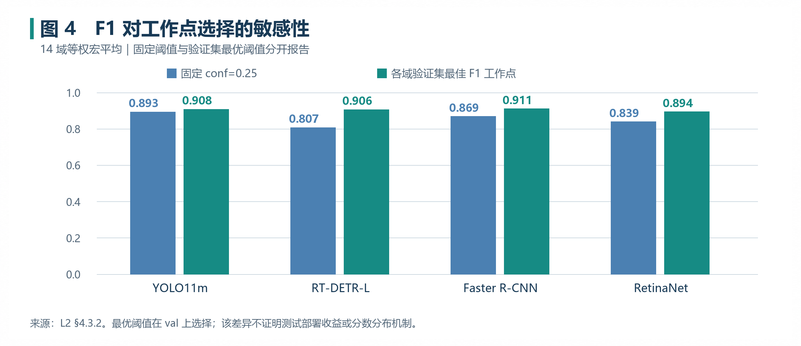

*图 4　固定 conf=0.25 与各自验证集最佳 F1 工作点的宏平均。纵轴从 0 开始；数值使用 L2 三位汇总，最佳阈值没有在独立 test 上验证。*

RT-DETR-L 的 F1 宏平均从固定工作点的 **0.807** 到验证集最佳工作点的 **0.906**；Precision 从 **0.719** 到 **0.919**。这一差异说明指定阈值会显著改变该模型在历史验证集上的误检／漏检权衡。最佳 F1 的四模型宏平均则接近 0.894–0.911。

从逐域已舍入表复算，最佳工作点相对固定工作点的 F1 宏平均差值约为：YOLO11m +0.0152、RT-DETR-L +0.0990、Faster R-CNN +0.0424、RetinaNet +0.0555。［L2，§4.3.2、附表 A1；本次复算］

**可以确认：** 工作点选择会影响 P/R/F1，固定工作点与扫描 mAP 应分开报告。

**不能确认：** RT-DETR 分数分布一定“平坦”，差异必然由分数校准造成，或验证集最优阈值在部署端一定改善相同幅度。要验证这些机制，需要分数分布、可靠性分析和独立测试；历史预测收集与后处理差异也需先排除。

### 6.6 优先误差分析的对象

从每个数据集四模型 AP50–95 的最大值与最小值之差观察，MooTrack360 的跨度为 **0.1339**，animals_10 为 **0.0838**，CImage 为 **0.0793**，COCO 牛类子集为 **0.0752**，NWAFU 为 **0.0708**。这些域适合优先做配对误差审核。

建议在同一批图片上并列四模型预测，记录：GT 与预测框、原分数、阈值筛选、匹配状态、FP/FN 类型、目标尺度、遮挡等级和框几何。先排除预处理／坐标还原差异，再讨论模型行为。

这里称为**模型与协议共同敏感的候选数据域**。输入、增强与后处理尚不一致，不能直接把上述跨度归因于某一种架构特性。［本次复算；L2，§4.3 的限制］

## 7. 讨论、后续计划与阶段结论（Discussion & Next Steps）

### 7.1 本次发现的来源冲突与处理

本次核查保留原始资料，另行记录以下问题，避免静默覆盖历史记录：

**① 有效 batch 的总括句。** L2 §4.1 写“两者有效优化批大小为 64”，但同段又给出 RT-DETR batch 12、累积 5；L1 明确记录有效 batch 60。本记录按 12×5=60 登记为稳态值，不据此补造实际 step 总数。warmup 与末批需另查。

**② 运行数量。** L1 硬件节出现“四架构、全部 28 个 run”的表述；其逐模型 14 域结果与 56 份评测文件指向 4×14=56 组。本记录用 56 表示全体训练组合，用 28 仅表示两种 Ultralytics 模型的组合数，不推断原文“28”具体指哪次硬件核查。

**③ 输入面积。** L1 将 640×640 与 Resize(1333,800) 的面积描述为约 4 倍；两个设置矩形的算术面积比为：

$$
\frac{1333\times800}{640\times640}=2.6035\ldots
$$

MMDetection 还保持宽高比并涉及 padding，真实输入面积应从各批张量核查。该比值不是 FLOPs、速度或显存比，本记录不沿用“4 倍”的概括。

**④ fitness 与 checkpoint。** L1 的 fitness 公式和官方 `v8.4.92` 源码冲突；L1 的“各指标同轮”与 L2 附录的 best.pt 重评及 3 个不重合 run 也存在身份差异。处理方式是保留数值、注明各表来源，待复核实际安装代码及逐权重 hash。［W8；L1，§1.2；L2，附表 A1］

**⑤ RT-DETR 的变换与后处理。** 两份本地资料对 Ultralytics 做统一 letterbox／NMS 描述，但官方 RT-DETR predictor 使用独立预处理和后处理，validator 也有其专用路径。若历史脚本额外添加 NMS，应明确是自定义评测决策；若未添加，YOLO 的 NMS 字段不能写成 RT-DETR 已执行操作。此项待读历史脚本及安装源码。［W9、W10］

这些问题主要影响复现与解释的精确度；本次没有证据认定所有历史指标失效，也没有把冲突修正成未经执行的新结果。

### 7.2 正式架构比较的后续步骤

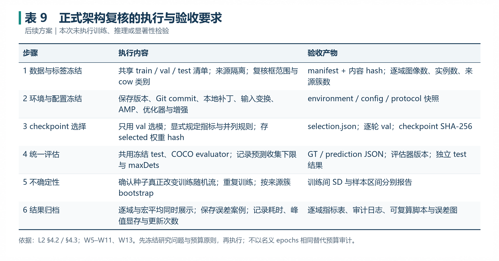

*表 9　后续执行及验收条件。各项均为方案，不代表本次完成。*

正式复核优先建立一份逐 run 清单。以下为**建议字段示例，不是已有完整产物**：

```yaml
dataset: CImage
model: YOLO11m
evaluation_split: test
class_names: [cow]
data_manifest_sha256: null
code_commit: null
local_patch_sha256: null
checkpoint:
  rule: val_mAP50_95_max
  tie_break: earliest_epoch
  selected_epoch: null
  sha256: null
preprocess:
  image_size: 640
  resize_and_padding: null
postprocess:
  score_collection_floor: null
  nms_applied: null
  nms_iou: null
  max_predictions_per_image: null
evaluation:
  evaluator_version: null
  matching_rule: null
  fixed_confidence: 0.25
  fixed_matching_iou: 0.50
```

其中 `null` 表示正式执行时必须填写的实际值。对 RT-DETR 等模型，`nms_applied` 要按真实路径登记，而不能继承另一个模型的配置。

选模阶段只读取 val，并预先冻结指标与并列规则；选定权重后在同一 test 上评估。多个随机种子的训练方差与有限测试样本的 bootstrap 区间分别报告；连续视频或同来源图像优先按来源簇重采样，避免将相关帧当成完全独立样本。小样本域需报告图像、实例及来源簇数量。［L2，§4.2.2；W7、W13］

### 7.3 截至整理日期的 10 月进展旁注

本地 [10月域内重测计划](../牛只数据集/10月域内重测计划.md)与 [域内重测-10月](../牛只数据集/域内重测-10月.md)记载：2026-10-05 至 10-08 完成新数据与冻结 test 视图上的 **YOLO11m×14** 主方案及运行稳定性检查；2026-10-09 至 10-12 另完成 es 种子重复扩展。执行记录明确四架构与 YOLO11s/l 的统一复核另行排期。［L4，§1、§3、§11；L5，§1、§10–11］

因此，“仍缺四架构统一 test 比较”在本记录中指 **四种检测器的同协议复核**，并不抹去 10 月已经记载的 YOLO11m 单模型重测。本记录保持 7–8 月四模型历史 val 表整体成套，不把新一轮 YOLO11m test 值单独替换进旧表。

10 月文件还记录了 stock seed 与真实随机流不完全对应的问题，并以 es 协议补充有效种子变化。该事件提醒后续复核：多写几个 seed 值不足以证明训练随机性真正不同，须保存初始化、洗牌和增强流的核验证据。本次仅核对本地记录，未重新检验远程实现。［L5，§5、§11］

### 7.4 从域内比较到多源 LODO：计划、执行与同视图参照

#### 7.4.1 研究任务分工与选模原则

[9月LODO泛化测试计划](../牛只数据集/9月LODO泛化测试计划.md)制定于 **2026-09-22**，将原有单源 14×14 迁移、多源留一数据集、外部新数据集 E 测试分为三层证据。历史四架构域内验证用于认识检测配置在本域的表现；LODO 则每次排除一个完整数据集，检验固定检测器面对未参与训练与选模的目标数据集时的表现。［L6，§1–3］

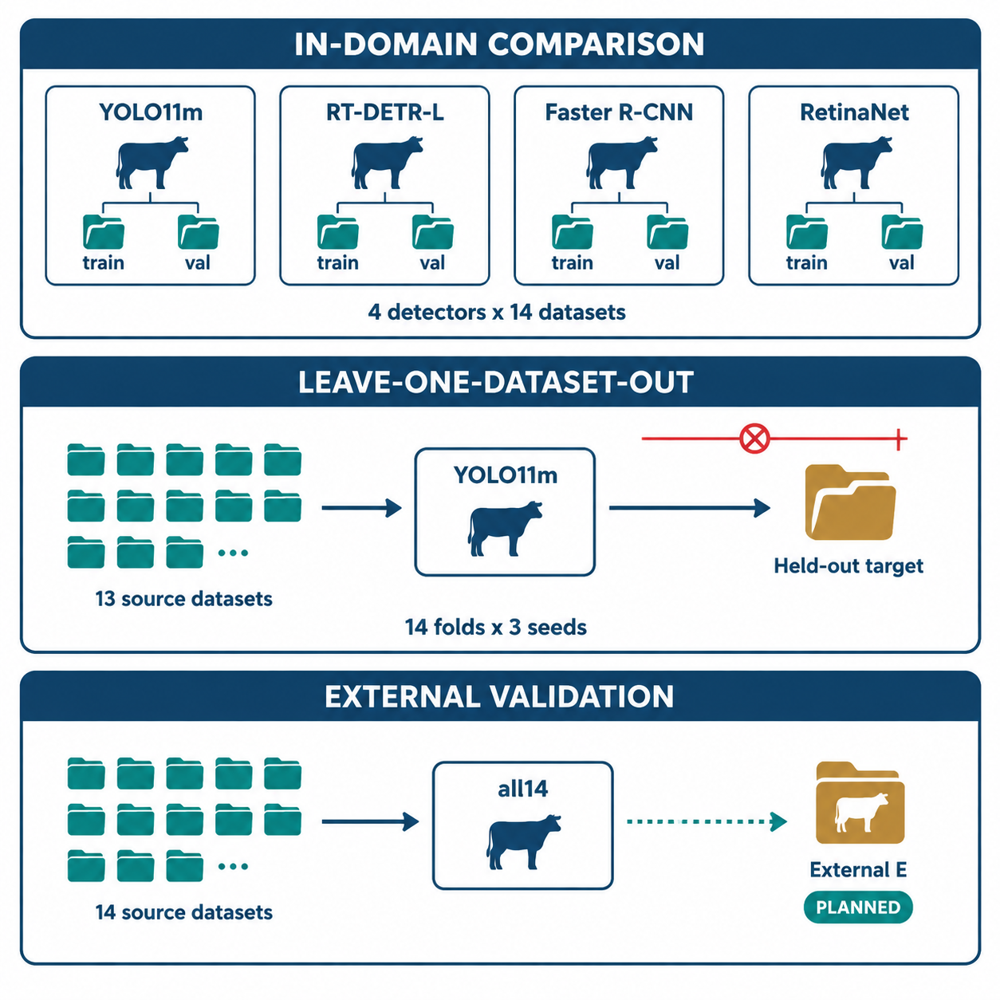

*图 5　Study Image 绘制的研究联系示意。第一层为逐域独立训练的四架构比较；第二层为 13 源训练后评测一个留出目标域，红色隔离标记指训练与选模阶段不访问目标；第三层的 External E 标为 PLANNED，表示指定执行记录尚未提供外部 E 的实测结果。图标用于示意，不是样本规模或网络拓扑。*

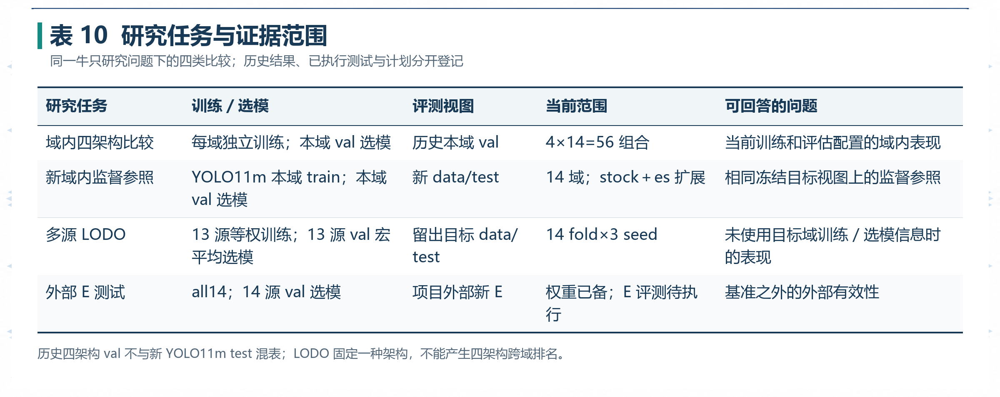

*表 10　四类比较的证据范围。all14 权重准备完成不等于 E 测试完成；LODO 中的“零样本”指没有使用目标域项目数据进行微调或选模，不表示 COCO 预训练期间必然从未见过相同来源。［L4–L7］*

Gulrajani 与 Lopez-Paz 的域泛化研究明确把模型选择列为方法的一部分，指出缺少可解释的选模策略会影响比较的可信度。本项目据此坚持只在源域验证集上选模，并预先规定并列处理；该论文的分类基准结果不作为本项目牛只检测提升的证据。［W15，§3、Recommendations 1–2］

#### 7.4.2 数据版本、固定配额与训练预算

L7 记载 2026-09-23/24 准备的新数据为 **train 25,079／val 3,142／test 3,124，共 31,345 张**；这是 SHA-256 同图同标去重及重新划分后的版本。旧架构表对应 **23,851／4,971／2,551，共 31,373 张**。两版不仅总数不同，划分组成也不同，不能只把 28 张的数量差理解成全部变化。［L7，§2.1；L4，§1］

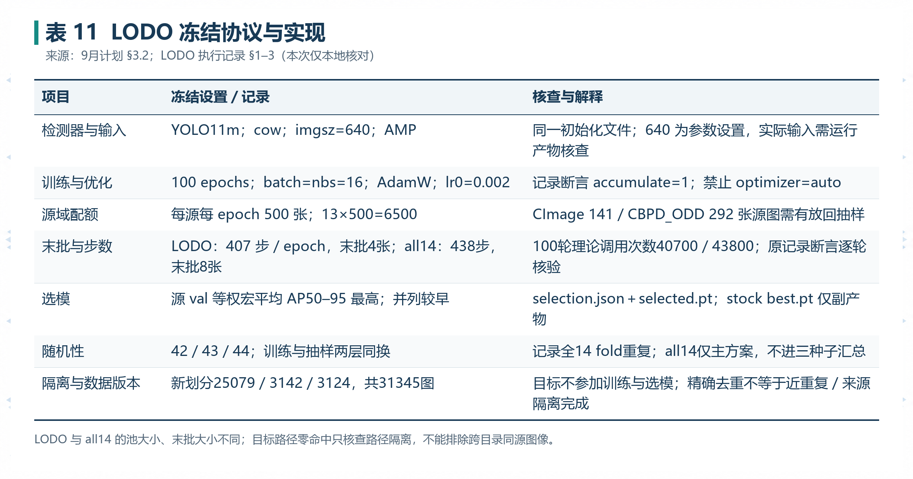

*表 11　LODO 的计划与执行设置。记录中的 `imgsz=640` 是接口设置；rect、padding 和每批实际张量形状另行登记，不能将所有验证输入概括为相同的 640×640 张量。*

每个 epoch 从 13 个源数据集各抽 500 张图像，训练池固定为 6,500 张；小源数据集采用有放回抽样，图像配额等权不等于实例数或唯一图像数等权。对 batch=16、不累积且保留末批的 LODO：

$$
S_{\mathrm{epoch}}=\left\lceil\frac{13\times500}{16}\right\rceil=407,\qquad
S_{100}=40\,700.
$$

末批为 **4 张**。all14 的池为 7,000 张，每 epoch 为 **438 次**调用、100 轮理论为 **43,800 次**，末批为 **8 张**。这些是预算复算；L7 另记载运行时逐 epoch 断言核验，本次未打开远程 step 日志。AMP 下还应区分优化器调用计数与因溢出跳过的有效参数更新，不能仅凭公式证明后者。［L6，§3.2.2；L7，§3.4；W11］

每轮分别评估 13 个源域 val，再等权选模：

$$
V_{\mathrm{macro}}^{(-t)}(e)=\frac{1}{13}\sum_{s\ne t}V_s(e),\qquad
e^*=\min\operatorname*{arg\,max}_e V_{\mathrm{macro}}^{(-t)}(e).
$$

最终以 `metrics.csv`、`select_checkpoint.py` 和 `selection.json` 确定 `selected.pt`，并以 epoch100 作预定敏感性对照。目标域不得用于早停、阈值搜索或重新选权重。源验证宏平均是选模指标，不是未见目标的测试分数。［L6，§3.2.3–3.3；L7，§3.1、§4.1］

#### 7.4.3 历史执行步骤与工程处理

L7 记载的实际训练主流程为：**冻结协议与数据清单→生成每轮每源配额清单→构建一次性标签库→逐 fold 训练与源验证→离线选择 checkpoint→冻结目标评测→种子复算**。操作入口如下，均是原记录中的历史定位，本次没有执行这些远程命令：

```text
/data1/yxli/LODOANDClassbyDomain/
├── lodo/protocol.yaml
├── make_lodo_dirs.py              # 抽样清单生成
├── lodo_train.py                  # 单fold训练
├── run_all_folds.sh               # 串行驱动与运行隔离
├── select_checkpoint.py           # 宏平均最大、并列较早
├── lodo_eval_target.py            # 目标冻结视图评测
└── lodo/
    ├── folds/<fold>/sample_lists*/、sample_stats.csv
    ├── folds/<fold>/logs/<run>/metrics.csv、run_info.json
    ├── folds/<fold>/runs/<run>/selection.json、weights/
    └── results/seed_compare.csv、seed_compare.json
```

执行过程中形成了四项可复用处理：

1. **逐 epoch 重建 dataset 与 loader。** 用于使预生成清单更新进入 worker，避免仅修改主进程对象而持续读取首轮清单。PyTorch 的多进程加载说明 worker 持有数据集副本，支持该风险的一般依据；该项目具体修复效果仍依据 L7 转述。［L7，§3.1；W16，Multi-process data loading］
2. **用标签库代替逐轮反复更新 `.cache`。** 原记录以一次性构建的全量训练标签库复用校验结果；另过滤隐藏目录并确认 14 个数据集，避免把 `.ipynb_checkpoints` 当作数据源。［L7，§2.2、§3.1、§3.3］
3. **显式洗牌与双层换 seed。** 清单由“主 seed、epoch、数据集”生成；训练洗牌使用 `seed×1048576+epoch`。seed=43/44 同时更换训练层和抽样层，不能以只改运行名或只改一个配置字段代替完整重复。PyTorch 可复现性指南亦提示要控制 worker、generator 及其他随机库。［L7，§2.3、§5.1；W17，DataLoader］
4. **固定路径身份与 batch 组合。** rect 验证的数据集分组 batch 与 loader batch 对齐；三个受影响的数据集依据 `data/` 重建旧 split 清单，保留历史备份；正式选模不依赖 stock `best.pt` 的同分覆盖行为。［L7，§3.1–3.4；W11，save_model］

**时间线：** 2026-09-24 完成目录与抽样清单准备；09-26 01:06 至 09-27 20:43，主方案完成 14 LODO fold 加 all14，共 15 个训练任务；09-30 17:25 至 10-02 12:16 完成 seed=43 的 14 fold；10-03 20:04 至 10-05 13:05 完成 seed=44 的 14 fold。每轮各做 selected／epoch100 两套目标推理，共 **14×2=28 次**，三轮 **84 次**。以上是本地执行记录报告的数量，本次未远程复核。［L7，§3.2、§5.1］

#### 7.4.4 三种子 LODO 结果与统计解释

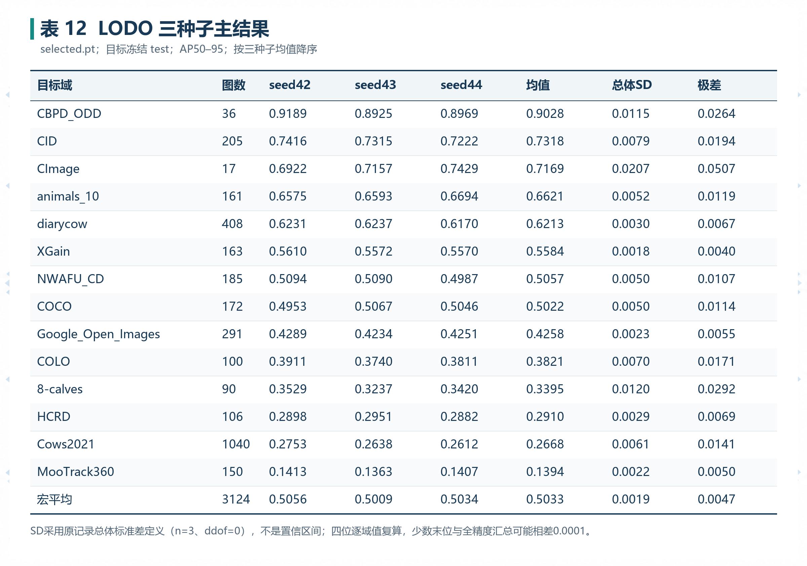

*表 12　从 L7 §5.3 四位逐域读数复算，保留 14 个目标域、3 个种子，共 42 个结果；图像数合计 3,124。SD 使用该记录的总体标准差定义（ddof=0），不代表置信区间；个别汇总末位受来源舍入影响，原值与复算值并列保存在 JSON 中。*

三轮 AP50–95 等权宏平均约为 **0.5056／0.5009／0.5034**，跨轮平均约 **0.5033**、总体 SD 约 **0.0019**。从已展示读数复算，使用样本标准差（ddof=1）则约 **0.0024**；两者分母不同，不能将“±0.0019”与新域内 es 的样本 SD 当作完全相同统计口径。［L7，§5.3–5.4；本次复算］

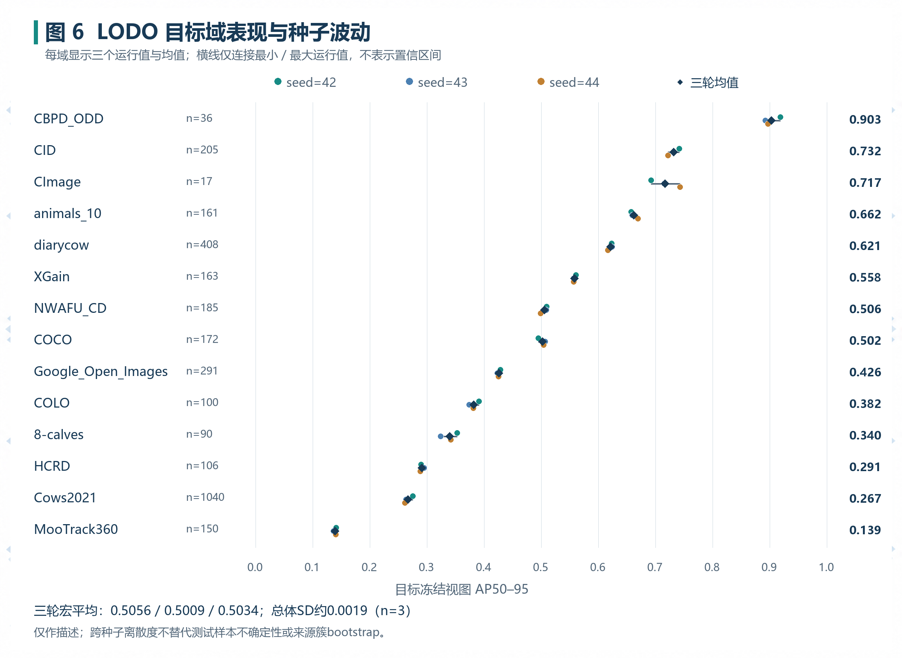

*图 6　每个目标域的三轮实测记录值与均值。横线连接三次运行的最小、最大值；不是误差区间，也不表示三个值之外的概率分布。数据由本地复算脚本读取，数值未交给生图模型自由绘制。*

三轮排序的 Spearman 相关为 **1.0000／0.9912／0.9912**；CBPD_ODD 与 MooTrack360 在三轮分别保持最高、最低。跨域均值约为 **0.9028–0.1394**，差异远大于宏平均种子离散度。当前重复支持目标域相对次序与均值量级较稳定，不能证明每个域的性能已精确估计。CImage 只有 **17 张**，其三轮极差 **0.0507**，需同时报告来源簇数量和实例数，避免把相关图像数量直接当成有效独立样本数。［L7，§5.3–5.4；本次复算］

L7 报告 selected 与 epoch100 的平均绝对 AP50–95 差分别为 **0.0004／0.0004／0.0009**，说明这两个已冻结规则在当前结果中的差异较小。e* 集中在 **94–100** 轮，只能说明峰值靠近预算末端；没有更长预算或曲线平台证据，不能据此认定 100 轮充分收敛。［L7，§4.1–4.3、§5.2–5.4］

**指标语义补充。** L7 的 P/R 没有声明 conf=0.25 下严格 TP/FP/FN 计数；L5 则明确使用默认 `YOLO(...).val(...)`。官方 v8.4.92 `ap_per_class` 的汇总 P/R 取平滑 F1 曲线峰值位置，因此不能把这些 P/R 并入 §5.3 的固定阈值四架构表。若原评测器未改写这一逻辑，峰值工作点还使用了当前评测标签；正式零样本部署工作点需另外冻结阈值并按预测重新计数。该实现分歧待核对 `lodo_eval_target.py` 与实际安装源码，本记录将 AP 作为此部分主结果，不从这些 P/R 补造“固定阈值 F1”。［L5，§2.3；L7，§4.2；W8，ap_per_class；W14］

#### 7.4.5 同一新 test 视图上的域内监督参照

10 月执行记录为相同 `data/<t>/test` 提供了 YOLO11m 域内参照 $M_{t\to t}$，可以与 LODO 目标结果按数据集配对。它仍与旧四架构 val 表属于不同批次，只能成套报告。［L4，§2；L5，§4.2、§6］

定义目标域保持率：

$$
R^{\mathrm{LODO}}_{\mathrm{target}}(t)
=\frac{\frac{1}{3}\sum_{s\in\{42,43,44\}}M^{(s)}_{-t\to t}}
       {M^{\mathrm{stock42}}_{t\to t}},\qquad
\overline R=\frac{1}{14}\sum_t R^{\mathrm{LODO}}_{\mathrm{target}}(t).
$$

分母为正时按逐域比值平均；分母为零时记 N/A 并报告有效项数。分母是目标监督配置的经验参照，不是理论上限，因此 R 可以大于 1。

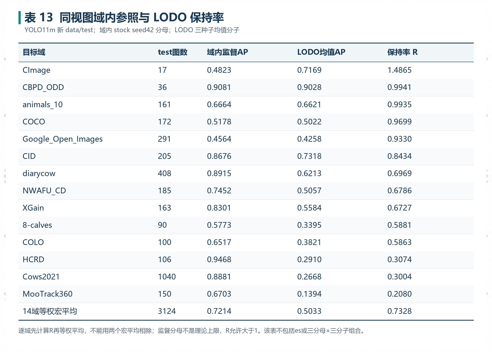

*表 13　分母仅使用 L5 §4.2 的 stock seed=42 主方案，分子使用 L7 三种子逐域 AP 均值。本次复算 $\overline R=0.7328$；L5 另报三域内重复×三 LODO 种子的九组合宏平均 0.7325，两者范围不同，不混写。*

新域内监督 AP50–95 宏平均为 **0.7214**。用两个宏平均直接相除为约 **0.6976**，而逐域保持率宏平均为 **0.7328**，这具体说明“宏平均之比”不等于“比值的宏平均”。CImage 的保持率约 **1.4865**，MooTrack360 约 **0.2080**；它们说明当前监督参照与多源零样本结果的对应关系，不证明样本规模或视角的单因素效应。［L5，§4.2、§6；本次复算］

L5 的 es 扩展另报 **0.7205±0.0016**，SD 为三个有效种子的样本标准差；stock 三轮仅检验运行间稳定性，es 才改变洗牌和增强随机流。两套协议不混表，本记录不使用 es 均值替换上表分母，也不把 LODO 的总体 SD 与 es 样本 SD直接排序。［L5，§5、§11］

保持率仍没有回答“多源比其他单源零样本迁移提高多少”。后者需要新数据同一冻结视图上的 14×14 单源矩阵：

$$
\Delta_{\mathrm{multi}}(t)
=M_{-t\to t}-\frac{1}{13}\sum_{s\ne t}M_{s\to t}.
$$

旧矩阵的数据划分与评测分母不同，不能直接填入该式。现有结果可报告多源模型的未见域表现与相对监督保持率；在对齐单源矩阵及预算对照前，不写“已证明多源域多样性带来净收益”。［L6，§3.2.5、§6.1；L5，§10］

#### 7.4.6 记录冲突、泄漏边界与后续验收

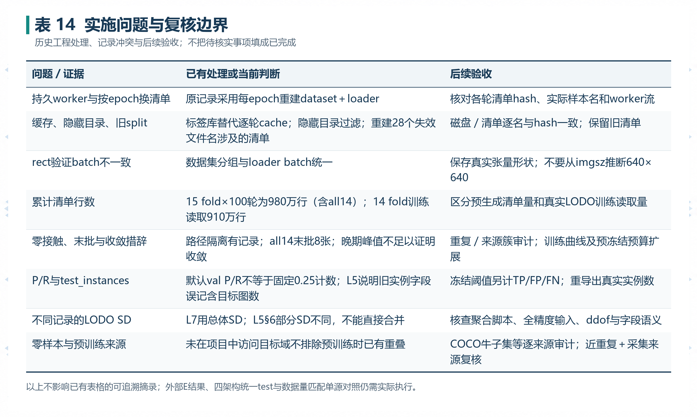

*表 14　计划、执行记载与本次算术／方法复核的对应。处理均不覆盖原始资料；涉及运行代码和数据身份的判断仍需原产物核查。*

本次还保留了五项需要明确处理的差异：

- **版本时间线。** L7 §2.3 的“暂不使用多种子重复”是前期记载；后续 §5 已记录 43/44 全量完成，引用时应以具体阶段说明，不把前期句子当当前状态。
- **清单总量。** 15 fold×100 轮清单含 all14：$14×100×6500+100×7000=9,800,000$ 行；43/44 实际只训练 14 LODO fold，每轮读取 $9,100,000$ 行。生成量与训练读取量应分开。
- **末批与耗时。** L7 总括“末 batch 的4张”只适用于 LODO，all14 为8张；主方案记载约43.6 h，但09-26 01:06至09-27 20:43的列示区间约43 h 37 min。若其中含15 fold，不能不加说明套用“每fold约2 h 56 min”；需从日志分离训练、验证、等待与任务数。
- **SD 字段。** L5 §6 的 LODO 种子 SD 部分值与 L7 §5.3 不一致，例如 CImage 为0.043与0.0207、8-calves为0.021与0.0120。ddof=0／1 不能解释全部差异，故本记录只用 L7 三轮 AP 复算此处 SD，不猜测 L5 字段真实语义。
- **实例数与来源独立性。** L5 §3.2 说明旧 `lodo_eval_target.py` 的 `test_instances` 将“含目标的图像数”误记为实例数，本记录不引用该字段作牛只数量。目标路径零命中和SHA-256精确去重也不证明感知近重复、同视频、牛群或跨数据集来源重叠已经排除。COCO牛类子集还需区分项目目标隔离与预训练来源接触。［L6，§3.4；L7，§2–6；L5，§3.2、§6］

下一阶段按可验收产物推进：

1. **同协议四架构 test 复核：** 先冻结数据／标签清单、输入和预算原则、选模规则与预测导出格式，再补齐另三架构的 test 结果，所有指标绑定唯一权重hash。
2. **补齐单源零样本对照：** 在新data和同一test视图上重建14×14矩阵，计算逐域 $\Delta_{\mathrm{multi}}$，再做相同图像／更新预算的单源重复采样对照。
3. **执行外部E：** 在查看输出前完成来源、标签、文件清单、阈值与评估器冻结，再用已选 all14 和预定对照模型一次性评测；保存全部预测与失败案例。
4. **分层与不确定性：** 补真实实例数、视频／个体／来源簇，按预定义视角、尺度、遮挡统计；训练种子离散度与来源簇bootstrap分别报告。［L6，§4–6、§8；L5，§10；本记录综合方案］

### 7.5 阶段结论与研究收获

1. **研究问题形成了完整观测链。** 四范式、14 域的验证表既给出逐域参照，也支持宏平均与误差优先级分析。
2. **模型总体差异应结合逐域结果解释。** RT-DETR-L 与 YOLO11m 的 AP50–95 宏平均相差 0.0047，9/14 与 5/14 的领先分布显示优势随数据集变化。
3. **共同高低分与定位敏感性具有研究价值。** 四模型次序高度一致；8-calves、MooTrack360、COLO 的严格定位指标下降值得优先审核，但尚未证明单因素原因。
4. **排障本身是可复用的方法成果。** 输入形状、匹配顺序、插值／严格计数以及 checkpoint 身份均可能改变读数，必须纳入评估协议。
5. **正式结论仍依赖协议闭合。** 需用同数据版本与 test、明确的预算和选模规则、模型专属预处理记录、统一 evaluator 与不确定性统计完成四架构复核。
6. **域内参照与未见域表现形成了可核查的衔接。** LODO三轮宏平均约0.5033，按新域内stock参照逐域归一化后平均保持率约0.7328；这两项描述固定YOLO11m的多源迁移，不能扩展成四架构泛化排名。外部E和匹配预算的单源零样本增益仍需补齐。

**本次整理的实际完成项：** 本地来源核对、官方资料检索、56 个历史域内组合核对、42 个 LODO 结果与同视图保持率复算、科研记录修订、新配图与可编辑底稿，以及来源摘要／索引／日志维护。**未运行项：** 远程训练与评测、历史产物实时存在性核查、逐图误差审核、显著性检验、数据库与向量索引同步。

---

## 附录 A. 本地来源、官方指南与原始研究

### A.1 本地来源与定位

- **L1　[域内模型与架构比较：服务器核查记录](../牛只数据集/域内模型与架构比较.md)**。标题核查日期 2026-09-02，含 09-06 修复与后续补记。主要定位：§1 配置、选模、batch；§2 环境；§3.0 排障；§3.1–3.6 指标与轮次；§4 时长；§5 历史产物；§6 与初稿的出入。
- **L2　[文章初稿](../牛只数据集/文章初稿.md)**。本次重点读取 §3.2 数据规模、§4.1 环境、§4.2.1–4.2.2 指标与汇总、§4.3 逐域与宏平均、附表 A1 及其后协议说明；另核对局限性相关段落。
- **L3　[实验记录格式参考](实验记录格式参考.md)**。采用实验目的、原理、资源、步骤、原始记录、分析、讨论七项结构，不补填未提供的姓名或签字。
- **L4　[10月域内重测计划](../牛只数据集/10月域内重测计划.md)**。重点核对历史问题、单模型范围、冻结训练与 test 协议、选模、种子扩展。
- **L5　[域内重测-10月](../牛只数据集/域内重测-10月.md)**。重点核对概述、§2.3评测、§3.2实例字段、§4.2域内主表、§5运行稳定性、§6保持率、§10后续与§11 es扩展；用于同视图对照、时间线与冲突核查，不替换旧四架构表。
- **L6　[9月LODO泛化测试计划](../牛只数据集/9月LODO泛化测试计划.md)**。用户指定的首要计划来源，完整读取；制定日期2026-09-22，定位§2任务关系、§3.2配额／更新预算／源验证／选模、§3.3–3.4目标隔离与泄漏、§4外部E、§6指标和§8执行优先级。
- **L7　[LODO测试-9月](../牛只数据集/LODO测试-9月.md)**。用户指定的执行来源，完整读取；定位§2数据与清单、§3工程处理和时间线、§4主方案、§5三种子、§6资产及§7后续。历史执行时间为2026-09-24至10-05。

L4、L5 本次另外读取新test域内主表、保持率表、随机性核验与es扩展相关段落，用于§7.4的同视图对照与冲突核查。上述资料是本地研究记录与初稿，不替代本次未打开的远程原始日志。七份来源的本次内容指纹保存于 [2026-10-14本地来源校验](多源留一域泛化.assets/20261014本地来源校验.json)；[原五份来源校验](多源留一域泛化.assets/本地来源校验.json)保留为上一版记录。

### A.2 官方指南与原始研究

W1–W14 首次于 **2026-10-13** 核查，本次 **2026-10-14** 重新打开相关论文、官方入口与版本源码，并补充W15–W17。论文查阅页面、摘要与相关方法段落；官方指南查阅操作段落；版本源码查阅相关方法。不将这些工作描述为全部全文精读，不将当前动态文档默认值倒填为历史参数。

- **W1　[Ultralytics YOLO11](https://docs.ultralytics.com/models/yolo11/)**。模型定位与训练／验证／推理接口；不引用其速度表作为牛只实验实测。
- **W2　Zhao Y. 等，[DETRs Beat YOLOs on Real-time Object Detection](https://arxiv.org/abs/2304.08069)**，arXiv:2304.08069，2023；CVPR 2024。用于 RT-DETR 的编码器、查询选择与 NMS-free 原理。
- **W3　Ren S. 等，[Faster R-CNN: Towards Real-Time Object Detection with Region Proposal Networks](https://arxiv.org/abs/1506.01497)**，NeurIPS 2015。用于 RPN 与共享特征的两阶段机制。
- **W4　Lin T.-Y. 等，[Focal Loss for Dense Object Detection](https://arxiv.org/abs/1708.02002)**，ICCV 2017。用于 RetinaNet 与 Focal Loss 的训练不平衡问题。
- **W5　[MMDetection 3.3.0：Customize Datasets](https://mmdetection.readthedocs.io/en/v3.3.0/advanced_guides/customize_dataset.html)**。用于单类别数据元信息及检测头 `num_classes` 修改。
- **W6　[MMEngine：OptimWrapper](https://mmengine.readthedocs.io/en/latest/api/generated/mmengine.optim.OptimWrapper.html)**。用于 `accumulative_counts` 与梯度累积的操作依据；历史值仍以生效配置为准。
- **W7　[MMEngine：CheckpointHook](https://mmengine.readthedocs.io/en/latest/api/generated/mmengine.hooks.CheckpointHook.html)**。用于 `save_best`、`rule` 与 checkpoint 保存规则。
- **W8　[Ultralytics v8.4.92：metrics.py](https://github.com/ultralytics/ultralytics/blob/v8.4.92/ultralytics/utils/metrics.py)**。重点核对 `Metric.fitness` 与 `ap_per_class`；官方代码不替代历史本地补丁核查。
- **W9　[Ultralytics v8.4.92：RT-DETR predict.py](https://github.com/ultralytics/ultralytics/blob/v8.4.92/ultralytics/models/rtdetr/predict.py)**。用于核对专用预处理和无常规 NMS 的后处理路径。
- **W10　[Ultralytics v8.4.92：RT-DETR val.py](https://github.com/ultralytics/ultralytics/blob/v8.4.92/ultralytics/models/rtdetr/val.py)**。用于核对 RT-DETR 专属验证输入及后处理；不将其与 YOLO 路径合并。
- **W11　[Ultralytics v8.4.92：trainer.py](https://github.com/ultralytics/ultralytics/blob/v8.4.92/ultralytics/engine/trainer.py)**。重点核对 nbs、accumulate、warmup 与 step 调用的关系。
- **W12　Lin T.-Y. 等，[Feature Pyramid Networks for Object Detection](https://arxiv.org/abs/1612.03144)**，CVPR 2017。用于 FPN 的多尺度特征设计。
- **W13　[COCO API：cocoeval.py](https://github.com/cocodataset/cocoapi/blob/master/PythonAPI/pycocotools/cocoeval.py)**。用于 IoU 扫描、预测排序、maxDets 和 AP 汇总参数；正式运行须冻结具体 commit。
- **W14　[Ultralytics：Model Validation](https://docs.ultralytics.com/modes/val/)**。用于验证接口、split、imgsz、conf、iou、rect 与指标读取；不同模型仍需对应版本实现核查。
- **W15　Gulrajani I.、Lopez-Paz D.，[In Search of Lost Domain Generalization](https://arxiv.org/html/2007.01434v1)**，arXiv:2007.01434，2020。重点核对§3模型选择、Recommendations 1–2与三种选模方法；用于目标访问边界，不把分类实验数值移植为牛只检测结果。
- **W16　[PyTorch v2.5.1：DataLoader说明源码](https://github.com/pytorch/pytorch/blob/v2.5.1/docs/source/data.rst)**。核对多进程数据副本、worker、generator、persistent_workers和drop_last。官网稳定版／2.5页面本次未返回可读正文，改用官方版本仓库的文档源码。
- **W17　[PyTorch v2.5.1：Reproducibility说明源码](https://github.com/pytorch/pytorch/blob/v2.5.1/docs/source/notes/randomness.rst)**。核对随机库、确定性与DataLoader worker／generator；不据此保证所有硬件和版本下逐位复现。

## 附录 B. 图表、复算与审核说明

### B.1 可编辑与机器可读产物

- [表格可编辑底稿](多源留一域泛化.assets/表格可编辑底稿.md)：九张正文表及完整 AP50、固定工作点 P/R/F1、最佳阈值数据。
- [逐模型逐数据集指标 CSV](多源留一域泛化.assets/逐模型逐数据集指标.csv)：56 个组合，含 split、两项 AP、两套 P/R/F1、最佳阈值与 mAP 峰值轮。
- [图表数据 JSON](多源留一域泛化.assets/图表数据.json)与 [数值复算 JSON](多源留一域泛化.assets/数值复算.json)：图表输入、六个 Spearman 相关、均值、配对差值和描述统计。
- [生成图表与复算脚本](多源留一域泛化.assets/生成图表与复算.py)：只读五份本地来源，写入本 assets 目录；使用 Python 标准库与 Pillow，中文字体为 Windows 微软雅黑。
- [表格清单](多源留一域泛化.assets/表格清单.json)：图表编号、表头、全部单元格、说明、尺寸与分辨率。
- [官方来源核查清单](多源留一域泛化.assets/官方来源核查.json)：14 项来源的访问状态、标题、内容 hash，以及关键版本代码的核查摘录。
- [来源摘要](../wiki/sources/cowcv-indomain-architecture-evidence.md)：知识库中的来源定位与未解决冲突。
- [LODO补充表格可编辑底稿](多源留一域泛化.assets/LODO补充表格可编辑底稿-20261014.md)：正文表10–14对应的全部单元格与说明。
- [LODO三种子与域内参照CSV](多源留一域泛化.assets/LODO三种子与域内参照-20261014.csv)和[本次数值复算JSON](多源留一域泛化.assets/LODO与域内复算-20261014.json)：三种子原值、总体／样本SD、Spearman、保持率及舍入差异。
- [补充图表与复算脚本](多源留一域泛化.assets/补充LODO图表与复算-20261014.py)：读取L5、L7，精确绘制新增表格与种子图；表格沿用本次Study Image母版。
- [本次外部来源核查](多源留一域泛化.assets/20261014外部来源核查.json)和[图表校阅总览](多源留一域泛化.assets/LODO图表校阅总览-20261014.png)：记录本次访问范围与新增图表。

### B.2 图表制作与核验原则

Study Image 实际成功生成研究流程图和科研表格母版；架构示意图请求返回 HTTP 502，未重复请求，由本地程序依据文献绘制替代图。表格通过母版保留边缘视觉，中央数据区由本地程序精确排字；数值差图与柱图也直接读取复算数据，未使用模型自由生成数字。

上述为2026-10-13的制作记录。本次2026-10-14通过Study Image成功新增**域内与泛化证据链示意图、LODO表格母版**；未重试上一版不确定结果的失败请求。新增表10–14和图6的数字由程序从本地表格精确读取、计算与排字；不以生图模型生成的数字作为实验数据。

十四张表格、范式示意图与三幅统计图均输出为 **2400 像素宽、300 dpi PNG**，保留可编辑底稿。Study Image 原始输出单独保存，不将其像素规格写成与本地排图相同。全文含六幅图、十四张表，Typora图片均使用相对路径。图表可见文字只采用本记录中已有数字与对应证据边界。

复算以当前本地公开表格的精度为限，不补造缺失小数、TP/FP/FN 原始计数、逐图预测或显著性。AP 宏平均先从逐域数值计算再舍入；固定及最佳工作点宏平均保留原文汇总，同时在 JSON 中提供逐域已舍入表的复算结果。

**结构与数值核验：** 14 个数据集、56 个历史组合及42个LODO种子结果；两版数据规模、新test图数、AP均值、历史9/5领先与12/14差距阈值、六个历史及三个LODO Spearman、逐域保持率、末批与预算算术；图片、本地链接、来源Frontmatter、索引及唯一ID、七份原始资料hash均检查。上一版结果保留于[原核验结果](多源留一域泛化.assets/核验结果.json)，本次结果保存于[2026-10-14核验结果](多源留一域泛化.assets/20261014核验结果.json)。远程训练／评测与检索索引同步未运行。

---

**记录人签字：** __________________　**日期：** __________________  
**审核人／导师签字：** __________________　**日期：** __________________
