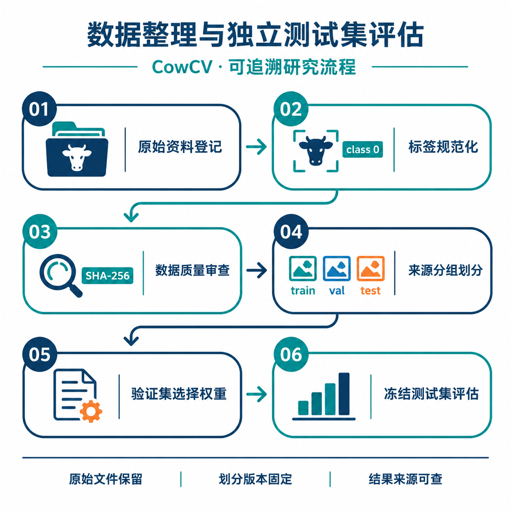
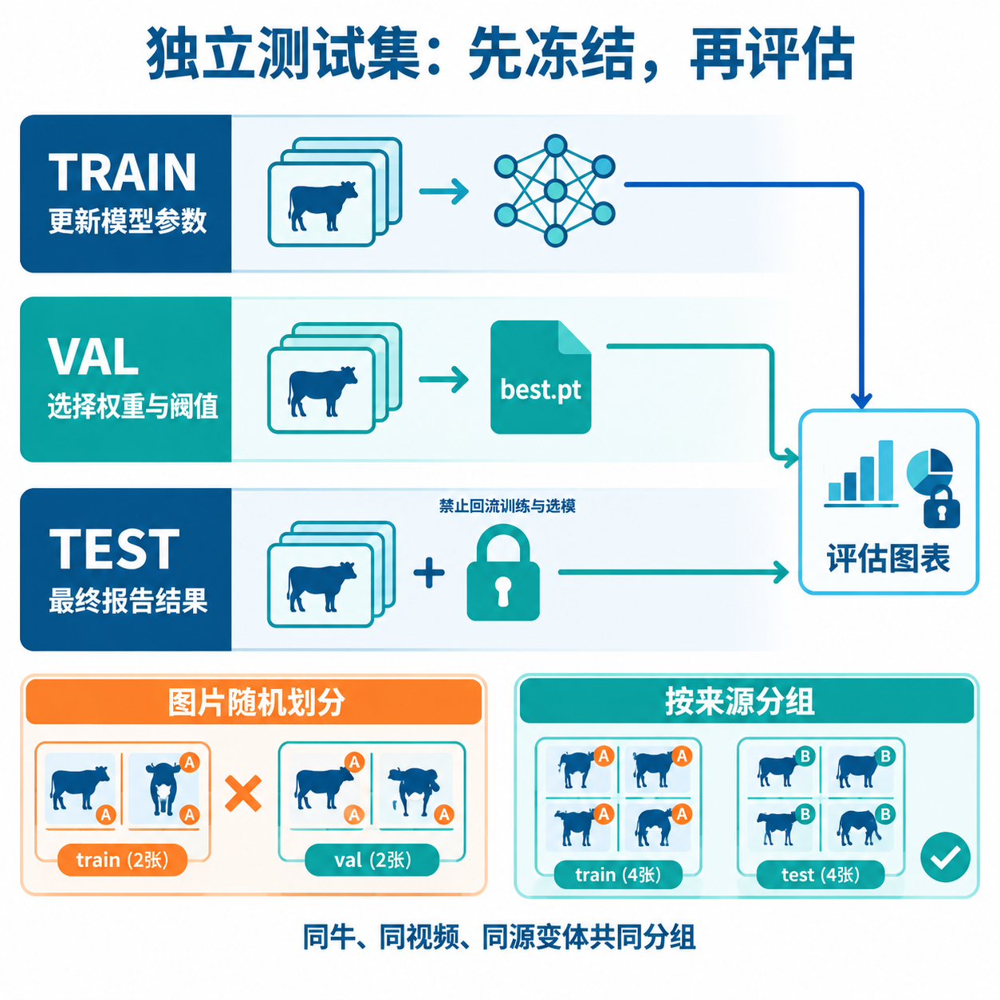
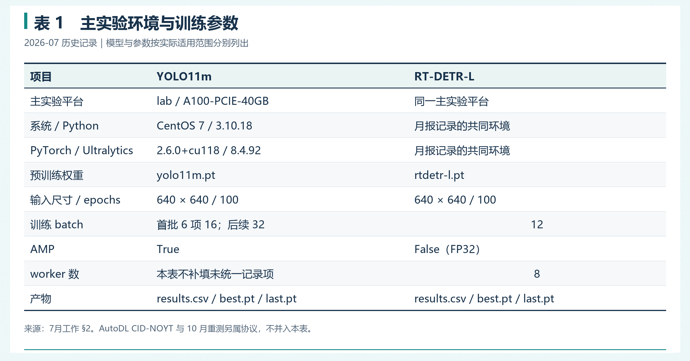
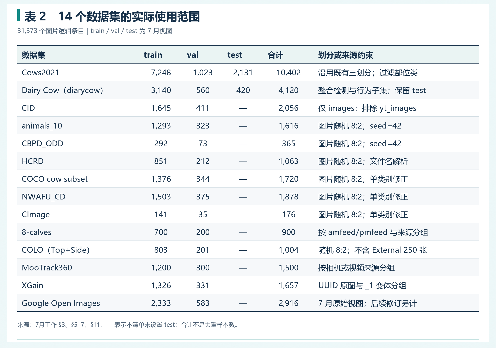
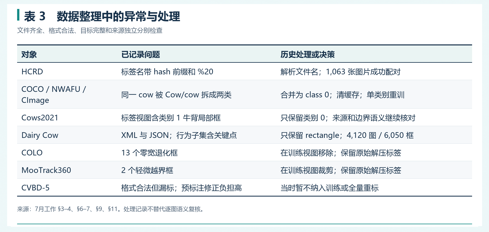
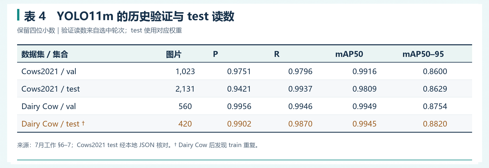
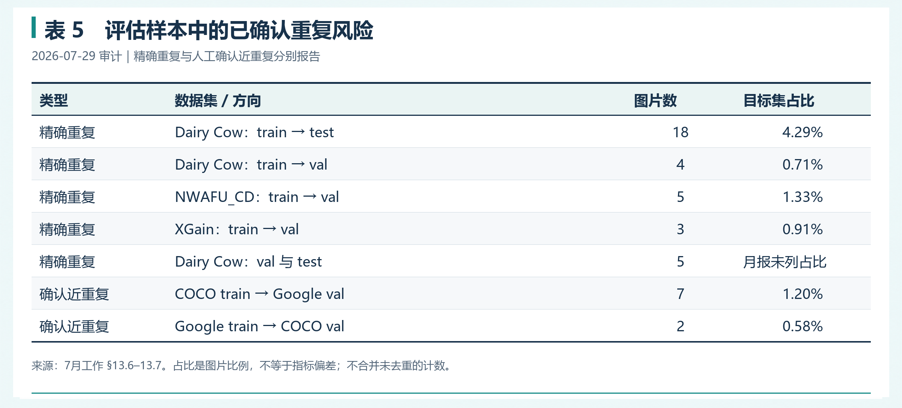
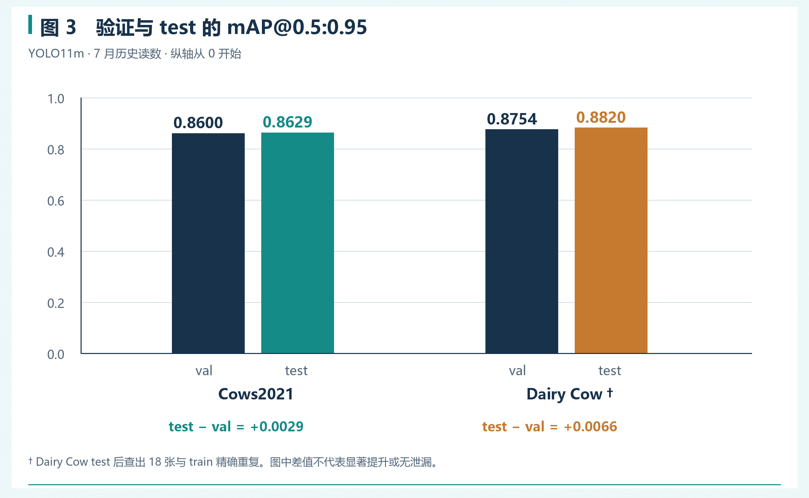
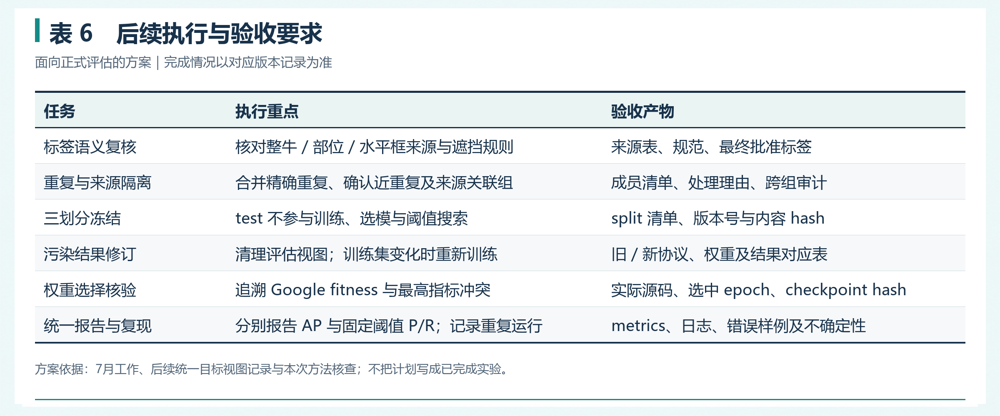

# 数据集整理与独立测试集评估

> **实验编号：** EXP-202607-COWCV-DATA-TEST  
> **实验主题：** 多来源牛只检测数据规范化、质量审计与域内独立测试评估  
> **原始工作时段：** 2026-07；其中基线汇总截至 2026-07-18，重复图像审计记录于 2026-07-29  
> **整理与文献核查日期：** 2026-10-13（北京时间）  
> **记录类型：** 阶段实验整理与方法复核；依据既有工作记录补充成文  
> **记录人：** 待填写　　**审核人：** 待填写  
> **研究对象：** CowCV 中 14 个单类别牛只目标检测数据集  
> **格式依据：** [实验记录格式参考](实验记录格式参考.md)中的实验记录七项结构；将“试剂与耗材”调整为“数据、软件与计算资源”。

**本阶段形成的主要产出：** 建立多来源图片与标签的统一训练视图，修正三套数据中的重复类别定义，完成 YOLO11m 与 RT-DETR-L 的单数据集基线，并记录 Cows2021 和 Dairy Cow 的 test 评估。随后通过内容哈希与近重复复核发现了划分污染，推动评估从“文件配对正确”进一步转向“测试样本与训练、选模过程隔离”。［L1，§1、§4、§6–8、§13.6–13.7］



*图 1　数据整理与独立测试评估的研究流程。*

[TOC]

---

## 1. 实验目的（Objective）

### 1.1 问题与研究目标

牛只公开资源来自检测、分类、姿态估计和个体识别等不同任务，标签的类别、目标范围和坐标表达并不一致。直接合并目录容易把牛体部位误当整牛、把大小写不同的 `Cow/cow` 当成不同类别，或将漏标图片当作负样本。部分数据来自连续视频或同牛多视角采集，逐图片随机划分还可能使相关样本同时进入训练和评估。［L1，§3–4、§6、§9–11；L2，§1、§3］

本次工作围绕三个问题展开：

1. **数据能否可靠用于单类别检测？** 完成标签来源登记、图片配对、类别与坐标核验，保留原始资料和转换轨迹。
2. **评估集能否支撑未参与选模的性能估计？** 区分 train、val、test 的用途，检查精确重复、近重复及同来源样本跨划分情况。
3. **如何解释所得指标？** 记录数据版本、权重选择和评估条件，分开报告验证峰值、域内 test 和跨数据集结果，避免把不同协议混成模型排名。

### 1.2 本记录的证据范围

**历史事实**以《7月工作》及本地保存的结果文件为依据；**综合分析**由已记录的数量和指标推导；**方案建议**来自本次核查的官方指南和文献。未记录的执行时间、人工工时、抽检比例和显著性不补造。

本次实际完成的是本地资料核对、文献检索、数值复算、记录编写与配图；没有连接服务器重新训练或评估。历史远程路径是产物定位线索，当前存在性与运行状态未远程核查。Cows2021 的 test 指标另外与本地 JSON 对照；Dairy Cow 的指标来自月报，尚缺本次直接打开的逐次评估原始文件。［L1；L3］

## 2. 实验原理与参考依据（Principle & References）

### 2.1 统一格式之前，先统一目标语义

本阶段工作集采用单类别 `cow`，训练标签的 class id 为 `0`。YOLO 检测标签每行对应一个目标：

```text
class_id x_center y_center width height
0        0.500000 0.500000 0.200000 0.300000
```

后四项是相对图像宽、高归一化后的中心坐标和框尺寸。像素坐标水平框的转换关系为：

$$
x_c=\frac{x_{\min}+x_{\max}}{2W},\qquad
y_c=\frac{y_{\min}+y_{\max}}{2H},
$$

$$
w=\frac{x_{\max}-x_{\min}}{W},\qquad
h=\frac{y_{\max}-y_{\min}}{H}.
$$

其中 $W,H$ 为图片实际尺寸。上述五字段、归一化坐标和零起始类别编号与 Ultralytics 官方数据格式一致。［O1，“Ultralytics YOLO format”］

**格式一致仍不足以保证标注一致。** 本地场景档案注明，Cows2021 原始资料含躯干旋转框，而 CowCV 视图使用水平框；《7月工作》记录当时标签视图仅保留类别 0、排除类别 1 牛背局部框，并在附录记载重新标注。两份记录描述了不同层次的标注来源，不能仅凭 `class_id=0` 推定所有数据采用完全相同的整牛边界定义。正式发布前仍需逐数据集核对“原始框、转换框、人工重标框”及遮挡目标边界约定。［L1，§6、附录；L2，§3、§4.1；O8］

### 2.2 独立测试集的判定条件

train 用于更新模型参数；val 用于选模和开发决策；test 用于开发方案确定后的评估。**目录名为 `test` 只是配置，不能单独证明独立性。** 还需确认测试样本未用于参数学习、权重选择、早停、阈值搜索或数据驱动的反复调参，并核验其与训练样本的来源关系。数据泄漏研究说明，不适当的划分和信息回流会产生过于乐观的性能估计。［O7；本项目综合］



*图 2　训练、验证与测试的职责及分组原则。右下的 A、B 表示不同牛只来源，张数仅用于说明分组方式。*

对于同牛多视角、同一视频连续帧、同源增强版本，应先建立来源组再划分。`GroupShuffleSplit` 按组而非按图片控制划分比例，因此实际图片比例可能略有偏差；若任务强调时间外推，应另设时间段隔离与间隔，而不是把随机分组自动解释为未来时段泛化。［O4，参数与示例；O5，“gap”；本项目方案建议］

**分组单元取决于研究问题：** 按牛 ID 隔离可减少同一牛跨集合的关联，但不能证明不同农场、相机或时间段完全隔离；按视频分组也不必然隔离牛只身份。记录应明确要检验的是同场新图像、新牛、新机位，还是跨场景迁移。

### 2.3 指标及阈值口径

水平框重叠度和检测统计定义为：

$$
\mathrm{IoU}=\frac{|B_{\mathrm{pred}}\cap B_{\mathrm{gt}}|}
{|B_{\mathrm{pred}}\cup B_{\mathrm{gt}}|},\qquad
P=\frac{TP}{TP+FP},\qquad R=\frac{TP}{TP+FN},
$$

$$
F_1=\frac{2PR}{P+R}.
$$

本记录的主指标是 mAP@0.5:0.95，即对匹配 IoU 阈值 $0.50,0.55,\ldots,0.95$ 的 AP 取平均；单类别时类别平均退化为该类别 AP。mAP@0.5 更宽松，应与严格定位指标同时报告。COCO 评估源码采用上述 IoU 范围，但其默认 `maxDets` 等设置与项目 Ultralytics 评估不同，不能只因指标名称相似便声称实现逐项等价。［O2；O3，`Params.setDetParams()`］

需要特别区分：

- **置信度过滤与匹配 IoU。** `conf=0.001` 是保留预测的最低分数；`model.val(iou=0.7)` 中的 `iou` 是 YOLO 的 NMS 阈值，不能理解为 mAP 只在 IoU=0.7 上计算。
- **默认汇总 P/R 与固定阈值 P/R。** 官方验证说明及指定版本 `ap_per_class()` 表明，汇总 P/R 取自 F1 最优工作点。本记录保留历史 P/R，不将其改写为 `conf=0.25` 下的结果。
- **AP 主评估与部署阈值分析。** 后续若补固定 `conf=0.25`、匹配 IoU=0.5 的 P/R/F1，应另做预测筛选与一对一匹配，分表保存；不依靠在 test 上找最佳 F1 后反复调整部署阈值。［O2，“Arguments”“conf”“iou”；O9，`ap_per_class()`；后两项为项目建议］

### 2.4 相关研究对本项目的启示

Gao 等的 Cows2021 工作及 Bristol 官方数据页提供了个体识别、视频采集和数据来源背景，提示检测视图应保留牛只与序列信息。Das 等的 COLO 研究关注拍摄角度、光照和模型复杂度对牛只定位泛化的影响，支持在本项目中同时记录数据规模与场景差异，不能仅凭域内 mAP 给数据集难度下总排名。［O8；O10；O11］

Kapoor 与 Narayanan 的数据泄漏研究用于建立本记录的评估边界；ImageHash 项目文档用于核查 pHash 与汉明距离的工具含义。**pHash 距离阈值是本项目筛选候选的设置，并非官方认定“同图”的通用标准。**［O6；O7；L1，§13.7］

## 3. 数据、软件与计算资源（Materials & Environment）

### 3.1 主实验环境与适用范围



*表 1　7 月主实验的环境与训练参数。依据 L1 §2；[可编辑表格数据](数据集整理与独立测试集评估.assets/表格数据.md#表1-环境与参数)。首批 YOLO11m 使用 batch=16，后续使用 32，不能表述为所有实验批量完全相同。*

RT-DETR-L 的 `amp=True` 训练曾在 epoch 15 后出现 NaN，改为 FP32 后记录为稳定；这一问题限定于所记录的模型、环境和尝试，不扩展为“所有 Transformer 均不适合 AMP”。CentOS 7 的旧 glibc、模型下载和结果输出目录问题也均保留为当时工程事件。［L1，§2.5、§4.2］

2026-07-14 的 AutoDL CID-NOYT 补充实验使用 RTX 5090、Python 3.12.3、PyTorch 2.7.0+cu128、Ultralytics 8.4.60 和 FP32，与主实验环境及划分不同，单独归档。2026-10 的域内重测又使用另一数据与协议版本；三者分别记录，不交叉填充缺失环境字段。［L1，§10.2；L5，§1–2］

### 3.2 数据与产物位置

以下均为《7月工作》记录的**历史路径**：

```text
/data1/yxli/
├── CowsDatabases/                  原始图片
├── new_labels/                     人工复核标签
├── CowsDatabases_labels/            后续上传标签
└── CODE/ultralytics/self_mAP/
    ├── configs/                    数据集 YAML
    ├── datasets/<dataset>/
    │   ├── images/{train,val,test}/
    │   └── labels/{train,val,test}/
    ├── scripts/                    准备、训练与恢复入口
    ├── logs/                       训练日志
    └── outputs/
        ├── yolo/
        ├── rtdetr/
        └── evaluations/
```

不是所有数据集在 7 月都有 `test/`。软链接视图避免重复复制图片，但仍需检查链接目标、标签来源和断链；有坐标修正、筛选或类别合并的标签应有派生版本，不能让软链接修改悄然影响原始标签。［L1，§2、§6、§11；后一项为项目建议］

### 3.3 14 个数据集的实际使用范围



*表 2　7 月主实验的数据规模、划分与来源约束。依据 L1 §3、§5–7、§11；[可编辑数据](数据集整理与独立测试集评估.assets/表格数据.md#表2-数据集清单)。合计 31,373 个图片逻辑条目，与 7 月 29 日审计范围一致；该数量不等于去重后的独立样本数。*

COLO 使用 Top+Side 共 1,004 张，未纳入公开集的 External 250 张；CID 使用 `images` 的 2,056 张，排除 YouTube 来源；MooTrack360、8-calves 使用项目实际选取的检测视图，不把原始资源的完整跟踪规模填作本实验训练量。`CBPD_ODD`、`CImage`、`animals_10` 保留项目名称，同时在来源档案说明其原始任务。［L1；L2，§1、§3–4］

## 4. 实验步骤与过程记录（Procedures）

### 4.1 原始资源登记与图片—标签配对

依据 7 月记录，新增数据上传后先进行 ZIP CRC 校验，再建立图片与标签训练视图；标签来源须逐数据集确认。HCRD 标签名含 8 位 hash 前缀和 `%20`，通过文件名解析完成 1,063 张图片配对。［L1，§2.3、§3.1、§11.1］

本次整理提炼的可复现检查顺序为：

1. 登记原始资源、采集子集、标签作者或来源、原始格式和实际使用范围。
2. 建立图片路径、标签路径、尺寸、来源组和内容 hash 清单。
3. 核对同名规则，区分正常辅助文件、缺失标签、重名图片、孤立标签及断链。
4. 抽图检查标签语义；格式检查通过后，再确认可见目标是否漏标。
5. 输出异常清单和处理结论，保留修正前后的标签版本。

这些字段是本次补充的归档建议，不表示 7 月已全部生成统一 manifest。原始包 CRC 检查只能验证压缩包完整性，不能替代标签语义或划分独立性检查。

### 4.2 类别规范化与标注几何修正



*表 3　有具体处理记录的异常与决策。依据 L1 §3–4、§6–7、§9、§11；[可编辑数据](数据集整理与独立测试集评估.assets/表格数据.md#表3-异常与处理)。表中内容是历史处理记录，目标边界一致性仍需逐图复核。*

对 `COCO`、`NWAFU_CD`、`CImage`，旧 YAML 的 `Cow/cow` 被拆成两类，与单类别牛检测目标不符。记录中的修复包含：标签 class id 合并为 0，统一 `classes.txt`、`notes.json` 和 YAML，清理旧缓存，并核对规范化标签哈希。旧双类别结果留在 `_invalid_two_class/`；有效结果使用 `*_new1class/`。［L1，§3.2、§4］

三套标签对应 1,720/1,878/176 个文件和 8,647/9,206/292 个框。类别修正后 mAP50–95 分别为 0.5175、0.7371、0.7586。数值变化说明标签定义错误会严重影响指标，但修正后训练条件也应一并记录，不能把差值解释成新算法贡献。［L1，§4；本项目综合］

### 4.3 空标签与困难场景质量决策

Dairy Cow 的 4,120 张图片包含 120 张空标签，转换记录中的缺失、冗余、格式错误与坐标越界均为 0。空标签应结合原图确认是否确无目标；它不能仅凭文件为空就被认定为可靠负样本。［L1，§7；项目质量要求］

CVBD-5 虽然 5,322 张图片均有标签文件、格式正常，但抽查发现可见牛只漏标和只标部分目标；2,123 个空标签也不能直接视为无牛场景。对全量图片生成预标注后，仍需大量补框、删框和调框，当时决定暂不纳入训练。早期定位的 23 张异常图只是已确认样例，不能代表全部问题范围。［L1，§9.1］

这项决策的依据是标签质量与人工修正负担。若后续重新启动，应先从连续帧中选取代表图片，明确局部可见牛只的纳入规则，再完成精选子集的人工标注；本次未开展新增标注或效率计时。

### 4.4 来源分组、重复审计与划分冻结

7 月采取的策略包括：Cows2021 沿用记录中的既有 train/val/test；8-calves 按采集来源分组；MooTrack360 按相机或视频来源分组；XGain 将 UUID 原图和 `_1` 变体分组；AutoDL CID-NOYT 按牛 ID 分组。其他若干数据仍采用固定 seed=42 的图片随机 8:2 划分。［L1，§3.1、§6、§10.1、§11.1］

分组策略只说明所控制的关联，不能推导出所有来源关联均已隔离。7 月 29 日审计进一步采用两级核查：

1. **SHA-256 精确审计：** 对真实图片内容计算哈希，检查同一数据集内及跨数据集重复，同时保留逻辑路径与真实路径。
2. **pHash 候选检索：** 使用 64 位 DCT pHash；汉明距离 ≤4 为严格候选，5–8 为宽松复核候选，辅以 dHash；排除 SHA-256 相同对后，再人工复核跨数据集候选。

上述设置来自历史审计记录。最终“确认同图”依赖人工复核，不能仅凭 pHash 候选计数删除图片。［L1，§13.6–13.7］

**后续冻结建议：** 在类别、语义和重复关系确认后，保存去重组、来源组、train/val/test 清单、标签与图片 hash、处理理由和版本号。来源关系可能交叠时，应把关联样本合并为共同组后划分。对仅有 train/val 且已经用 val 选模的数据，新增独立 test 时需确认哪些图片从未参与既有训练和选择；若重新划分，应重新训练，不能把旧权重直接当作新划分的无泄漏结果。

### 4.5 基线训练与权重选择

主实验训练脚本复用单类别数据视图。RT-DETR-L 于 2026-07-16 23:13 启动，经历暂停与恢复，14 项于 2026-07-18 12:58 完成；记录注明每项有 100 行 `results.csv` 与 `best.pt/last.pt`。YOLO11m 同样形成 14 项有效结果。［L1，§1、§8.1、§12］

选模需同时保存 `results.csv` 中的目标指标、选中 epoch、实际 checkpoint 和选择规则。**最高 mAP50–95 行与文件名 `best.pt` 不应未经核查便视为同一权重。**《7月工作》对 Google 数据记录了 epoch 89 的 mAP50–95=0.4562 和 epoch 74 的 `best.pt`=0.4553，并将后者归因于综合 fitness；本次打开的官方 v8.4.92 `Metric.fitness()` 权重为 `[0,0,0,1]`，即仅使用 mAP50–95，两者存在需追溯的冲突。［L1，§11.3；O9，`Metric.fitness()`］

本记录保留历史描述并将原因列为待核实。后续应核对当时实际安装源码、是否存在自定义改动、训练参数和 checkpoint 元数据；不根据当前源码反推历史训练一定采用相同实现。

### 4.6 独立 test 评估与结果归档

历史 Cows2021 评估使用本域最佳权重和 test 2,131 张；Dairy Cow test 420 张。评估前应确认 YAML 显式配置 test、真实清单数量与记录一致，并保存所用权重的内容 hash。［L1，§6–7；后半项为归档建议］

下面是依据官方接口及本地已保存协议整理的**复现示例**，本次未在服务器执行，也不表示完整复刻每一次 7 月测试：

```python
from pathlib import Path
from ultralytics import YOLO

root = Path("/data1/yxli/CODE/ultralytics/self_mAP")
weights = root / "outputs/yolo/Cows2021/weights/best.pt"
data = root / "configs/Cows2021.yaml"  # 执行前核对实际路径与 test 清单

metrics = YOLO(str(weights)).val(
    data=str(data),
    split="test",
    imgsz=640,
    batch=12,
    conf=0.001,
    iou=0.7,        # YOLO NMS 阈值；不是 AP 匹配阈值
    max_det=300,
    device=0,
    workers=8,
    plots=True,
    project=str(root / "outputs/evaluations"),
    name="Cows2021_test_reproduce_20261013",
    exist_ok=False,
)

print({
    "precision": float(metrics.box.mp),
    "recall": float(metrics.box.mr),
    "map50": float(metrics.box.map50),
    "map50_95": float(metrics.box.map),
})
```

`batch=12/conf=0.001/iou=0.7/max_det=300` 可在本地 Cows2021 JSON 的 `signature` 中定位。该文件记录的是已归档评估；不把这些参数补写为 Dairy Cow 测试的已确认参数。正式复现需核对模型类别、图像预处理、软硬件版本和是否覆盖既有输出。［L3；O2］

结果归档至少应同时包含：数据清单与 hash、YAML、checkpoint 与 hash、评估参数、图像/实例数、机器可读指标、评估日志及错误样例。`max_det=300` 在密集场景可能构成输出限制，需核对每图实例分布并披露；如调整参数，应新增协议版本，不只对某个模型单独放宽。

## 5. 原始数据与过程现象（Raw Data & Observations）

### 5.1 主要过程节点

- **2026-07-11：** 首批 6 个 YOLO11m 数据集实验；发现 COCO、NWAFU_CD、CImage 的双类别错误。［L1，§2.4、§3］
- **2026-07-14：** AutoDL 完成 CID-NOYT 按牛 ID 分组的补充自测。［L1，§10］
- **2026-07-16：** 新增 4 个数据集的 YOLO11m 串行训练完成；当晚启动 RT-DETR-L 系列。［L1，§8.1、§11.2］
- **2026-07-18 12:58：** 14 个 RT-DETR-L 实验记录为全部完成；主实验两模型各形成 14 项有效单数据集结果。［L1，§1、§8.1］
- **2026-07-29：** SHA-256 和 pHash 审计记录了内部跨划分重复及跨数据集近重复；同时新增原始预训练模型评估基线。［L1，§13.6–13.8］

未写明日期的标签修正、转换和 test 评估不在这里虚构到具体某天。上述节点来自记录的明确日期，未重新读取历史服务器任务日志。

### 5.2 Cows2021 与 Dairy Cow 的验证、测试读数



*表 4　YOLO11m 历史验证与 test 读数，均保留四位小数。依据 L1 §6–7；Cows2021 test 另外由 L3 核对。[可编辑数据](数据集整理与独立测试集评估.assets/表格数据.md#表4-验证与测试读数)。Dairy Cow test 后来发现重复污染，见 §5.3。*

Cows2021 的本地 JSON 包含 `split="test"`、`images=2131`、源权重路径及 mAP50–95=0.8629461777139316，与月报四位小数一致。Dairy Cow 的记录中，验证峰值为 epoch 100，test mAP50–95=0.8820；本次未取得独立的 Dairy Cow test JSON，不额外填充其评估实例数、阈值或耗时。［L1；L3］

历史产物位置：

```text
# Cows2021（L1 §6）
outputs/yolo/Cows2021/weights/best.pt
outputs/evaluations/Cows2021_test/

# Cows2021 的本地 JSON 对应一次已归档评估（L3）
/data1/yxli/CODE/ultralytics/OOD/Cows2021OOD/
  results/yolo11m/runs/Cows2021_test/

# Dairy Cow（L1 §7）
outputs/yolo/diarycow/weights/best.pt
logs/diarycow_yolo11m_100e_b32_amp.log
runs/detect/outputs/evaluations/diarycow_test/
```

同一 Cows2021 指标在两份材料中指向不同记录目录，本次以“读数一致”作为核验结论，不据此认定两个目录是同一次运行或内容完全相同。

### 5.3 重复审计及记录冲突

SHA-256 审计范围为 31,373 个图片逻辑条目、31,373 个物理文件、31,254 个唯一哈希和 112 个重复哈希组。跨数据集精确重复组为 0；**数据集内部仍有跨划分重复。**［L1，§13.6］



*表 5　影响评估的已记录重复关系。依据 L1 §13.6–13.7；[可编辑数据](数据集整理与独立测试集评估.assets/表格数据.md#表5-重复审计发现)。精确重复与近重复分开计数，表中“图片”不能与 pHash 全部候选“图片对”混加。*

**冲突一：文件检查与内容检查。** Dairy Cow §7.2 早期记录“无跨划分重复”，而 §13.6 后来确认 train→test 有 18 张精确重复、val↔test 另有 5 张。后者有明确审计方法与内容级判定，应据此修订结论：早期配对和文件名检查通过，尚不能证明评估独立。两类重复是否涉及相同评估图片，本记录没有成员清单证据，不相加成“23 张独立污染样本”。

**冲突二：来源分组与精确重复。** XGain 早期记录原图及 `_1` 变体分组，来源组跨划分为 0；后续 SHA-256 仍发现 train→val 3 张重复，说明当时的组名规则未覆盖全部内容重复关系。不能用“已分组”覆盖后续审计结果。［L1，§11.1、§13.6］

pHash 共发现严格跨数据集候选 33 对，人工复核确认均为同一底层图片的重编码或缩放版本；其中 COCO↔Google 有 28 对，9 对跨 train/val。宽松跨数据集训练到评估候选 9 对均为场景相似误报。数据集内部的 19,306 对严格 train→val/test 候选没有在该记录中全部获得同图确认，不能写成“19,306 对已确认泄漏”。［L1，§13.7］

在原始图像不变、模型权重不变的前提下，COCO 或 Google 目标评估视图修订会影响所有使用这些目标图像的结果。7 月记录建议优先重跑两个已确认受泄漏影响的定向单元；后续本地 `TargetUnifyTests` 则记录统一更新这两个目标列和 Cows2021 test 列，避免不同源模型使用不同目标样本集合。前者是优先修复范围，后者是完整矩阵口径一致性的补充。［L1，§13.7；L4］

## 6. 结果与数据分析（Results & Analysis）

### 6.1 域内验证与 test 的关系



*图 3　依据 L1 表中四位小数制作的确定性绘图；数据见表 4。无误差条，因为本轮历史读数不包含重复实验的不确定性。Dairy Cow test 使用带提示的配色，提醒其存在后续查出的训练重复。*

用历史读数计算 test−val 的 mAP50–95 差：

$$
\Delta_{\mathrm{test-val}}^{\mathrm{Cows2021}}
=0.8629-0.8600=+0.0029,
$$

$$
\Delta_{\mathrm{test-val}}^{\mathrm{Dairy\ Cow}}
=0.8820-0.8754=+0.0066.
$$

两组 test 与 val 的数值较接近，且 test 略高。**这只能作为同一历史实验的描述性观察，不能证明测试更容易、泛化更好或不存在过拟合。** 集合构成、目标难度和采样变化都可能影响差值；Dairy Cow 还存在已确认的训练重复，没有清理后的重新评估就不能量化泄漏抬高指标的幅度。

Cows2021 test 的 mAP50 与 mAP50–95 相差 0.1180，Dairy Cow 相差 0.1125。这说明严格 IoU 范围下得分更低，提示应继续分析框边界和遮挡目标；具体误差类型仍需查看预测与真值，不能仅凭差值指定因果。［由表 4 计算；综合分析］

### 6.2 独立评估的分层结论

**Cows2021：** 有 train/val/test 划分记录，test 2,131 张和评估读数获得本地 JSON 支持，可以保留为“既有划分上的域内 test 结果”。本次未直接复核原始分组清单、所有测试样本来源或训练日志，因此不升级为“同牛、同视频、同相机、同农场均已完全隔离”的结论。

**Dairy Cow：** 有单独 test 420 张和高指标，但审计确认其中 18 张与 train 精确重复，占 test 的 4.29%。保留 0.8820 作为历史结果，同时标注划分污染；正式无泄漏评估应使用修订视图和重新核验的结果。4.29% 是受影响图片比例，不是 mAP 的偏差或可信度折扣。

**AutoDL CID-NOYT：** 按 514 个牛 ID 分为训练 411 组/1,644 张、评估 103 组/412 张，同一牛四视角不跨组；best epoch 73 的 mAP50–95 为 0.8760。月报将 412 张写为 `test/val`，又以验证指标选 best，缺少第三个隔离集合，因此应称为“按牛 ID 分组的验证/自测”，不能当作未参与选模的独立 test。它与 lab CID 的 1,645/411 图片随机划分结果也不能直接横向归因。［L1，§5、§10］

**其余 12 个主实验数据集：** 7 月清单只有 train/val，不把验证峰值改名为 test；正式比较需建立冻结 test，并确保旧训练与选模记录没有污染新测试样本。［L1，§14；项目方法判断］

### 6.3 验证峰值比较的适用范围

7 月两模型验证峰值比较中，RT-DETR-L 在 14 项中的 9 项更高，YOLO11m 在 5 项更高。这一结果说明各模型在已记录训练与选择条件下的域内验证表现，不构成统一预算的正式架构排名，也不能替代独立测试或跨数据集泛化。两模型 batch、AMP 等条件不同，首批 YOLO11m 的批量与后续也不同；“均训练 100 epoch”不等于优化预算严格相同。［L1，§2.4、§8.3］

CImage 的验证集只有 35 张，YOLO11m 在 epoch 1 达峰。该现象提示应检查小样本选择偏差和训练动态，但仅靠峰值轮次不能证明因果意义上的过拟合。样本量、验证曲线、选模规则和独立 test 都应一起分析。［L1，§4.2、§8.3；综合分析］

### 6.4 由域内 test 延伸到跨数据集评估

零样本迁移使用源域训练的权重直接测试目标域，不使用目标域图像进行训练、选模或阈值搜索。若目标域只有冻结 val，报告应明确写“跨数据集冻结验证视图”，而非笼统称“独立 test”。［L1，§13.1、§13.3、§13.5］

对源域参照的保持率：

$$
R_{\mathrm{source}}(s,t)=
\frac{\mathrm{mAP}_{s\rightarrow t}}
{\mathrm{mAP}_{s\rightarrow s}},
$$

回答“该源模型迁移后相对源域水平保留多少”。若改用目标域监督模型作分母：

$$
R_{\mathrm{target}}(s,t)=
\frac{\mathrm{mAP}_{s\rightarrow t}}
{\mathrm{mAP}_{t\rightarrow t}},
$$

则回答“迁移模型达到目标域监督参照的多少”。两种分母含义不同，所有分子、分母都需注明数据视图与版本。跨域保持率不是域内 test 合格与否的指标，且在分母接近 0 时不稳定；本记录不补造未完成或未核查的跨域数值。

14 数据集指标汇总应先逐数据集计算，再等权宏平均；合并所有图片计算的 pooled AP 是另一种量，不能互换。若计算微调增益，原始预训练基线也需在相同目标视图上评价。COCO 预训练模型的 `cow` 类编号与项目单类 `0` 不同，历史记录采用临时 `0→19` 标签映射并限定 `classes=[19]`，原始标签保留。［L1，§13.2、§13.8；L4］

## 7. 讨论、后续计划与阶段结论（Discussion & Next Steps）

### 7.1 本阶段的研究价值与局限

本阶段的工作价值在于建立了从图片和标签到训练权重、测试读数、重复审计的追溯链。重复类别修正解决了目标定义错误；格式检查和人工抽图揭示了“标签文件齐全”与“标签质量合格”的差别；后续内容审计又揭示了“文件名或来源规则无重叠”与“样本内容独立”的差别。

当前记录的主要局限是：7 月测试视图并未覆盖全部 14 数据集；Dairy Cow 历史 test 有污染；部分训练参数与 checkpoint 选择记录存在版本差异；Cows2021 水平框来源与整牛语义仍需核对；历史结果缺乏本次直接复核的成员级审计材料和重复实验不确定性。

### 7.2 后续执行与验收要求



*表 6　由历史问题提炼的改进任务及验收产物。[可编辑数据](数据集整理与独立测试集评估.assets/表格数据.md#表6-后续任务与验收)。本表是整理后的方案，完成状态以对应版本的后续记录为准。*

对于测试集清理，先生成带删除或重分配理由的修订清单，保持原始数据与旧读数可追溯。若仅移除污染测试样本，可以复评固定旧权重，报告为“清理后的评估视图”；若重划训练数据，则重新训练并选模，报告为新的实验版本。二者不能混写为同一次复现。

若增加置信区间，建议按牛 ID、视频或来源组进行组级重采样，而非默认把连续帧看作独立样本；重复训练的种子离散度与测试样本重采样的不确定性也应分别解释。该项为后续方法建议，本记录不提供虚构误差条或显著性检验。

### 7.3 截至整理日的后续进展旁注

本地《域内重测-10月》记载，2026-10-05 至 10-08 已在新的 `data/` 去重与 8:1:1 划分上重建 YOLO11m 的 14 个域内 test 参照，2026-10-09 至 10-12 扩展有效种子重复。该阶段改变了数据版本、训练协议与选模方式，属于后续实验；本记录保留 7 月读数，不将 10 月结果回填为 7 月完成事项。［L5，§1–2、§11；本次未远程复核］

**截至 7 月的阶段结论：** 多来源数据已形成有效的单类别检测基线，Cows2021 提供了可定位的域内 test 参照；Dairy Cow 的高 test 指标需附带后续发现的重复污染说明。后续正式评估应以标签语义一致、来源与重复关系隔离、val 选模和冻结 test 为共同前提，按版本保留历史结论。

---

## 附录 A. 来源、文献与定位

### A.1 本地证据

- **［L1］** [7月工作](../牛只数据集/7月工作.md)。主来源；§2 环境与目录，§3–4 类别错误，§6–7 test 结果，§9 质量决策，§10 CID-NOYT，§11 新数据准备，§13.6–13.7 重复审计。
- **［L2］** [14 个牛只检测数据集的拍摄环境与场景](../牛只数据集/拍摄环境与场景.md)。§1–4：原始任务、实际子集、采集来源及 Cows2021 标注几何差异。
- **［L3］** [Cows2021 本地评估 JSON](../牛只数据集/_remote_matrix/Cows2021.json)。`records` 中 `in_domain=true`：2,131 张 test 图像、权重和协议签名、四项指标。
- **［L4］** [TargetUnifyTests 冻结统一目标视图说明](../牛只数据集/_remote_target_unify/README.md)。目标列视图、近重复修订、统一评估参数及新旧结果关系。
- **［L5］** [域内检测重测：过程与结果](../牛只数据集/域内重测-10月.md)。§1–2 与 §11：后续数据版本与独立 test 协议，限用于 10 月进展旁注。
- **［L6］** [测试方法](../牛只数据集/测试方法.md)。既有二手文献线索；本文回溯其中相关研究与官方资料，未直接采用其“自测可验证标注质量”等过强表述。
- **［F1］** [实验记录格式参考](实验记录格式参考.md)。仅作为编排格式，不作为实验结果证据。

另读取 [7月汇报](../牛只数据集/7月汇报.md)及本目录既有 [Label Studio 科研记录](Label-Studio进行数据标注的分析与操作步骤.md)的相关段落，核对研究脉络与版式；核心数字采用 L1/L3，不把摘要或调研建议当作新实验。

### A.2 本次核查的官方指南与原始研究

以下资料于 **2026-10-13** 检索并阅读相关章节。持续更新的官方页面用于核查接口和方法，不证明 7 月安装版本或实例状态；指定版本源码用于发现待追溯冲突。

- **［O1］** Ultralytics. [Object Detection Datasets Overview](https://docs.ultralytics.com/datasets/detect/)。定位：`Ultralytics YOLO format`；数据 YAML、目录和五字段归一化坐标。
- **［O2］** Ultralytics. [Model Validation](https://docs.ultralytics.com/modes/val/)。定位：`Arguments`、`conf`、`iou`、`split`、指标读取；核查 test 入口及阈值语义。
- **［O3］** COCO authors. [COCOeval 源码](https://github.com/cocodataset/cocoapi/blob/master/PythonAPI/pycocotools/cocoeval.py)。定位：`Params.setDetParams()`、`summarize()`；IoU 范围与默认 maxDets。源码未固定 commit，不用于声称历史二进制实现相同。
- **［O4］** scikit-learn. [GroupShuffleSplit](https://scikit-learn.org/stable/modules/generated/sklearn.model_selection.GroupShuffleSplit.html)。定位：按组划分、`test_size` 针对组数、`random_state` 和示例。
- **［O5］** scikit-learn. [TimeSeriesSplit](https://scikit-learn.org/stable/modules/generated/sklearn.model_selection.TimeSeriesSplit.html)。定位：时间顺序与 `gap`；仅借鉴时序隔离思路，未在本次执行交叉验证。
- **［O6］** Johannes Buchner et al. [ImageHash 项目文档](https://github.com/JohannesBuchner/imagehash)。定位：支持的哈希算法、`hash1-hash2` 汉明距离与 hash size；未引用其为项目阈值提供通用保证。
- **［O7］** Kapoor S, Narayanan A. *Leakage and the reproducibility crisis in machine-learning-based science*. Patterns, 2023, 4(9):100804. [论文](https://doi.org/10.1016/j.patter.2023.100804)；[作者预印本](https://arxiv.org/abs/2207.07048)。用于数据泄漏与评估独立性的论证。
- **［O8］** Gao J et al. *Towards Self-Supervision for Video Identification of Individual Holstein-Friesian Cattle: The Cows2021 Dataset*. 2021. [作者论文](https://arxiv.org/abs/2105.01938)。阅读摘要与数据背景，用于确认资源原始研究任务；具体 CowCV 标签处理以 L1/L2 为准。
- **［O9］** Ultralytics v8.4.92. [metrics.py 指定版本源码](https://github.com/ultralytics/ultralytics/blob/v8.4.92/ultralytics/utils/metrics.py)。定位：`ap_per_class()`、`Metric.fitness()`；P/R 工作点及 fitness 冲突核查。
- **［O10］** Das M, Ferreira G, Chen C P J. *A Model Generalization Study in Localizing Indoor Cows with COw LOcalization (COLO) dataset*. 2024. [作者预印本](https://arxiv.org/abs/2407.20372)。本次阅读摘要及研究问题；引用角度、光照、模型复杂度研究范围，不复制本地二手笔记未经核对的效应大小。
- **［O11］** University of Bristol. [Cows2021 Dataset 官方数据页](https://data.bris.ac.uk/data/dataset/4vnrca7qw1642qlwxjadp87h7)。定位：资源说明、配套论文与代码；原始资源和 CowCV 派生视图分别记录。

## 附录 B. 数据、图表与复核说明

- [表格数据 Markdown](数据集整理与独立测试集评估.assets/表格数据.md)：六张表的可编辑文字，便于复制与复核。
- [图表数据 JSON](数据集整理与独立测试集评估.assets/图表数据.json)：数值、表头、来源与绘图数据。
- [图表生成脚本](数据集整理与独立测试集评估.assets/生成图表.py)：在 Study Image 表格版式基础上确定性排字；统计图使用精确数值绘制。
- [本地来源校验](数据集整理与独立测试集评估.assets/本地来源校验.json)：本次读取的主要文件路径、长度与 SHA-256；用于确认来源原文未被本次改写。
- [复核结果](数据集整理与独立测试集评估.assets/复核结果.json)：链接、配图、元数据、数值与语法检查结果，以及未运行的远程评估和索引同步。
- [知识库来源摘要](../wiki/sources/cowcv-dataset-test-evaluation-evidence.md)：资料关系、关键事实和冲突索引。

**图像说明：** 图 1、图 2 及表格版式母图由 Study Image 生成；表 1–6 的正文和数值由程序排入，图 3 由数值绘图。示意图片与真实实验结果分开标注；不把生成图片当作标注样例、服务器截图或泄漏复核 contact sheet。

**本次复核范围：** 检查本地链接、相对图片路径、来源文件完整性、六张表的数量与四位小数读数、计算差值、JSON 与绘图输入、图像可读性和新增索引条目。训练、远程评估、原始图像逐图审查、数据库与向量索引同步、统计显著性检验均未运行。

---

**记录人签字：** __________________　**日期：** __________________  
**审核人 / 导师签字：** __________________　**日期：** __________________
