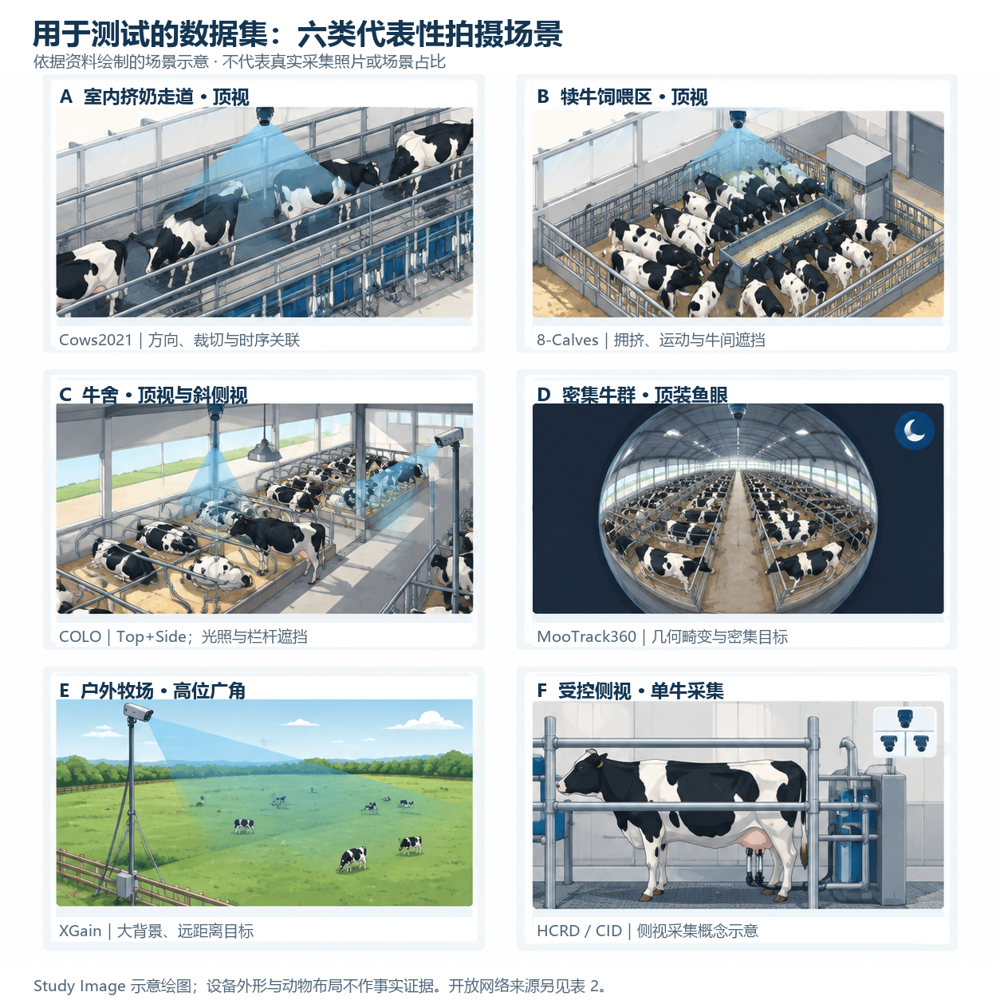
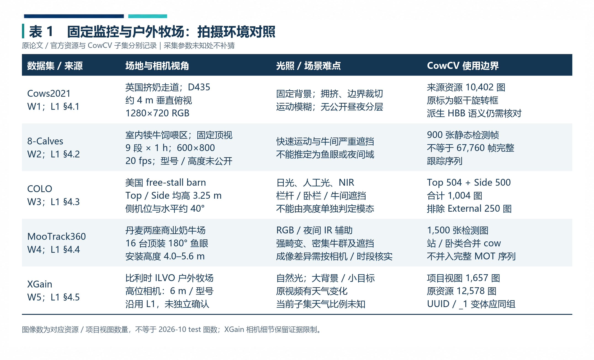
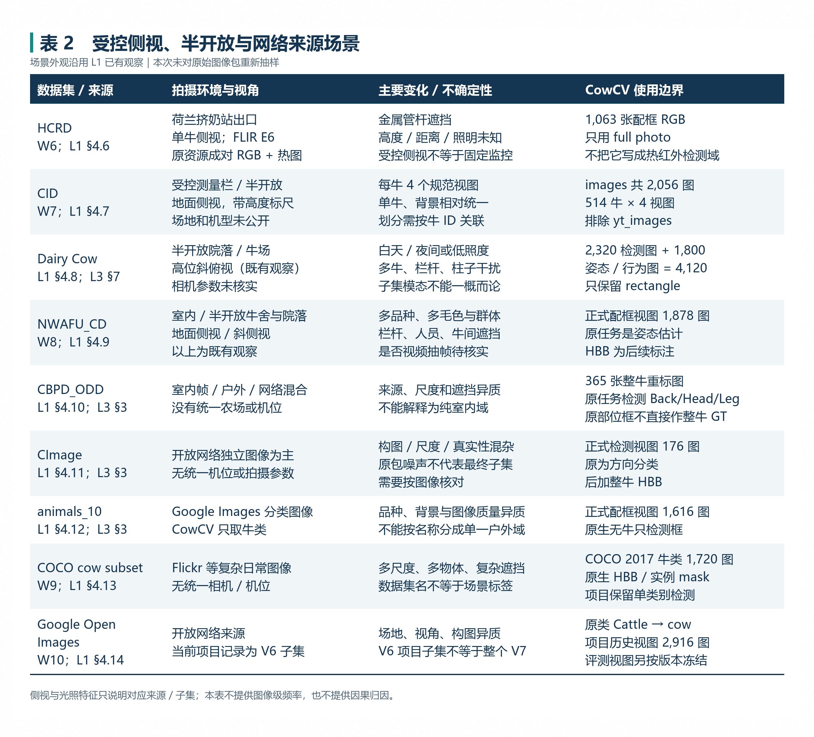
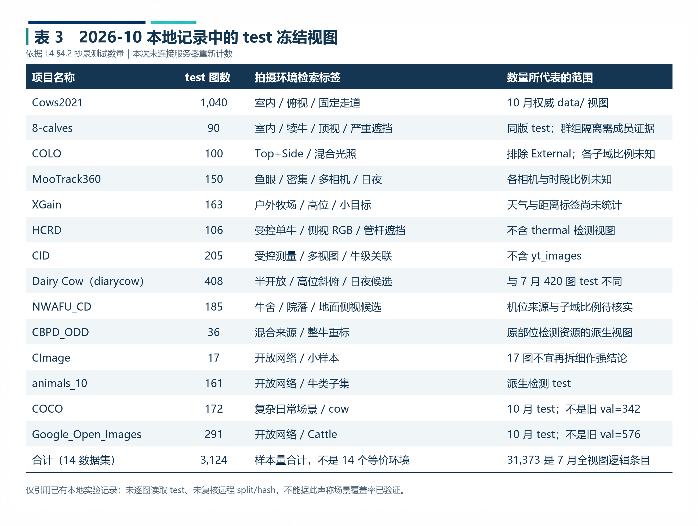
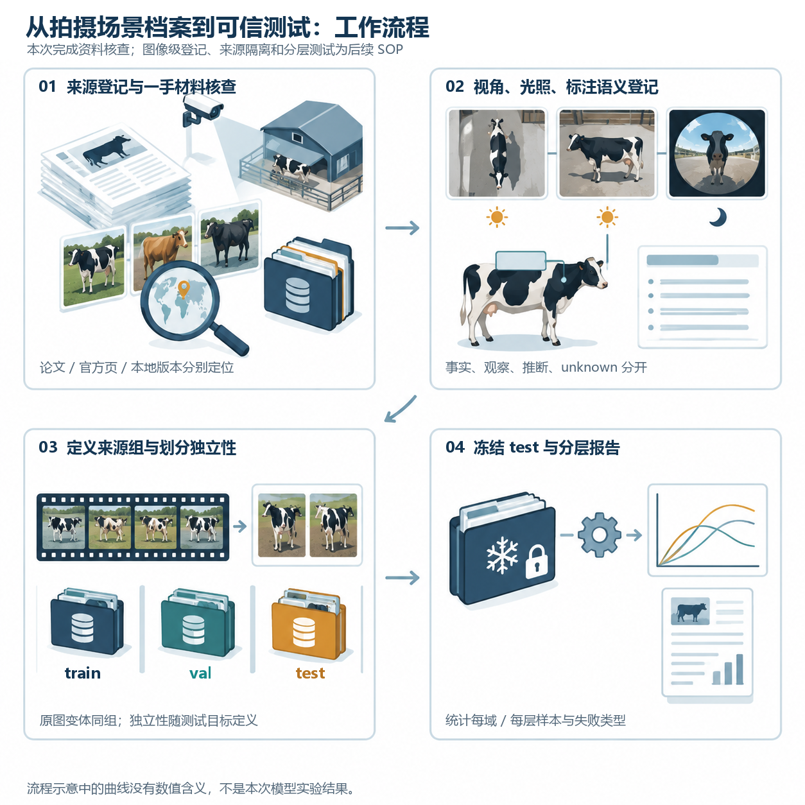
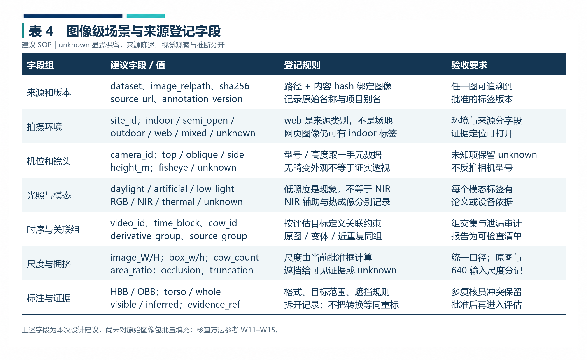
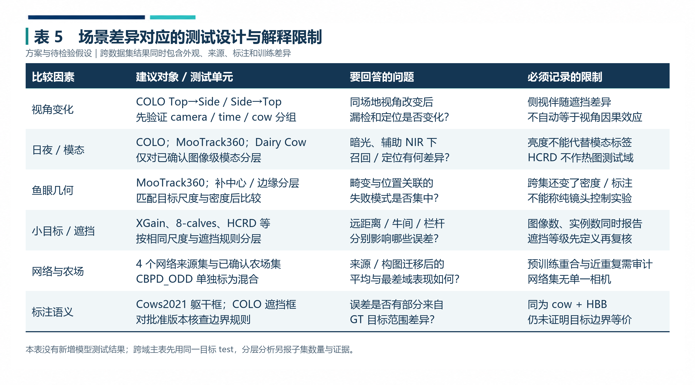
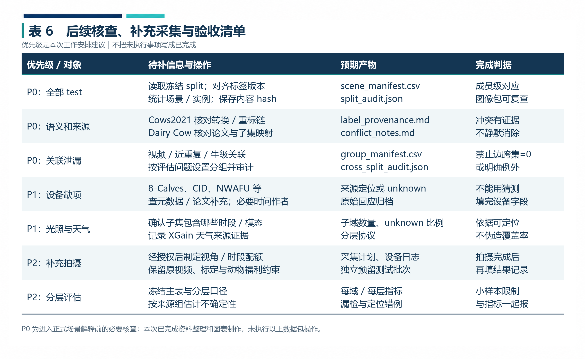

# 用于测试的数据集拍摄环境与场景

> **记录编号：** EXP-20261013-COWCV-SCENE  
> **研究主题：** 牛只检测测试数据的拍摄环境调查、场景差异分析与分层评估设计  
> **整理与来源核查日期：** 2026-10-13（北京时间）  
> **记录性质：** 资料调研与测试方案记录；关联已有实验，不新增实地拍摄或模型测试结果  
> **研究对象：** CowCV 使用的 14 个牛只检测数据集及其派生测试视图  
> **记录人：** 待填写　　**审核人：** 待填写  
> **格式依据：** [实验记录格式参考](实验记录格式参考.md)的七项结构；将“试剂与耗材”调整为“数据、设备信息与核查工具”。  
> **天气／温湿度：** 本次为文献与文件核查，不适用；各原始采集地的天气和环境参数分别登记，未知处不补填。

本次记录围绕三个问题展开：**测试图像从什么环境中获得、不同来源改变了哪些检测条件、怎样让这些差异进入可复核的测试设计。** 先核对原始采集条件，再限定 CowCV 实际使用的子集，最后提出图像级场景登记与分层测试方案。资料中的“原始资源规模”“项目使用图数”和“当前 test 数量”分开呈现。

*图 1　六类代表性拍摄场景。使用 Study Image 绘制，中文说明经本地精确排字；用于理解机位、背景、密度与遮挡的区别。设备外形、牛只布局和示意中的天气均为绘图表达，不能作为实际采集证据；六幅图也不代表场景占比。*

## 1. 实验目的（Objective）

### 1.1 研究问题

牛只检测模型在某个数据集上取得较高指标，并不直接说明它能适应另一种拍摄条件。相机俯角变化会改变可见身体部位；远距离拍摄缩小目标像素；栏杆和其他牛只形成不同类型的遮挡；鱼眼镜头改变边缘目标几何；网络图片还改变了背景、构图和图像质量。与此同时，数据集间的目标边界与标注来源也可能不同。［L1，§4–5；W1–W4、W9–W10］

本次工作的具体目标为：

1. 建立 14 个数据集的场地、视角、光照／模态、镜头、时序与遮挡对照，注明每项证据来自论文、官方说明还是已有观察。
2. 说明原始资源与 CowCV 派生检测视图的关系，防止把未纳入的子域写进测试条件。
3. 关联已有 2026-10 test 视图，明确测试数量与场景组成是两个需要分别核验的层面。
4. 给出能够实际执行的场景登记、来源隔离、分层分析与补充采集步骤。

### 1.2 本次实际完成的工作

本次阅读了指定的[拍摄环境与场景](../牛只数据集/拍摄环境与场景.md)、[COLO 论文笔记](../牛只数据集/COLO.md)、[7月工作](../牛只数据集/7月工作.md)、[域内重测-10月](../牛只数据集/域内重测-10月.md)相关章节、[27 个牛类公开数据集详细档案](牛只数据集/134个数据集信息收集/27个牛类公开数据集详细档案.md)相关条目，以及格式参考与已有科研记录。外部资料用于核对采集事实和操作方法；具体页面、版本与核查限制见附录 A。

指定文档引用的 `F:\ZCOW\pig-cow-sheep_dataset\` 和旧 `C:\Users\ChuXiao\markdowns\` 路径，本次未取得相应原始图像包与工作簿。因此，原文的“本地样例观察”在本记录中标为**既有观察**；本次没有重新逐图审核、连接服务器、重新训练、抽取真实视频帧或测量场景覆盖率。

## 2. 实验原理与参考依据（Principle & References）

### 2.1 将“数据集来源”与“拍摄场景”分开

一个数据集可以同时含有多个机位、时段和来源；不同数据集也可能具有相似的视角。因而，14 个数据集可以作为项目评测单元，但不能未经图像级核查就称为 14 个同质、等价的环境域。COLO 内部同时包含 Top 和 Side，MooTrack360 含多相机与日夜采集，CBPD_ODD 本身来源混合；COCO 与 Open Images 则没有统一农场或相机。［L1，§4–5；W3–W4、W9–W10］

本次采用下列场景描述结构：

$$
\mathbf{s}(x)=
(\text{场地},\text{视角},\text{镜头},\text{光照},\text{模态},
\text{尺度},\text{密度},\text{遮挡},\text{时序},\text{来源},\text{标注语义}) .
$$

这是**本记录提出的登记框架**，并非已完成的数据统计或某篇论文直接给出的模型。同一图像可同时具有“半开放、斜俯视、RGB、低照度、多牛群体”等标签；缺失的信息记为 `unknown`。`web` 描述来源，不能替代 `indoor/outdoor` 场地标签。数据集来源说明应覆盖组成、采集过程、预处理、用途与限制，参考 Datasheets for Datasets 的文档化思路。［W11］

### 2.2 拍摄差异与标注差异共同作用

本次最需要保留的边界有四项：

- **原生 OBB 与派生 HBB：** Cows2021 原始定向框主要围绕躯干；转成水平外接框不会自动变成完整牛体框。7 月记录另涉及部位类别筛选与人工标签来源，最终版本的转换／重标链仍要对照具体标签核实。［W1；L1，§4.1；L3，§2.3、§6］
- **NIR 辅助与热成像：** 相机夜间近红外辅助、暗光 RGB 与热红外图像应分别登记，不能因为图像黑白或较暗就判断模态。HCRD 原资源有 RGB／热图配对，当前 CowCV 检测视图只用配框 RGB。［L1，§4.3–4.6；W3–W4、W6］
- **整牛与部位任务：** CBPD_ODD 原先检测 Back／Head／Leg，CID 和 HCRD 原先也不是整牛检测数据。后加框的版本、目标范围和复核标准是评测条件的一部分。［L1，§3–4；W6–W7］
- **原资源与项目子集：** COLO 当前只用 Top+Side，CID 排除 `yt_images`，8-Calves 使用静态检测帧。不能将完整资源的相机、模态或跟踪规模直接填作本次检测测试范围。［L1，§3–4；L3，§10–11；W2–W3、W7］

因此，跨数据集指标的变化只能先描述为**整体测试分布的差异**。要论证某个因素的独立影响，还需要匹配或控制其他因素，并核对标注语义；单凭“室内→户外”或“普通图→鱼眼图”的数据集对照，不能完成因果归因。

### 2.3 独立性应对应具体研究问题

视频帧、同牛多视图、原图及其变体具有来源关联。随机按图片切分，可能保留相邻帧或相同个体；SHA-256 去重则只能识别字节相同的文件，不能单独排除全部来源关联。［L1，§5.4；L3，§13.6–13.7；W12］

应先定义测试目标，再定义禁止跨划分的关联：

1. **同场地未来时段：** 主要隔离时间块及相邻帧，允许相同相机、甚至相同牛只出现，但明确这是时间外推。
2. **新个体：** 以牛 ID 隔离，保持其他条件的匹配；不可将同牛的四个视图任意分开。
3. **新相机／新场地：** 以相机或场地留出，记录其与视角、光照等因素的同时变化。
4. **跨数据集零样本：** 目标数据集不参与训练、选模、早停与阈值搜索；另查跨来源重复与已知关联。

不能把每个“同相机”关系都与“同牛”关系盲目合并：单相机集可能因此只剩一个巨大组，无法三划分。应按研究问题选择必须隔离的关系，其他关联作为共享条件公开说明。`GroupShuffleSplit` 可以按预先定义的组划分，其比例指**组数**，不是图片数；它不能替代研究者对组的定义。［W12］

## 3. 数据、设备信息与核查工具（Materials & Environment）

### 3.1 固定监控与户外牧场资源

*表 1　五个场景较明确的监控／视频来源。图数按原资源或项目历史视图注明；[可编辑表格](用于测试的数据集拍摄环境与场景.assets/表格数据.md#表1-固定监控场景)。XGain 的 6 m 高度与相机型号沿用 L1 的项目文章摘录，本次未独立取得该配套文章全文，证据限制保留。*

Cows2021 用于观察固定俯视走道中的方向、裁切与时序关联；8-Calves 更突出犊牛活动和牛间遮挡；COLO 提供同牛舍的 Top／Side 与光照条件；MooTrack360 同时增加强鱼眼畸变、多相机和高密度；XGain 为户外牧场来源，已有样例记录呈现大背景和远距离目标。以上是**场景描述与测试价值的综合判断**，不是已测得的难度排名。［L1，§4.1–4.5；W1–W5］

### 3.2 受控侧视、半开放与异质来源资源

*表 2　其余九个资源的采集或来源特征。[可编辑表格](用于测试的数据集拍摄环境与场景.assets/表格数据.md#表2-侧视与异质来源)。CID、Dairy Cow、NWAFU 等场景外观主要引用 L1 的既有观察；设备缺项没有根据图片外观反推。*

HCRD 与 CID 都可作为受控侧视来源，但 HCRD 的管杆遮挡、CID 的测量背景和每牛多视图不相同；两者不宜合并成“无障碍单牛域”。Dairy Cow 与 NWAFU 的半开放环境同样只是粗层次描述，实际图像中的场地、视角与密度需要进一步登记。CBPD_ODD 单独保留“混合来源”属性。［L1，§4.6–4.10］

CImage、animals_10、COCO 和 Open Images 作为四个开放网络来源分别保留。原包中的卡通、商品图、非牛噪声与原资源的多样性，不能未经最终成员核查就认定为正式 test 的组成；“来源较杂”也不自动等于“质量较差”。［L1，§4.11–4.14；L3，§3–4；W9–W10］

### 3.3 关联的 2026-10 test 版本

*表 3　从 L4 §4.2 整理的 test 图数，14 项合计 **3,124 张**。本次只复算本地表格，没有核查远程清单当前状态；场景标签用于检索，不能解释为已完成的逐图标签。[可编辑表格](用于测试的数据集拍摄环境与场景.assets/表格数据.md#表3-十月测试视图)。*

该表与 7 月的 31,373 个全数据逻辑条目、旧 Cows2021 test=2,131、Dairy Cow test=420，以及旧 COCO／Google 修订 val=342／576 不同。L4 描述的是 SHA-256 去重与 8:1:1 划分后的权威 `data/` test 视图；本次不能仅凭这个描述进一步断言其牛 ID、相机、视频或时段已经全部隔离。正式场景分析必须取得对应成员清单与来源组审计。［L1，§4.13–4.14；L3，§6–7、§13；L4，§1、§4.2］

### 3.4 核查与后续操作工具

本次实际使用文件读取与关键词检索核对本地材料，使用原论文／官方页面核对外部事实，使用 Study Image 制作场景示意与表格母版，使用 Pillow 将已确认文字精确排入图表。所有图片以 Typora 相对路径引用；表格文字另存为 Markdown 和 JSON。

后续图像包核查可使用 OpenCV 读取图像尺寸、视频帧与捕获属性，使用来源清单与分组工具管理划分，使用统一评估器汇总检测指标。**这些是方法选择，不是本次已执行的软件实验**；采集相机的型号、帧率和高度属于来源条件，也不是本次购买或部署的设备。［W12–W15］

## 4. 实验步骤与过程记录（Procedures）

### 4.1 来源核查与项目边界确认——本次已执行

1. 确认指定文档、格式参考和相关记录实际存在，读取根目录索引与相关来源摘要，确定本次范围。
2. 按“场地、设备、视角、光照、序列、任务、标注、项目子集”逐项提取信息，定位到文档章节。
3. 回溯能取得的一手论文和官方资源；页面加载失败、仓库信息不足或只得到摘要时，保留核查限制。
4. 用 7 月记录核对项目使用数量与标签来源，用 10 月记录核对 test 数量；不把不同月份的数量混写。
5. 对缺失信息、两份本地材料的口径差异和待验证解释单独登记，形成表 1–3。

*图 2　从来源核查到分层测试的工作流程。Study Image 示意；其中图像级登记、划分审计、冻结与模型评估属于后续 SOP。右下曲线仅是流程图标，没有性能数值含义。*

### 4.2 建立图像级场景清单——后续 SOP

*表 4　建议登记字段与验收规则。[可编辑表格](用于测试的数据集拍摄环境与场景.assets/表格数据.md#表4-场景登记字段)。空白模板已保存为 [scene_manifest-template.csv](用于测试的数据集拍摄环境与场景.assets/scene_manifest-template.csv)，本次没有生成真实样本记录。*

操作时先读当前批准的 split 与标签，逐图填写清单；每项场景判断保留 `evidence_kind` 和 `evidence_ref`。建议使用 `paper`、`official`、`local_metadata`、`visual_observation`、`inference`、`unknown` 六种证据标记。来自观察的“斜俯视”不能升级成已知机位高度，来自论文的“全资源多天气”也不能升级成当前 test 的天气比例。

先覆盖全部 test 的基本来源字段，再补细粒度视角／光照／遮挡。人工抽查时按数据集、相机、时段与来源组取样，并记录抽样种子、成员、抽查数量和冲突数量；只看几张典型图片可用于发现候选场景，不能估算场景占比。小集合如 CImage test 的 17 图应优先全量复核，仍不宜用极小分层作稳定结论。

### 4.3 视频与多视图关联核查——后续 SOP

对视频源保留原视频 ID、时间戳、抽帧规则、相机 ID 和派生图像名；先确认解码成功、实际尺寸和帧定位，再记录帧率属性。本次建议把软件读取值与原始设备元数据交叉核对，不把缺失值或读取失败的值当作真实采集参数。帧率未知时，不由文件数量推算视频时长；设备安装高度未知时，不由牛只像素大小推算米数。W13 为后续接口核查入口，本次访问受限，未将其正文内容作为已核实证据。

对 CID 保留牛 ID 与四视图关联；对 XGain 保留 UUID 与 `_1` 变体组；对 Cows2021 和 8-Calves 保留视频／时段来源。确切组成员必须来自元数据或可核查的文件映射，不能仅根据相似外观自动认定同一头牛。［L1，§4.1–4.2、§4.5、§4.7；W1–W2、W7］

### 4.4 划分与重复检查——后续 SOP

以第 2.3 节定义的独立性为准，建立必须同组的关联清单；对原图变体、确认近重复及指定来源关系形成连通组，再按组划分。核对以下结果：

- 图片和最终标签逐成员对应，路径可打开；空标注、漏标和非法坐标分别检查。
- train／val／test 文件成员不交叉；禁止跨集的组关系交集为 0，或明确说明无法满足的条件。
- 精确重复与确认近重复单独报告；pHash 候选不是确认重复，需人工复核。
- 同一目标 test 的成员、图像 hash、标签版本、忽略规则与 split 版本冻结。

精确去重、时间外推、个体隔离和相机留出是不同检查。若清理改变了训练集，需要另建实验版本；若只改评估成员，也应记录前后清单与比较范围，不能悄悄替换结果。［L3，§13.6–13.7；L4，§1；W12］

### 4.5 分层测试与失败样例归档——后续 SOP

先在同一冻结 test 上生成主结果，再按已核实标签分层：顶视／侧视／斜视、日光／人工光／低照度、RGB／NIR／thermal、尺度、密度、遮挡类型、鱼眼中心／边缘等。每层同时登记图像数、实例数和来源组数；未知层不删除，单独报告。

AP 指标与阈值固定的 P／R／F1 分别计算。`model.val(iou=...)` 的 YOLO NMS 参数与 AP 的匹配 IoU 范围不是同一个概念；如报告固定工作点，须声明置信度与匹配 IoU，并避免在 test 上搜索阈值。COCO 评估器还具有面积范围与最大检测数量等设置，尤其需要记录密集目标的截断上限。［W14–W15；L5，§2.3］

本记录不指定各模型新的训练超参数，也不产生新的 mAP 表。分层结果应链接到同一次模型评估的预测、标签、权重 hash 与配置，并保存漏检、误检、重复框和边界错位的代表样例。

## 5. 原始数据与核查现象（Raw Data & Observations）

### 5.1 已核实的资源边界

**COLO：** 原资源共 1,254 图，包含 Top 504、Side 500、External 250；CowCV 当前场景文档和本地笔记一致指出只采用前两项共 1,004 图。因此，本记录中 COLO 的场景覆盖不包含 External 的低机位／较远视角；测试视图中 Top／Side 各占多少尚无本次成员统计。［W3；L1，§4.3；L2，末段］

**HCRD：** 原资源的 RGB／热图配对可服务于识别研究，CowCV 使用的却是 1,063 张已配框 `full photo` RGB。热图存在并不证明当前检测实验进行了热红外测试。相机拍摄为受控侧视，脚架或固定安装方式仍未知。［L1，§4.6；W6］

**CID 与 8-Calves：** CID 项目使用规范 `images`，不包含 `yt_images`；8-Calves 使用 900 张静态检测图，不将整段跟踪序列帧数当作项目检测图数。两者都需保留来源关联，但关联单位不同。［L1，§4.2、§4.7；L3，§10–11；W2、W7］

**网络与混合来源：** 开放网络图像没有统一拍摄参数；CBPD_ODD 也不能强行归入纯室内或纯户外。不存在统一参数不表示不能测试，而是要求用图像级标签限定解释范围。［L1，§4.10–4.14；W9–W10］

### 5.2 资料中的冲突与缺项

**Dairy Cow 的模态与数量口径：** L6 综述档案将其关联到 2022 年姿态研究，写为 IR、1,800 图；L1 描述当前整理资源的日夜外观，并记载公开 `op_dataset` 约 1,980 图，项目实际只整理了 1,800 图。L3 §7 的目录统计支持“2,320 检测图 + 1,800 行为／姿态图 = 4,120 图”。这些信息可能分别指论文子集、公开页描述与项目派生组合，**尚不能仅凭名称认定它们是同一批图像**。本次不将 Dairy Cow 全体改写为 RGB 或 IR，后续要核对论文、文件名、子目录与设备模式的对应关系。［L1，§4.8；L3，§7；L6，Dairy Cow 条目］

**Cows2021 的框范围：** L1 写水平外接框转换，L3 记录人工复核标签与部位类别筛选。两条记录没有在本次提供逐版本映射；本记录确认原始躯干 OBB 的语义，保留最终 HBB 是否逐图重标的待核查项，不选择性消除差异。［W1；L1，§4.1；L3，§2.3、§6］

**设备与采样缺失：** 8-Calves 的机型／高度、CID 的机构／机型、NWAFU 的精确采集与视频来源、Dairy Cow 的设备／日夜比例，缺少本次可定位的一手说明。XGain 的天气分布、帧率与抽帧间隔也没有被当前子集统计证明。上述字段不以示意图、数据集名字或经验补齐。［L1，§6］

### 5.3 数量核对与样本独立性

本次按 L4 test 表复算：

$$
1040+90+100+150+163+106+205+408+185+36+17+161+172+291=3124 .
$$

这是测试图片数量的文档复算。没有实例级场景标签和来源组清单时，不能由 3,124 张进一步得出“覆盖全部天气”“所有测试样本互相独立”或“各场景比例均衡”。CImage 17 图与 CBPD_ODD 36 图的 test 尤其限制细分后估计的稳定性。［L4，§4.2；后半为本次方法分析］

## 6. 结果与数据分析（Results & Analysis）

### 6.1 本次形成的场景分析框架

资料可以支持以下四类分析方向：

- **几何与视角：** 固定顶视、斜俯视、地面侧视及鱼眼成像；视角改变可同时改变可见部位和遮挡。
- **光照与成像：** 日光、人工照明、低照度现象，以及有设备／论文依据的 RGB、NIR 或 thermal 模态。
- **尺度与群体结构：** 单牛受控、多牛群体、密集饲喂、远距离牧场；以批准框和实际图像尺寸量化尺度。
- **来源与标签：** 固定视频、多视图采集、开放网络与混合来源；同时考虑整牛／躯干／部位及可见／推断边界。

这些类别是**跨来源综合**。它们可以用来提出假设和定位失败样例，不能单独说明哪个因素造成了多少性能下降。

*表 5　场景因素对应的可执行比较与解释边界。[可编辑表格](用于测试的数据集拍摄环境与场景.assets/表格数据.md#表5-测试设计与限制)。全部为后续设计，本次没有执行或声称获得其中的测试结果。*

### 6.2 尺度、密度和覆盖率的计算口径

建议将像素尺度和相对面积同时记录：

$$
a_{\mathrm{rel}}=\frac{w_{\mathrm{box}}h_{\mathrm{box}}}{WH},
\qquad
r_w=\frac{w_{\mathrm{box}}}{W},
\qquad
d_{\mathrm{img}}=N_{\mathrm{cow}} .
$$

其中 $W,H$ 为批准图像尺寸，$w_{\mathrm{box}},h_{\mathrm{box}}$ 为对应版本的 HBB 尺寸；$d_{\mathrm{img}}$ 仅为图中牛实例数，**不是每平方米的真实养殖密度**。这些量受标注范围影响，躯干框与整牛框不宜无说明地合并比较。原图尺度和 resize／letterbox 到 640 输入后的尺度分别记录，避免把原图中的目标像素数直接作为模型输入尺度。

对已知场景标签 $c$，可分别报告图片覆盖率和实例覆盖率：

$$
q_c^{\mathrm{img}}=\frac{n_c^{\mathrm{img}}}{N^{\mathrm{img}}},
\qquad
q_c^{\mathrm{inst}}=\frac{n_c^{\mathrm{inst}}}{N^{\mathrm{inst}}}.
$$

同一图片允许多个场景标签，因此多标签比例不要求相加为 100%；若某字段采用互斥分类，须把 `unknown` 一并计入。**本次仅给出公式，没有填入未经统计的覆盖率。**

### 6.3 从场景对照到可靠报告

主表应先逐数据集报告，再对相同指标做数据集等权宏平均：

$$
\overline{m}_{\mathrm{macro}}=\frac{1}{K}\sum_{t=1}^{K}m_t,
\qquad
m_{\mathrm{worst}}=\min_t m_t .
$$

宏平均反映评测单元等权，不等于按图片池化的 AP，也不表示各环境均匀。场景分组应随成员清单发布；混合来源集和 `unknown` 层不能为了表格整齐而删除。样本级不确定性应尊重视频、牛级或来源组相关性，训练重复运行的离散度与测试样本不确定性也分别报告。［L1，§5.4；L4，§8–9；W12；汇总方式为本次建议］

如果要量化目标域泛化下降，域内与跨域分子／分母应使用**同一目标 test 和同一评估口径**，并说明训练方案。已有 7 月与 10 月结果不能只按数据集同名就直接拼成一个指标比较。更完整的评估背景见[数据集整理与独立测试集评估](数据集整理与独立测试集评估.md)。［L4，§1、§6、§9；L5］

## 7. 讨论、后续计划与阶段结论（Discussion & Next Steps）

### 7.1 阶段结论

本次资料核查表明，测试资源同时包含室内固定俯视、受控侧视、半开放牛场、密集鱼眼、户外牧场和开放网络来源。**“拍摄环境与场景”应落实为图像级条件与来源证据，而不能仅由数据集名称代替。** 统一 `cow` 类别和 HBB 文件格式是必要的准备，但不能自动消除目标边界、遮挡规则、来源关联和成像差异。［L1；W1–W4、W9–W11］

当前可以确认的是资料中的采集条件、项目子集边界与本地记录的 test 数量。尚未确认的是当前 test 的细粒度场景比例、全部来源关系、最终标签语义一致性，以及单一拍摄因素的性能影响。本次记录据此形成可追溯的场景对照与执行方案。

### 7.2 后续工作与验收

*表 6　后续优先级与交付物。[可编辑表格](用于测试的数据集拍摄环境与场景.assets/表格数据.md#表6-后续核查与验收)。优先级为本次安排建议，完成情况须在执行后另记。*

若安排补充采集，应在拍摄前确定验证问题和测试批次，登记设备型号、镜头／FOV、安装高度与角度、时间、照明模式、曝光、分辨率、帧率、牛只或群体来源。先做试拍，检查对焦、逆光、运动模糊、边缘目标与遮挡，再按计划采集并保留原视频。不同场地／时段的配额属于采集设计，不应在未拍摄前写成已覆盖事实；动物福利、场地许可和现场安全按真实采集要求落实。

完成清单与复核后，再输出“每层样本／实例／来源组数量—统一指标—典型失败样例—证据限制”四联结果。这将使记录既能呈现工作过程，也能让审核者判断结论由哪些数据支持。

**记录人签字：** __________________　**日期：** __________________  
**审核人／导师签字：** __________________　**日期：** __________________

## 附录 A. 资料来源与定位

### A.1 实际读取的本地资料

- **L1：** [拍摄环境与场景](../牛只数据集/拍摄环境与场景.md)，§1 证据分层、§2–4 场景与标注档案、§5 评测含义、§6 缺项。本次主要整理依据；其中旧图像样例观察没有被本次重新逐图验证。
- **L2：** [COLO 论文简要总结与相关性分析](../牛只数据集/COLO.md)，§2–3 数据与设计、§5–8 迁移边界及末段 Top+Side 确认。属于二手笔记，关键采集事实回到 W3 核对；不采用笔记对模型规模的因果推断作为已证实结论。
- **L3：** [7月工作](../牛只数据集/7月工作.md)，§2.3 标签来源、§3–7 项目数量、§10–11 多视图与新增资源、§13.1–13.7 分组与重复审计。只证明所记录时段与条件。
- **L4：** [域内重测-10月](../牛只数据集/域内重测-10月.md)，§1 权威数据与协议、§4.2 test 图数、§6–9 泛化解释及限制；参考[10月域内重测计划](../牛只数据集/10月域内重测计划.md)中数据版本与新旧结果边界。没有远程重新验证其当前产物。
- **L5：** [数据集整理与独立测试集评估](数据集整理与独立测试集评估.md)，§2 指标与独立性、§3 数据范围、§5 重复审计、§7 后续任务；并读取[对应来源摘要](../wiki/sources/cowcv-dataset-test-evaluation-evidence.md)定位历史口径。本页是已有综合记录，不能替代原论文。
- **L6：** [27 个牛类公开数据集详细档案](牛只数据集/134个数据集信息收集/27个牛类公开数据集详细档案.md)，一览表、A5 Cows2021 及 Dairy Cow 相关检索条目；用于发现模态与子集口径差异，没有把综述笔记当作项目当前成员统计。
- **格式：** [实验记录格式参考](实验记录格式参考.md)。日期、签字、原始资料、分析和后续计划分栏保留。

### A.2 外部原始研究、官方资源与指南

以下为本次来源核查清单；访问结果、定位关键词、核查摘要及错误保存在 [外部来源核查.json](用于测试的数据集拍摄环境与场景.assets/外部来源核查.json)，不保存或分发论文全文。取得了 Cows2021、8-Calves、COLO 可读全文，MooTrack360 官方摘要、XGain DOI 元数据、NWAFU 官方仓库元数据，COCO／Datasheets 摘要、Open Images V6 说明、分组／验证指南和 COCOeval 代码页。HCRD、CID 的相关入口与 OpenCV 文档未取得可读正文，其事实沿用带定位的本地资料。每个 W 编号只支持其可核查范围。

- **W1：Gao et al. (2021)，Cows2021。** [原论文](https://arxiv.org/abs/2105.01938)与[可读全文](https://arxiv.org/html/2105.01938)。定位采集与数据集说明、原始定向框范围；用于顶视走道、设备与标注语义核查。
- **W2：Fang et al. (2025)，8-Calves。** [原论文](https://arxiv.org/abs/2503.13777)与[作者仓库](https://github.com/tonyFang04/8-calves)。定位数据采集、静态检测集与完整跟踪序列；不补未公开的安装高度。
- **W3：Das et al.，COLO。** [原论文](https://arxiv.org/abs/2407.20372)与[作者仓库](https://github.com/Niche-Squad/COLO)。定位摄像机布置、光照、标注及数据数量；论文的同牛场因素实验不直接证明 CowCV 的跨来源因果效应。
- **W4：Christiansen et al. (WACV 2026)，MooTrack360。** [CVF 论文页](https://openaccess.thecvf.com/content/WACV2026/html/Christiansen_MooTrack360_A_Novel_Fisheye_Camera_Dataset_for_Robust_Multi_Diary_WACV_2026_paper.html)与[作者仓库](https://github.com/SDU-Robotics/MooTrack360)。用于确认鱼眼、多相机、密集场景与日夜资源；详细高度、型号和数量沿用 L1 的论文摘录，未将摘要当作全部参数的直接证据。
- **W5：Computer Vision Dataset for Detecting Cattle Behaviors in Pasture Environments。** [Zenodo 数据记录](https://zenodo.org/records/15688349)直接访问失败，改通过 [DataCite DOI 元数据](https://api.datacite.org/dois/10.5281/zenodo.15688349)核对：RGB 高位牧场图像、人工行为框、YOLOv8 格式及 UUID 配对。采集地点、时段与原图数沿用 L1；[配套项目文章](https://doi.org/10.5281/zenodo.14762157)本次未取得全文，6 m、型号和 1 ha 等细节保留为 L1 摘录。
- **W6：Bhole et al. (2019)，Holstein Cattle Recognition。** [原论文 DOI](https://doi.org/10.1007/978-3-030-29891-3_10)、[原始数据 DOI](https://doi.org/10.34894/O1ZBSA)与[作者代码](https://github.com/ameybhole/IIHC)。本次代码页／README 访问失败，论文与数据入口为 L1 提供的回溯线索；双模态资源、采集设备与项目 RGB 数量均引用 L1／L3，没有伪称本次阅读全文。
- **W7：CID。** [作者仓库](https://github.com/bhuiyanmobasshir94/CID)与[配套论文 DOI](https://doi.org/10.1145/3542954.3543018)。本次仓库／README 未取得可读正文；514 牛、四视图、属性任务和 `images/yt_images` 边界沿用 L1／L3，机构／机型仍待核实。
- **W8：NWAFU Cattle Dataset。** [作者仓库](https://github.com/MicaleLee/Database)网页访问失败，经 [GitHub 官方仓库元数据](https://api.github.com/repos/MicaleLee/Database)读到简介 `cattle pose estimation`。该简介仅定位任务；采集设备、精确场地和视频来源不补推断。
- **W9：Lin et al. (2014)，Microsoft COCO: Common Objects in Context。** [原论文](https://arxiv.org/abs/1405.0312)与[官网](https://cocodataset.org/)。用于复杂日常场景来源与通用任务背景；CowCV 牛类筛选规模取本地记录。
- **W10：Google Open Images。** [官方资源页](https://storage.googleapis.com/openimages/web/index.html)与 [V6 facts and figures](https://storage.googleapis.com/openimages/web/factsfigures_v6.html)。核查图像级标签、检测与版本说明；当前 CowCV 下载为 V6 的判断来自 L1 的项目元数据记录。
- **W11：Gebru et al.，Datasheets for Datasets。** [原论文](https://arxiv.org/abs/1803.09010)。参考数据组成、采集、预处理、用途与维护的记录框架；本记录的字段表是按项目需要设计的建议。
- **W12：scikit-learn，GroupShuffleSplit。** [官方 API 文档](https://scikit-learn.org/stable/modules/generated/sklearn.model_selection.GroupShuffleSplit.html)。核查按组划分与比例含义；不把库函数等同于自动消除泄漏。
- **W13：OpenCV，VideoCapture 与视频捕获属性。** [VideoCapture 官方说明](https://docs.opencv.org/4.x/d8/dfe/classcv_1_1VideoCapture.html)及[属性列表](https://docs.opencv.org/4.x/d4/d15/group__videoio__flags__base.html)。本次遇到 HTTP 403／网络错误，未取得正文；只保留后续接口核查入口，未执行真实视频读取。
- **W14：Ultralytics，Model Validation。** [官方验证指南](https://docs.ultralytics.com/modes/val/)。用于评估集合、输出与后处理参数定位；其当前接口说明不证明历史运行采用相同版本。
- **W15：COCO API，COCOeval。** [官方实现](https://github.com/cocodataset/cocoapi/blob/master/PythonAPI/pycocotools/cocoeval.py)。定位匹配 IoU 范围、面积范围及最大检测数量；正式结果需记录实际采用的实现版本。

### A.3 补充资源入口与未直接核查范围

L1 提供了 [Dairy Cow](https://www.kaggle.com/datasets/twisdu/dairy-cow)、[Cattle Body Parts](https://www.kaggle.com/datasets/alikhalilit98/cattle-body-parts-dataset-for-object-detection)、[Cow-images](https://www.kaggle.com/datasets/afnanamin/cow-images)和[Animals-10](https://www.kaggle.com/datasets/alessiocorrado99/animals10)入口。本次相关子集事实主要依据 L1／L3；未下载这些原包，不宣称入口当前完整可用或逐图来源已核实。旧 `F:\ZCOW\` 工作簿与图像目录、论文补充材料、逐图 URL、远程清单均列入后续核查。

## 附录 B. 图表底稿与完成检查

- **可编辑材料：** [表格数据.md](用于测试的数据集拍摄环境与场景.assets/表格数据.md)、[图表数据.json](用于测试的数据集拍摄环境与场景.assets/图表数据.json)、[场景清单空白模板](用于测试的数据集拍摄环境与场景.assets/scene_manifest-template.csv)。
- **绘图来源与复现：** Study Image 生成两张场景／流程原图和一张表格母版，保留在同名 assets 目录；[生成图表.py](用于测试的数据集拍摄环境与场景.assets/生成图表.py)负责确定性排字，PNG 保存 300 dpi 元数据，表格同时嵌入对应 JSON。dpi 元数据不增加生成原图的实际细节。
- **来源留档：** [本地来源校验.json](用于测试的数据集拍摄环境与场景.assets/本地来源校验.json)保存所读主要文件的 SHA-256，用于确认本次没有改写这些原始资料；外部访问结果与核查摘要保存在同目录，不能替代原始页面。
- **结构验证：** 链接、图片相对路径、表格文字／JSON／PNG 一致性、test 数量、来源摘要元数据与索引条目，检查结果见[复核结果.json](用于测试的数据集拍摄环境与场景.assets/复核结果.json)。
- **未运行：** 真实图像逐图场景审核、视频抽帧、相机标定、设备实测、远程数据计数、训练与模型评估、场景覆盖率统计、统计显著性检验、SQLite 与向量索引同步。
