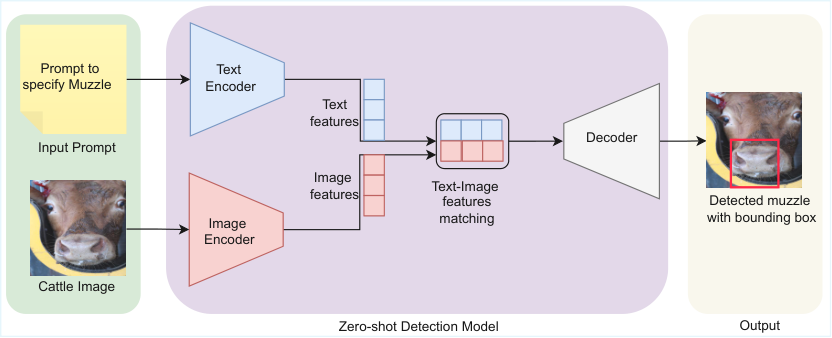

# 当语言模型引导视觉 用于牛吻部检测的 Grounding DINO

**原文题名：** When Language Model Guides Vision: Grounding DINO for Cattle Muzzle Detection

**作者：** Rabin Dulal、Lihong Zheng、Muhammad Ashad Kabir

**作者单位：**

1. 澳大利亚查尔斯特大学计算、数学与工程学院，新南威尔士州，2678。
2. 澳大利亚查尔斯特大学 Gulbali 农业、水与环境研究所，新南威尔士州，2678。
3. 澳大利亚 Food Agility CRC Ltd，悉尼，新南威尔士州，2000。

**电子邮箱：** {rdulal,lzheng,akabir}@csu.edu.au

**原文版本：** arXiv:2509.06427v2，2025-10-13；首次提交于 2025-09-08。

**原文链接：** [arXiv 摘要页](https://arxiv.org/abs/2509.06427v2)；[本地英文原文](assets/2509.06427v2_英文原文.pdf)。

**许可与翻译标识：** 原文采用 [CC BY-NC-SA 4.0](https://creativecommons.org/licenses/by-nc-sa/4.0/) 许可。本中文译稿由 AI 翻译，属于非官方译文；对原文作了语言翻译与版式调整，译稿同样采用 CC BY-NC-SA 4.0 许可，原作者署名保留。

**术语说明：** muzzle 统一译为“吻部”，指牛面部前端鼻孔、口唇及其周围区域；muzzle pattern 译为“吻部纹理”。正文、图表与参考文献沿用原文编号。实验提示词保留英文并附中文，以便对照；参考文献保留原始书目信息并附题名中文译文。

## 摘要

吻部纹理是牛只身份识别中最有效的生物特征之一。快速、准确地检测作为感兴趣区域的吻部，是实现牛只自动视觉身份识别的关键。早期方法依赖人工检测，劳动强度大，而且结果的一致性不足。近年来，采用 YOLO 等监督学习模型的自动化方法逐渐广泛用于吻部检测。尽管这些方法有效，但它们需要大量标注数据，并且往往依赖训练数据，因而在新的或未见过的牛只上的表现受到限制。

为解决这些局限，本研究提出一种基于 Grounding DINO 的零样本吻部检测框架。Grounding DINO 是一种视觉语言模型，无需任何针对该任务的训练或标注数据，即可检测吻部。该方法利用自然语言提示词引导检测，使吻部定位能够灵活扩展到不同品种和环境。我们的模型在 mAP@0.5 指标上达到 76.8%，表明它无需标注数据也能取得有潜力的表现。据我们所知，这是首项面向真实场景和产业应用、为牛吻部检测提供免标注解决方案的研究。该框架为监督学习方法提供了一种实用的替代方案，有望提高牲畜监测应用的适应性与部署便利性。

**关键词：** 牛只身份识别；卷积神经网络（CNN）；Transformer；零样本；Grounding DINO；深度学习。

## 1 引言

准确的牛只身份识别对生物安全和牲畜管理至关重要。RFID 标签等传统方法存在标签丢失和被篡改等问题 [10, 26, 6]。利用视网膜、虹膜和吻部等特征的生物识别方法提供了更可靠的替代方案 [10]。吻部纹理具有独特性，而且便于采集，因此尤其有效。

深度学习模型，特别是 CNN 和 Transformer，推动了基于吻部的身份识别，但此类识别依赖准确的吻部检测。早期方法依赖油墨印痕和人工裁剪，劳动强度大，也容易产生不一致。尽管近年来 YOLO [23] 及其变体等目标检测器已实现该任务的自动化 [26, 7]，但它们仍需要标注数据集，并且需要针对新的牛只重新训练 [21, 3]。这些模型虽然提高了准确性和效率，却需要带有吻部区域标注的数据集来开展监督训练 [21]。然而，收集此类大规模标注数据通常既困难又昂贵，还需要领域专业知识。为此，我们探索将零样本吻部检测作为一种可扩展的替代方案。

零样本目标检测（zero-shot object detection，ZSD）旨在解决无需标注数据即可检测目标的问题，例如检测牛的吻部 [21, 3]。它通过共享的语义信息，模拟人类从已知类别泛化到未见类别的能力。DeViSE 和 ALE 等早期 ZSD 模型使用固定的语义嵌入，例如 Word2Vec 和 GloVe，并通过度量学习将这些嵌入与视觉特征对齐。然而，这类模型在复杂视觉场景中的表现有限，也缺乏对上下文的理解。

RegionCLIP [34] 和 Grounding DINO [16] 等较新的模型，采用基于 Transformer 的架构和大规模图像文本对来学习联合表示。这些系统支持视觉与文本特征之间的细粒度对齐，从而提高对未见类别的泛化能力。在 ZSD 中，模型使用带有文本描述的已见类别标注数据进行训练；推理时，通过将视觉区域与文本嵌入匹配，即可检测未见目标，而无需重新训练 [21, 16]。当前先进的 ZSD 方法包括 OWL-ViT [19]、ViLD [8]、RegionCLIP、OV-DETR [32]、DetCLIP [31]、OmDet [33] 和 Grounding DINO。

本研究将语言引导的零样本目标检测模型 Grounding DINO 用于牛吻部检测。受人类通过理解语义而从已知概念泛化到未知概念的能力启发，我们探索能够将视觉特征与语义描述对齐的模型。该方法利用预训练阶段形成的视觉语言对齐能力，仅根据“cattle muzzle”（牛的吻部）或“nose of a cattle”（牛的鼻部）等文本提示词即可进行检测，因此无需再训练模型。通过消除对人工标注训练数据和模型重新训练的依赖，所提出的方法有助于在真实应用中实现可扩展、适应性强且高效的吻部检测。本研究的主要贡献如下：

- 我们提出一种基于零样本目标检测框架的新型吻部检测模型，无需进行大量数据集标注即可实现准确检测。据我们所知，这是首次将零样本方法应用于牛吻部检测任务。
- 我们对七种融合语言与视觉的先进零样本目标检测模型进行了全面评估，考察其在吻部检测任务中的表现。这一比较建立了一个基准，可为该领域的后续研究提供指导和支持。

## 2 相关工作

本节概述围绕吻部检测方法开发与评估开展的研究。

研究 [11] 开发了一种生物识别系统，使用 Haar 级联分类器 [14] 检测牛脸，随后通过分割提取吻部区域。深度学习进一步改进了这一过程。研究 [26] 使用 YOLOv3 [24] 检测吻部区域，研究 [30] 则采用改进的 YOLOv5 [27] 模型。其他研究 [12, 2, 1] 也有效利用了基于 YOLO 的模型，实现精确、自动的吻部提取。

使用深度学习模型检测吻部面临的一个难点，是需要大量标注数据，这增加了模型训练和部署所需的时间、成本与计算资源。现有研究高度依赖大型牛吻部图像标注数据集，而此类数据的收集与标注既昂贵又耗时。本研究采用零样本吻部检测方法，使模型无需事先获得任何带标注的吻部数据样本，即可识别和定位吻部区域。这降低了对大量人工标注的依赖，从而在保持有效检测性能的同时节省时间和资源。以往大多数研究对 YOLOv3 [24]、YOLOv5 [27]、YOLOv7 [29] 和 YOLOv8 [28] 等预训练目标检测模型采用微调策略，通过额外训练使其适应特定数据集。Haar 级联分类器等传统机器学习方法既不涉及微调，也不涉及零样本学习。相比之下，本研究使用基于 Grounding DINO 的零样本检测方法。该方法无需针对特定任务重新训练，即使训练时没有见过目标类别，也能够检测目标。

## 3 方法

本研究的方法如图 1 所示。首先输入一对数据，即一张图像和一个文本提示词。本研究选择七种不同的 ZSD 模型，使用平均精度均值（mean Average Precision，mAP）等适当指标评估输出，随后选取表现最好的模型。

**图 1** 使用描述牛图像中吻部区域的文本提示词，引导零样本检测模型完成吻部检测的总体框架。

**图内文字对照：** Prompt to specify Muzzle＝用于指定吻部的提示词；Input Prompt＝输入提示词；Cattle Image＝牛只图像；Text Encoder＝文本编码器；Image Encoder＝图像编码器；Text features＝文本特征；Image features＝图像特征；Text-Image features matching＝文本与图像特征匹配；Decoder＝解码器；Zero-shot Detection Model＝零样本检测模型；Detected muzzle with bounding box＝带有边界框的吻部检测结果；Output＝输出。

### 3.1 数据集

本研究使用三个不同的数据集，以确保环境条件、成像设备和牛只品种的多样性。第一个数据集称为 CSU Data1，采集于澳大利亚沃加沃加的查尔斯特大学（Charles Sturt University，CSU）全球数字农场。图像采集遵循已获批准的动物伦理方案 A21414，以确保符合动物福利标准。

此外，为提高方法的泛化能力和鲁棒性，我们还使用了两个公开数据集，即 UNE 数据集 [26] 和 NUCES 数据集 [1]。表 1 总结了各数据集的主要属性。值得关注的是，这些数据集在地理来源、环境条件、成像设备和牛只品种多样性方面存在差异，因此形成了异质的数据基础，适合用于评估牛只身份识别模型的跨域表现。

**表 1** 用于零样本吻部检测的数据集概况。

| 数据集 | 图像数量 | 品种 | 地点 | 设备 |
| --- | --- | --- | --- | --- |
| CSU Data1 | 163 | 安格斯牛 | 澳大利亚沃加沃加 | Nikon D7200 |
| UNE | 2,632 | 安格斯牛、西门塔尔牛、海福特牛、夏洛来牛 | 澳大利亚阿米代尔 | Canon D800 |
| NUCES | 2,893 | 未提及 | 巴基斯坦拉合尔 | Canon D80、Oppo A76、OnePlus 9 Pro |

### 3.2 数据预处理

为评估 ZSD 模型在吻部检测中的表现，需要一个真实标注数据集来进行客观比较。尽管 ZSD 模型不需要目标类别的标注数据，但模型评估仍离不开标注数据。在本研究中，我们使用被广泛采用的标注与数据集管理平台 Roboflow，在牛头图像的吻部区域周围绘制边界框。

标注后的图像以 COCO 格式导出，其中包含图像元数据及相应的边界框坐标和类别标签。这些标注仅用于评估，以便衡量检测性能。

### 3.3 零样本检测模型

我们选择的七种 ZSD 模型分别为 OWL-ViT、ViLD、RegionCLIP、OV-DETR、DetCLIP、OmDet 和 Grounding DINO。选择这些模型主要基于两项标准。第一，每个模型都支持句子形式的文本提示词，能够使用详细的自然语言描述来引导检测。这对于检测牛吻部等特定且细微的特征尤为重要，因为一个句子，例如“牛脸前部包含鼻孔和嘴巴的区域”，能够比单个词语传达更丰富的语义信息。第二，所有选定模型都已在 COCO [15]、LVIS [9] 和 ODinW [13] 等标准基准数据集上表现出较强性能，体现了它们在不同目标类别上的鲁棒性和泛化能力。通过同时利用视觉特征和语义文本嵌入，这些模型为零样本吻部检测任务提供了一条有潜力的路径。

表 2 总结了所选零样本检测模型，并根据基础架构、开放词汇策略和检测方式进行分类。基础架构指用于从图像和文本中提取特征的组件，通常包括用于图像特征提取的 ViT [5]、Faster R-CNN [25]、ConvNeXt [18]、DETR [4] 和 Swin [17] 等视觉骨干，以及用于处理文本描述或提示词的 CLIP [22] 等语言编码器。

开放词汇策略描述模型如何将视觉特征与语言监督相结合，从而检测此前未见过的类别。这类技术涵盖 CLIP 引导的分类、区域级对比学习、基于查询的视觉定位，以及多来源语义蒸馏。检测方式则表示模型采用的检测范式：一种是先利用区域建议网络生成候选区域，再进行分类；另一种是端到端方式，直接通过 Transformer 预测目标查询，无需单独生成候选区域。OWL-ViT、OV-DETR、DetCLIP、OmDet 和 Grounding DINO 等多数较新模型采用端到端框架，以实现更好的语言视觉融合和零样本泛化；ViLD 和 RegionCLIP 则保留基于候选区域的两阶段设计，以兼容传统检测器。

基于上述方法框架，我们开展了一系列实验，以评估所选模型的有效性。下一节报告这些评估的结果。

**表 2** 所选零样本检测模型概况。

| 模型 | 基础架构 | 检测方式 | 开放词汇策略 |
| --- | --- | --- | --- |
| OWL-ViT [19] | ViT + CLIP | 端到端 | CLIP 引导的 Transformer，采用基于提示词的分类 |
| ViLD [8] | Faster R-CNN + CLIP | 基于候选区域 | 区域级 CLIP 知识蒸馏 |
| RegionCLIP [34] | Faster R-CNN + CLIP | 基于候选区域 | 区域与文本对比学习 |
| OV-DETR [32] | DETR + CLIP | 端到端 | 将 CLIP 嵌入作为 DETR 中的查询词元 |
| DetCLIP [31] | Swin + CLIP | 端到端 | 概念词典与多来源对比学习 |
| OmDet [33] | ConvNeXt + CLIP | 端到端 | 通用开放世界检测框架 |
| Grounding DINO [16] | DINO + 编码器 | 端到端 | 语言引导的查询与跨模态解码器 |

## 4 实验评估

所有实验均在一台 HP Victus 笔记本电脑上进行，该电脑配备 Intel Core i7 处理器和 NVIDIA GeForce RTX 4070 Laptop GPU。实现采用 Python 3.13 和 PyTorch 深度学习框架。所有选定模型均使用其预训练权重进行零样本检测。我们首先使用 Grounding DINO 开展一系列实验，确定吻部检测任务中最有效的文本提示词。实验测试了多个提示词变体，并比较其检测性能，将准确性最高的提示词选为最优提示词。随后，将这一提示词统一应用于全部七种零样本学习模型，在一致的文本引导下评估和比较它们的检测能力。该方法使我们能够将模型表现与提示词变化的影响分离，并确保不同架构之间的公平比较。

前两个实验在合并的 CSU Data1 和 UNE 数据集上进行评估。最后，在各数据集采用不同数量训练样本的条件下，将所选 ZSD 模型与现有吻部检测模型 YOLOv3 [26]、YOLOv5 [30]、YOLOv7 [1] 和 YOLOv8 [12] 进行性能比较。

### 4.1 提示词选择

本节分析不同提示词，以确定最适合吻部检测的提示词。我们观察到，相比零样本学习模型通常采用的通用提示词，提供详细或描述性信息的定制提示词表现更好 [20]。基于这一观察，我们从一个基础、通用的提示词出发，逐步添加描述性短语或句子，使对吻部的描述更加具体。我们使用 mAP@0.5 评估各提示词的检测性能，结果汇总于表 3。

**表 3** Grounding DINO 在不同提示词变体下的检测性能（mAP@0.5）。粗体数值表示最佳表现。各行在上一条提示词的基础上继续追加描述，英文为实验所用原始提示词，中文为对应译文。

| 编号 | 提示词描述 | mAP@0.5 |
| --- | --- | --- |
| 1 | cattle muzzle 牛的吻部 | 0.242 |
| 2 | [Prompt 1], the nose and mouth of a cattle [提示词 1]，牛的鼻部和嘴巴 | 0.386 |
| 3 | [Prompt 2], the lower front part of a cattle’s face [提示词 2]，牛脸前端的下部 | 0.536 |
| 4 | [Prompt 3], the snout of a cattle [提示词 3]，牛的口鼻部 | 0.713 |
| 5 | [Prompt 4], the area around the nostrils and lips of a cattle [提示词 4]，牛的鼻孔和口唇周围区域 | **0.768** |
| 6 | [Prompt 5], the fleshy soft rounded part of a cattle’s face used for eating and smelling [提示词 5]，牛脸上用于进食和嗅闻的肉质、柔软且圆润的部位 | 0.755 |
| 7 | [Prompt 6], cattle’s face with visible nasal cavities [提示词 6]，可见鼻腔的牛脸 | 0.682 |

在本实验中，我们从概括性较强且最简短的提示词“cattle muzzle”（牛的吻部）开始，逐步加入更多描述性文本，以增强对目标吻部的语义理解。每个后续提示词都在前一条的基础上追加更多上下文或解剖细节，例如“the nose and mouth of a cattle”（牛的鼻部和嘴巴），以及“the area around the nostrils and lips of a cattle”（牛的鼻孔和口唇周围区域）。

这种逐步细化旨在改善 Grounding DINO 模型使用的视觉特征与文本输入之间的对齐。如表 3 所示，这一策略提高了检测性能；当提示词在具体性和简洁性之间达到平衡时，即提示词 5，mAP@0.5 最高。然而，在此基础上继续加入过多或过于详细的短语，例如提示词 6 和 7，性能反而略有下降，说明过于冗长的提示词可能分散模型的关注重点。

### 4.2 ZSD 模型的性能

本研究的主要目标是探究将 ZSD 模型用于牛吻部检测的可行性。为便于比较评估，我们使用标准指标报告所选模型的结果。为保持性能比较的一致性，所有模型均使用各自的基础版本进行评估。具体而言，我们通过 mAP@0.5、mAP@0.75 和 mAP@[0.50:0.95] 报告吻部检测性能。结果汇总于表 4，可用于全面比较各模型的准确性。

**表 4** ZSD 模型在牛吻部检测中的性能（mAP）。结果为五次运行的均值 ± 95% 置信区间（CI）。粗体数值表示最佳表现。

| 模型 | mAP@0.50:0.95 | mAP@0.5 | mAP@0.75 |
| --- | --- | --- | --- |
| OWL-ViT | 0.103 ± 0.019 | 0.298 ± 0.026 | 0.032 ± 0.011 |
| ViLD | 0.0852 ± 0.014 | 0.2178 ± 0.018 | 0.0782 ± 0.016 |
| RegionCLIP | 0.160 ± 0.017 | 0.489 ± 0.028 | 0.104 ± 0.021 |
| OV-DETR | 0.0985 ± 0.012 | 0.368 ± 0.027 | 0.0792 ± 0.013 |
| DetCLIP | 0.132 ± 0.015 | 0.386 ± 0.022 | 0.102 ± 0.020 |
| OmDet | 0.227 ± 0.019 | 0.538 ± 0.030 | 0.116 ± 0.018 |
| Grounding DINO | **0.340 ± 0.021** | **0.768 ± 0.025** | **0.180 ± 0.021** |

在所有模型中，Grounding DINO 在全部阈值下都明显取得了最佳整体表现，分别为 0.340 ± 0.021（mAP@0.50:0.95）、0.768 ± 0.025（mAP@0.5）和 0.180 ± 0.021（mAP@0.75）。这表明，该模型既能可靠地检测吻部区域，也能进行高精度定位。其优异表现可归因于将基于 CLIP [22] 的强大图像文本对齐模块与基于 Transformer 的目标检测器相结合，即使不进行针对任务的微调，也能实现细粒度的视觉定位。

OmDet 的表现位居第二，分别达到 0.227 ± 0.019（mAP@0.50:0.95）、0.538 ± 0.030（mAP@0.5）和 0.116 ± 0.018（mAP@0.75）。尽管它在较低 IoU 阈值下的表现相对较好，但 mAP@0.75 的得分表明其定位准确性出现了一定程度的下降。这一差距说明，与 Grounding DINO 相比，OmDet 的检测头在紧密贴合目标的定位方面精度较低，不过其动态提示学习有助于改善泛化能力。

RegionCLIP 和 DetCLIP 在中等性能区间表现出一定竞争力。RegionCLIP 分别达到 0.160 ± 0.017（mAP@0.50:0.95）、0.489 ± 0.028（mAP@0.5）和 0.104 ± 0.021（mAP@0.75）；DetCLIP 的相应得分为 0.132 ± 0.015、0.386 ± 0.022 和 0.102 ± 0.020。两种模型都利用了结合区域级特征和对比训练的 CLIP 表示，因此取得了较为合理的检测表现和中等水平的定位表现。然而，它们较低的 mAP@0.75 数值反映出，在要求边界框紧密定位时，预测精度会下降。

OV-DETR 的表现较低，分别为 0.0985 ± 0.012（mAP@0.50:0.95）、0.368 ± 0.027（mAP@0.5）和 0.0792 ± 0.013（mAP@0.75）。它的表现优于 ViLD 和 OWL-ViT，但由于缺少强有力的视觉定位机制，其细粒度定位能力不足，限制了它在吻部检测等任务中的实用性。

ViLD 和 OWL-ViT 的表现最差。ViLD 分别达到 0.0852 ± 0.014（mAP@0.50:0.95）、0.2178 ± 0.018（mAP@0.5）和 0.0782 ± 0.016（mAP@0.75）；OWL-ViT 的相应得分为 0.103 ± 0.019、0.298 ± 0.026，而 mAP@0.75 仅为 0.032 ± 0.011。它们在全部阈值，尤其是在较高 IoU 阈值下的得分相对较低，表明定位能力较弱；这可能是因为它们依赖较粗粒度的 CLIP 特征，并且缺少专用检测头或空间推理模块。

### 4.3 与现有模型的性能比较

本实验旨在比较 Grounding DINO 与现有吻部检测模型，重点确定这些模型至少需要多少张带标注的吻部图像，才能达到与 Grounding DINO 相近的准确性。现有基于深度学习的吻部检测模型包括 YOLOv3、YOLOv5、YOLOv7 和 YOLOv8。

Haar 级联是一种依赖手工设计特征的经典机器学习模型，不支持通过从输入图像提取特征来进行自动学习。因此，本研究考虑现有的深度学习吻部检测模型。在三个数据集上，分别使用 10、20、40、80 和 160 张带标注的训练图像开展训练。所有训练实验的图像尺寸均为 640 × 640 像素，训练 100 个 epoch，批量大小为 32。所有模型均使用 IoU 阈值为 0.5 时的平均精度均值（mAP@0.5）进行评估，结果见表 5。

**表 5** 不同训练样本数量下的吻部检测模型比较。粗体数值表示 Grounding DINO 的表现。原文以浅绿色单元格标出其他模型得分低于 Grounding DINO 对应数据集得分的情况；本表保留全部数值，Word 版保留该配色标记。

| 模型及方法 | 训练样本数 | CSU Data1 上的 mAP@0.5 | UNE 上的 mAP@0.5 | NUCES 上的 mAP@0.5 |
| --- | --- | --- | --- | --- |
| YOLOv3（微调） | 160 | 0.829 | 0.985 | 0.988 |
| YOLOv3（微调） | 80 | 0.834 | 0.887 | 0.954 |
| YOLOv3（微调） | 40 | 0.712 | 0.697 | 0.661 |
| YOLOv3（微调） | 20 | 0.661 | 0.635 | 0.596 |
| YOLOv3（微调） | 10 | 0.491 | 0.365 | 0.040 |
| YOLOv5（微调） | 160 | 0.874 | 0.975 | 0.995 |
| YOLOv5（微调） | 80 | 0.848 | 0.975 | 0.995 |
| YOLOv5（微调） | 40 | 0.738 | 0.655 | 0.682 |
| YOLOv5（微调） | 20 | 0.637 | 0.629 | 0.437 |
| YOLOv5（微调） | 10 | 0.443 | 0.464 | 0.039 |
| YOLOv7（微调） | 160 | 0.968 | 0.995 | 0.995 |
| YOLOv7（微调） | 80 | 0.968 | 0.995 | 0.995 |
| YOLOv7（微调） | 40 | 0.765 | 0.729 | 0.592 |
| YOLOv7（微调） | 20 | 0.689 | 0.581 | 0.441 |
| YOLOv7（微调） | 10 | 0.431 | 0.419 | 0.189 |
| YOLOv8（微调） | 160 | 0.985 | 0.995 | 0.995 |
| YOLOv8（微调） | 80 | 0.989 | 0.995 | 0.995 |
| YOLOv8（微调） | 40 | 0.731 | 0.728 | 0.647 |
| YOLOv8（微调） | 20 | 0.558 | 0.493 | 0.227 |
| YOLOv8（微调） | 10 | 0.139 | 0.256 | 0.045 |
| Grounding DINO（零样本） | 0 | **0.753** | **0.789** | **0.758** |

结果表明，Grounding DINO 无需任何微调或训练，即可取得较强的零样本表现，在 CSU Data1、UNE 和 NUCES 上的 mAP@0.5 分别为 0.753、0.789 和 0.758。相比之下，所有 YOLO 变体都需要 40 至 80 个带标注的训练样本，才能达到相近的性能水平，这突出体现了 Grounding DINO 在数据稀缺场景下的有效性。

Grounding DINO 具有显著的实际优势。对基于 YOLO 的模型，即 YOLOv3、YOLOv5、YOLOv7 和 YOLOv8，进行微调需要投入相当多的时间、计算资源和人工劳动。这一过程涉及数据集准备、人工标注、在配备 GPU 的系统上训练，以及大量超参数调优。此外，对于每个目标数据集，都必须重复这一过程，进一步增加时间和成本。相比之下，Grounding DINO 提供了一种成本较低且可扩展的替代方案，无需任何监督训练即可获得有竞争力的结果。它能够跨数据集泛化而无需重新训练，因此尤其适合数据有限或计算预算受限的应用。

## 5 讨论

如表 5 所示，近期研究使用 YOLOv3、YOLOv5、YOLOv7 和 YOLOv8 等监督式深度学习模型，取得了较高的准确性，部分情况下可达 99.5%。然而，监督模型的一个主要局限，是依赖其训练时使用的特定数据集。这些模型通常针对特定牛只品种或受控环境进行优化。如果引入新的数据集或牛只品种发生变化，就必须对整个数据集重新标注并从头训练，这需要大量资源，对实时或大规模应用而言并不实用。

相比之下，本研究探索的基于 Grounding DINO 的零样本检测方法，无需针对任务重新训练。它利用“cattle muzzle”（牛的吻部）或“snout of a cattle”（牛的口鼻部）等自然语言提示词检测目标，因此在不同牛只品种和未见环境中具有更高的灵活性与泛化能力。尽管其准确性（76.8%）低于监督模型，但方法的适应性、部署时免标注的特点，以及向不同品种和地区扩展的潜力，可以弥补这一性能取舍。因此，零样本检测是实际吻部检测应用中一个有潜力的方向。

未来工作可以通过更先进的视觉语言模型和更精细的提示词设计，进一步提高零样本吻部检测的准确性。采用详细且具有领域针对性的提示词，可能带来更准确、更可靠的结果。一个有潜力的方向是支持自然语言查询，例如“有多少头牛的吻部是白色的？”或“吻部呈白色且带有红色标记的牛只，其用药历史是什么？”，以实现直观交互并增强可追溯性。这将使农场主和牲畜管理人员能够用简单描述监测和检索特定牛只。进一步开展跨品种、跨条件评估，并针对边缘部署进行优化，将有助于在真实农场环境中实现实用且可扩展的应用。

## 6 结论

在本研究中，我们选择了七种能够处理较长描述性提示词的 ZSD 模型，用于检测牛的吻部。我们探索了多种描述吻部特征的定制自然语言提示词，并确定了检测效果最好的提示词。通过全面评估，我们考察了全部七种 ZSD 模型的表现，发现 Grounding DINO 在准确性和一致性方面优于其他模型。与传统监督方法相比，Grounding DINO 的优势是无需针对任务的训练数据即可检测吻部，因此更能适应不同品种和环境。这些发现表明，由提示词驱动的 ZSD 模型在实用、可扩展的牲畜监测中具有潜力。

不过，也应承认该方法存在一定局限。大语言模型仍可能产生幻觉，从而影响所生成引导信息的可靠性。此外，该方法对提示词设计较为敏感，措辞的变化可能影响结果的一致性和质量。

## 致谢

本项目得到 Food Agility CRC Ltd 的经费支持，该公司由澳大利亚联邦政府 CRC 计划资助。CRC 计划支持由产业主导、产业界、研究人员与社区共同参与的合作。感谢 Gulbali 农业、水与环境研究所提供差旅支持。同时感谢 Shawn McGrath 博士、Jonathan Medway 先生和 Dave Swain 教授对本项目的帮助。

## 参考文献

[1] Ahmed, S.U., Frnda, J., Waqas, M., Khan, M.H.: Dataset of cattle biometrics through muzzle images. Data in Brief p. 110125 (2024)。题名中译：基于吻部图像的牛只生物特征数据集。

[2] Anitha, J., Avanthika, R., Kavipriya, B., Vishnupriya, S.: Cattle identification using muzzle images. In: Applied Data Science and Smart Systems, pp. 370–377 (2024)。题名中译：使用吻部图像进行牛只身份识别。

[3] Cao, W., Yao, X., Xu, Z., Liu, Y., Pan, Y., Ming, Z.: A survey of zero-shot object detection. Big Data Mining and Analytics 8(3), 726–750 (2025)。题名中译：零样本目标检测综述。

[4] Carion, N., Massa, F., Synnaeve, G., Usunier, N., Kirillov, A., Zagoruyko, S.: End-to-end object detection with transformers. In: Proceedings of the European Conference on Computer Vision. pp. 213–229. Springer (2020)。题名中译：基于 Transformer 的端到端目标检测。

[5] Dosovitskiy, A., Beyer, L., Kolesnikov, A., Weissenborn, D., Zhai, X., Unterthiner, T., Dehghani, M., Minderer, M., Heigold, G., Gelly, S., et al.: An image is worth 16x16 words: Transformers for image recognition at scale. arXiv:2010.11929 (2020)。题名中译：一幅图像相当于 16×16 个词：用于大规模图像识别的 Transformer。

[6] Dulal, R., Zheng, L., Kabir, M.A.: Mhaff: Multihead attention feature fusion of cnn and transformer for cattle identification. IEEE Transactions on AgriFood Electronics pp. 1–12 (2025)。题名中译：MHAFF：用于牛只身份识别的 CNN 与 Transformer 多头注意力特征融合。

[7] Dulal, R., Zheng, L., Kabir, M.A., McGrath, S., Medway, J., Swain, D., Swain, W.: Automatic cattle identification using yolov5 and mosaic augmentation: A comparative analysis. In: International Conference on Digital Image Computing: Techniques and Applications. pp. 1–8. IEEE (2022)。题名中译：使用 YOLOv5 与 Mosaic 增强进行牛只自动身份识别：比较分析。

[8] Gu, X., Lin, T.Y., Kuo, W., Cui, Y.: Open-vocabulary object detection via vision and language knowledge distillation. arXiv:2104.13921 (2021)。题名中译：通过视觉与语言知识蒸馏实现开放词汇目标检测。

[9] Gupta, A., Dollar, P., Girshick, R.: Lvis: A dataset for large vocabulary instance segmentation. In: Proceedings of the IEEE Conference on Computer Vision and Pattern Recognition. pp. 5356–5364 (2019)。题名中译：LVIS：用于大词汇量实例分割的数据集。

[10] Hossain, M.E., Kabir, A., Zheng, L., Swain, D., McGrath, S., Medway, J.: A systematic review of machine learning techniques for cattle identification: Datasets, methods and future directions. Artificial Intelligence in Agriculture (2022)。题名中译：用于牛只身份识别的机器学习技术系统综述：数据集、方法与未来方向。

[11] Kusakunniran, W., Wiratsudakul, A., Chuachan, U., Kanchanapreechakorn, S., Imaromkul, T., Suksriupatham, N., Thongkanchorn, K.: Biometric for cattle identification using muzzle patterns. International journal of pattern recognition and artificial intelligence 34(12), 2056007 (2020)。题名中译：利用吻部纹理进行牛只身份生物识别。

[12] Lee, T., Na, Y., Kim, B.G., Lee, S., Choi, Y.: Identification of individual hanwoo cattle by muzzle pattern images through deep learning. Animals 13(18) (2023)。题名中译：通过深度学习利用吻部纹理图像识别韩牛个体。

[13] Li, L.H., Zhang, P., Zhang, H., Yang, J., Li, C., Zhong, Y., Wang, L., Yuan, L., Zhang, L., Hwang, J.N., et al.: Grounded language-image pre-training. In: Proceedings of the IEEE Conference on Computer Vision and Pattern Recognition. pp. 10965–10975 (2022)。题名中译：具有视觉定位能力的语言图像预训练。

[14] Lienhart, R., Maydt, J.: An extended set of haar-like features for rapid object detection. In: Proceedings. international conference on image processing. vol. 1, pp. I–I. IEEE (2002)。题名中译：用于快速目标检测的扩展 Haar 类特征集。

[15] Lin, T.Y., Maire, M., Belongie, S., Hays, J., Perona, P., Ramanan, D., Dollár, P., Zitnick, C.L.: Microsoft coco: Common objects in context. In: Proceedings of the European Conference on Computer Vision. pp. 740–755. Springer (2014)。题名中译：Microsoft COCO：上下文中的常见目标。

[16] Liu, S., Zeng, Z., Ren, T., Li, F., Zhang, H., Yang, J., Jiang, Q., Li, C., Yang, J., Su, H., et al.: Grounding dino: Marrying dino with grounded pre-training for open-set object detection. In: European Conference on Computer Vision. pp. 38–55. Springer (2024)。题名中译：Grounding DINO：将 DINO 与视觉定位预训练相结合以实现开放集目标检测。

[17] Liu, Z., Lin, Y., Cao, Y., Hu, H., Wei, Y., Zhang, Z., Lin, S., Guo, B.: Swin transformer: Hierarchical vision transformer using shifted windows. In: Proceedings of the IEEE International Conference on Computer Vision. pp. 10012–10022 (2021)。题名中译：Swin Transformer：使用移位窗口的层次化视觉 Transformer。

[18] Liu, Z., Mao, H., Wu, C.Y., Feichtenhofer, C., Darrell, T., Xie, S.: A convnet for the 2020s. In: Proceedings of the IEEE Computer Vision and Pattern Recognition. pp. 11976–11986 (2022)。题名中译：面向 2020 年代的卷积网络。

[19] Minderer, M., Gritsenko, A., Stone, A., Neumann, M., Weissenborn, D., Dosovitskiy, A., Mahendran, A., Arnab, A., Dehghani, M., Shen, Z., et al.: Simple open-vocabulary object detection. In: European Conference on Computer Vision. pp. 728–755. Springer (2022)。题名中译：简洁的开放词汇目标检测。

[20] Nawaz, U., Awais, M., Gani, H., Naseer, M., Khan, F., Khan, S., Anwer, R.M.: Agriclip: Adapting clip for agriculture and livestock via domain-specialized cross-model alignment. arXiv:2410.01407 (2024)。题名中译：AgriCLIP：通过领域专门化的跨模型对齐，使 CLIP 适用于农业与畜牧业。

[21] Pourpanah, F., Abdar, M., Luo, Y., Zhou, X., Wang, R., Lim, C.P., Wang, X.Z., Wu, Q.J.: A review of generalized zero-shot learning methods. IEEE Transactions on Pattern Analysis and Machine Intelligence 45(4), 4051–4070 (2022)。题名中译：广义零样本学习方法综述。

[22] Radford, A., Kim, J.W., Hallacy, C., Ramesh, A., Goh, G., Agarwal, S., Sastry, G., Askell, A., Mishkin, P., Clark, J., et al.: Learning transferable visual models from natural language supervision. In: Proceedings of the International Conference on Machine Learning. pp. 8748–8763. PmLR (2021)。题名中译：从自然语言监督中学习可迁移的视觉模型。

[23] Redmon, J., Divvala, S., Girshick, R., Farhadi, A.: You only look once: Unified, real-time object detection. In: Proceedings of the IEEE/CVF Conference on Computer Vision and Pattern Recognition. pp. 779–788 (2016)。题名中译：You Only Look Once：统一的实时目标检测。

[24] Redmon, J., Farhadi, A.: Yolov3: An incremental improvement. arXiv:1804.02767 (2018)。题名中译：YOLOv3：渐进式改进。

[25] Ren, S., He, K., Girshick, R., Sun, J.: Faster r-cnn: Towards real-time object detection with region proposal networks. Advances in Neural Information Processing Systems 28 (2015)。题名中译：Faster R-CNN：利用区域建议网络实现实时目标检测。

[26] Shojaeipour, A., Falzon, G., Kwan, P., Hadavi, N., Cowley, F.C., Paul, D.: Automated muzzle detection and biometric identification via few-shot deep transfer learning of mixed breed cattle. Agronomy 11(11), 2365 (2021)。题名中译：通过少样本深度迁移学习实现混合品种牛的自动吻部检测与生物身份识别。

[27] Ultralytics: The state-of-the-art yolo model. https://github.com/ultralytics/yolov5, (accessed: 15.01.2023)。题名中译：先进的 YOLO 模型。访问日期：2023-01-15。

[28] Ultralytics: The state-of-the-art yolo model. https://ultralytics.com/yolov8, (accessed: 15.01.2023)。题名中译：先进的 YOLO 模型。访问日期：2023-01-15。

[29] Wang, C.Y., Bochkovskiy, A., Liao, H.Y.M.: Yolov7: Trainable bag-of-freebies sets new state-of-the-art for real-time object detectors. arXiv:2207.02696 (2022)。题名中译：YOLOv7：可训练的免费优化策略集合刷新实时目标检测器的先进水平。

[30] Xu, X., Wang, Y., Shang, Y., Yang, G., Hua, Z., Wang, Z., Song, H.: Few-shot cow identification via meta-learning. Information Processing in Agriculture (2024)。题名中译：通过元学习实现少样本牛只身份识别。

[31] Yao, L., Han, J., Wen, Y., Liang, X., Xu, D., Zhang, W., Li, Z., Xu, C., Xu, H.: Detclip: Dictionary-enriched visual-concept paralleled pre-training for open-world detection. Advances in Neural Information Processing Systems 35, 9125–9138 (2022)。题名中译：DetCLIP：面向开放世界检测的词典增强视觉概念并行预训练。

[32] Zang, Y., Li, W., Zhou, K., Huang, C., Loy, C.C.: Open-vocabulary detr with conditional matching. In: European Conference on Computer Vision. Springer (2022)。题名中译：采用条件匹配的开放词汇 DETR。

[33] Zhao, T., Liu, P., Lee, K.: Omdet: Large-scale vision-language multi-dataset pre-training with multimodal detection network. IET Computer Vision 18(5) (2024)。题名中译：OmDet：利用多模态检测网络进行大规模视觉语言多数据集预训练。

[34] Zhong, Y., Yang, J., Zhang, P., Li, C., Codella, N., Li, L.H., Zhou, L., Dai, X., Yuan, L., Li, Y., et al.: Regionclip: Region-based language-image pretraining. In: Proceedings of the IEEE Computer Vision and Pattern Recognition. pp. 16793–16803 (2022)。题名中译：RegionCLIP：基于区域的语言图像预训练。

## 译注

以下为译者说明，不属于论文原文。

1. 原文所说的“无需训练”或“免标注”，在本研究应用中指无需针对牛吻部任务进行训练或准备训练标注；模型使用预训练权重，而且第 3.2 节明确说明，评估仍使用人工绘制的边界框。
2. 第 5 节中的 76.8% 和 99.5% 依原文译为“准确性”。结合表 3 至表 5，它们对应的是 mAP@0.5，并非分类准确率。
3. 第 4.2 节“OV-DETR 的表现优于 ViLD 和 OWL-ViT”为原文表述。表 4 中 OV-DETR 的 mAP@0.50:0.95 为 0.0985，低于 OWL-ViT 的 0.103，因此该表述不能理解为 OV-DETR 在所有指标上均优于 OWL-ViT。模型架构及性能原因的其他解释均忠实保留作者原述，未另作外部核实。
