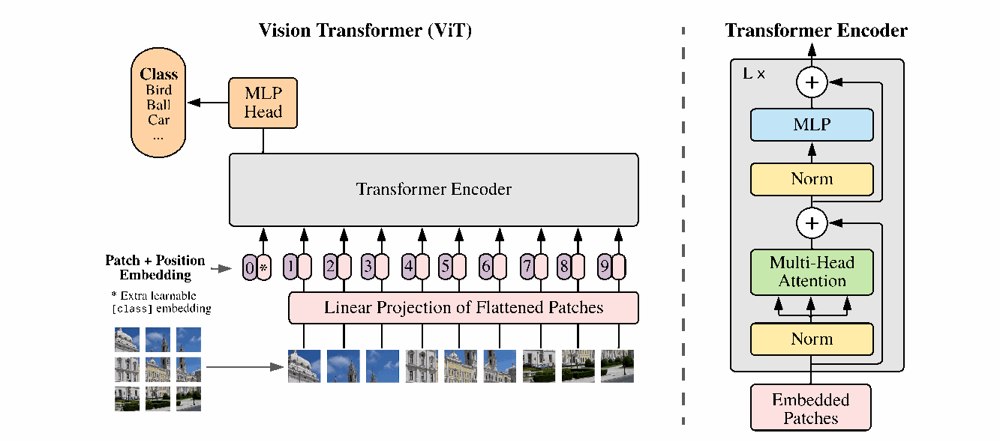
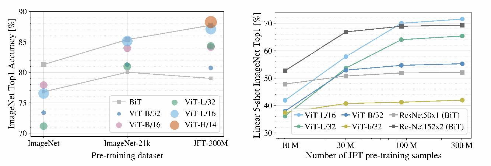
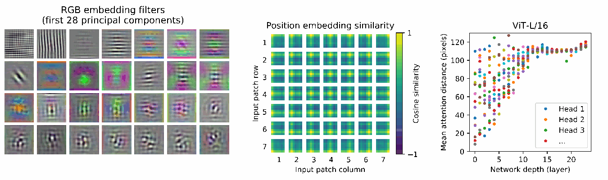

# ViT 论文精读

> **论文**：An Image is Worth 16x16 Words: Transformers for Image Recognition at Scale  
> **作者**：Alexey Dosovitskiy、Lucas Beyer 等，Google Research / Brain Team  
> **发表信息**：2020-10-22 首次上传 arXiv，ICLR 2021；本文核查版本为 arXiv:2010.11929v2，2021-06-03。  
> **视频来源**：[《ViT论文逐段精读【论文精读】》](https://www.bilibili.com/video/BV15P4y137jb/)，UP 主“跟李沐学AI”，创作团队含 bryanyzhu，2021-11-30 发布，时长 01:11:31。  
> **字幕来源**：页面署名“仁不犯二枉少年_”；字幕片头署名“沐神AI字幕组，制作 Reza/Keii，校验 Keii/Reza”。本次读取 2,518 条中文字幕，覆盖 00:00.05 至 01:11:30.00。  
> **整理日期**：2026-11-01。  
> **整理方式**：以完整字幕为主线，去除口语重复，按知识结构重组为学习笔记，不是逐字字幕稿。模型、公式和实验数字对照原论文及官方实现核查；补充推导标为“整理理解”。视频中的“现在”“最近”和榜单排名均指 2021 年讲解时的背景，不作为当前结论。[^video][^paper]

## 一、先抓住这篇论文的核心

ViT，即 **Vision Transformer**，用一个很直接的流程完成图像分类：

**图像 → 切成 patch → 线性映射为 token → 加入分类 token 和位置编码 → Transformer Encoder → 分类头。**

它最重要的贡献，是通过大规模实验说明：

**在足够大的数据集上预训练后，一个只做少量图像输入适配的 Transformer，也能学到优秀的视觉表示，并迁移到多个图像分类任务。**

阅读时要同时保留两个条件：

- **模型结构很简单**：主体采用成熟的 Transformer Encoder，没有为每一层专门设计视觉注意力。
- **训练条件并不简单**：原论文的重要结果依赖大规模预训练，以及与模型规模相匹配的数据和计算。

因此，不能把论文概括为“Transformer 在任何视觉任务、任何数据条件下都优于 CNN”。

**对应视频**：00:00-05:06、16:15-20:25；论文摘要、§1、§5。

## 二、为什么不能直接把每个像素当作 token

### 2.1 从二维图像到一维序列

Transformer 接收的是一组 token 向量。要处理图像，首先需要决定：

**一个 token 对应图像里的什么？**

最直接的想法是把每个像素当作一个 token。对于一张 $224\times224$ 的 RGB 图像：

$$
N_{\text{pixel}}=224\times224=50\,176.
$$

这里序列长度是像素位置的数量；RGB 三个通道是该位置的内容，不能再把序列长度乘以 3。

### 2.2 全局注意力的平方代价

自注意力需要计算 token 之间的两两关系，因此每个注意力头的注意力矩阵大小为：

$$
N\times N.
$$

如果 $N=50\,176$，一张图、一个头的矩阵就包含约 **25.18 亿个元素**。

**整理理解**：常说的“平方复杂度”主要指注意力矩阵相关的计算与存储随序列长度平方增长。完整模块还包括特征投影等计算，不能认为整个 Transformer 的所有成本都只有 $N^2$ 一项。

对于检测、分割中常见的更大图像，直接在像素层面做标准全局注意力会更加昂贵。

### 2.3 ViT 的办法：把一个图像块当作一个 token

设图像高、宽分别为 $H,W$，patch 大小为 $P\times P$，且这里假设 $H,W$ 都能被 $P$ 整除：

$$
N=\frac{H}{P}\frac{W}{P}=\frac{HW}{P^2}.
$$

对于 $224\times224$ 的图像和 $16\times16$ 的 patch：

$$
N=14\times14=196.
$$

这样，图像被转成 196 个图像块，序列长度进入了标准 Transformer 能够处理的范围。

**整理理解**：先忽略额外的分类 token，序列长度减少 256 倍，注意力矩阵的元素数量减少 $256^2=65\,536$ 倍。这是矩阵规模的对比，不是模型实际速度提升倍数。

标题中的“16×16 Words”，就是把 **16×16 的图像块类比为语言中的词元**；它不是说一张图只有 16×16 个词，也不是说 patch 必须固定为 16×16。

**对应视频**：06:11-08:24、11:37-14:29；论文 §2、§3.1。

## 三、前人已经做过什么，ViT 又推进了什么

视频在引言和相关工作部分反复强调：视觉领域在 ViT 之前已经使用过自注意力。

| 路线 | 基本做法 | 与 ViT 的区别 |
| --- | --- | --- |
| CNN 与注意力结合 | 先由 CNN 提取特征，再引入自注意力，例如 Non-local 一类方法 | 仍依赖卷积特征或卷积主体 |
| 局部注意力 | 只在一个局部窗口内计算关系 | 为视觉设计了特定注意力范围 |
| 轴向注意力 | 分别沿行、列计算注意力 | 改写了二维注意力的组织方式 |
| 更早的 patch + 全局注意力 | Cordonnier 等人的工作使用 2×2 patch 处理小分辨率图像 | ViT 进一步研究较大图像、模型与预训练数据的扩展 |
| image GPT | 用生成式目标学习图像表示 | 训练目标和输入处理与原始 ViT 的监督分类路线不同 |

ViT 的研究问题可以表述为：

**尽量保留标准 Transformer，配上简单的图像 token 化，在大数据、大模型条件下能走多远？**

这种定位避免把贡献误写成“第一次把注意力用于图像”，或者“第一次想到把图像切块”。

**讲解中的写作启发**：相关工作应说明最接近的方法、已有能力和自己的增量；把前人的贡献交代清楚，反而有助于读者理解创新点。

**对应视频**：08:24-11:37、14:29-16:15、24:36-30:04；论文 §2。

## 四、整体架构：从图像到分类结果

*图源：原论文图 1，PDF 第 3 页，截取架构图。左侧为图像分类流程，右侧为重复堆叠的 Transformer block。[^paper]*

模型可以分成四部分：

1. **Patch embedding**：把每个图像块映射为一个向量。
2. **输入序列组织**：在前面拼接一个可学习的分类 token，并加上位置编码。
3. **Transformer Encoder**：让所有 token 交换信息，形成上下文化表示。
4. **分类头**：读取最终分类 token 的表示，输出类别预测。

原始 ViT 的主体是 **Encoder**：图像 patch 之间可以双向交互，不使用 GPT 那种限制“只能看前文”的因果注意力。

**核查补充**：视频将其类比为 BERT，主要是在说明 Encoder、分类 token 等设计来源。ViT 使用 Pre-LayerNorm，不能由此认为它与原始 BERT 的全部结构和训练目标完全相同。

**对应视频**：30:04-33:22；论文 §3.1、图 1、公式 1-4。

## 五、把输入的张量尺寸完整走一遍

下面以 **ViT-B/16，输入 224×224 RGB 图像**为例，先忽略 batch 维度。

### 5.1 切块并展平

原始图像：

$$
x\in\mathbb{R}^{224\times224\times3}.
$$

切成 $16\times16$ 的 patch 后：

- patch 数量：$196$。
- 每个 patch 的像素值数量：$16\times16\times3=768$。

展平每个 patch，得到：

$$
X_p\in\mathbb{R}^{196\times768}.
$$

### 5.2 通过共享的线性映射

所有 patch 使用同一组线性映射参数：

$$
E\in\mathbb{R}^{(P^2C)\times D}.
$$

其中：

- $P^2C$：输入 patch 展平后的维度。
- $D$：Transformer 的隐藏维度，由模型配置决定。

对于 ViT-B/16，恰好有：

$$
P^2C=768,\qquad D=768.
$$

因此：

$$
X_pE:
\quad
(196\times768)(768\times768)
\longrightarrow196\times768.
$$

**整理理解**：两个 768 的来源不同。前一个由 patch 尺寸和通道数决定，后一个由模型宽度决定。例如 ViT-L/16 的输入 patch 仍是 768 维，隐藏维度却是 1024，映射矩阵就变成 $768\times1024$。

线性映射不是单纯调整张量形状。切块、展平本身不引入可学习参数，映射矩阵 $E$ 才负责学习如何组合块内的像素值。

**官方实现补充**：`vit_jax/models_vit.py` 将切块和线性映射合并成一个 `kernel_size=P`、`stride=P` 的卷积实现。这与非重叠 patch 的共享线性投影等价，不意味着模型主体又变成了传统 CNN。[^code]

### 5.3 拼接分类 token

再引入一个可学习向量：

$$
x_{\text{class}}\in\mathbb{R}^{1\times D}.
$$

将它拼接到 patch 序列前面：

$$
[x_{\text{class}};X_pE]
\in\mathbb{R}^{197\times768}.
$$

这个额外 token 不对应某一块真实像素，它通过训练学习如何从其他 token 中汇总分类所需的信息。

这里的 `[CLS]` 是对功能的称呼；在图像模型中，它直接是一个可学习向量，不需要先输入一个文本字符。

### 5.4 加上位置编码

定义可学习的位置编码：

$$
E_{\text{pos}}\in\mathbb{R}^{197\times768}.
$$

输入 Transformer 的序列为：

$$
z_0=
[x_{\text{class}};x_p^1E;x_p^2E;\ldots;x_p^NE]
+E_{\text{pos}}.
$$

注意两个不同操作：

- 分类 token 与 patch token 沿**序列维度拼接**，序列从 196 变成 197。
- 位置编码与 token 表示**逐元素相加**，结果仍是 $197\times768$。

位置编码不是把整数 `0, 1, 2, ...` 直接加进图像特征。整数是位置索引，每个位置对应的是一个可学习向量；图中的 `0` 也不表示分类 token 的位置向量数值全部为零。

### 5.5 尺寸汇总

| 阶段 | 单张图像的形状 |
| --- | --- |
| 输入图像 | $224\times224\times3$ |
| 切块、展平 | $196\times768$ |
| 线性投影 | $196\times768$ |
| 拼接分类 token | $197\times768$ |
| 加位置编码 | $197\times768$ |
| 每个 Encoder block 的输出 | $197\times768$ |
| 读取最终分类 token 并归一化 | $768$ |
| 分类头输出 | $K$，其中 $K$ 为类别数 |

加入 batch 后，Encoder 的主要张量形状为：

$$
B\times197\times768.
$$

**对应视频**：33:22-36:39、38:17-40:30；论文 §3.1、公式 1。

## 六、Transformer block 内部做了什么

### 6.1 先归一化，再做注意力和 MLP

原论文使用：

$$
z'_\ell=
\operatorname{MSA}\bigl(\operatorname{LN}(z_{\ell-1})\bigr)
+z_{\ell-1},
$$

$$
z_\ell=
\operatorname{MLP}\bigl(\operatorname{LN}(z'_\ell)\bigr)
+z'_\ell,
\qquad\ell=1,\ldots,L.
$$

两个子层都有残差连接。整个 block 输入、输出形状相同，因此可以重复堆叠。

最终取分类 token：

$$
y=\operatorname{LN}(z_L^0),
$$

其中 $z_L^0$ 是最后一层中序列第 0 个位置的输出；上标 $0$ 表示位置，不是取零次方。

### 6.2 多头自注意力

**整理理解**：下面展开视频中的维度讲解，公式对应论文附录 A。

对于某个注意力头：

$$
Q=ZW_Q,\quad K=ZW_K,\quad V=ZW_V,
$$

$$
A=\operatorname{softmax}\left(
\frac{QK^\top}{\sqrt{d_h}}
\right),
\qquad
O=AV.
$$

softmax 在被关注的 key 位置上计算，使每个 query 对所有位置的权重归一化。

ViT-Base 的 $D=768$，使用 12 个头，所以每个头的维度为：

$$
d_h=768/12=64.
$$

对于一个头：

$$
Q,K,V\in\mathbb{R}^{197\times64},
\qquad
A\in\mathbb{R}^{197\times197},
\qquad
O\in\mathbb{R}^{197\times64}.
$$

12 个头的输出拼接后变回 $197\times768$，**随后还要经过输出投影**，才形成多头注意力子层的输出。

“多头”是用不同参数学习不同的关系，不是把图像切成 12 块，让每个头只看其中一块。

### 6.3 MLP 与注意力分工不同

ViT-Base 的 MLP 维度变化是：

$$
197\times768
\longrightarrow197\times3072
\longrightarrow197\times768.
$$

两层线性映射之间使用 **GELU**。

- 自注意力负责不同 token 之间的信息交换。
- MLP 对每个 token 的通道特征进行非线性变换，各位置共享参数。

**整理理解**：不能将 MLP 的“升维”理解为 token 数量增加，也不能认为隐藏维度 $D$ 不变就表示 block 内部的所有中间张量维度都不变。

### 6.4 Encoder 里的 MLP 与分类头不是同一个东西

论文区分了两种 MLP：

| 位置 | 作用与设置 |
| --- | --- |
| Encoder block 内部 | 对每个 token 变换通道，两层线性映射，中间为 GELU |
| 预训练分类头 | 在全图表示后接一个带单隐藏层的 MLP，隐藏层使用 tanh |
| 下游微调分类头 | 去掉预训练头，换成输出 $K$ 个类别的单个线性层 |

主实验是有监督分类训练，使用类别标签提供监督。主体采用 Transformer，并不自动意味着训练方式就是自监督。

**对应视频**：36:39-38:17、40:30-43:13、46:10-47:44；论文 §3.1、§3.2、附录 A、D.3。

## 七、归纳偏置：为什么原始 ViT 更依赖数据

归纳偏置可以理解为：**模型在看到数据之前，结构已经替它做了哪些假设。**

### 7.1 CNN 中的图像先验

视频着重讨论两个特点：

- **局部性**：卷积先在局部邻域内提取特征，再通过多层叠加扩大感受野。
- **平移等变性**：同一个卷积核在不同位置共享，因此输入平移时，输出特征也相应平移。

平移等变性可以示意为：

$$
f(T_\Delta x)=T_\Delta f(x).
$$

**整理理解**：这与“平移不变性”不同。等变是输出跟着变；不变是输出保持不变。对实际有限图像，padding、步幅和边界处理还会影响严格的等变性质。

这些结构先验能减少需要从数据中重新学习的内容，在数据不足时往往有帮助。

### 7.2 ViT 的先验更少，但不是完全没有

ViT 从较早的层就允许全局 token 交互，没有把“优先关注局部邻居”写进每个注意力层。

不过它仍然具有结构选择：

- 先把相邻像素组织为二维 patch。
- 所有 patch 使用共享的投影。
- 使用位置编码区分位置。
- 改变输入分辨率时，利用二维网格关系调整位置编码。

因此，更准确的说法是 **ViT 具有更少的图像特定归纳偏置**。

### 7.3 数据规模改变了比较结果

论文观察到，原始训练设置下：

- 数据较少时，ViT 更容易过拟合，未必比 CNN 好。
- 数据充分增大后，ViT 可以从数据中学习许多原本由 CNN 结构提供的规律。
- 更大的 ViT 需要与之匹配的数据，不能只增加参数而忽略训练数据。

这是对论文所测模型和训练条件的经验总结，不是一个适用于所有后续方法的固定数据量门槛。

**对应视频**：16:15-20:25、47:44-49:00；论文 §1、§3.1、§4.3。

## 八、两个消融问题：分类 token 和位置编码

### 8.1 一定要使用分类 token 吗

另一种自然方案是：

**不加分类 token → 对所有 patch 的输出做全局平均池化 → 接分类器。**

论文一开始发现这条路线效果较差，但进一步调整学习率后，结果可以接近分类 token 方案。

附录图 9 比较了分类 token 在学习率 $8\times10^{-4}$ 下，以及 GAP 在不同学习率下的训练结果；GAP 使用 $3\times10^{-4}$ 时显著改善。

**讲解中的实验启发**：结构改动后，原来的最优超参数未必仍然合适。不能只复用一套参数，就把结果差异全部归因于结构。

ViT 主实验保留分类 token，是为了沿用成熟的文本 Transformer 分类设计，不是证明了 GAP 在原理上不可行。

### 8.2 为什么使用一维位置编码

论文比较了：

- 不使用位置编码。
- 可学习的一维绝对位置编码。
- 结合横、纵坐标的二维位置编码。
- 相对位置编码。

附录表 8 中，ViT-B/16 的默认输入位置编码设置结果如下：

| 设置 | ImageNet 5-shot 线性评测准确率 |
| --- | --- |
| 无位置编码 | 61.382% |
| 一维位置编码 | 64.206% |
| 二维位置编码 | 64.001% |
| 相对位置编码 | 64.032% |

**注意评测口径**：这里是冻结表示后的 **5-shot 线性评测**，不是表 2 的全量微调结果。

可以得到的结论是：在这个实验里，加入位置信息有帮助，但更复杂的位置编码没有带来明显优势。

作者给出的解释是，patch 网格比原始像素网格小得多，学习其空间关系相对容易。图 7 还显示，一维位置编码可以学出与二维距离、同行和同列有关的结构。

这是论文实验下的结果及作者解释，不能推广成“视觉模型永远不需要二维或相对位置编码”。

**对应视频**：40:30-46:10；论文附录 D.3、D.4，图 9、表 8。

## 九、模型命名与 patch 大小

### 9.1 Base、Large、Huge

| 模型 | Encoder 层数 | 隐藏维度 $D$ | MLP 中间维度 | 注意力头数 | 论文报告参数量 |
| --- | --- | --- | --- | --- | --- |
| ViT-Base | 12 | 768 | 3072 | 12 | 86M |
| ViT-Large | 24 | 1024 | 4096 | 16 | 307M |
| ViT-Huge | 32 | 1280 | 5120 | 16 | 632M |

来源为论文表 1。参数量是论文配置的报告值，实际实现还会受到分类头和输入配置等影响。

`ViT-L/16` 中：

- `L` 表示 Large，即 24 层 Encoder、隐藏维度 1024。
- `/16` 表示 patch 的边长为 16，不是有 16 层。

### 9.2 更小的 patch 通常更贵

固定输入分辨率时：

$$
N=\frac{HW}{P^2}.
$$

| 输入分辨率 | patch 大小 | patch token 数量 | 加分类 token 后 |
| --- | --- | --- | --- |
| 224×224 | 32×32 | 49 | 50 |
| 224×224 | 16×16 | 196 | 197 |
| 224×224 | 8×8 | 784 | 785 |
| 384×384 | 16×16 | 576 | 577 |

**整理理解**：patch 边长减半，patch 数量增为四倍，注意力矩阵相关项约增为十六倍，不能仅用参数量判断模型贵不贵。

更小的 patch 保留了更细的空间粒度，也带来更长的序列；它不是没有代价的精度提升。

**对应视频**：53:36-54:49；论文 §4.1、表 1。

## 十、混合模型与高分辨率微调

### 10.1 混合模型：token 也可以来自 CNN 特征

原始路径是：

$$
\text{图像}\rightarrow\text{像素 patch}\rightarrow\text{线性投影}.
$$

混合路径是：

$$
\text{图像}\rightarrow\text{CNN 特征图}
\rightarrow\text{特征 patch}\rightarrow\text{线性投影}.
$$

如果选中的 CNN 特征图大小为 $H'\times W'\times C'$，并在上面使用 1×1 的特征 patch，就得到 $H'W'$ 个 token，再投影到维度 $D$。

**字幕澄清**：视频用 14×14 特征图举例，这是特定输出阶段或下采样设置下的例子；不能据此记成“标准 ResNet-50 的最终特征图永远是 14×14”。对于常见的 224×224 输入、总步幅 32 的配置，最后空间尺寸通常是 7×7。

混合模型仍按相同方式加入分类 token 和位置编码，再交给 Transformer。

### 10.2 微调时替换分类头

把预训练模型迁移到新的 $K$ 类数据集时：

1. 保留已经学习好的视觉表示部分。
2. 移除预训练分类头。
3. 接入新的 $D\times K$ 线性分类层，论文使用零初始化。
4. 在下游数据上微调。

这与“冻结整个编码器，只训练一个线性分类器”的线性评测不同。

### 10.3 输入分辨率变大，位置编码如何处理

例如，从 224×224 改为 384×384，同时保持 patch 为 16×16：

$$
14\times14=196
\quad\longrightarrow\quad
24\times24=576.
$$

Transformer 的共享参数可以用于更长序列，但原来的位置编码表长度不够。

论文的办法是按二维位置插值：

1. 单独保留分类 token 对应的位置向量。
2. 将 patch 位置编码恢复为原来的二维网格。
3. 在网格上插值到新的高、宽。
4. 展平后，再与分类 token 的位置向量组合。

**整理理解**：这里改变的是 patch 位置编码的网格尺寸，不是把隐藏维度 $D$ 插值成另一个维度；这也不等于模型可以不受显存和计算量限制地接收任意大小图像。

**论文补充**：预训练分辨率为 224，默认微调分辨率为 384；表 2 的 ImageNet 结果另有设置，ViT-L/16 使用 512，ViT-H/14 使用 518。引用精度时，应连同具体设置一起看。

**对应视频**：49:00-52:17；论文 §3.1、§3.2、§4.1，附录 B.1。

## 十一、实验：先看数据和评测协议

### 11.1 预训练数据集

| 数据集 | 原论文使用的规模口径 | 用途 |
| --- | --- | --- |
| ImageNet / ImageNet-1k | 约 130 万图像、1,000 类 | 较小规模的预训练对照，也作为下游评测 |
| ImageNet-21k | 约 1,400 万图像、约 2.1 万类 | 更大规模、公开数据预训练 |
| JFT-300M | 约 3.03 亿图像、约 1.8 万类 | Google 内部的大规模预训练 |

论文说明，预训练数据相对于下游测试集做过去重。这里记录的是原论文协议，不表示本次独立审计了所有原始数据。

视频偶尔把 ImageNet-21k 说成 22k，正文统一采用原论文的命名。

### 11.2 下游任务

论文考察 ImageNet、ImageNet-ReaL、CIFAR-10/100、Oxford-IIIT Pets、Oxford Flowers-102，以及 **VTAB 的 19 个任务**。

VTAB 在这里评估跨多种任务的低数据量迁移，每个任务使用 1,000 个训练样本，包括自然图像、专门领域图像和结构化任务。

**核查澄清**：VTAB 不应简单等同于“抗遮挡”“抗对抗攻击”等鲁棒性测试。视频开头展示的特殊图像例子来自另一篇分析工作，不是原始 ViT 论文表 2 的直接结论。

### 11.3 两种评测不能混在一起

| 评测 | 编码器是否更新 | 下游标签怎么使用 | 作用 |
| --- | --- | --- | --- |
| 全量微调 | 更新 | 用目标训练集微调整个模型及分类头 | 测量任务适配后的效果 |
| 少样本线性评测 | 冻结 | 每类取少量有标签样本，拟合线性映射 | 快速检查预训练表示质量 |

**特别纠正**：视频在讲图 4 时把线性评测口述为类似 logistic regression。原论文 §4.1 明确使用的是 **正则化最小二乘回归**，将冻结特征映射到 $\{-1,1\}^K$ 目标向量，并利用闭式解。

“5-shot”指每个类别使用 5 个有标签样本，依然需要目标任务标签，不是零样本。

**对应视频**：52:17-54:49、59:14-01:00:56；论文 §4.1、§4.3。

## 十二、主要结果应该怎样读

### 12.1 表 2：迁移精度与预训练成本

下表摘录原论文表 2。准确率单位为 %，为便于阅读只列均值；原表中的 ViT 结果报告了三次微调的均值与标准差。

| 指标 | ViT-H/14，JFT | ViT-L/16，JFT | ViT-L/16，I21k | BiT-L，JFT |
| --- | --- | --- | --- | --- |
| ImageNet | 88.55 | 87.76 | 85.30 | 87.54 |
| ImageNet-ReaL | 90.72 | 90.54 | 88.62 | 90.54 |
| CIFAR-10 | 99.50 | 99.42 | 99.15 | 99.37 |
| CIFAR-100 | 94.55 | 93.90 | 93.25 | 93.51 |
| Oxford-IIIT Pets | 97.56 | 97.32 | 94.67 | 96.62 |
| Oxford Flowers-102 | 99.68 | 99.74 | 99.61 | 99.63 |
| VTAB，19 个任务 | 77.63 | 76.28 | 72.72 | 76.29 |
| 预训练 TPUv3-core-days | 2,500 | 680 | 230 | 9,900 |

这里的 BiT-L 是 ResNet152×4，不是未改动的普通 ResNet-152。论文所用 BiT 基线包含 GroupNorm、标准化卷积等设置。

原表还比较了 Noisy Student EfficientNet-L2：ImageNet 为 88.4%，并注明另一工作报告的改进结果为 88.5%；预训练成本为 12,300 TPUv3-core-days。

读表时有几个细节：

- 更大的 ViT-H/14 并非在每一项都最高，例如 Flowers-102 上 ViT-L/16 为 99.74，高于 H/14 的 99.68。
- 不同预训练数据的结果不能混写。例如 I21k 预训练的 L/16 与 JFT 预训练的 L/16，条件不同。
- TPUv3-core-days 是“TPU 核数 × 天数”的资源量，不是实际连续训练了多少个自然日，也不是 GPU 天数。
- “成本更低”是相对于表中模型而言，2,500 core-days 仍然是大量计算。
- 表 2 的训练成本同时受训练日程、优化器等影响，不能全部归因于架构；论文因此又做了 §4.4 的扩展性比较。

**对应视频**：54:49-56:42；论文 §4.2、表 2。

### 12.2 图 3：这篇论文最重要的实验信息

*图源：原论文 PDF 第 7 页上半部。左为图 3，全量微调到 ImageNet；右为图 4，冻结特征后的 ImageNet 5-shot 线性评测。两图的纵轴评测协议不同。[^paper]*

图 3 比较不同预训练数据规模下，模型微调到 ImageNet 后的结果：

- **ImageNet 规模**：原始 ViT，尤其较大的变体，表现不如 BiT ResNet。
- **ImageNet-21k 规模**：差距缩小，ViT 开始显示较强竞争力。
- **JFT-300M 规模**：更大的 ViT 能发挥优势，大模型也开始优于较小模型。

因此，论文的主线是 **scaling：模型规模、数据规模与效果之间的关系**。

**整理理解**：图 3 不能推出“自己的数据不足 1,400 万张就不能使用 ViT”。从头预训练，与在已有预训练权重上做下游微调，是不同问题；后续训练方法的改变也会影响结果。

### 12.3 图 4：更受控地研究数据量

图 4 采用同一 JFT 数据源的不同规模子集，减少跨数据集差异的干扰。

原文 §4.3 的子集规模是 **9M、30M、90M 和完整 JFT-300M**；图中的数量刻度、视频口述有近似表达，应以正文为准。

为便于分析，论文没有为每个小子集额外调整正则化，使用相同超参数，并采用早停和验证结果选取。为节省计算，使用线性少样本评测，未对每个设置都进行完整微调。

主要观察仍是：较小数据量下，ViT 更容易过拟合；预训练数据增加后，其表示质量提升明显。

**对应视频**：56:42-01:00:56；论文 §4.3、图 3、图 4。

### 12.4 图 5：性能与计算预算的关系

论文在 JFT-300M 上比较 ViT、ResNet 和混合模型：

1. 在所测范围内，ViT 通常具有更好的性能与预训练计算量权衡。
2. 小预算时，混合模型略有优势；模型和预算增大后，优势逐渐消失。
3. ViT 在所测范围内仍有继续提升的趋势。

作者在五个数据集平均指标上报告，ViT 达到相近表现所需计算量约少 2-4 倍。

**核查澄清**：图 5 的横轴是总预训练计算量 **exaFLOPs**，不是推理延迟或端到端训练耗时。“尚未饱和”也仅描述论文尝试的范围，不是证明性能会无限增长。

视频对混合模型的原因提出了讨论，论文并未给出能够排除其他因素的完整因果解释，整理稿不把这些猜测写成定论。

**对应视频**：01:00:56-01:03:29；论文 §4.4、图 5。

## 十三、可视化：ViT 到底学到了什么

*图源：原论文图 7，PDF 第 9 页。左、中对应 ViT-L/32，右侧注意力距离对应 ViT-L/16；三部分不应当作同一配置的所有分析。[^paper]*

### 13.1 Patch embedding 学到局部结构

图 7 左侧展示输入线性映射滤波器的前 28 个主成分，可以看到与颜色、纹理、边缘有关的模式。

它们与 CNN 底层特征的某些可视化相似，说明简单线性投影也能学到有用的块内结构。

**核查补充**：展示的是主成分可视化，不是完整列出所有投影参数，也不是证明 ViT 与 CNN 的内部表示完全相同。

### 13.2 一维位置编码能学出二维关系

图 7 中间比较位置向量的余弦相似度：

- 邻近 patch 的位置向量往往更相似。
- 同行、同列出现明显结构。
- 这支持位置编码学到了部分二维拓扑关系的解释。

论文用这一现象解释：手工设计更复杂的二维位置编码，为何没有在对应实验中带来明显收益。

### 13.3 注意力从底层就可能跨越较远距离

图 7 右侧用平均注意力距离，描述各层、各头整合信息的空间范围。

**整理理解**：忽略分类 token 等实现细节，可以把它示意为：

$$
\bar d=
\frac{1}{N}\sum_i\sum_j A_{ij}\|r_i-r_j\|_2,
$$

其中 $r_i,r_j$ 是 patch 在图像中的位置，$A_{ij}$ 是注意力权重；论文还在图像间平均。

观察到：

- 较浅层有些头主要看局部，有些头已经关注大范围。
- 越往深层，多数头的平均注意力距离越大。
- 结构允许全局交互，不代表每一层、每一个头都平均关注整张图。

### 13.4 注意力图不是检测框或分割标注

视频展示的图 6 表明，输出 token 的注意力在一些样本上集中于分类相关区域。

**论文补充**：这些图通过 Attention Rollout 生成，将多层注意力的传播考虑在内，不只是把最后一层的一张注意力矩阵直接画出来。

它们是定性的表示分析，不能直接当作目标检测或语义分割性能，也不能仅凭一张热图证明模型的完整决策原因。

**对应视频**：01:03:29-01:08:04；论文 §4.5、图 6、图 7，附录 D.7、D.8。

## 十四、自监督尝试：原始 ViT 与后续 MAE 的区别

### 14.1 先区分架构和训练目标

**ViT 是一种模型架构，自监督是一类训练方式。**

同一种 ViT 可以通过不同目标学习：

- 有监督分类。
- 遮挡图像建模。
- 对比学习。
- 自蒸馏。

原始 ViT 论文的主要成绩来自有监督预训练；自监督部分是一个初步探索。

### 14.2 Masked patch prediction

视频将其类比为 BERT 的完形填空：

**遮住部分图像块 → 利用上下文 → 预测被遮住部分的信息。**

但“预测 patch”不一定意味着重建其全部像素。

**论文补充核查，附录 B.1.2**：

- 随机选择 50% 的 patch embedding 作为需要扰动和预测的位置。
- 对这些位置中的 80% 用可学习的 mask 向量替换，10% 用其他随机 patch embedding 替换，10% 保持原样。
- 最终报告的方案主要预测每个被选 patch 的**平均颜色类别**：RGB 每个通道量化为 3 bit，共 $8^3=512$ 类。
- 作者也试过预测降采样 patch、回归完整 RGB patch，但最终选择了少样本评测较好的平均颜色方案。

所以，不能把这段直接记成后来 MAE 的完整像素重建方法；它们有关联，但不是同一套实验。

### 14.3 结果与限制

原论文 §4.6 报告，自监督预训练的 **ViT-B/16** 在 ImageNet 上达到 **79.9%**：

- 比对应的从头训练结果提高约 2 个百分点。
- 仍比有监督预训练低约 4 个百分点。

这些差值属于论文的对应比较设置，不能将不同模型规模、不同数据条件下的表 2 成绩直接拿来相减。

视频随后介绍 MAE、MoCo v3、DINO 等后续方向。这里保留其研究脉络，不将视频中的历史评价扩写为完整的后续工作综述。

**补充纠正**：DINO 属于无标签自蒸馏；不能因为它也是自监督学习，就把它与 MoCo 一起笼统归为相同的标准对比学习方法。DINO 论文将其明确解释为 self-distillation with no labels。[^dino]

**对应视频**：23:19-24:36、27:42-28:48、01:08:04-01:09:52；论文 §4.6、附录 B.1.2。

## 十五、讲解最后提出的研究方向

视频最后把 ViT 看作一个可以继续扩展的基础框架，讨论了几类方向：

| 方向 | 可以继续研究的问题 |
| --- | --- |
| 扩展任务 | 如何让图像分类表示适用于检测、分割、视频等任务 |
| 改变 token 化 | 怎样形成更有利于视觉学习的输入 token |
| 改变模型结构 | 注意力、MLP、池化等 token 交互方式分别起什么作用 |
| 改变训练目标 | 有监督、自监督、对比学习、自蒸馏如何影响表示 |
| 多模态 | 图像、语言及其他信号能否使用相近的序列建模框架 |

这些是讲者结合当时研究给出的方向判断。原始 ViT 本身是图像模型，不因为架构与语言 Transformer 接近，就自动获得语言理解能力。

**字幕校正**：

- “传送门”“自制力”等明显识别错误，按上下文分别整理为 Transformer、自注意力。
- `VATB` 统一为 `VTAB`，`global average pulling` 统一为 `global average pooling`。
- “mataformer / poll former”按上下文整理为 MetaFormer / PoolFormer，仅保留为视频提及的方向。
- 视频约 22:53 将 SETR 的会议年份说成 CVPR 2020；CVF 官方收录为 **CVPR 2021**，不沿用错误年份。[^setr]

**讲解中的论文写作启发**：

1. 先读摘要、引言和结论，确认问题、贡献和主要证据。
2. 再读模型总览图、张量变化与关键公式，理解方法怎样运行。
3. 将实验拆成“最终效果”“数据要求”“计算代价”“内部分析”，逐一对应研究问题。
4. 区分实验已经证明的结论，与未来工作中仍需探索的方向。

**对应视频**：20:25-24:36、01:09:52-01:11:31。

## 十六、复习时检查这几个问题

| 问题 | 应掌握的回答 |
| --- | --- |
| ViT 的一个 token 对应什么？ | 通常对应一个图像 patch 的向量表示，另有分类 token |
| 224×224、16×16 patch 为什么得到 196？ | 每边 14 块，共 14×14 块 |
| 为什么最终是 197 个 token？ | 196 个 patch token 加 1 个分类 token |
| 展平 patch 的 768 与隐藏维度 768 是一回事吗？ | 来源不同，只是在 ViT-B/16 中数值相同 |
| 位置编码怎样加入？ | 与对应 token 向量逐元素相加 |
| 多头注意力怎样组合？ | 各头分别计算，拼接输出后再做输出投影 |
| MLP 是否改变序列长度？ | 不改变；它变换每个 token 的通道特征 |
| 分类 token 是否必不可少？ | 不是，合适调参后的全局平均池化也可行 |
| 原论文最重要的经验结论是什么？ | 数据、模型和计算的规模匹配，决定标准 Transformer 能否发挥视觉学习能力 |
| 原始 ViT 是否主要通过自监督取得成绩？ | 不是，主实验是有监督预训练，自监督仅为初步探索 |
| ViT 能否直接输出检测框？ | 原始分类模型不能；需要相应任务结构与训练 |
| 更低的预训练计算量是否意味着部署一定更快？ | 不是，推理还取决于模型、分辨率、硬件和实现 |

可结合已有的 [CLIP 论文精读](CLIP%20论文精读.md) 理解：ViT 可以作为图像编码器，而 CLIP 还包括文本编码器、图文对比学习目标和跨模态匹配方式；二者处于不同的概念层次。

## 十七、视频时间导航

下表按字幕中主题开始的位置定位，链接可用于回看；部分主题在视频中会再次出现。

| 时间 | 内容 |
| --- | --- |
| [00:00](https://www.bilibili.com/video/BV15P4y137jb/?t=0) | ViT 的影响与开场示例，均为讲解时背景 |
| [02:43](https://www.bilibili.com/video/BV15P4y137jb/?t=163) | 标题和摘要：为什么是 16×16 words |
| [06:11](https://www.bilibili.com/video/BV15P4y137jb/?t=371) | 将 Transformer 用于图像的序列长度难题 |
| [08:24](https://www.bilibili.com/video/BV15P4y137jb/?t=504) | 前人的 CNN、局部注意力与轴向注意力路线 |
| [11:37](https://www.bilibili.com/video/BV15P4y137jb/?t=697) | ViT 的简单方案及与相近工作的区别 |
| [16:15](https://www.bilibili.com/video/BV15P4y137jb/?t=975) | 归纳偏置、数据规模与主要结论 |
| [20:25](https://www.bilibili.com/video/BV15P4y137jb/?t=1225) | 先读结论，讨论未来研究方向 |
| [24:36](https://www.bilibili.com/video/BV15P4y137jb/?t=1476) | 相关工作：BERT、GPT、视觉注意力、iGPT |
| [30:04](https://www.bilibili.com/video/BV15P4y137jb/?t=1804) | 模型总览图与完整流程 |
| [33:22](https://www.bilibili.com/video/BV15P4y137jb/?t=2002) | 逐步计算输入与 token 的尺寸 |
| [36:39](https://www.bilibili.com/video/BV15P4y137jb/?t=2199) | 多头注意力与 MLP 的维度 |
| [40:30](https://www.bilibili.com/video/BV15P4y137jb/?t=2430) | 分类 token 与全局平均池化消融 |
| [43:13](https://www.bilibili.com/video/BV15P4y137jb/?t=2593) | 位置编码消融 |
| [46:10](https://www.bilibili.com/video/BV15P4y137jb/?t=2770) | 回到正文，串联前向公式 |
| [47:44](https://www.bilibili.com/video/BV15P4y137jb/?t=2864) | 归纳偏置与混合架构 |
| [50:16](https://www.bilibili.com/video/BV15P4y137jb/?t=3016) | 高分辨率微调与位置编码插值 |
| [52:17](https://www.bilibili.com/video/BV15P4y137jb/?t=3137) | 实验设置、数据集和模型变体 |
| [54:49](https://www.bilibili.com/video/BV15P4y137jb/?t=3289) | 表 2：分类结果与预训练成本 |
| [56:42](https://www.bilibili.com/video/BV15P4y137jb/?t=3402) | 图 3：预训练数据规模的作用 |
| [59:14](https://www.bilibili.com/video/BV15P4y137jb/?t=3554) | 图 4：冻结表示后的 5-shot 评测 |
| [01:00:56](https://www.bilibili.com/video/BV15P4y137jb/?t=3656) | 图 5：性能、计算预算与混合模型 |
| [01:03:29](https://www.bilibili.com/video/BV15P4y137jb/?t=3809) | 输入滤波器、位置编码与注意力可视化 |
| [01:08:04](https://www.bilibili.com/video/BV15P4y137jb/?t=4084) | 自监督的 masked patch prediction |
| [01:09:52](https://www.bilibili.com/video/BV15P4y137jb/?t=4192) | 论文总结与研究方向 |

## 来源与核查范围

- **视频**：完整读取现有中文字幕，未逐句回听整段音频。字幕可能保留个别听写问题；本文不把已发现的误识别、口误直接写成事实。
- **原论文**：核查 v2 的正文第 1-9 页，以及附录 A、B.1、D.3、D.4、D.7、D.8 等相关部分；三张配图截自 PDF 第 3、7、9 页。
- **官方实现**：核查 `vit_jax/models_vit.py` 中的 patch 投影、分类 token、Encoder 和分类头。仓库 `main` 可能更新，不声称它与最初训练时的全部代码完全一致。
- **后续工作**：仅为澄清视频表述，核对 DINO 的方法定义与 SETR 的会议年份；未逐篇核查视频提及的所有后续工作和开场鲁棒性例子。
- **验证边界**：本文是字幕整理和文献核查，不包含模型训练、推理或论文分数复现。

[^video]: 跟李沐学AI：《ViT论文逐段精读【论文精读】》，2021-11-30，BV15P4y137jb。https://www.bilibili.com/video/BV15P4y137jb/
[^paper]: Dosovitskiy et al. *An Image is Worth 16x16 Words: Transformers for Image Recognition at Scale*. ICLR 2021，arXiv:2010.11929v2。https://arxiv.org/abs/2010.11929v2
[^code]: Google Research 官方仓库，`vit_jax/models_vit.py`，核查日期 2026-11-01。https://github.com/google-research/vision_transformer/blob/main/vit_jax/models_vit.py
[^dino]: Caron et al. *Emerging Properties in Self-Supervised Vision Transformers*，论文摘要将 DINO 解释为无标签自蒸馏。https://arxiv.org/abs/2104.14294
[^setr]: Zheng et al. *Rethinking Semantic Segmentation From a Sequence-to-Sequence Perspective With Transformers*，CVPR 2021，CVF 官方页面。https://openaccess.thecvf.com/content/CVPR2021/html/Zheng_Rethinking_Semantic_Segmentation_From_a_Sequence-to-Sequence_Perspective_With_Transformers_CVPR_2021_paper.html
